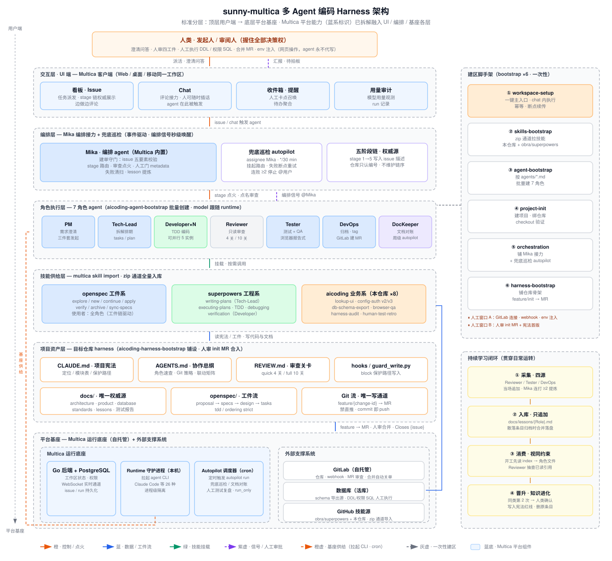
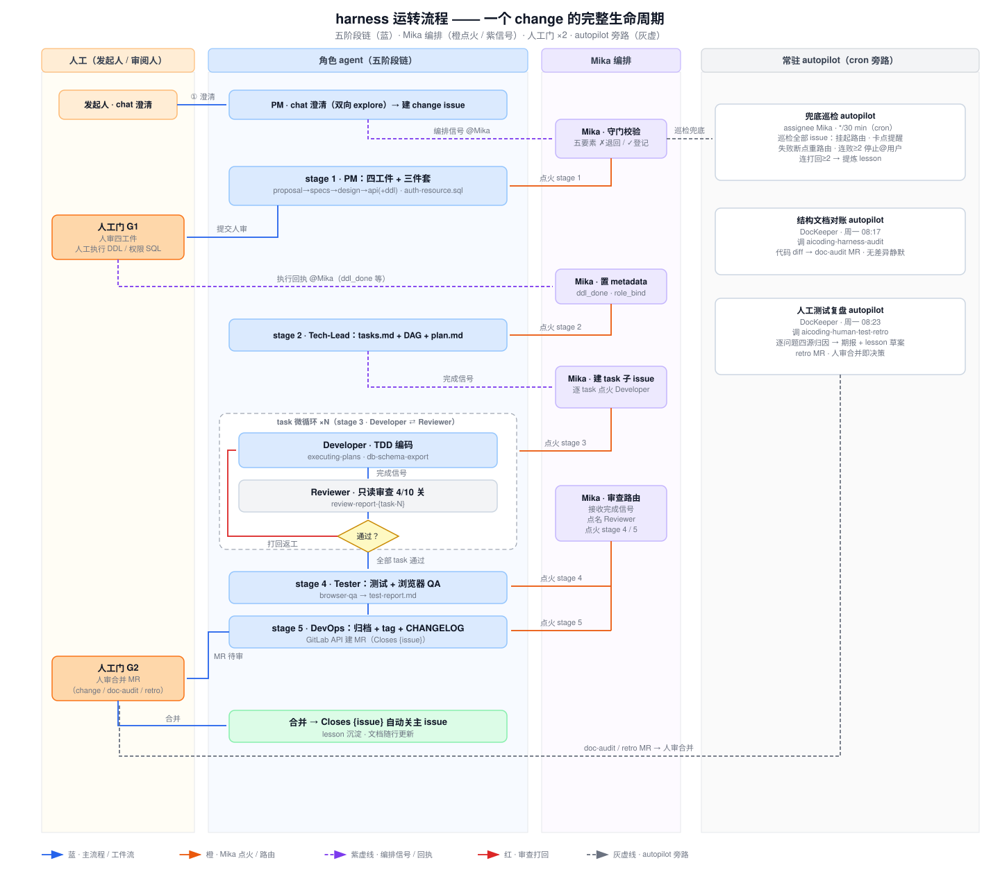
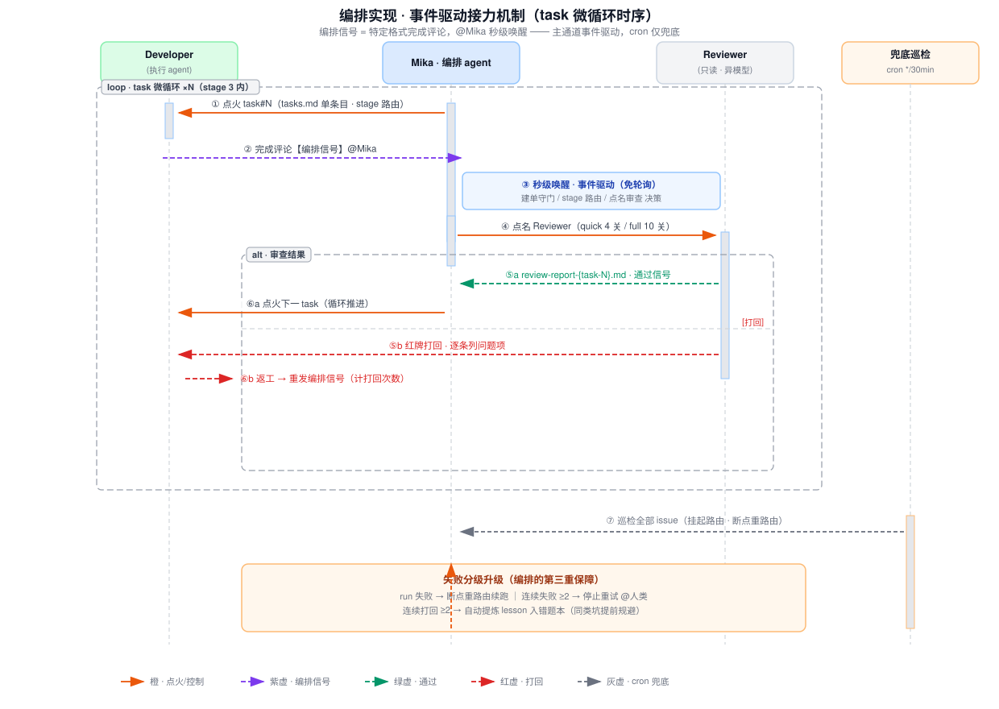
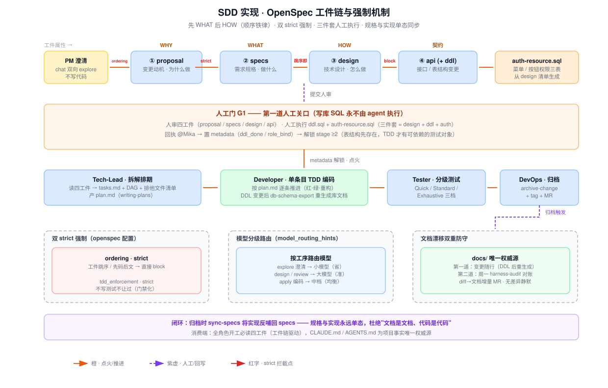
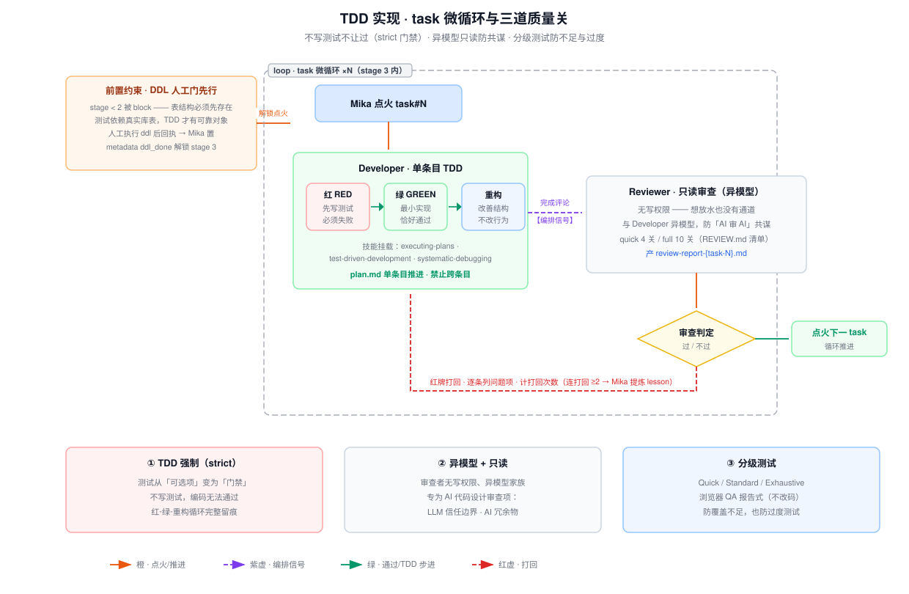
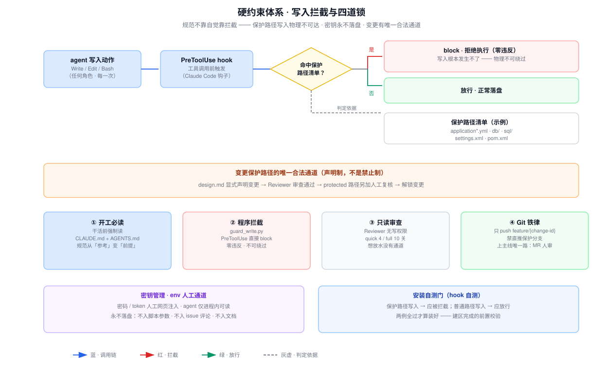
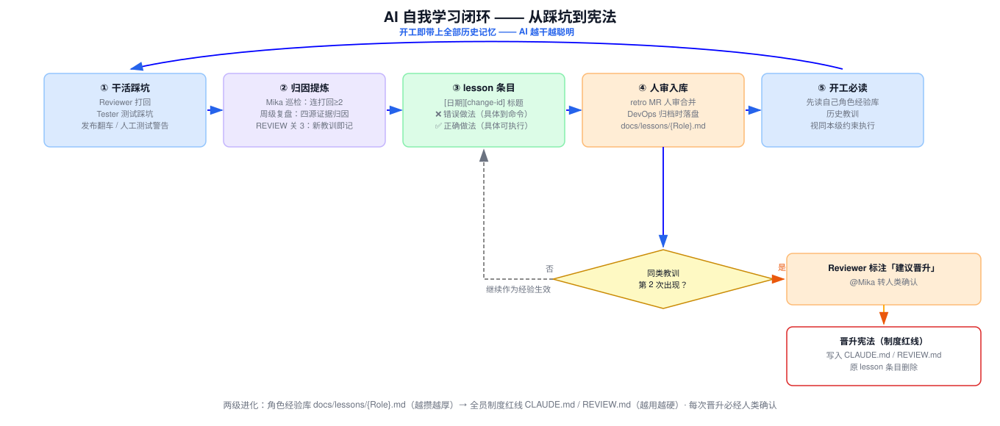

# 任职资格答辩 · 演示文稿 v2

> 使用方式：`---` 为分页符（VSCode 大纲/Marp/Typora 均可按页浏览）；演讲内容按《典型项目举证讲稿-独立完成版》进行，本稿为评委视觉辅助，每页右上标注对应行为要点。
> v2 排版逻辑：**软件设计**（整体架构 + 流程生命周期）→ **软件实现**（五个重难点逐个单拎）→ 治理与落地 → 成果。技术深挖材料见《软件实现深度-编排SDD与TDD.md》。
> 【待填】处为量化数字占位，定稿前替换。

---

## 封面

# 从"辅助工具"到"开发流水线"

### AI 多 Agent 编码 Harness 的设计与规模化落地

**独立完成 · 2026 年 4 月 — 至今**

认证岗位：软件开发 ｜ 认证等级：高级工程师 ｜ 汇报人：〔姓名〕

---

## 汇报框架（15 分钟）

| 环节 | 内容 | 时长 |
|---|---|---|
| **S 情境** | 为什么做：三大痛点与我的判断 | 2 min |
| **T 任务** | 做成什么：目标与四大难题 | 2 min |
| **A 行动** | 软件设计（架构+生命周期）→ 软件实现（五重难点）→ 治理与落地 | 7 min |
| **R 结果** | 做成了什么：三类成果 | 3 min |
| 收尾 | 总结与展望 | 1 min |

---

## S1 ｜ 2026 年初的三个现实问题

**① AI 工具零散使用**
个人用 Copilot 补全——收益碎片化、经验不沉淀，AI 是"私人助理"，不是"生产力"

**② 开发人力瓶颈**
需求持续积压，加人加班已到顶 【待填：积压数据】

**③ 质量与规范失控**
文档失修 · 人肉审查 · 同样的坑反复踩

> 三者共同根因：**开发模式本身没有变**

---

## S2 ｜ 我的判断与三步演化

**技术判断：单点辅助式 AI 天花板很低**
真正的突破口不是"用好一个 AI 工具"，而是建一条**可管、可控、可审计的 AI 开发流水线**

```
2026.04 ──────────→ 随后 ──────────→ 年内
引入 OpenSpec       固化 harness        引入 Multica
本地单会话框架  →   治理+技能+硬约束 →   多 Agent 半托管
（最小闭环验证）    （制度化）          （规模化使用）
```

**三步小步快跑，每步验证可行再前进**

---

## T ｜ 目标与四大难题

**目标一句话：AI 承接全流程执行，人类只握关键决策**

> AI 干活 · 人拍板 —— 人从"执行者"变为"决策者"

| 四大难题 | 一句话 | 对应实现重难点 |
|---|---|---|
| 🔀 编排 | 7 种角色 agent 怎么接力？失败了怎么办？ | 重难点 ① |
| 🧐 质量 | AI 写码谁审？AI 审 AI 会不会共谋？ | 重难点 ② ③ ⑤ |
| 📚 知识 | 业务知识/历史踩坑怎么让 AI 学到？文档怎么不漂移？ | 重难点 ② ⑤ |
| 🔐 安全 | 密码怎么管？AI 乱改配置怎么办？ | 重难点 ④ |

---

## A0 ｜ 行动总览：设计 → 实现 → 落地

| 行动 | 解决的难题 | 行为要点 |
|---|---|---|
| A1 调研选型与体系规划 | 全局 | 1.1 · **1.2 ◆** |
| A2 **软件设计**：整体架构 + 流程生命周期 | 编排 | **2.1 ◆** · 2.2 |
| A3 **软件实现**：五个重难点单拎讲透 | 编排·质量·安全 | 3.3 · 3.2 |
| A4 治理体系与规范库 | 质量·安全 | **3.1 ◆** |
| A5 部署导入与规模化 | 全局 | **6.1 ◆** |

**5 个核心项全覆盖，逐一向各位汇报**

---

## A1 ｜ 组合式创新，而非重复造轮车 ｜ 1.1 · 1.2 ◆

| 方案 | 评估 | 结论 |
|---|---|---|
| A. 深化 Copilot 类补全 | 不改开发模式，天花板低 | ✗ |
| B. 自研多 Agent 平台 | 以年计，IT 无专职平台团队 | ✗ |
| **C. Multica + Claude Code + OpenSpec** | 自研面压缩到"编排+治理+技能"薄层 | **✓** |

**关键决策价值：正因为选对路线，这套体系能由我一人、半年内独立建成**

> 全组件开源自托管——数据不出公司，信息安全合规

---

# 第一部分 · 软件设计

---

## A2-设计 ｜ 整体架构：标准五层结构 ｜ 2.1 ◆ · 2.2



- **顶层用户端 → 底层平台基座**：人工 → UI 交互（Multica）→ 编排 → 角色执行 → 技能供给 → 项目资产 → 平台基座
- Multica 平台能力拆解融入三处（蓝系标识）：UI 层 / Mika 编排 / 运行底座
- **治理层骨架 = 结构权威源**，对齐模式可铺设到公司任意仓库

---

## A2-设计 ｜ 流程生命周期：一个 change 的一生 ｜ 2.1 ◆



- **五阶段链主线**：澄清建单 → 四工件 → 拆解 → 编码微循环 → 测试 → 归档 MR
- **人只出现两次**（G1 审设计+执行 DDL / G2 审 MR），其余全程 AI 接力、边做边汇报
- **旁路自愈**：30min 兜底巡检 · 周一文档对账 · 周一测试复盘

---

# 第二部分 · 软件实现：五个重难点

> 设计回答"搭什么"，实现回答"难在哪、怎么破"——每个重难点按 **问题 → 方案 → 突破** 讲透

---

## 实现① ｜ 编排：事件驱动接力机制 ｜ 3.3



- **问题**：7 角色松耦合接力 = 分布式系统三大难：状态一致性 · 接力延迟 · 失败恢复
- **方案**：编排信号（完成评论）秒级唤醒 + 五阶段链单一权威源（issue 描述）+ 人工门 metadata 状态机
- **突破**：事件驱动替代轮询（秒级接力）；cron 降级纯兜底（30min 自愈）；失败分级升级（连败≥2 才找人类）

---

## 实现② ｜ SDD：工件链与双 strict ｜ 3.3



- **问题**：AI 三个天然缺陷——先码后文 · WHAT/HOW 混淆 · 文档代码两态漂移
- **方案**：`proposal→specs→design→api` 顺序铁律（`ordering: strict` 跳序即 block）+ 三件套人工执行 + `sync-specs` 回写闭环
- **突破**：规格与实现**永远单态**；库表文档工具生成唯一化 + 周级对账双重防守；模型分级路由压成本

---

## 实现③ ｜ TDD：task 微循环与三道关 ｜ 3.3



- **问题**：AI 不爱写测试 · 测试依赖表结构 · AI 审 AI 共谋
- **方案**：`tdd_enforcement: strict` 门禁 + 单条目红-绿-重构 + DDL 人工门前置（表结构先存在）+ Reviewer 异模型且无写权限
- **突破**：测试从可选项变**闸门**；真表测试拒绝 mock 幻觉；专为 AI 代码设计审查项（LLM 信任边界 · AI 冗余物）

---

## 实现④ ｜ 硬约束：写入拦截与四道锁 ｜ 3.3



- **问题**：规范的痛点是"靠自觉"——提示词可被绕过，AI 乱改配置防不住
- **方案**：`guard_write.py` 挂 PreToolUse 钩子，保护路径（yml/db/sql/pom 等）写入**直接 block**；变更有唯一合法通道（design 声明→审查→人工复核）
- **突破**：**零违反、物理不可绕过**；四道锁（开工必读/程序拦截/只读审查/Git 铁律）+ 密钥 env 人工通道永不落盘 + 安装自测门

---

## 实现⑤ ｜ 创新点：AI 自我学习闭环 ｜ 4.3 ◆



- **问题**：同样的坑反复踩——经验只在个人会话里，不沉淀、不进化
- **方案**：四源采集（打回/测试/发布/人工复盘）→ ❌/✅ 条目具体到命令 → 人审入库 → 开工必读视同本级约束
- **突破（精髓）**：同类教训**第 2 次出现 → 自动晋升全员红线**（错题本越攒越厚，宪法越用越硬，每次晋升必经人类确认）

---

## 实现⑥ ｜ 其他核心实现一览 ｜ 3.3 · 3.2

**8 个业务技能**（我设计开发）：UI 参考查找 · 权限三表注册 · 库表导出 · 浏览器 QA · 结构对账 · 测试复盘…

**6 个建区脚手架**：一键建区全链路（幂等 · 断点续传）

**两项提效革新**：模型分级路由（省成本【待填：N%】）· Developer 5 实例并行（吞吐×【待填】，排他文件清单防写冲突）

**问题解决范式**：GBK 乱码 → 定位代码页根因 → 固化 `@文件` 传参铁律入宪法 → **根治一类问题**

---

# 第三部分 · 治理与落地

---

## A4 ｜ 治理体系：四套规范，一个体系 ｜ 3.1 ◆

| 规范 | 定位 | 内容 |
|---|---|---|
| CLAUDE.md | 项目宪法 | 15 节红线（模块表/TDD/分层/命名/保护路径） |
| AGENTS.md | 协作总纲 | Git 策略 · 工件结构 · 变更联动矩阵 · 错题本读写矩阵 |
| REVIEW.md | 审查关卡 | 快审 4 关 + 全审 10 关清单 |
| standards/ | 技术详单 | api / database / testing 三篇 |

> 与传统规范的本质区别：**机器可执行的制度**——开工必读 · 程序拦截（见实现④）· 关卡校验，不靠自觉靠拦截
> 周级对账兜底 + 教训晋升红线 → 规范库越用越严密

---

## A5 ｜ 部署导入：一键建区，半日接入 ｜ 6.1 ◆

```
「安装工作区」一句话触发，6 步自动串联（幂等 · 断点续传）：
技能导入 → 角色创建 →【人工窗口①】→ 项目初始化
→ 编排铺设 → 仓库治理铺设 →【人工窗口②：审 MR】
```

- **hook 自测**：保护路径应拦截、普通路径应放行——不过不算装好
- **性能调优**：事件驱动替代轮询 · 模型分级 · cron 错峰 · 增量对账
- **规模化**：【待填：N 团队 / N 仓库 / N 需求】

---

## R1 ｜ 量化效能成果

| 指标 | 数值 |
|---|---|
| AI 流水线端到端交付需求 | **【待填：N 个】** |
| 平均交付周期 | 【待填：X 天 → Y 天，降幅 Z%】 |
| 人力投入节省 | 【待填】 |
| 审查打回率 / 上线缺陷率 | 【待填】 |
| 测试覆盖率（TDD 强制） | 【待填】 |

---

## R2 ｜ 制度资产与专业影响力

**制度资产（可被公司长期借鉴）**
- 四套规范库 + 治理骨架 → 铺设任意仓库，已被【待填：N 团队】参考
- 疑难问题库沉淀【待填：N 条】，【待填：N 条】晋升全员红线
- 架构文档 4 篇 + 架构图 9 张（本稿 7 张 + 仓库结构 2 张）

**专业影响力（流程端到端变革）**
- 从 0 到 1 全链路**独立完成**
- 推动开发模式变革：人写码人审查 → **AI 流水线执行、人决策**
- 推广【待填：N 团队】 · 培训【待填：N 人】

---

## 收尾

# AI 干活 · 人拍板

**把"AI 编码"从个人技巧，升级为组织能力：**

一套流水线 · 一套规范库 · 一套自我进化的知识体系

**——由我一人设计、一人建成**

### 下一步：【待填：推广/深化方向】

谢谢各位评委！
