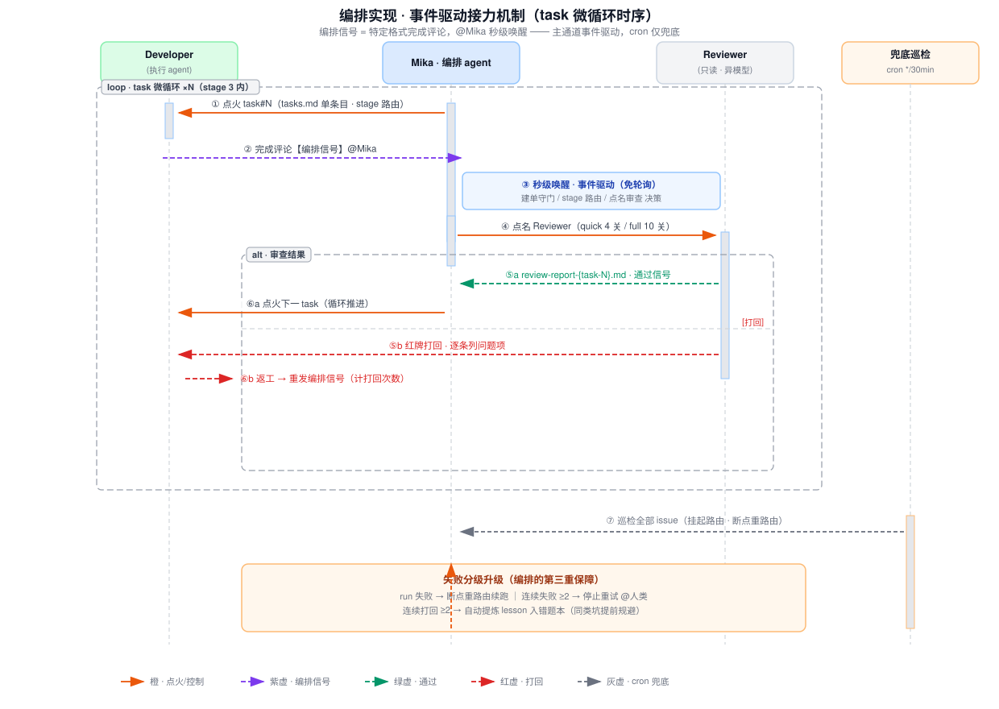
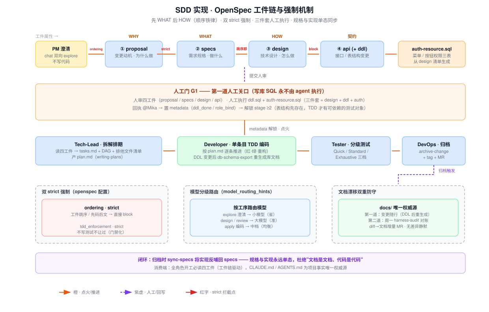
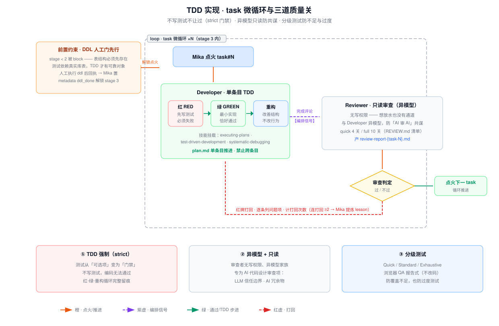

# 软件实现深度剖析 · 编排 / SDD / TDD

> **定位**：配合《演示文稿》A4 页（行为要点 3.3 代码编写 / 3.2 构成管理）的深度储备材料。评委追问"软件实现的技术细节、难点怎么突破"时按本文展开；三张配图可按需投屏。
> **三者的关系一句话**：编排解决"多 agent 怎么接力"，SDD 解决"动手前先想清楚"，TDD 解决"AI 写的码凭什么可信"——三者咬合成一条流水线，缺一环即塌。

---

## 一、编排实现：事件驱动接力机制

### 1.1 问题定义

7 种角色 agent 在一个 change 上接力，本质上是一个**松耦合分布式系统**：每个角色是独立进程、独立上下文，没有共享内存。三大工程难点：

| 难点 | 具体表现 |
|---|---|
| **状态一致性** | "现在谁干到哪了"存哪？链序如果记在代码库里，代码变更和链序变更会互相污染 |
| **接力延迟** | 上一个角色完成后，下一个角色何时被唤醒？轮询有分钟级空窗 |
| **失败恢复** | agent run 会失败、审查会打回、信号会丢失——不能指望每一步都成功 |

### 1.2 技术方案

**① 五阶段链单一权威源（状态一致性）**

五阶段链（stage 1 PM → stage 2 拆解 → stage 3 编码微循环 → stage 4 测试 → stage 5 归档）的链序**只存在 issue 描述里**，由 Mika 维护；仓库侧只认 stage 编号、不维护链序。一处存储、处处引用，从结构上消灭"两处状态漂移"。

**② 编排信号：事件驱动（接力延迟）**

角色完成时发布**特定格式的完成评论**（编排信号）@Mika，平台事件通道**秒级唤醒** Mika 做 stage 路由决策——整个接力系统不靠轮询。这是我在开发前事前验证的四个关键技术点之一（事件驱动编排信号 / PreToolUse 写入拦截 / spec 顺序强制 / 模型分级路由）。

**③ 人工门 metadata 状态机（人机切换点）**

两个人工门（G1 审设计+执行 DDL、G2 审 MR）不是"口头约定"，而是 Mika 维护的 metadata 状态位：`ddl_done` / `role_bind` 未置位时 stage ≥2 的点火请求不生效——人工确认是**硬前置**，不是提示。

**④ 双通道自愈（信号丢失）**

主通道事件驱动之外，cron 兜底巡检 `*/30 * * * *` 全量对账所有 issue：信号丢失的挂起 issue 重新路由、失败 run 断点重路由。**事件保低延迟，cron 保最终一致**。

**⑤ 失败分级升级（失败恢复）**

```
run 失败        → 兜底巡检断点重路由，接着干（无需人工）
连续失败 ≥2 次  → 停止重试，@人类介入（防无限雪崩）
审查打回        → 红牌退回 Developer，逐条问题项返工
连续打回 ≥2 次  → 自动提炼 lesson 入错题本（同类坑下次提前规避）
```



### 1.3 难点突破

| 难点 | 常规做法的坑 | 我的方案 | 效果 |
|---|---|---|---|
| 接力延迟 | 轮询调度：粒度粗（分钟级空窗）或成本高（高频轮询） | 编排信号事件驱动，cron 降级为纯兜底 | 接力秒级，巡检成本恒定 |
| 状态漂移 | 链序/进度记在代码库或散落各 agent 记忆 | 五阶段链单一权威源（issue 描述），仓库只认编号 | 结构上不可能两态 |
| 信号丢失 | 只靠事件，丢一次接力即断 | 事件 + cron 双通道，30min 内必然自愈 | 失败可恢复 |
| 失败雪崩 | 无限重试烧 token，或一失败就找人工 | 连败 ≥2 才升级人工；连打回 ≥2 转知识沉淀 | 人只在真正需要决策时被召唤 |

---

## 二、SDD 实现：OpenSpec 工件链（Spec-Driven Development）

### 2.1 问题定义

让 AI 直接写代码，有三个天然缺陷：

1. **顺序倒置**——LLM 惯于"先写码后补文档"，需求和设计被代码倒逼；
2. **WHAT / HOW 混淆**——需求（做什么）和技术方案（怎么做）搅在一起，评审无从下手；
3. **两态漂移**——文档描述的是 A，代码实现的是 B，且越漂越远。

### 2.2 技术方案

**① 四工件顺序铁律（先 WHAT 后 HOW）**

`proposal → specs → design → api(+ddl)` 依次回答"为什么做 → 做什么 → 怎么做 → 接口/表契约"。顺序不是建议而是**配置强制**：`ordering: strict`，工件跳序直接 block——这是事前验证的关键技术点"spec 顺序强制"。

**② 三件套与人工门 G1（安全边界内嵌于工件链）**

`design.md + ddl.sql + auth-resource.sql` 三件套绑定为同一人审单元：人审四工件 + **亲手执行**两份 SQL（写库 SQL 永不由 agent 执行），回执后 Mika 置 metadata 解锁下游——DDL 先行同时是 TDD 的前置条件（见第三章）。

**③ sync-specs 回写闭环（两态漂移的结构解）**

归档 change 时 `sync-specs` 把实现结果**反哺回 specs**：规格与实现永远单态。这与"文档是唯一权威源"配合——`docs/database/` 只能由 `aicoding-db-schema-export` 工具生成，人手不可写。

**④ 漂移双重防守（时间维兜底）**

第一道：变更随行（DDL 变更后 Developer 收尾即重生成库文档）；第二道：周一 08:17 `harness-audit` 周级对账，diff→文档增量 MR，无差异静默。

**⑤ 模型分级路由（成本工程）**

`model_routing_hints` 按工序路由模型：explore 澄清用小模型、design/review 用大模型、apply 编码用中档——同一质量基线下压低单位需求成本。



### 2.3 难点突破

| 难点 | 常规做法的坑 | 我的方案 | 效果 |
|---|---|---|---|
| AI 先码后文 | 提示词"请先写设计"——可被绕过 | `ordering: strict` 程序级拦截 | 顺序不可违反 |
| WHAT/HOW 混淆 | 一份"需求文档"什么都写 | 四工件职责切分，逐件评审 | 评审可聚焦、可追溯 |
| 两态漂移 | 事后补文档 / 人工对账 | sync-specs 回写 + 工具生成唯一化 + 周级对账 | 规格与实现单态 |
| 权限类变更失控 | agent 直接改库 | 三件套人工执行 + metadata 硬前置 | 高危操作物理隔离 |
| 模型成本 | 全程大模型 | 按工序分级路由 | 质量不降、成本下压 |

---

## 三、TDD 实现：task 微循环

### 3.1 问题定义

AI 生成代码的**信任问题**有三个具体形态：

1. **AI 不爱写测试**——生成"能跑的代码"容易，生成"被测试证明的代码"不会自发发生；
2. **测试依赖表结构**——库表不存在，测试无从写起，写库 SQL 又必须人工执行，时序矛盾；
3. **AI 审 AI 共谋**——同源模型互相审查，容易"同病相怜"一起放水。

### 3.2 技术方案

**① strict 门禁：测试从可选项变成闸门**

`tdd_enforcement: strict`——不写测试，编码阶段无法通过。Developer 按 plan.md **单条目**推进（禁止跨条目），每条目走完整**红-绿-重构**循环：先写测试且必须失败（红）→ 最小实现恰好通过（绿）→ 重构不改行为。

**② DDL 人工门前置（解时序矛盾）**

stage < 2 被 block：表结构必须先于编码存在。人工执行 DDL → metadata `ddl_done` 置位 → stage 3 解锁。测试从此依赖**真实库表**而非 mock 幻觉——这是 SDD 人工门与 TDD 的咬合点。

**③ 异模型 + 只读双保险（解共谋）**

Reviewer 与 Developer **异模型**（不同模型家族，认知偏差不同源）；且 Reviewer **无写权限**——想放水也没有通道。审查按 REVIEW.md 清单执行（quick 4 关 / full 10 关），产出 `review-report-{task-N}.md` 留痕可审计。

**④ 专为 AI 代码设计的审查项**

不同于人写代码的审查清单，增加：LLM 信任边界（外部输入未校验）、AI 冗余物（过度防御 / 死代码 / 幻觉式重命名）——这些是 AI 生成代码的高频病灶。

**⑤ 分级测试（防不足与过度）**

Quick / Standard / Exhaustive 三档 + 报告式浏览器 QA（只出报告不改码），按变更风险选档，避免"全覆盖"的成本浪费和"不覆盖"的质量裸奔。



### 3.3 难点突破

| 难点 | 常规做法的坑 | 我的方案 | 效果 |
|---|---|---|---|
| AI 不写测试 | 口头要求 / 事后补测 | `tdd_enforcement: strict` + 单条目红绿重构 | 无测试代码无法推进 |
| 测试依赖表结构 | mock 数据库（测试对象失真） | DDL 人工门前置，真表先存在 | 测试对象真实 |
| AI 审 AI 共谋 | 同模型互审 | 异模型 + 无写权限双保险 | 制度性防共谋 |
| 审查项不对症 | 沿用人审清单 | AI 冗余物 / LLM 信任边界专项 | 命中 AI 高频缺陷 |
| 覆盖失衡 | 一刀切全覆盖或随机覆盖 | 三档分级按风险选档 | 成本与质量平衡 |

---

## 四、三者咬合：一条流水线而非三个功能

- **SDD 的 G1 人工门是 TDD 的前置**：DDL 人工执行解锁编码，测试才有真实表结构；
- **TDD 的微循环由编排驱动**：每次点火、打回、通过都是编排信号流转，失败分级升级接住所有异常路径；
- **编排的权威源由 SDD 工件定义**：stage 推进的验收标准写在工件里，Mika 只认工件不认口头。

一句话收束：**SDD 定边界、TDD 保质量、编排管接力**——三者共同把"AI 写代码"从碰运气变成可管、可控、可审计的工程流水线。

---

*配图源文件：`docs/images/orchestration-signal.svg` · `sdd-pipeline.svg` · `tdd-microloop.svg`（生成脚本在 `docs/images/.gen/`，可迭代重生成）*
