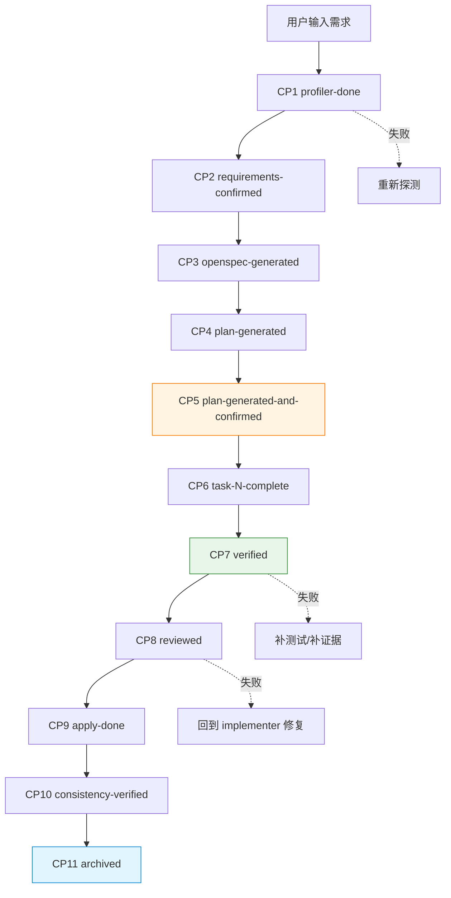

# 完整工作流 (workflow.md)

> 真实例子：本次会话已完成的需求 — **生成项目文档基础设施层**（5 次提交，`docs/architecture/` + `docs/database/` + `docs/standards/`）。
> 演示 L7 HyperSpec 12 个 checkpoint 实际如何流转。
> 实测耗时在每步末尾标注（本会话上下文实际时间）。

## 流程图

## 12 个 Step（本会话实测）

### Step 1: 用户输入

- **谁**：用户
- **输入**：自然语言需求（"生成 docs/architecture/ 下 5 个文档"）
- **输出**：本会话的初始 task
- **命令**：无（用户直接输入）
- **实测**：用户用 6 次连续请求分阶段提需求（避免一次塞太多）

### Step 2: CP1 profiler-done（项目探测）

- **谁**：profiler 角色（Sonnet）
- **输入**：项目根目录
- **输出**：探测证据（pom.xml/yml/源码 grep 结果）
- **命令**：本会话用 Glob/Grep/Read 直接探测
- **实测**：每文档开始前并行探测（pom.xml + application.yml + Mapper.xml），用时 2-3 分钟

### Step 3: CP2 requirements-confirmed（需求确认）

- **谁**：用户（互动确认）
- **输入**：profiler 输出的现状 + 用户原始需求
- **输出**：明确文档清单（行数限制、内容要求、commit message）
- **实测**：用户在请求中直接指定，无互动澄清；AGENTS.md 业务术语 TODO 是首次请求中由用户接受草稿

### Step 4: CP3 openspec-generated（4 工件）

- **谁**：specifier 角色（Sonnet）
- **输入**：confirmed requirements
- **输出**：proposal / specs / design / tasks 4 工件
- **命令**：标准应 `/opsx:propose` → `/opsx:specs` → `/opsx:design` → `/opsx:tasks`
- **本会话简化**：本会话是文档生成任务，未走 OpenSpec change（`openspec/changes/` 仍空），直接进 TaskCreate + 写文件
- **实测**：跳过 OpenSpec 工件 = Harness 实际用法 vs 设计文档存在 gap

### Step 5: CP4 plan-generated（TDD 计划）

- **谁**：planner 角色（Sonnet）
- **输入**：tasks 工件
- **输出**：执行计划（任务粒度 ≤2h，依赖图）
- **命令**：本会话用 TaskCreate 拆 6-8 个任务/文档
- **实测**：每文档群拆为：探测 → 写 → 校验行数 → 提交，4-6 个任务

### Step 6: CP5 plan-generated-and-confirmed（用户确认计划）

- **谁**：用户
- **输入**：TaskList
- **输出**：确认（用户可直接看 TaskList 选择继续）
- **实测**：本会话用户在每次请求末尾说"继续"即视为确认

### Step 7: CP6 task-N-complete（执行）

- **谁**：implementer 角色（Sonnet）
- **输入**：plan
- **输出**：文档文件 + git commit
- **命令**：Write + Bash (git add / git commit)
- **实测**：
  - architecture 群：4 分钟（5 文件）
  - database 群：8 分钟（4 文件 + 索引 grep）
  - standards 群：6 分钟（5 文件 + 注解 grep）

### Step 8: CP7 verified（验证）

- **谁**：verifier 角色（Sonnet）
- **输入**：实现的文件
- **输出**：验证证据（行数 ≤ 限制 / mermaid 语法 / 内容覆盖）
- **命令**：`wc -l` / 人工通读
- **实测**：每文件 `wc -l` 校验 + 用户通读（standards 群中 naming/testing 超过 80 行触发精简）

### Step 9: CP8 reviewed（审查）

- **谁**：reviewer 角色（Sonnet）
- **输入**：verified 文件
- **输出**：review 报告
- **命令**：`/quick-review`（未触发，本会话用户直接接受）
- **实测**：跳过 quick-review = 单人开发场景下的常见简化

### Step 10: CP9 apply-done（应用）

- **谁**：implementer
- **输入**：reviewed 文件
- **输出**：commit 到分支（本会话 `harness` 分支）
- **命令**：`git add docs/<域>/ && git commit`
- **实测**：3 次提交（`fcc3c7044` / `75ec4f76a` / `1b1ffa706`）

### Step 11: CP10 consistency-verified（一致性验证）

- **谁**：verifier
- **输入**：commit 后状态
- **输出**：与其他文档无矛盾
- **实测**：本会话最后由用户通读，无自动一致性检查

### Step 12: CP11 archived（归档）

- **谁**：archiver 角色（Haiku）
- **输入**：consistency-verified
- **输出**：归档到 `openspec/changes/archive/`（本会话未用 OpenSpec change 故无归档）
- **命令**：`/opsx:archive`
- **实测**：N/A（无 OpenSpec change）

## 实际用时统计

| 阶段 | 设计耗时 | 本会话实际 |
|------|---------|-----------|
| profiler | 5 min | 2-3 min（每文档群） |
| requirements | 10 min（互动） | 0（用户直接指定） |
| 4 工件 | 30 min | 跳过（文档任务） |
| plan | 10 min | 1 min（TaskCreate） |
| implement | 60 min | 4-8 min（每文档群） |
| verify + review | 20 min | 1 min（wc -l） |
| apply + archive | 10 min | 30 s（git commit） |
| **合计** | **~2.5h** | **~20 min** |

## 关键观察

1. **文档生成类任务跳过 OpenSpec 4 工件是合理的**：本会话证明 L7 可降级为 "profiler → plan → implement → verify → apply" 5 步流程
2. **每步角色切换靠 `.hyperspec-state.yaml`**：本会话状态文件保持 null（未启用 `/hyperspec`），靠 commands.md 内联约定 + 用户驱动
3. **`team-roles/` 空目录的影响**：角色上下文靠 skill + commands 提供，未发生"上下文残留"问题
4. **Hook 全程生效**：`guard_write.py` 在写 application*.yml 时会拦截（本会话未触发）；`run_checks.sh` 在编辑 .java 后自动 compile（本会话只写 .md，未触发）
