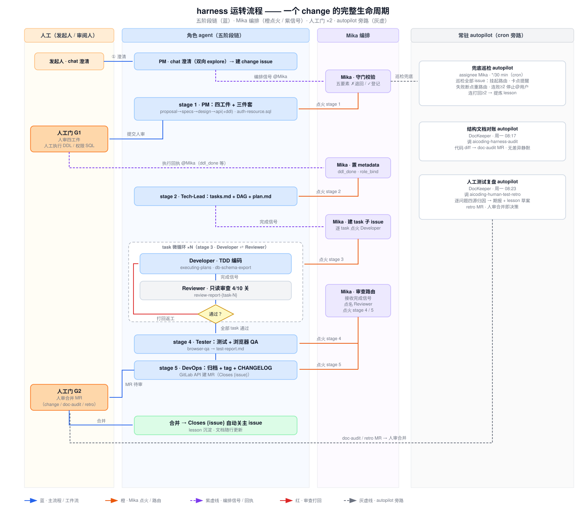
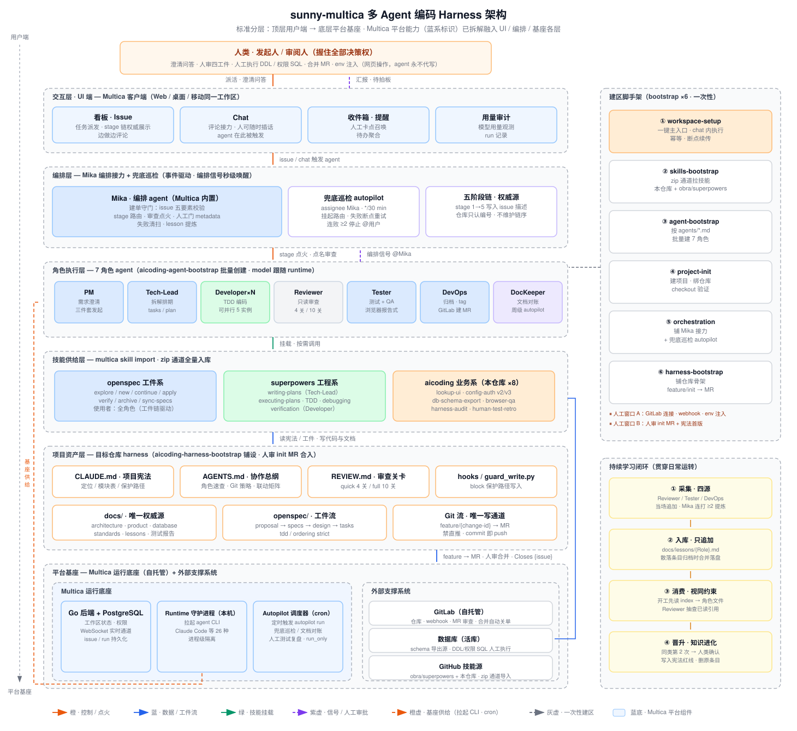
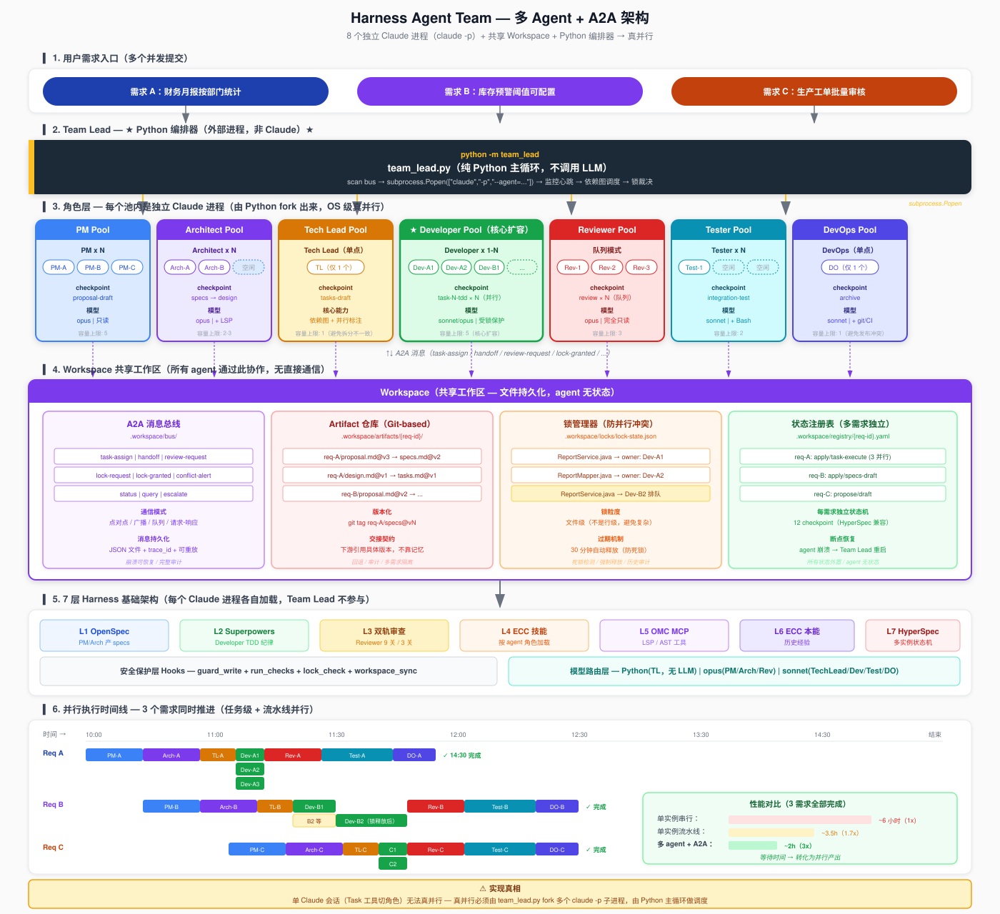

# 核心项举证材料：2.1 概要设计

# 概要设计说明书

**（AI 多 Agent 编码 Harness 平台）**

> 本材料按 GB8567-88《概要设计说明书》模板编制，作为任职资格答辩核心项 2.1 概要设计的举证材料。

| 项目 | 内容 |
|---|---|
| 行为模块 | 2、软件设计（权重 30%） |
| 行为要点 | 2.1 概要设计 **【核心项】** |
| 举证项目 | AI 多 Agent 编码 Harness 的设计与规模化落地 |
| 项目时间 | 2026 年 4 月至今 |
| 个人角色 | 架构设计负责人 |
| 编制日期 | 2026-11-07（修订版） |

**行为标准原文**

> ①根据需求文档的功能要求设计软件功能流程。
> ②根据需求文档的功能要求设计软件人机界面框架及评审人机界面的用例。
> ③根据需求分析中的功能要求及式样书设计测试用例，根据功能要求及式样书分解出关键技术要点，并确定各技术要点的可行性。
> ④根据功能需求、系统流程、人机界面、技术要求等独立完成软件的结构设计/模块划分。
> ⑤根据需求和技术分析结果确定开发技术路线，并形成供开发使用的技术文档。

---

## 1 引言

### 1.1 编写目的

本说明书给出 AI 多 Agent 编码 Harness 平台的总体设计，作为建设与维护的权威依据及核心项 2.1 的举证材料。预期读者：评审评委、平台建设与维护人员。

### 1.2 背景

待开发系统：AI 多 Agent 编码 Harness 平台。任务提出者：集团 IT 部；开发者：IT 开发团队（本人主导架构设计）；用户：IT 各业务系统开发团队；运行于公司内网自托管环境。

### 1.3 定义

同《软件需求说明书》（1.2 需求分析举证材料）§1.3。补充：五阶段链 = 澄清建单→四工件→拆解→编码微循环→测试归档；G1/G2 = 两个人工决策门。

### 1.4 参考资料

- 《软件需求说明书》（1.2 举证材料）
- harness-architecture.md / harness-runtime-flow.md / harness-repo-structure.md（`files/harness架构文档/`）
- Harness V2 架构设计文档（七层架构 + 12 checkpoint）、Harness Agent Team 多 Agent 架构设计

---

## 2 总体设计

### 2.1 需求规定

见《软件需求说明书》§3（功能：AI 承接全流程执行、人握两个决策门、旁路自愈；性能：接力秒级、需求交付分钟级；安全：密钥人工通道、保护路径物理拦截）。

### 2.2 运行环境

Multica 平台（Go + PostgreSQL + 本机 Runtime 守护进程拉起 agent CLI）自托管；目标项目构建链（Maven/JDK/Node）；GitLab；内网数据库。

### 2.3 基本设计概念和处理流程（功能流程设计，对应行为标准①）

**一个 change 的一生——五阶段链主线**：

```
stage 1  PM 澄清（chat 双向 explore）→ 四工件设计
         proposal(WHY) → specs(WHAT) → design(HOW) → api(+ddl)
   ═════ 人工门 G1：人审四工件 + 人工执行 ddl.sql / 权限脚本 ═════
stage 2  Tech-Lead 拆解：tasks.md + 依赖图(DAG) + 排他文件清单 → plan.md
stage 3  Developer ⇄ Reviewer 逐任务微循环
         写码(TDD) → 编排信号 → 只读审查 → 不过红色打回 → 返工重循环
stage 4  Tester：集成/边界/性能测试 + 浏览器 QA 三档 → test-report
stage 5  DevOps：归档 + tag + CHANGELOG + GitLab API 建 MR
   ═════ 人工门 G2：人审合并 → Closes {issue} 自动关闭 ═════
```



**旁路机制**（主线之外的自动巡检）：

| autopilot | 频率 | 职责 |
|---|---|---|
| 兜底巡检 | 每 30 分钟 | 挂起路由、人工卡点提醒、失败断点重路由、连败 ≥2 停手 @人、连打回 ≥2 提炼教训 |
| 结构文档对账 | 周一 08:17 | 基线以来代码 diff 映射为文档修正 MR，无差异静默 |
| 人工测试复盘 | 周一 08:23 | 未读测试报告逐 ⚠️ 四源证据链归因 |

### 2.4 结构（结构设计与模块划分，对应行为标准④）



| 层 | 组件 | 模块划分 |
|---|---|---|
| 平台层 | Multica（自托管） | Go 后端 + PostgreSQL + 本机 Runtime 守护进程（拉起 26 种 agent CLI） |
| 编排层 | Mika 调度 agent + 3 autopilot | 建单守门 / stage 路由 / 审查点火 / 人工门 metadata / 失败清扫 |
| 角色层 | 7 角色 agent | PM×3 / Tech-Lead×1 / Developer×5 / Reviewer×3 / Tester×2 / DevOps×1 / DocKeeper×1 |
| 技能层 | 3 系技能库（zip 通道整包入库） | openspec 工件系 7 个 / superpowers 工程系 / aicoding 业务系 8 个 |
| 治理层 | 目标仓库内 | 三大治理文档 + docs/ 九子目录字典 + 硬约束钩子 + Git 流 |



**角色分工表**（部分）：

| 角色 | 职责 | 出场 | 并发 |
|---|---|---|---|
| PM | chat 澄清 + 四工件 + 权限 SQL 草案，不写代码 | stage 1 | 3 |
| Developer | plan.md 单条目 TDD 编码，排他文件清单防冲突 | stage 3 | 5 |
| Reviewer | 只读审查，异模型防共谋，产 review-report | stage 3 横向 | 3 |
| DevOps | 归档 + GitLab API 建 MR（description 含 Closes {issue}） | stage 5 | 1 |

**跨仓库复用设计**：治理层骨架为"结构权威源"（20+ 文件模板），对齐模式铺设到任意仓库——补缺节、不覆盖已有定制。

### 2.5 功能需求与程序的关系（部分）

| 功能需求 | 承载组件 |
|---|---|
| 需求澄清与四工件产出 | PM agent + OpenSpec 工件系技能 |
| 任务拆解与并行编排 | Tech-Lead + Mika + 排他文件清单机制 |
| TDD 编码与审查微循环 | Developer + Reviewer + guard_write.py 钩子 |
| 分级测试与浏览器 QA | Tester + aicoding-browser-qa |
| MR 归档与流水线闭环 | DevOps + GitLab API |
| 文档防漂移 | aicoding-db-schema-export + aicoding-harness-audit |

### 2.6 人工处理过程（人机界面框架与评审用例，对应行为标准②）

| 界面 | 用途 | 评审用例设计（实物规则） |
|---|---|---|
| chat 问答 | 需求澄清、建区引导 | 建单守门五要素：change-id / 五阶段链 / 人工门段 / 验收点 / 澄清结论——**缺一样打回澄清**，不入流程 |
| issue 看板 | 过程可视、agent 汇报 | 每阶段完成发标准格式"编排信号"评论 @调度秒级接力；人可随时插话；agent 边做边评论留痕 |
| 人工门网页 | 关键决策 | 全流程仅 2 个人工门 + 建区 2 个人工窗口（GitLab 集成窗口 / harness MR 人审窗口，另含启动前一轮问答）；环境变量只由人在网页注入（agent 永不代写） |

### 2.7 尚未解决的问题

部分老仓库存量文档缺口需分批对齐（对齐模式按需补缺节，不一次性追溯全量）。

---

## 3 接口设计

### 3.1 用户接口

chat 自然语言问答（建单/建区/澄清）；issue 看板（过程可视+编排信号评论）；MR 审核页（G2 人工门）。

### 3.2 外部接口

GitLab API（注册仓库、webhook 事件、建 MR）；数据库连接（表结构导出，密码 env 单次使用）；浏览器基座（gstack）。

### 3.3 内部接口

编排信号（标准格式完成评论 + @Mika）事件通道；人工门 metadata 状态位（ddl_done / role_bind）；agent 间工件传递（openspec/changes/{change-id}/ 目录约定）。

---

## 4 运行设计

### 4.1 运行模块组合

主链：7 角色按 stage 接力；旁路：3 autopilot 周期巡检；并行：Developer 5 实例（排他文件清单防写冲突）。

### 4.2 运行控制

编排信号事件驱动为主（秒级唤醒）；cron 兜底（30min 全量对账）；人工门 metadata 硬前置（未置位 stage ≥2 点火不生效）。

### 4.3 运行时间

接力延迟秒级；小需求约 5 分钟、bugfix 约 3 分钟、中大需求 30-60 分钟端到端；快速审查 2 分钟/全量审查 15 分钟。

---

## 5 系统数据结构设计

### 5.1 逻辑结构设计要点

openspec/changes/{change-id}/ 工件目录（proposal/specs/design/api/ddl/auth-resource/tasks）；docs/ 九子目录知识字典（product/architecture/database/standards/lessons/help/implicit-contracts/human-test-reports/templates）；docs/lessons/{角色}.md 错题本。

### 5.2 物理结构设计要点

全部落 Git 仓库（feature/{change-id} 分支 → MR → master）；对账基线 commit 登记于 docs/index.md。

### 5.3 数据结构与程序的关系

五阶段链链序单一权威源存于 issue 描述（由 Mika 维护），仓库侧只认 stage 编号——结构上消灭两处状态漂移。

---

## 6 系统出错处理设计

### 6.1 出错信息

run 失败/审查打回/信号丢失均有分类出错信息（issue 评论留痕）；agent 输出强制 UTF-8（Windows GBK 乱码根治约定）。

### 6.2 补救措施

失败分级升级：run 失败→断点重路由；连败 ≥2→停手 @人；打回→红色退回逐条返工；连打回 ≥2→自动提炼 lesson；信号丢失→30min cron 兜底对账。

### 6.3 系统维护设计

变更随行（文档随 change 同步更新，不允许事后补文档）+ 周级对账兜底 + 教训晋升红线的规范进化机制。

---

## 7 关键技术要点分解与可行性论证（对应行为标准③）

测试用例设计详见 4.3 综合测试举证材料。四项关键技术要点的事前可行性论证（开发前逐一验证，全部通过后才进入实施）：

| 技术要点 | 论证结论 | 落地配置（实物） |
|---|---|---|
| 事件驱动编排信号 | 评论格式约定即可秒级唤醒，替代轮询 | 标准格式完成评论 + @Mika，30 分钟 cron 仅兜底 |
| PreToolUse 写入拦截 | agent 工具调用前可注入决策，block 可行 | guard_write.py：stdin 读 tool_input.file_path，命中保护模式输出 `{"decision":"block"}` |
| 工件顺序强制 | strict 模式可校验 proposal→specs→design→tasks | `ordering: strict` |
| 模型分级路由 | 按工序路由大小模型可行且省本 | `explore: haiku / propose: opus / apply: sonnet / review: opus` |

---

## 8 技术路线与开发文档（对应行为标准⑤）

**技术路线**：Multica（底座）+ Claude Code（执行引擎）+ OpenSpec（工件规范）+ superpowers（工程方法论），自研面聚焦"编排机制 + 治理层 + 业务技能"薄层。多 agent CLI 适配（opencode/Qwen/Trae）已验证，保留工具链替换灵活性。

**输出供开发使用的技术文档 6 篇 + 架构图 18 张**：

| 文档 | 内容 | 主要用途 |
|---|---|---|
| harness-architecture.md | 分层架构总览 | 建设与维护的权威依据 |
| harness-runtime-flow.md | 五阶段链运转流程 + autopilot 旁路 | 日常运转手册 |
| harness-repo-structure.md | 目标仓库治理结构 + 建设 5 步 | 仓库铺设指南 |
| harness-explained.md | 通俗讲解版（AI 编码公司类比） | 培训新人材料 |
| Harness V2 架构设计文档 | 三次范式跃迁 + 七层架构 + 12 checkpoint | 架构决策留档 |
| Harness Agent Team 多 Agent 架构设计 | 伪并行根因论证 + 真并行编排设计 | 多 Agent 演化依据 |

**配套架构图 18 张**（`files/images/`）：核心流程图 9 张（架构/运转/编排时序/SDD 工件链/TDD 微循环/硬约束/学习闭环/仓库结构/概念图，SVG+PNG 双格式）+ 四代演进架构图 9 张（V2 七层架构 `harness-v2-architecture`、双审查流程 `harness-v2-dual-review`、HyperSpec 流程、AI 编码演化、生命周期、会话初始化、TDD 分层、团队架构、多 Agent 团队架构，SVG 源）。

## 9 设计成果的有效性

- 前代 Harness V2 单会话全周期流程（12 checkpoint）在 MDM「PLM 继承接口」真实需求端到端验证（2026.06，`files/实战记录/MDM-PLM继承接口/`）；
- Multica 形态五阶段链于 2026.08 平台化后在六个业务系统规模化运行——MDM 仓库 Multica 阶段 6 个 MR（2026.08-11）为两代对照实证，典型 change「商品码清洗」四工件全目录归档见 `files/实战记录/MDM-商品码清洗-Multica阶段/`；
- 六个业务系统仓库（LIMS/QMS×3/ECQ/MDM）铺设应用；
- Developer 5 实例并行经受住并发考验（排他文件清单防写冲突）。

## 10 证据物清单

- 架构文档 6 篇 + 架构图 18 张（核心流程 9 张 SVG+PNG、四代演进 9 张 SVG，`files/harness架构文档/`、`files/images/`）
- 编排配置实物（autopilot cron 表：*/30min 巡检 / 周一 08:17 对账 / 周一 08:23 复盘，错峰设计）
- 关键技术可行性验证实物（guard_write.py 源码、openspec-config.yaml，`files/治理文件实物/`）
- 角色批量创建与技能导入脚手架（6 个 bootstrap，源码见项目仓库）
- 两代阶段实战对照（`files/实战记录/`：MDM-PLM继承接口 2026.06 / MDM-商品码清洗-Multica阶段 2026.09）+ MR 合并时间戳凭证（`files/凭证/`）

## 11 个人贡献声明

本行为要点项下的功能流程、人机界面框架与评审用例、测试体系与关键技术论证、五层结构设计与模块划分、技术路线决策及供开发使用的技术文档，由本人主导设计，并在团队协作下落地验证。
