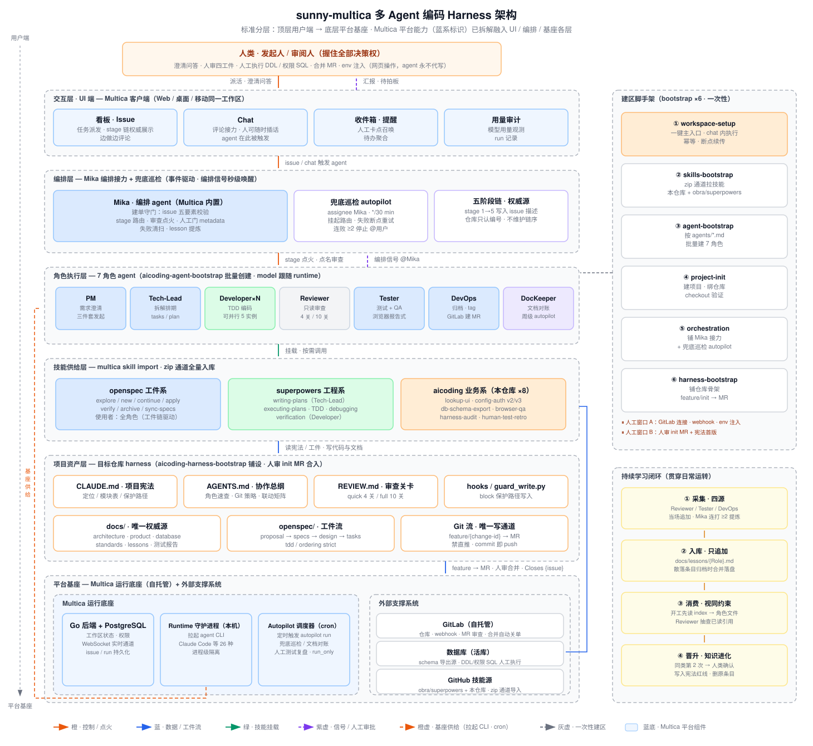
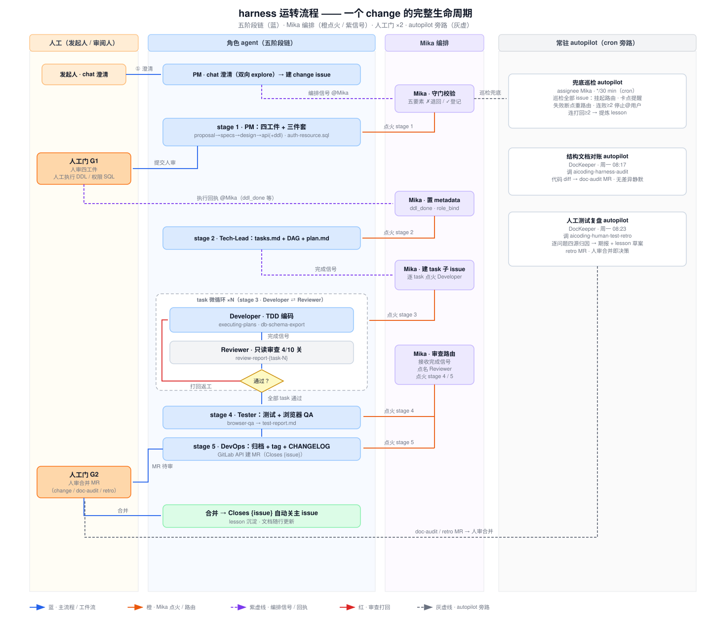
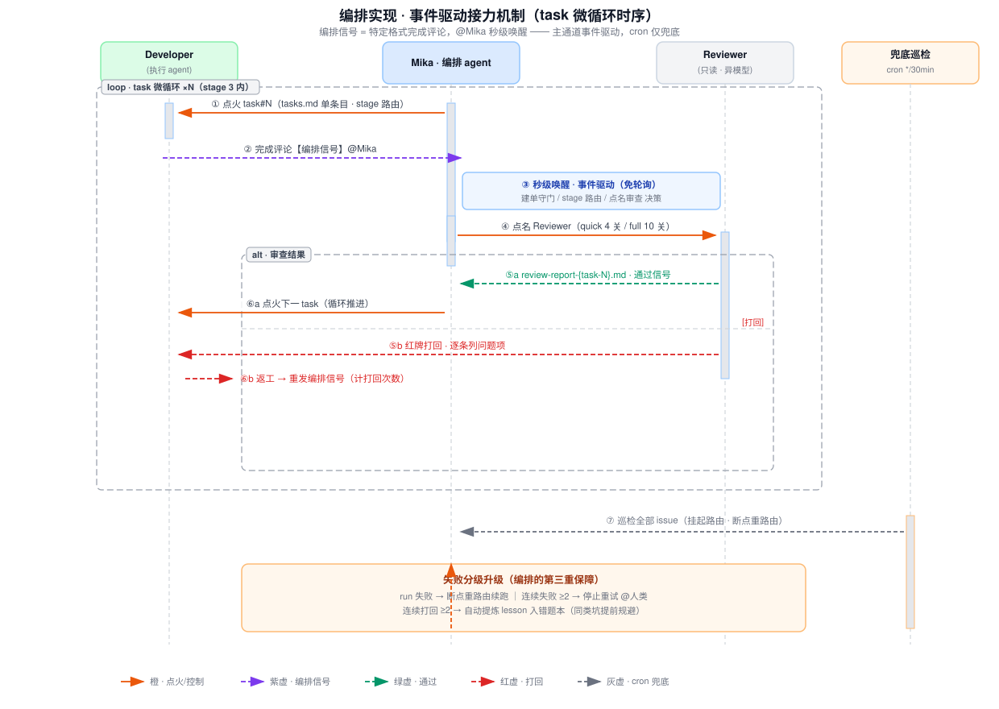
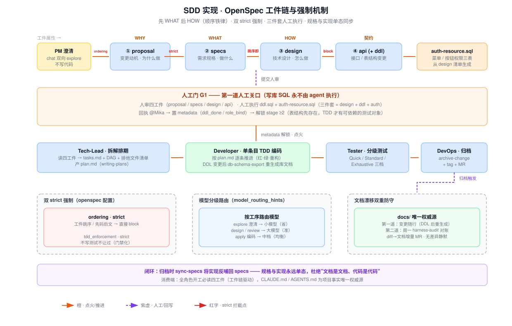
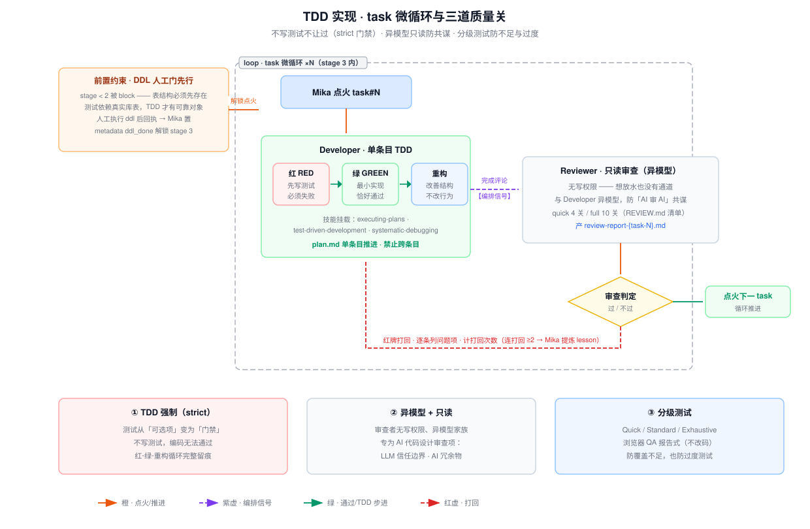
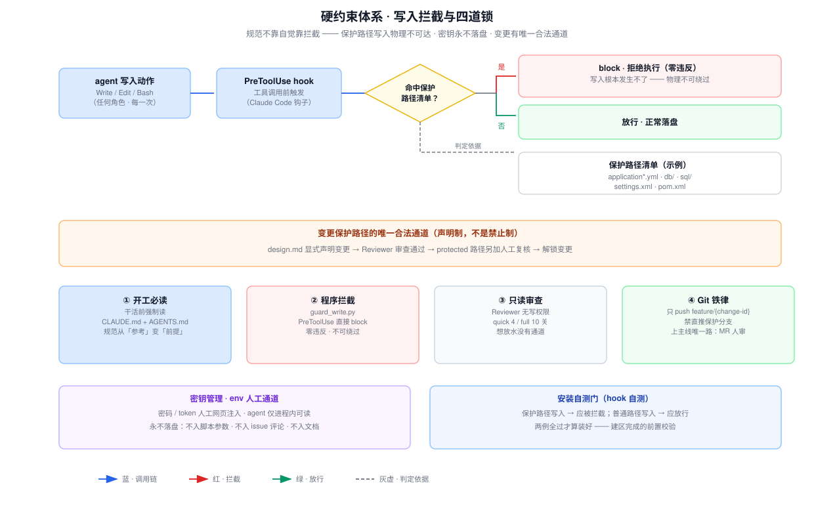
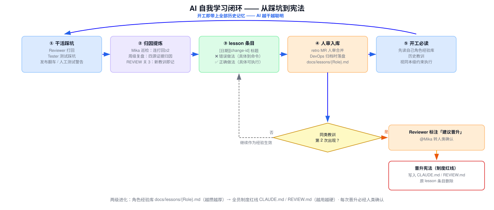

# 任职资格答辩报告

| 项目 | 内容 |
|---|---|
| 姓　　名 | 翁金林 |
| 公　　司 | 舜宇光学科技 |
| 认证岗位 | 软件开发 |
| 认证等级 | 高级工程师 |
| 日　　期 | 2026 年 11 月 |

---

# 一、个人简介

## 个人信息

| 个人信息 |          | |            |
|---|----------|---|------------|
| 学　历 | 本科       | 所学专业 | 计算机科学与技术   |
| 毕业院校 | 温州大学城市学院 | 入职时间 | 2018/04/18 |
| 参评人员类型 | 常规申请等    | 现聘任专业 | 软件       |
| 现聘任等级 | 工程师      | 现聘任等级开始时间 | 2023/07/01 |
| 现职级 | 13       | |            |

## 近三年绩效考核

| 年度 | 考核结果 |
|---|------|
| 2025 | B+   |
| 2024 | B    |
| 2023 | B+   |

## 工作经历

| 工作经历          | | | | |
|---------------|---|---|---|---|
| **时间**        | **公司** | **部门** | **岗位** | **工作特长** |
| 2018/04/18—至今 | 舜宇光学科技 | 集团 IT 部 | 软件开发 | Java 后端开发 / AI 辅助研发效能建设 |

## 近三年主要荣誉

获取MDM系统的软件著作权

---

# 二、认证周期内主要业绩成果概述

## 行为模块涉及情况

| 行为模块 1：需求分析 | 行为模块 2：软件设计 | 行为模块 3：软件实现 | 行为模块 4：软件测试 | 行为模块 6：导入/运行维护 | 模块涉及数量 |
|---|---|---|---|---|---|
| **涉及** | **涉及** | **涉及** | **涉及** | **涉及** | **5** |

## 行为要点明细

> 加粗 ◆ 标示的行为要点为核心项。核心项举证材料按国家标准模板重新编制，见本 V2 目录。

| 序号 | 行为模块 | 行为要点 | 项目/业绩主题 | 角色 | 时间 | 个人贡献 |
|---|---|---|---|---|---|---|
| 1 | 需求分析 | 1.1 需求调研 | AI 编码 Harness 建设前期技术调研 | 主导 | 2026.04—2026.05 | 完成 agent CLI 生态扫描（Multica 平台支持 26 种 agent CLI）；重点完成 Claude Code / OpenSpec / superpowers / Multica 核心组件选型调研，整理成选型技术文档并在团队内分享 |
| 2 | 需求分析 | **1.2 需求分析 ◆** | AI 多 Agent 编码 Harness 的设计与规模化落地 | 项目发起人、总体设计 | 2026.04 至今 | 根因评估三大痛点、五层体系架构规划、"6 脚手架 + 8 技能 + 1 治理层"任务分解与多方案比选，提出组合式创新方案 |
| 3 | 软件设计 | **2.1 概要设计 ◆** | 同上 | 架构设计负责人 | 2026.05—2026.10 | 设计五阶段链功能流程、人机交互界面框架与评审用例、四项关键技术事前论证、五层结构设计与模块划分，输出技术文档 6 篇与架构图 18 张（四代演进全覆盖） |
| 4 | 软件设计 | 2.2 详细设计 | 同上 | 架构设计负责人 | 2026.06—2026.10 | 完成中大型多 Agent 系统架构设计（Harness V1→V2→Agent Team→Multica 平台化四代演进），治理骨架已在 6 个业务系统仓库复用铺设，具备跨团队借鉴条件 |
| 5 | 软件实现 | **3.1 规范编写 ◆** | 机器可执行软件规范库建设 | 规范体系牵头人 | 2026.06 至今 | 主导编制覆盖编码、数据库、测试、部署、维护全维度的四级规范库（项目宪法 16 节 / 协作总纲 8 节 / 审查关卡 4+10 关 / 技术详单骨架三篇 + 各仓库实铺扩充），配套三重强制执行机制，已在公司 IT 多个业务系统仓库铺设沿用 |
| 6 | 软件实现 | 3.2 构成管理 | AI 编码技术路线规划 | 技术路线负责人 | 2026.04 至今 | 规划"Multica + Claude Code + OpenSpec + superpowers"组合技术路线并分阶段推进；多 agent CLI 适配（opencode/Qwen/Trae）探索；定期输出技术报告与团队分享 |
| 7 | 软件实现 | 3.3 代码编写 | 编排 / SDD / TDD 三大核心机制实现 | 核心机制设计实现 | 2026.05—2026.10 | 设计并实现事件驱动编排信号、OpenSpec 工件链双 strict 门禁、TDD 微循环、写入拦截硬约束等核心框架；整理 AI 代码审查质量问题提交处理；提出模型分级路由等提效革新 |
| 8 | 软件测试 | **4.3 综合测试 ◆** | 三道质量关与 AI 疑难问题库 | 测试体系设计者 | 2026.06 至今 | 设计三道质量关（TDD 强制门 / 异模型只读审查 / 分级测试+浏览器 QA）；建立疑难问题四源采集与错题本机制，同类问题第二次出现自动晋升全员红线 |
| 9 | 导入/运行维护 | **6.1 系统导入 ◆** | 一键建区部署导入与规模化推广 | 部署方案设计者 | 2026.08 至今 | 评估自托管部署方案并编写一键建区导入方案（幂等、断点续传）；部署指导与问题解决；五层性能瓶颈定位与调优；建立导入后运行维护机制 |

## 简述 2-3 项重点业绩

### 业绩一：从 0 到 1 建成 AI 多 Agent 编码流水线并规模化落地（主业绩）

- **业绩来源**：公司 IT 开发的现实痛点（AI 工具零散使用收益碎片化、开发人力瓶颈、质量与规范失控）与本人主动发现的技术突破口。
- **难点/技术点**：多 Agent 松耦合接力的分布式难题（状态一致性、接力延迟、失败恢复）；AI 生成代码的可信问题（不写测试、AI 审 AI 共谋、文档代码两态漂移）；规范的"靠自觉"问题（提示词可被绕过）。
- **过程简述**：三步演化——OpenSpec 单会话最小闭环验证 → Harness V2 制度化（治理+技能+硬约束）→ Multica 多 Agent 平台化规模化；四代架构迭代（V1 方法手册 → V2 七层架构 → Agent Team 真并行 → Multica 半托管）。
- **价值贡献**：小需求端到端约 5 分钟、bugfix 约 3 分钟、中大需求 30-60 分钟交付；已在 LIMS、QMS（服务端/前端/SPC）、ECQ、MDM 六个业务系统实战开发应用（GitLab 仓库地址与 MR 合并时间戳凭证见 `files/凭证/MR时间戳凭证-GitLab合并记录.md`）。
- **专业影响力**：详见下文典型项目举证。

### 业绩二：建成"机器可执行"的软件规范库（对应核心项 3.1）

- **业绩来源**：传统"给人看"的规范无法约束 AI 行为这一新问题。
- **难点/技术点**：规范如何从"参考文档"变成"物理可执行的制度"；规范如何随仓库实际代码保持一致不漂移；规范库如何随使用自我进化而非逐渐过时。
- **过程简述**：两级结构设计（红线一句话进宪法、详单进 standards/）；16 项占位符全部要求代码证据填充；三重强制执行（开工必读/PreToolUse 程序拦截/关卡校验）；防漂移双保险 + 教训晋升红线的进化机制。
- **价值贡献**：保护路径写入默认拦截 + 编排器受控通道（`HARNESS_ALLOW_WRITE=1` 仅受控流程可用，stdin 异常保守放行有日志可查），日常运行零违反；规范铺设到公司多个业务系统仓库，新仓库全套规范铺设约半日。
- **专业影响力**：规范库作为治理骨架（结构权威源）可对齐模式铺设到公司任意仓库，供相关岗位参考借鉴。

### 业绩三：AI 疑难问题库与自我进化知识体系（对应核心项 4.3）

- **业绩来源**：AI 与人协作开发中"同样的坑反复踩"——经验只散落在个人会话，不沉淀、不进化。
- **难点/技术点**：经验采集的四源归口；AI 能否自说自话改知识库的入库把关；知识如何从"个人教训"升级为"组织红线"。
- **过程简述**：四源采集（审查打回/测试踩坑/发布踩坑/人工测试复盘）→ 条目具体到命令级（❌/✅ 对照）→ 人审 MR 入库 → 各角色开工必读视同本级约束 → 同类第 2 次出现自动晋升全员红线。
- **价值贡献**：周级复盘对人工测试问题做四源证据链归因，问题定位到责任环节并产出修正；已沉淀疑难问题技术资料 10 条（MDM 集成踩坑避坑指南，实物归档 `files/疑难问题库/MDM-pitfalls.md`），其中 6 项晋升为全员红线；LIMS 仓库 8 角色错题本文件随案归档（`files/疑难问题库/LIMS-lessons/`）；错题本越攒越厚、制度红线越用越硬。
- **专业影响力**：该机制随治理骨架在多仓库复制，形成公司级可查询、可借鉴、可提交、可解决的疑难问题库。

---

# 三、典型项目/关键事件举证

## 主题：从"辅助工具"到"开发流水线"——AI 多 Agent 编码 Harness 的设计与规模化落地

### S - 情境：2026 年初的三个现实问题

**① AI 工具零散使用**。同事们各自用 Copilot/ChatGPT 做代码补全——收益碎片化、经验不沉淀，AI 停留在"私人助理"层面，没有成为组织级生产力。

**② 开发人力瓶颈**。IT 需求持续积压，加人加班已到顶，产能天花板在"人串行执行"的开发模式本身。

**③ 质量与规范失控**。文档失修、人肉审查、同样的坑反复踩——规范的执行依赖个人自觉。

对三者共同根因，我当时的判断是：**开发模式本身没有变**。单点辅助式 AI 的天花板很低，真正的突破口不是"用好一个 AI 工具"，而是建一条**可管、可控、可审计的 AI 开发流水线**——AI 承接全流程执行，人类只握关键决策。

### T - 任务：目标与四大难题

**目标一句话：AI 干活、人拍板**——人从"执行者"变为"决策者"。

| 四大难题 | 一句话 | 对应实现重难点 |
|---|---|---|
| 🔀 编排 | 7 种角色 agent 怎么接力？失败了怎么办？ | 重难点 ① |
| 🧐 质量 | AI 写码谁审？AI 审 AI 会不会共谋？ | 重难点 ② ③ ⑤ |
| 📚 知识 | 业务知识/历史踩坑怎么让 AI 学到？文档怎么不漂移？ | 重难点 ② ⑤ |
| 🔐 安全 | 密码怎么管？AI 乱改配置怎么办？ | 重难点 ④ |

### A - 行动：三步演化 × 四代架构 × 五个重难点

#### A0 演化总览（真实时间线）

```
2026.04 启动调研：agent CLI 生态扫描 + 核心组件选型（Claude Code / OpenSpec / superpowers / Multica）
         —— 04 月 OpenSpec 实战产出实物在案：MDM 仓库 2 个 change 工件 + 2 个 MR（04-01 / 04-10，
            归档 files/实战记录/MDM-04月实战产出/，时间戳见 files/凭证/MR时间戳凭证）
2026.05 引入 OpenSpec：单会话 spec 驱动 + TDD 最小闭环，sunny 系项目实战验证
2026.06.03 Harness V1 成形：《Harness》实战方法手册（四条核心原则）
2026.06.09 四层工具链：OpenSpec / Superpowers / gstack / HyperSpec 使用指南
2026.06.10 Harness V2 架构：三次范式跃迁理论 + 七层架构 + 12 checkpoint
2026.06.17 多 Agent 架构设计：外部编排器真并行（单会话 Task 工具为伪并行的根因论证）
2026.06.23-24 业务实战：sunny-qms-service 全套治理落地；MDM PLM 继承接口全周期交付（Harness V2 阶段）
2026.07   能力打包：harness-packages 可安装包；多 CLI 适配（opencode/Qwen/Trae）；MCP 服务化探索
2026.08-10 Multica 平台化：多 Agent 半托管流水线 + 6 脚手架 + 8 技能，推广六个业务系统
         —— Multica 阶段实战实物在案：MDM 6 个 MR（08-04 ~ 11-05），典型 change 归档
            files/实战记录/MDM-商品码清洗-Multica阶段/（分支产出 09-21，MR 合并 09-24）
```

**三步小步快跑，每步验证可行再前进；四代架构演进，每代解决上一代的结构性瓶颈。**

演进过程的关键技术文档与实战记录已归档：`files/harness架构文档/`（V2 架构设计、多 Agent 架构设计、4 篇 harness 系列文档）；两代实战对照——`files/实战记录/MDM-PLM继承接口/`（Harness V2 阶段，2026.06）与 `files/实战记录/MDM-商品码清洗-Multica阶段/`（Multica 阶段，2026.09）。

#### A1 调研选型与体系规划 ｜ 行为要点 1.1 · 1.2 ◆

对三大痛点逐一做根因评估，确认本质需求：AI 零散使用需要**流程级**承接而非工具级辅助；人手不够需要 AI **角色化分工**承接全流程；质量不稳需要**机器可执行**的规范与审查体系。

多方案比选：

| 方案 | 评估 | 结论 |
|---|---|---|
| A. 深化 Copilot 类补全 | 不改开发模式，收益天花板低 | ✗ |
| B. 自研多 Agent 平台 | 开发量以年计，IT 无专职平台团队 | ✗ |
| **C. Multica + Claude Code + OpenSpec** | 复用成熟件，自研面压缩到"编排+治理+技能"薄层 | **✓** |

结合公司现状的关键考量：全部组件开源自托管、数据不出公司（信息安全合规）；公司技术栈为传统 Java/Vue 单体，治理层按仓库实际代码证据定制，不引入重平台改造。正因为选对路线，这套体系得以在半年内建成落地。

体系架构规划为五层（Multica 平台层 → 编排层 → 角色 agent 层 → 技能层 → 目标仓库治理层），任务分解为"6 脚手架 + 8 技能 + 1 治理层"实物清单（skills 与 bootstrap 全部源码见项目仓库 `skills/`、`bootstrap/` 目录，说明文档 `sunny-multica-skills_README.md`）。

> 核心项 1.2 的完整举证（含行为标准逐条映射、证据物清单）见 `核心项举证-1.2需求分析-软件需求说明书.md`（按 GB856T-88 软件需求说明书模板编制）。

#### A2 软件设计：整体架构与流程生命周期 ｜ 行为要点 2.1 ◆ · 2.2



**五层结构设计**：顶层用户端 → UI 交互（Multica）→ 编排 → 角色执行 → 技能供给 → 项目资产 → 平台基座。治理层骨架作为"结构权威源"，可对齐模式铺设到公司任意仓库。



**流程生命周期——一个 change 的一生**：五阶段链主线（澄清建单 → 四工件设计 → 拆解 → 编码微循环 → 测试 → 归档 MR），**人只出现两次**（G1 审设计+执行 DDL / G2 审 MR），其余全程 AI 接力、边做边汇报；旁路自愈三条 autopilot（30min 兜底巡检 / 周一文档对账 / 周一测试复盘）。

四项关键技术要点事前可行性论证（开发前逐一验证，全部通过才进入实施）：事件驱动编排信号（评论格式约定秒级唤醒）、PreToolUse 写入拦截（stdin 读 tool_input 输出 block 决策）、工件顺序强制（`ordering: strict`）、模型分级路由（按工序路由大小模型）。

> 核心项 2.1 的完整举证见 `核心项举证-2.1概要设计-概要设计说明书.md`（按 GB8567-88 概要设计说明书模板编制）。

#### A3 软件实现：五个重难点 ｜ 行为要点 3.3 · 3.2

**实现① 编排：事件驱动接力机制**



- 问题：7 角色松耦合接力 = 分布式系统三大难（状态一致性 / 接力延迟 / 失败恢复）。
- 方案：编排信号（完成评论）秒级唤醒 + 五阶段链单一权威源（issue 描述）+ 人工门 metadata 状态机 + 事件与 cron 双通道自愈。
- 突破：接力延迟从分钟级降至秒级；失败分级升级（连败 ≥2 才找人类，连打回 ≥2 转知识沉淀），人只在真正需要决策时被召唤。

**实现② SDD：工件链与双 strict**



- 问题：AI 三个天然缺陷——先码后文、WHAT/HOW 混淆、文档代码两态漂移。
- 方案：`proposal→specs→design→api` 顺序铁律（跳序即 block）+ 三件套人工执行 + `sync-specs` 回写闭环。
- 突破：规格与实现永远单态；库表文档工具生成唯一化 + 周级对账双重防守。

**实现③ TDD：task 微循环与三道关**



- 问题：AI 不爱写测试、测试依赖表结构、AI 审 AI 共谋。
- 方案：`tdd_enforcement: strict` 门禁 + 单条目红-绿-重构 + DDL 人工门前置（真表测试拒绝 mock 幻觉）+ Reviewer 异模型且无写权限。
- 突破：测试从可选项变闸门；专为 AI 代码设计审查项（LLM 信任边界、AI 冗余物）。

**实现④ 硬约束：写入拦截与四道锁**



- 问题：规范的痛点是"靠自觉"——提示词可被绕过，AI 乱改配置防不住。
- 方案：`guard_write.py` 挂 PreToolUse 钩子，保护路径（yml/db/sql/pom 等）写入直接 block；变更有唯一合法通道（design 声明→审查→人工复核）。
- 突破：默认拦截 + 编排器受控通道（`HARNESS_ALLOW_WRITE=1` 仅受控流程可用），日常运行零违反；四道锁（开工必读/程序拦截/只读审查/Git 铁律）+ 密钥 env 人工通道永不落盘 + 安装自测门。钩子源码：骨架模板版见 `files/治理骨架模板/hooks/guard_write.py`（PROTECTED_PATTERNS 含 settings.xml/pom.xml，decision:block 机制），QMS 实铺版见 `files/治理文件实物/hooks/guard_write.py`（149 行早期变体）。

**实现⑤ 创新点：AI 自我学习闭环 ｜ 行为要点 4.3 ◆**



- 问题：同样的坑反复踩——经验只在个人会话里，不沉淀、不进化。
- 方案：四源采集（打回/测试/发布/人工复盘）→ ❌/✅ 条目具体到命令 → 人审 MR 入库 → 开工必读视同本级约束。
- 突破（精髓）：同类教训**第 2 次出现自动晋升全员红线**——错题本越攒越厚，宪法越用越硬，每次晋升必经人类确认。

**实现⑥ 其他核心实现一览**

- 8 个业务技能（UI 选型速查 v2/v3、权限资源 SQL 生成 v2/v3、库表结构导出、浏览器 QA、结构文档对账、人工测试复盘——前后端技能由团队协同建设）；
- 6 个建区脚手架：一键建区全链路（幂等、断点续传）；
- 两项提效革新：模型分级路由（explore 小模型/proposal·review 大模型/apply 中档）压成本；Developer 5 实例并行 + 排他文件清单防写冲突提升吞吐；
- 问题解决范式：Windows GBK 乱码 → 定位代码页根因 → 固化 `@文件` 传参铁律入宪法 → 根治一类问题（同类固化案例还有 ddl.sql 平铺约束、MyBatis Map 大小写等，已沉淀疑难问题技术资料 10 条、晋升红线 6 项，实物归档 `files/疑难问题库/`，见 4.3 举证 §5.1）。

#### A4 治理体系：四套规范，一个体系 ｜ 行为要点 3.1 ◆

| 规范 | 定位 | 内容 |
|---|---|---|
| CLAUDE.md | 项目宪法 | 骨架模板 §0-§15 共 16 节红线（模块表/TDD/分层/命名/保护路径） |
| AGENTS.md | 协作总纲 | 骨架模板 §0-§7（适用范围/废弃产物隔离/stage 编号/角色速查/Git 策略/工件结构/变更联动/持续学习层） |
| REVIEW.md | 审查关卡 | 快审 4 关 + 全审 10 关清单（行数路由：<50 行快审 / ≥50 行全审） |
| standards/ | 技术详单 | 骨架模板三篇（api / database / testing）+ 各仓库按技术栈实铺扩充（QMS 实例为 java / mybatis / naming / spring / testing 五篇） |

与传统规范的本质区别：**机器可执行的制度**——开工必读、程序拦截、关卡校验，不靠自觉靠拦截；周级对账兜底 + 教训晋升红线 → 规范库越用越严密。规范实物随案归档两套：**治理骨架模板版**（结构权威源，`files/治理骨架模板/`：宪法/总纲/审查关卡/openspec-config.yaml 双 strict 配置/拦截钩子/standards 三篇/lessons 机制）与 **QMS 仓库实铺版**（`files/治理文件实物/`：按 sunny-qms-service 仓库代码证据填充后的实例，standards 五篇）。

> 核心项 3.1 的完整举证见 `核心项举证-3.1规范编写-详细设计说明书.md`（按 GB8567-88 详细设计说明书模板编制）。

#### A5 部署导入：一键建区，半日接入 ｜ 行为要点 6.1 ◆

```
「安装工作区」一句话触发，6 步自动串联（幂等 · 断点续传）：
技能导入 → 角色创建 →【人工窗口①】→ 项目初始化
→ 编排铺设 → 仓库治理铺设 →【人工窗口②：审 MR】
```

- **hook 自测**：保护路径应拦截、普通路径应放行——不过不算装好；
- **性能调优四层**（操作系统 / 数据库 / 应用服务器 / 应用程序，逐层映射见 6.1 举证 §2.2）：事件驱动替代轮询（秒级接力）、模型分级路由、Developer 并行、cron 错峰、增量对账；业务侧批处理调优实例——4211 工厂定时任务（分布式锁单实例 → SQL 分片 5 实例并行 + 线程池 + 每条物料独立事务，2026.04，量化对比见 R1 表）；
- **规模化**：已推广至 LIMS / QMS 服务端 / QMS 前端 / QMS SPC / ECQ / MDM 六个业务系统仓库；新团队从零接入约半日（对照：平台化之前新仓库 harness 手工落地需 4-6 天）。

> 核心项 6.1 的完整举证见 `核心项举证-6.1系统导入-用户手册.md`（按 GB8567-88 用户手册模板编制）。

#### A6 测试与知识进化 ｜ 行为要点 4.3 ◆

三道质量关（TDD 强制门 / 异模型只读审查门 / 分级测试+浏览器 QA 门）；疑难问题四源分类归口；AI 疑难问题库（错题本）的提交、入库把关、查询借鉴、共享、晋升红线全机制落地——标准要求逐项映射见测试举证材料。

> 核心项 4.3 的完整举证见 `核心项举证-4.3综合测试-测试分析报告.md`（按 GB8567-88 测试分析报告模板编制）。

### R - 结果：三类成果

#### R1 量化效能成果（有证据支撑的实测数据）

| 指标 | 数值 | 证据来源 |
|---|---|---|
| 小需求端到端交付 | 约 5 分钟 | Harness V2 演讲稿实测数据（`files/harness架构文档/`） |
| bugfix 交付 | 约 3 分钟 | 同上 |
| 中大需求端到端 | 30-60 分钟 | 同上；MDM PLM 继承接口 60-100 分钟跑通全流程（Harness V2 阶段实测） |
| 快速审查 / 全量审查 | 2 分钟 / 15 分钟（自动路由） | 同上 |
| MDM 实战单需求（Harness V2 阶段，2026.06） | 新增 7 文件、修改 6 个 Mapper（10 方法 + 9 段 XML）、**Tests run: 22, Failures: 0**、BUILD SUCCESS | `files/实战记录/MDM-PLM继承接口/`（6 份全周期记录） |
| MDM 实战单需求（Multica 阶段，2026.09） | 商品码清洗 change：10 文件 +431 行（代码+测试+文档+规格四工件同 MR） | `files/实战记录/MDM-商品码清洗-Multica阶段/`；分支产出 2026-09-21 10:06 → MR 合并 2026-09-24 08:09（GitLab 服务器时间戳） |
| 本人在 MDM 仓库 MR 节奏 | 2026.04-11 共 14 个 MR：V2 阶段 8 个（04-07 月）、Multica 阶段 6 个（08-11 月） | `files/凭证/MR时间戳凭证-GitLab合并记录.md`（git log 导出） |
| 规模化应用 | 6 个业务系统仓库（LIMS / QMS×3 / ECQ / MDM） | GitLab 仓库清单（地址见下表） |
| 承载系统规模 | QMS：120+ 业务模块、279 个 Mapper.xml、117 个 Controller | `files/harness架构文档/`、治理实物 |
| 新仓库接入耗时 | 手工 4-6 天 → 一键建区约半日 | 落地实操手册 vs 建区脚手架实测 |
| 4211 工厂定时任务批处理调优（2026.04） | 实例利用率 1/5 → 5/5（分布式锁单实例执行 → SQL 分片 5 实例并行，单实例数据量降至 1/5）；万条物料单一大事务 → 每条物料独立事务（失败影响面从整批降为单条）；改动约 150 行、零新依赖 | `files/实战记录/MDM-04月实战产出/2026-04-09-task-2026030925/`（proposal + design 全文在案）；MR 合并 2026-04-10 09:26（`files/凭证/`） |
| 单需求当日端到端（Multica 阶段实例） | 商品码清洗：分支首 commit 2026-09-21 10:06 → 四工件+代码+测试+文档当日全部完成（10 files +431 行） | `files/凭证/MR时间戳凭证-GitLab合并记录.md` 第二节（GitLab 服务器时间戳演算） |
| 保护路径违规写入 | 日常运行零违反（默认拦截 + 编排器受控通道 HARNESS_ALLOW_WRITE=1；stdin 异常保守放行有日志可查） | guard_write.py PreToolUse 机制（骨架版 `files/治理骨架模板/hooks/`） |

**规模化应用仓库地址（内网 GitLab，实测可达）**：

| 系统 | 仓库地址 |
|---|---|
| LIMS（实验室信息管理系统） | http://192.168.45.236/lims/sunny-lims.git |
| QMS 服务端（质量管理系统） | http://192.168.45.236/qms/sunny-qms-service.git |
| QMS 前端 | http://192.168.45.236/qms/sunny-qms-web.git |
| QMS SPC（统计过程控制） | http://192.168.45.236/qms/sunny-qms-spc.git |
| ECQ | http://192.168.45.236/ecq/sunny-ecq.git |
| MDM（主数据管理） | http://192.168.45.236/MDM/sunny-mdm.git |

> 注：MDM 两代阶段实战共享同一套质量关与规范体系（治理实物 2026.06.23 铺设后沿用），测试口径连续——V2 单会话阶段（2026.05-07）与 Multica 流水线阶段（2026.08 起）的 MR 记录见 `files/凭证/MR时间戳凭证-GitLab合并记录.md`。

#### R2 制度资产与专业影响力

**制度资产（可被公司长期借鉴）**
- 四套规范库 + 治理骨架（结构权威源，20+ 文件模板，随案归档 `files/治理骨架模板/`）→ 对齐模式铺设到任意仓库；
- 疑难问题库机制：同类教训第 2 次出现自动晋升全员红线——已沉淀疑难问题技术资料 10 条（实物归档 `files/疑难问题库/MDM-pitfalls.md`，含 Superpowers/gstack 集成避坑等真实条目），其中 6 项晋升全员红线（ddl.sql 平铺约束条款在 LIMS `docs/standards/database.md`、MyBatis Map 大小写与 PageHelper 平台封装条款在 QMS 实铺版 `standards/mybatis.md`，实物可查）；LIMS 8 角色错题本文件随案归档（`files/疑难问题库/LIMS-lessons/`）；
- 架构文档 6 篇 + 架构图 18 张（架构/运转/编排时序/SDD 工件链/TDD 微循环/硬约束/学习闭环/仓库结构等 9 张，SVG+PNG 双格式；另含 V2 七层架构、双审查流程、多 Agent 团队等 9 张四代演进架构图，共 18 张，SVG 源）。

**专业影响力（流程端到端变革）**
- 推动开发模式变革：人写码人审查 → AI 流水线执行、人决策；从 0 到 1 建成并在六个业务系统规模化验证；
- 技术判断与方法论（三次范式跃迁：Prompt→Context→Harness；证据链分析纪律）沉淀为可复制文档，供公司相关团队参考借鉴；
- 多 CLI 适配探索（opencode/Qwen/Trae）为公司后续工具链选型保留了灵活性。

#### R3 知识与经验萃取

- 《Harness》实战方法手册（V1）→《Harness V2 架构设计文档》（七层架构 + 12 checkpoint）→《Harness Agent Team 多 Agent 架构设计》（含"单会话 Task 工具为伪并行"的实现真相论证）→ Multica 平台化——四代演进全部留档，新人培训与跨团队复制有完整材料；
- `files/harness架构文档/harness-explained.md` 以"AI 编码公司"类比通俗讲解，用作培训材料。

---

# 四、AI 应用与流程贡献

本项目本身就是 AI 应用与流程变革的融合陈述：

**AI 应用**：认证周期内主导将 AI 编码从个人补全工具升级为组织级多 Agent 流水线——AI（7 种角色 agent）承接需求澄清、设计、拆解、编码、审查、测试、归档全流程执行，人只保留两个人工决策门。实测小需求约 5 分钟、中大需求 30-60 分钟端到端交付，六个业务系统规模化应用。

**流程贡献**：建立"机器可执行"的规范体系（四套规范 + 三重强制执行）与自我进化的疑难问题库（四源采集 → 人审入库 → 晋升红线），实现软件交付流程质量与效率的端到端提升；一键建区使新团队接入成本从 4-6 天压缩到半日。

---

# 五、核心项举证材料索引

全部举证材料按软件工程国家标准模板（GB8567-88 / GB856T-88）重新编制，与本报告并列于 V2 目录下（1 主报告 + 5 举证 = 评审完整文档 6 份）：

| 核心项 | 举证材料 | 套用国标模板 |
|---|---|---|
| 1.2 需求分析 | 核心项举证-1.2需求分析-软件需求说明书.md | GB856T-88 软件需求说明书 |
| 2.1 概要设计 | 核心项举证-2.1概要设计-概要设计说明书.md | GB8567-88 概要设计说明书 |
| 3.1 规范编写 | 核心项举证-3.1规范编写-详细设计说明书.md | GB8567-88 详细设计说明书 |
| 4.3 综合测试 | 核心项举证-4.3综合测试-测试分析报告.md | GB8567-88 测试分析报告 |
| 6.1 系统导入 | 核心项举证-6.1系统导入-用户手册.md | GB8567-88 用户手册 |

支撑证据实物位于：
- `files/images/`：架构图与流程图 18 张（9 张核心流程图 SVG+PNG 双格式 + 9 张四代演进架构图 SVG 源，覆盖 harness-ai 演化/生命周期/会话初始化/TDD 分层、team 架构/多 Agent、V2 架构/双审查/HyperSpec 流程）
- `files/harness架构文档/`：Harness 演化四代技术文档 6 篇
- `files/治理骨架模板/`：治理骨架模板版实物（结构权威源）——宪法（§0-§15）/协作总纲（§0-§7）/审查关卡（4+10 关）/openspec-config.yaml（双 strict）/拦截钩子（骨架版）/standards 三篇/lessons 机制与文档导航
- `files/治理文件实物/`：QMS 仓库实铺版治理文件（宪法/总纲/关卡/workflow、standards 五篇、openspec 配置、拦截钩子实铺版）
- `files/疑难问题库/`：MDM `pitfalls.md` 10 条全文 + LIMS `docs/lessons/` 8 角色错题本文件
- `files/实战记录/`：两代对照实战——`MDM-PLM继承接口/`（Harness V2 阶段 2026.06，6 份全周期记录）、`MDM-商品码清洗-Multica阶段/`（Multica 阶段 2026.09，四工件全目录）、`MDM-04月实战产出/`（2026.04 起点实证，2 个 change 工件，含 4211 定时任务调优 proposal/design）
- `files/凭证/`：GitLab MR 合并时间戳凭证（14 个 MR 服务器时间戳 + 6 仓库地址实测可达记录）
- `files/测试样本/`：MDM 单元测试报告实例（Multica 阶段真实测试类运行记录）

---

# THANKS!
