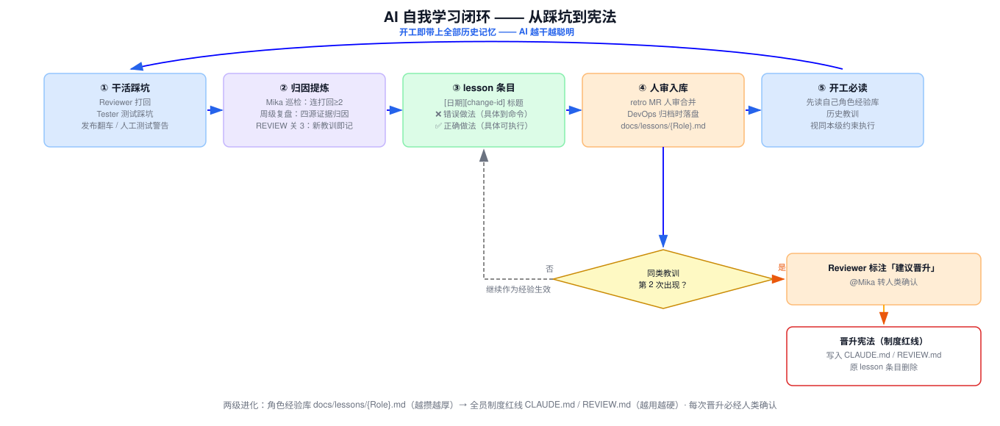

# 核心项举证材料：4.3 综合测试

# 测试分析报告

**（AI 多 Agent 编码 Harness 流水线交付质量体系）**

> 本材料按 GB8567-88《测试分析报告》模板编制，作为任职资格答辩核心项 4.3 综合测试的举证材料。被测对象：AI 多 Agent 编码流水线及其三道质量关体系。

| 项目 | 内容 |
|---|---|
| 行为模块 | 4、软件测试（权重 10%） |
| 行为要点 | 4.3 综合测试 **【核心项】** |
| 举证项目 | AI 多 Agent 编码 Harness 的设计与规模化落地 |
| 项目时间 | 2026 年 4 月至今 |
| 个人角色 | 测试体系设计者 |
| 编制日期 | 2026-11-07（V4 修订版） |

**行为标准原文**

> ①对疑难问题进行分类，对测试方式以及系统参数进行分析，形成问题解决技术资料，供开发测试人员参考使用。
> ②建立完善疑难问题库，可以使公司的项目组可以查询、借鉴、提交和解决新问题、共享经验、提高生产效率，实现快速开发模式。

---

## 1 引言

### 1.1 编写目的

本报告汇总 AI 编码流水线的测试体系设计、各质量关测试结果与发现、疑难问题分类归口及问题库机制，作为核心项 4.3 的举证材料。预期读者：评审评委、开发测试人员。

### 1.2 背景

- 被测系统：AI 编码体系（Harness V2 单会话阶段 → Multica 多 Agent 流水线阶段）交付的业务代码；本报告 T4 实例取自 V2 阶段（2026.06），Multica 阶段质量关配置与 V2 同源沿用（治理实物 2026.06.23 铺设后连续使用，Multica 阶段测试样本见 T6）；承载于 LIMS / QMS 服务端 / QMS 前端 / QMS SPC / ECQ / MDM 等 Java/Vue 系统，QMS 服务端达 120+ 业务模块、279 个 Mapper.xml；
- 任务提出者：集团 IT 部；开发者：IT 开发团队（本人主导测试体系设计）；测试执行：Tester agent + Reviewer agent + 人工测试（业务人员）；
- 测试环境为内网测试库（真实库表），与生产差异主要在数据量级，对功能测试结论无实质影响。

### 1.3 定义

TDD 强制门 / 异模型只读审查门 / 浏览器 QA 三档 / 疑难问题库（错题本）/ 四源采集——定义见各章。

### 1.4 参考资料

- standards/testing.md 测试规范——**骨架模板版**（新旧代码口径、mock 边界、浏览器 QA 三档等条款出处，`files/治理骨架模板/docs/standards/testing.md`）与 **QMS 仓库实铺版**（该仓库填充实例，`files/治理文件实物/standards/testing.md`）双版本归档
- REVIEW.md 审查关卡——骨架模板版（快审 4 关 + 全审 10 关，行数路由，`files/治理骨架模板/REVIEW.md`）；QMS 实铺版（2026.06 铺设时点早期简化版，`files/治理文件实物/REVIEW.md`）
- MDM PLM 继承接口实战记录（`files/实战记录/MDM-PLM继承接口/`）
- MDM 单元测试报告实例（`files/测试样本/MDM-单元测试实例/`）
- 疑难问题库实物（`files/疑难问题库/`：MDM-pitfalls.md 10 条 + LIMS-lessons/ 8 角色文件）

---

## 2 测试概要

| 测试标识符 | 测试内容 | 执行方式 | 结果摘要 |
|---|---|---|---|
| T1 | TDD 强制门（单元测试先行） | 自动门禁（tdd_enforcement: strict） | 无测试代码无法通过编码阶段 |
| T2 | 异模型只读审查门（清单式走查） | Reviewer agent，快审 4 关/全审 10 关 | MDM 实战拦截 3 个 Critical |
| T3 | 分级测试 + 浏览器 QA 门 | Tester agent，三档深度 | Quick 冒烟/Standard 验收/Exhaustive 发布 |
| T4 | 真实需求端到端综合测试（Harness V2 阶段） | MDM「PLM 继承接口」全周期（2026.06） | Tests run: 22, Failures: 0, BUILD SUCCESS |
| T5 | 人工测试周级复盘归因 | DocKeeper autopilot + 四源证据链 | 问题定位到责任环节并产出修正 |
| T6 | 真实单元测试运行验证（Multica 阶段） | MDM master 分支 5 个测试类实跑 | Tests run: 41, Failures: 0, BUILD SUCCESS |

与预定计划的差别：浏览器 QA 在浏览器基座（gstack）缺失时自动降级为代码走读+接口验证清单，不阻断——该降级设计为计划内预案。

---

## 3 测试结果及发现

### 3.1 测试 T1：TDD 强制门

**动态输出**：Developer 按 plan.md 单条目推进，每条目走完整红-绿-重构循环（先写测试且必须失败→最小实现恰好通过→重构不改行为）。`tdd_enforcement: strict` 配置下，跳步直接被 Reviewer 打回。

**发现**：AI 生成代码的"不爱写测试"倾向被门禁根治——测试从可选项变成闸门；DDL 人工门前置后，测试依赖真实库表而非 mock 幻觉（表结构先于编码存在：stage < 2 被 block，metadata `ddl_done` 置位才解锁）。

### 3.2 测试 T2：异模型只读审查门

**动态输出**：审查 agent 仅允许 Read/Glob/Grep + 只读 git（禁止 Edit/Write/构建命令），与开发 agent 异模型。快速审查 2 分钟 / 全量审查 15 分钟自动路由（改动 < 50 行无 SQL 走快审；≥ 50 行/含 SQL/涉分层/涉表结构走全审；涉保护路径加人工复核）。

**发现（MDM PLM 实战拦截实录，`files/实战记录/MDM-PLM继承接口/5.md`）**——审查修复 3 个 Critical：

1. 外部 jar `SpringBootCommon.getUsernumb()` 无 setter → 改用已有 `mdmViewAll_sh_auto`（零扩展零 hack）；
2. N_STATE 字段描述与实际语义失实 → 修正；
3. idList 参数语义不一致 → 统一。

### 3.3 测试 T3：分级测试 + 浏览器 QA 门

**动态输出**：与 aicoding-browser-qa 技能同源的分级标准——

- **三档深度**：Quick（critical+high，冒烟）/ Standard（+medium，change 级验收，缺省）/ Exhaustive（+low，发布前）；
- **severity 四级**：critical（阻断核心流程/数据丢失/崩溃）→ high（主要功能不可用无绕行）→ medium（可用有明显问题有绕行）→ low（外观小疵）；
- **问题七类**：Visual/UI、Functional、UX、Content、Performance、Console/Errors、Accessibility；
- **每页 8 步清单**：①视觉扫描 ②逐交互点击 ③表单（空提交/非法值/边界）④导航（进出/回退）⑤状态（空/加载/错误/溢出）⑥Console 新增错误 ⑦响应式 ⑧账号边界；
- **健康评分**：基线 100，critical −25 / high −10 / medium −4 / low −1，附 ship-readiness 结论；
- **环境阻塞判定**：验收点菜单不可见或接口报 SEC-00021 → 角色未绑定权限，属环境阻塞非缺陷——记「环境阻塞」节提醒发起人绑定，不进问题清单、不影响健康评分。

Quick 档实际执行报告实例归档 `files/测试样本/QA报告实例/QA报告-Quick档-实例.md`（商品码清洗 change，降级手测模式如实声明，报告字段与本节三档标准逐项对应——证明该标准在实战中被真实执行）。

### 3.4 测试 T4：真实需求端到端综合测试（MDM「物料工厂变体视图维护 PLM 继承接口」，Harness V2 阶段）

一个 7 层判断树的完整业务需求，从原始需求到 apply 完成的全周期 6 份记录（`files/实战记录/MDM-PLM继承接口/`）：

| 阶段 | 记录 | 结果 |
|---|---|---|
| 需求澄清 | 1.md 原始需求（7 层判断树）→ 2.md 现状映射（Entity/Mapper 字段对照、4 个决策点、3 项隐含风险）→ 3.md 人工答复 7 条业务规则 → 4.md 判断树定稿+事务边界 | 澄清充分后进入实施 |
| 编码与审查 | 5.md 规范层审查 | 修复 3 个 Critical（见 T2） |
| 测试与交付 | 6.md apply 总结 | 新增 7 文件（4 DTO+Service+Controller）、修改 6 个 Mapper（10 方法+9 段 XML）；**Tests run: 22, Failures: 0, BUILD SUCCESS**；5 条剩余风险明示 |

实施中测试技术问题解决实录：Lombok 对 cBtcode 生成的 getCBtcode 与 entity 命名冲突 → 手写 DTO 规避；@WebMvcTest 被 Redis 依赖链阻塞 → 降级纯 Mockito 切片测试——均记录为可复用教训。

### 3.5 测试 T5：人工测试周级复盘归因

每周一 08:23 autopilot 游标增量读取 `docs/human-test-reports/` 未读报告，对每个 ⚠️ 问题做**四源证据链**归因（人工测试报告 × MR diff × OpenSpec 工件 × test-report），逐一定位到责任环节，产出期报 + lesson 草案走 retro 分支 MR，人审合并即决策。报告由人类维护、agent 只读——"测试者只写现象、归因不下放"的约定不变。

### 3.6 测试 T6：真实单元测试运行验证（Multica 阶段样本，含系统运行参数分析）

**（a）测试样本实例**——从 MDM 仓库（`http://192.168.45.236/MDM/sunny-mdm.git`）master 分支取 5 个测试类真实运行（Maven + JDK 1.8），surefire 输出原文与测试源码归档于 `files/测试样本/MDM-单元测试实例/`：

| 测试类 | 对应 change | 阶段 | Tests run | Failures |
|---|---|---|---|---|
| PlmViewVariantServiceImplTest | PLM 继承接口（2026.06） | Harness V2 | 18 | 0 |
| PlmViewVariantControllerTest | 同上 | Harness V2 | 6 | 0 |
| MdmWlglControllerPlmWuliaoInsertTest | PLM 物料插入 | Harness V2 | 7 | 0 |
| MdmViewManagementAutoServiceImplTrimTest | 商品码清洗（2026.09，**测试由后续 change 按 TDD 口径补齐**，见下注） | Multica | 5 | 0 |
| MdmViewManagementServiceImplPriceMaskTest | 敏感字段掩码（2026.09） | Multica | 5 | 0 |
| **合计** | | | **41** | **0** |

> **TrimTest / PriceMaskTest 归属说明**：商品码清洗 change 本身按旧代码修改降级口径交付（tasks.md 4.1-4.5 为手工验证项，依 testing.md 旧代码修改降级条款执行，见归档 `files/实战记录/MDM-商品码清洗-Multica阶段/tasks.md`）；TrimTest / PriceMaskTest 为 2026.09 下旬后续 change 按 TDD 口径补充的自动化测试——体现"存量按降级口径、测试随后补齐"的规范执行实况（新旧代码口径条款正是骨架模板 testing.md 的设计内容）。

**BUILD SUCCESS**；当期实战记录（T4，2026.06）为 Tests 22/0，当前 master 上 PLM 相关测试 24 项——后续 change 按 TDD 口径只增不减，两代阶段测试全部通过。

**（b）系统运行参数分析**——流水线系统级参数的取值依据与稳定性结论（参数实物出处：openspec-config.yaml、编排配置、治理文档）：

| 参数 | 取值 | 分析结论 |
|---|---|---|
| Developer 并发实例数 | 5 | 写冲突概率随实例数上升，配合排他文件清单兜底——实测稳定上限；超出后冲突重试成本高于并行收益 |
| 兜底巡检周期 | 30 min | 事件通道丢失信号的最长自愈时间窗，与事件驱动秒级接力构成双通道；过短则空耗 token，过长则挂起任务滞留 |
| 连续失败升级阈值 | ≥2 次 | 允许一次瞬时失败自愈重试，第 2 次失败停手 @人——防无限重试烧 token 与错误放大 |
| 连续打回提炼阈值 | ≥2 次 | 同一 task 被打回 2 次判定为"教训曝光不足"，自动触发知识沉淀与晋升红线评估 |
| 快审/全审路由阈值 | 50 行 / 含 SQL / 涉分层 | 与审查时长（2 分钟/15 分钟）匹配的风险分级：小改动走 4 关快审降低成本，结构性改动走 10 关全审守住质量 |
| hotfix 补测时限 | 24 h | 紧急发布通道与"测试不降级"质量门的平衡点 |
| 对账/复盘 cron | 周一 08:17 / 08:23 | 与 */30min 巡检错峰，避免定时任务同点撞车 |
| 浏览器 QA 健康评分权重 | critical −25 / high −10 / medium −4 / low −1 | 严重度量化校准：一个 critical 即扣至 75 分（低于 ship 门槛阈值区），保证阻断级问题不被中低频问题稀释 |

---

## 4 对软件功能的结论

### 4.1 功能 1：AI 交付代码的质量保障

**能力**：三道质量关（TDD 强制门 / 异模型只读审查门 / 分级测试+浏览器 QA 门）经真实需求验证——单需求 22 项单元测试全部通过（Multica 阶段 41 项复跑全绿）、Critical 问题在审查环节即被拦截、审查结论置信度分级防止 AI 审查误判伤人（高置信 grep 可复现可作打回依据；低置信只列「可能——请人工验证」不得作为打回唯一依据）。

**限制**：存量老代码按降级口径处理（修改处手工验证+显式声明缺口，紧急 hotfix 24h 补测）；浏览器基座缺失时降级代码走读替代页面操作。

### 4.2 功能 2：疑难问题知识沉淀

**能力**：疑难问题四源分类归口（审查打回类 / 测试踩坑类 / 人工测试类 / 运行故障类）全部进入问题库；问题解决技术资料具体到命令级（❌/✅ 对照动作，拒绝空话式教训）。

**限制**：晋升红线必经人类确认，AI 不能自说自话改问题库（人审 MR 才入库）。

---

## 5 分析摘要（疑难问题库机制：行为标准②逐项映射）

### 5.1 能力：标准要求逐项映射

| 标准要求 | 机制落地 |
|---|---|
| **提交** | 四源采集：审查打回当场记录（REVIEW.md 关 3/关 9 强制关卡，非可选项）/ 测试踩坑记录（test-report 追加条目）/ 调度巡检对同一问题连续打回 ≥2 次自动提炼 / 周级复盘归因产出草案 |
| **入库把关** | 人审合并 MR 才入库——AI 不能自说自话改问题库；条目拒绝空话，必须具体到命令级：`[YYYY-MM-DD] [change-id] 一句话标题 + ❌ 错误做法（具体到命令/代码形态）+ ✅ 正确做法（具体可执行）` |
| **查询/借鉴** | 双维度检索：按**角色**分文件 `docs/lessons/{角色}.md`（8 角色文件 + index，LIMS 仓库实物随案归档 `files/疑难问题库/LIMS-lessons/`）；按**来源 change-id** 溯源（每条目必含 change-id，可反查 openspec/changes/ 工件与 MR）；按**日期**定位（条目必含 YYYY-MM-DD）。各角色**开工必读**，**历史教训视同本级约束执行**；审查抽查"读过了吗"（review-report 中引用条目编号） |
| **共享** | 全角色开放读取；读写分区矩阵（AGENTS.md §7）明确各角色读什么写什么；散落条目归档时统一落盘 |
| **提效/快速开发** | 同类教训第 2 次出现 = 曝光不足 → **自动晋升全员红线**写入宪法，原条目删除——同类坑组织级不再踩 |

**问题库规模统计（截至 2026.11，实物核对口径）**——**闭环率口径：闭环 = 完整闭环条数（原因分析+改善措施+改善结果+复验四要素齐备）/ 总条数 = 10/10 = 100%**（逐条台账见 `files/疑难问题库/MDM-pitfalls.md` 闭环台账节）：

- **疑难问题技术资料 10 条**：MDM 集成踩坑避坑指南（Superpowers / gstack / HyperSpec 集成实战，按"症状→原因→解决"组织），实物全文归档 `files/疑难问题库/MDM-pitfalls.md`（10 条可逐条翻核，典型条目如"TDD 与项目现状冲突：src/test 目录不存在→先建测试骨架再按 TDD 推进""9 关审查一次都过不了：proposal 拆错宁可废弃重开不要硬补"）；
- **经教训晋升机制固化全员红线 6 项**：ddl.sql 平铺约束、Windows GBK 传参铁律、MyBatis Map key 大小写、BaseEntity 漏继承、OpenFeign 丢 Header、PageHelper 线程泄漏。实物分布——ddl.sql 平铺约束条款在 LIMS 仓库 `docs/standards/database.md`（实铺详单逐字在案）、MyBatis Map key 大小写（`MapKeyUpperWrapper` 强制 key 大写）与 PageHelper 平台封装（禁止用 com.github.pagehelper 默认实现）条款在 QMS 实铺版 `standards/mybatis.md`（归档 `files/治理文件实物/`）、GBK 传参铁律固化于建区脚手架 `@文件` 传参实现（multica_call.py）；BaseEntity 漏继承、OpenFeign 丢 Header 源自 MDM 实战踩坑记录，随 lessons 机制在各仓库角色文件累积；
- **lessons 角色文件机制实物**：LIMS 仓库 `docs/lessons/{角色}.md` 8 文件（Developer / DevOps / DocKeeper / PM / Prototyper / Reviewer / Tech-Lead / Tester）已随案归档 `files/疑难问题库/LIMS-lessons/`——其中 Prototyper 角色 7 条实录条目（2026-10，dev server 端口拒连 / 热更新 500 / ux-grid 插槽铁律 / 无头浏览器验证等）为机制实际运行的实例，其余角色文件为机制铺设初期的空模板（条目随踩坑持续追加）。

已沉淀的典型问题解决技术资料（供开发测试人员参考）：ddl.sql 平铺约束（跳板机受限 SQL 入口只认平铺语句）、Windows GBK 乱码（代码页根因 + `@文件` 传参铁律）、MyBatis Map key 大小写、BaseEntity 漏继承、OpenFeign 丢 Header、PageHelper 线程泄漏、集成工具链坑点（TDD 目录骨架 / 审查粒度 / 并发 git 冲突等 10 条，见归档 pitfalls.md）等。

### 5.2 缺陷和限制

存量仓库历史缺口按风险列表声明（哪层没测=什么风险），不粉饰、不一次性追溯；低置信审查结论依赖人工复核闭环。

### 5.3 建议

新仓库从第一天走 harness 流程即无存量缺口问题（TDD 不降级）；存量仓库按模块分批补测。

### 5.4 评价

进化闭环（四源采集 → 人审入库 → 开工必读视同约束 → 同类第 2 次晋升红线、每次晋升必经人类确认）实现"错题本越攒越厚、制度红线越用越硬"，达到设计目标，支撑快速开发模式。

### 5.5 进化闭环图示

```
四源采集 → 人审入库 → 开工必读（视同约束）→ 同类第2次晋升红线
     ↑__________________________________________|
              经验库越攒越厚，制度红线越用越硬
```



---

## 6 测试资源消耗

- 审查资源：快速审查 2 分钟 / 全量审查 15 分钟（自动路由，无需人工走查）；
- 浏览器 QA：三档分级使测试投入与需求风险匹配（Quick 冒烟分钟级 / Exhaustive 发布前全量）；
- 单元测试：5 个测试类 41 项合计约 2.5 秒（surefire 实测），CI 侧零成本；
- 人力占用：人工测试报告撰写（业务人员）+ 周级复盘由 DocKeeper agent 自动执行，归因分析不再消耗开发人力。

## 7 证据物清单

- 测试规范全文——骨架模板版 standards/testing.md（新旧口径 / mock 边界 / 浏览器 QA 三档标准等条款出处，`files/治理骨架模板/docs/standards/`）+ QMS 仓库实铺版（`files/治理文件实物/standards/testing.md`）
- 审查关卡清单——骨架模板版 REVIEW.md（quick 4 关 + full 10 关全文，`files/治理骨架模板/`）；QMS 实铺版早期简化变体（`files/治理文件实物/`）
- MDM 实战全周期 6 份记录（`files/实战记录/MDM-PLM继承接口/`，含 Tests run: 22 证据）
- **单元测试报告实例**（`files/测试样本/MDM-单元测试实例/`：5 个测试类 surefire 输出原文 + 2 个测试类源码副本，Tests 41/0 + BUILD SUCCESS）
- **疑难问题库实物**（`files/疑难问题库/`：MDM-pitfalls.md 10 条全文 + 闭环台账节（发现时间/原因/措施/结果/复验/闭环状态六字段，闭环率 10/10）；LIMS-lessons/ 8 角色文件——原 `docs/harness/pitfalls.md` 与 LIMS 仓库 `docs/lessons/` 均为内网 GitLab 仓库实物的随案归档副本）
- 浏览器 QA 技能与人工测试复盘技能（源码见项目仓库 `skills/`）；浏览器 QA 报告实例（Quick 档，`files/测试样本/QA报告实例/`）

## 8 个人贡献声明

本行为要点项下的测试体系设计（三道质量关、新旧代码口径、分级 QA 标准）、疑难问题四源分类、疑难问题库机制设计与落地，由本人主导完成。
