# 任职资格答辩报告

| 项目 | 内容 |
|---|---|
| 姓　　名 | 翁金林 |
| 公　　司 | 舜宇光学科技 |
| 认证岗位 | 软件开发 |
| 认证等级 | 高级工程师 |
| 日　　期 | 2026 年 11 月 |

---

# 一、个人简介

## 个人信息

| 个人信息 |         | |            |
|---|---------|---|------------|
| 学　历 | 本科      | 所学专业 | 计算机科学与技术   |
| 毕业院校 | 温州大学城市学院 | 入职时间 | 2018/04/18 |
| 参评人员类型 | 常规申请    | 现聘任专业 | 软件       |
| 现聘任等级 | 工程师     | 现聘任等级开始时间 | 2023/07/01 |
| 现职级 | 13      | |            |

## 近三年绩效考核

| 年度 | 考核结果 |
|---|------|
| 2025 | B+   |
| 2024 | B    |
| 2023 | B+   |

## 工作经历

| 工作经历          | |          | | |
|---------------|---|----------|---|---|
| **时间**        | **公司** | **部门**   | **岗位** | **工作特长** |
| 2018/04/18—至今 | 舜宇光学科技 | 流程与信息技术部 | 软件开发 | Java 后端开发 / AI 辅助研发效能建设 |

## 近三年主要荣誉

获取 MDM 系统的软件著作权 1 项
获取 QMS 系统的软件著作权 1 项

---

# 二、认证周期内主要业绩成果概述

## 行为模块涉及情况

| 行为模块 1：需求分析 | 行为模块 2：软件设计 | 行为模块 3：软件实现 | 行为模块 4：软件测试 | 行为模块 6：导入/运行维护 | 模块涉及数量 |
|---|---|---|---|---|---|
| **涉及** | **涉及** | **涉及** | **涉及** | **涉及** | **5** |

## 行为要点明细

> 加粗 ◆ 标示的行为要点为核心项。核心项举证材料按国家标准模板重新编制，见本 V5 目录。

| 序号 | 行为模块 | 行为要点 | 项目/业绩主题 | 角色 | 时间 | 个人贡献 |
|---|---|---|---|---|---|---|
| 1 | 需求分析 | 1.1 需求调研 | AI 编码 Harness 建设前期技术调研 | 主导 | 2026.04—2026.05 | 完成 agent CLI 生态扫描（Multica 平台支持 26 种 agent CLI）；重点完成 Claude Code / OpenSpec / superpowers / Multica 核心组件选型调研，整理成选型技术文档并在团队内分享（归档 `files/调研选型/agent CLI生态扫描与核心组件选型报告.md`） |
| 2 | 需求分析 | **1.2 需求分析 ◆** | AI 多 Agent 编码 Harness 的设计与规模化落地 | 项目发起人、总体设计 | 2026.04 至今 | 根因评估三大痛点、五层体系架构规划、"6 脚手架 + 8 技能 + 1 治理层"任务分解与多方案比选，提出组合式创新方案 |
| 3 | 软件设计 | **2.1 概要设计 ◆** | 同上 | 架构设计负责人 | 2026.05—2026.10 | 设计五阶段链功能流程、人机交互界面框架与评审用例、四项关键技术事前论证、五层结构设计与模块划分，输出技术文档 6 篇与架构图 18 张（四代演进全覆盖） |
| 4 | 软件设计 | 2.2 详细设计 | 同上 | 架构设计负责人 | 2026.06—2026.10 | 完成中大型多 Agent 系统架构设计（Harness V1→V2→Agent Team→Multica 平台化四代演进），治理骨架已在 6 个业务系统仓库复用铺设，具备跨团队借鉴条件 |
| 5 | 软件实现 | **3.1 规范编写 ◆** | 机器可执行软件规范库建设 | 规范体系牵头人 | 2026.06 至今 | 主导编制覆盖编码、数据库、测试、部署、维护全维度的四级规范库（项目宪法 16 节 / 协作总纲 8 节 / 审查关卡 4+10 关 / 技术详单骨架三篇 + 各仓库实铺扩充），配套三重强制执行机制，已在公司 IT 多个业务系统仓库铺设沿用 |
| 6 | 软件实现 | 3.2 构成管理 | AI 编码技术路线规划 | 技术路线负责人 | 2026.04 至今 | 规划"Multica + Claude Code + OpenSpec + superpowers"组合技术路线并分阶段推进；多 agent CLI 适配（opencode/Qwen/Trae）探索；定期输出技术报告与团队分享 |
| 7 | 软件实现 | 3.3 代码编写 | 编排 / SDD / TDD 三大核心机制实现 | 核心机制设计实现 | 2026.05—2026.10 | 设计并实现事件驱动编排信号、OpenSpec 工件链双 strict 门禁、TDD 微循环、写入拦截硬约束等核心框架；整理 AI 代码审查质量问题提交处理；提出模型分级路由等提效革新 |
| 8 | 软件测试 | **4.3 综合测试 ◆** | 三道质量关与 AI 疑难问题库 | 测试体系设计者 | 2026.06 至今 | 设计三道质量关（TDD 强制门 / 异模型只读审查 / 分级测试+浏览器 QA）；建立疑难问题四源采集与错题本机制，同类问题第二次出现自动晋升全员红线 |
| 9 | 导入/运行维护 | **6.1 系统导入 ◆** | 一键建区部署导入与规模化推广 | 部署方案设计者 | 2026.08 至今 | 评估自托管部署方案并编写一键建区导入方案（幂等、断点续传）；部署指导与问题解决；五层性能瓶颈定位与调优；建立导入后运行维护机制 |

## 简述重点业绩

### 业绩一：从 0 到 1 建成 AI 多 Agent 编码流水线并规模化落地（主业绩，含规范库与疑难问题库体系）

> **白话**：给公司建了一条"AI 软件生产流水线"——7 个 AI 分工接力干开发，人只审两道关；配套"AI 违反不了的规范库"（以前靠自觉，现在开工必读、程序拦截、关卡校验三重强制）和"越用越聪明的错题本"（踩过的坑全公司共享，同类坑第 2 次出现自动升级全员红线）。已在本部门 6 个业务系统天天在用。

- **业绩来源**：公司 IT 开发的现实痛点（AI 工具零散使用收益碎片化、开发人力瓶颈、质量与规范失控）与本人主动发现的技术突破口。
- **难点/技术点**：① 7 个 AI 接力怎么不出乱子（状态一致性、交接延迟、失败恢复）；② AI 写的代码怎么可信（AI 不爱写测试、AI 审 AI 可能互相包庇、文档与代码两张皮）；③ 规范怎么不靠自觉（提示词可被绕过——规范要从"参考文档"变成"物理可执行的制度"，且随仓库实况不漂移、随使用自我进化）；④ 踩过的坑怎么不重复踩（经验只散落个人会话，不沉淀、不进化）。
- **过程简述**：三步走——先小范围试点验证可行 → 再把方法固化成制度（治理+技能+硬约束）→ 最后做成平台推广到 6 个系统；四代架构迭代（详见第三章 A0 演化总览）。体系三大组成：**① 流水线主线**（五阶段链 + 人工两门 + 旁路自愈）；**② 机器可执行规范库**（两级结构"红线一句话进宪法、详单进 standards/"，16 项占位符全部要求代码证据填充，三重强制执行：开工必读/PreToolUse 程序拦截/关卡校验，防漂移双保险 + 教训晋升红线进化机制）；**③ AI 疑难问题库**（四源采集：审查打回/测试踩坑/发布踩坑/人工测试复盘 → 条目具体到命令级（❌/✅ 对照）→ 人审 MR 入库 → 各角色开工必读视同本级约束 → 同类第 2 次出现自动晋升全员红线）。
- **价值贡献**：小需求端到端约 30 分钟、bugfix 约 20 分钟、中大需求 30-60 分钟交付，已在 LIMS、QMS（服务端/前端/SPC）、ECQ、MDM 六个业务系统实战开发应用（GitLab 仓库地址与 MR 合并时间戳凭证见 `files/凭证/MR时间戳凭证-GitLab合并记录.md`）；保护路径写入默认拦截 + 编排器受控通道（`HARNESS_ALLOW_WRITE=1` 仅受控流程可用，stdin 异常保守放行有日志可查），日常运行零违反，新仓库全套规范铺设约半日；已沉淀疑难问题技术资料 10 条（MDM 集成踩坑避坑指南，实物归档 `files/疑难问题库/MDM-pitfalls.md`），其中 6 项晋升为全员红线，LIMS 仓库 8 角色错题本文件随案归档（`files/疑难问题库/LIMS-lessons/`）。
- **专业影响力**：详见下文典型项目举证（规范库对应核心项 3.1、疑难问题库对应核心项 4.3，举证材料已按国标模板独立成册）。

### 业绩二：QMS 检验数据转换器——从第三方定制开发到自研配置化引擎（2024.03 至今）

> **白话**：以前每接一种检验设备，就要找第三方定制开发一个转换器，平均一周才能交付；现在自研的配置型转换引擎半小时到一小时配好即上线——334 种设备格式已全部由公司自研系统承接。

- **业绩来源**：检验设备数据格式碎片化——ZYGO 干涉仪、Micro-vu/尼康/天准/OGP 影像测量仪、DAGE 推拉力机、电测/阻抗设备等各导各的文件（列布局、指标编码、文件形态互不相同）；原有模式为**每一种设备单独定制开发一个转换器，且由第三方开发交付，平均开发周期约一周**——接入慢、依赖外部供应商、需求变更不自主。
- **难点/技术点**：① 格式千差万别如何不写死代码——设计**配置驱动的解析引擎**（12 张配置表：主配置 + 列映射明细 + JSON 扩展配置 + K10/K20/K00 标准数据段分层配置），新设备接入从"第三方定制开发"变为"自研系统上填配置"；② 指标校验与编码转换（原始测量值 → 标准指标编码，含数据校验/标准指标校验/限定指标校验三级）；③ 光电等特殊设备专用转换器（2910 行）与三类特殊格式执行器，兜住配置覆盖不了的长尾格式；④ 三通道接入（Kafka + S3 自动消费链路 / 页面上传 / 批量文件）全程日志留痕、源文件 S3 归档可追溯。
- **过程简述**：2024.03 首批检验数据自动入库上线；本人自 2024.05 起主导模块化重构与持续演进（git 历史核实：模块累计 92 次提交中本人 82 次、占 89%，代码约 1.13 万行，演进持续至 2026.09），将"一设备一开发"的第三方定制模式改造为"一设备一配置"的自研配置化引擎，累计长成 337 套配置、334 种设备格式。
- **价值贡献**（正式库实测，截至 2026.11.09）：① **接入效率**——单个转换器接入从第三方定制开发**约 1 周**缩短为自研系统配置**0.5~1 小时**，提升数十倍；② **自主可控**——334 种设备格式全部经自研系统配置上线，按旧模式需约 334 人周的第三方定制开发，现已完全自主承接，且需求变更即时改配置生效；③ **稳定运行实证**——累计自动解析入库 **121,954 条**检验原始数据、关联 **54,509 张**检验单，2024.03—2026.11 连续 32 个月运行、月均约 3,700 条；④ 数据直采自设备原始文件（源文件 S3 留档可追溯），杜绝转录差错，覆盖 IQC（来料）/制程/OQC（出货）/LAB/首件 FAI/SPC/标准件点检全质检环节。
- **专业影响力**：转换器已成为 QMS 检验数据入口的标准基础设施——测量设备覆盖 ZYGO、Micro-vu、尼康、天准、沃顿、美细耐斯、基恩士、TDK、三星马达、Luphoscan、OGP、DAGE 等数十种品牌型号；"配置驱动归一 + 自主承接"模式可直接复制到公司其他设备数据采集场景。

### 业绩三：MDM 物料视图引擎——12 类视图 × 62 个组织维度的元数据驱动配置化呈现（2024.05 至今）

> **白话**：物料主数据有十几类视图（基本/分类/计划/MRP/采购/销售/成本/会计……），而且每个工厂要看的字段还不一样；这套引擎把"视图有哪些字段、怎么显示"全部做成可配置——12 类视图 × 62 个组织维度、586 套视图方案、9,762 条字段配置在线运行，调整字段不用改代码。

- **业绩来源**：物料主数据信息维度多（基本/分类/会计/非SAP/成本/销售/计划/采购/MRP/MRP区域/细分/变体共 12 类视图），且不同工厂/组织关注的字段集不同——若按"每视图每组织写死一套页面字段"的常规做法，组合数爆炸，且字段一变就要改前后端代码发版。
- **难点/技术点**：① 视图形态如何与代码解耦——**元数据驱动**：视图方案表（视图类型 × 组织维度 × 版本）+ 字段配置明细（字段名/显示名/显隐/必填/默认值/字段类型/关联字典/可搜索/排序），前端按配置动态渲染物料视图；② 多维差异化——同一视图类型在不同组织维度下配置不同字段集，支持同维度多方案并存（销售视图双方案、细分视图多版本）与按工厂差异化的字段配置；③ 12 张视图数据表 + 汇总表统一治理，通用查询/保存链路按方案动态路由；④ 配套 Excel 批量导入链路（含导入数据清洗）。
- **过程简述**：2024.05 立项，本人主导设计开发与持续演进至今（git 核实：模块累计 290 次提交中本人 277 次、占 95.5%，代码 20,569 行，2024.05—2026.11 持续迭代）。
- **价值贡献**（正式库实测，截至 2026.11.09）：① **配置化规模实证**——12 类视图 × 62 个组织维度，586 套视图方案、9,762 条字段配置全部在线运行；物料视图字段调整零代码、配置即时生效，新增工厂维度走配置化路径；② **承载规模**——模块承载物料视图数据 4,972,413 条，为公司主数据平台核心数据资产；③ Excel 批量导入链路支撑大批量维护入口。
- **专业影响力**：元数据驱动的视图配置能力已成为 MDM 平台的标准基础设施；该模式可直接复制到公司其他主数据/档案类系统的列表与表单配置场景。

---

# 三、典型项目/关键事件举证

## 主题：从"辅助工具"到"开发流水线"——AI 多 Agent 编码 Harness 的设计与规模化落地

> **一句话讲清这个项目**：给公司 IT 建了一条"AI 软件生产流水线"——7 个 AI 分工接力干开发（产品→设计→拆解→编码→测试→交付），人只在两个关键关口拍板。已在本部门 6 个业务系统天天在用，小需求从"按天排期"变成"约 30 分钟"。

**先看懂这张图（评审阅读指引）**

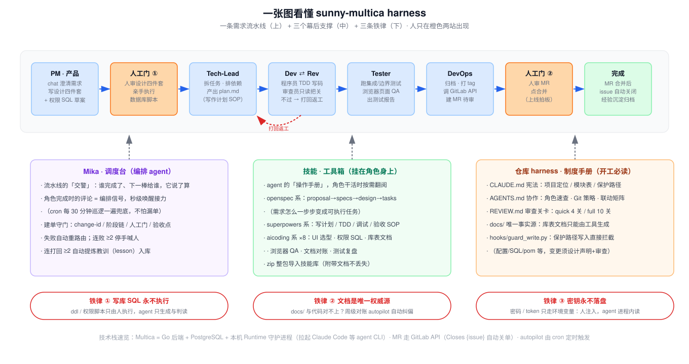

> 上半部分是流水线主线：需求从左侧进入，AI 各角色接力，**人只在橙色两站出现**（审设计、审最终代码）；下半部分是三条铁律（先图纸后施工 / 考试不过不出厂 / 碰红线直接拦截）。

**术语白话对照表（非本专业评委参考）**

| 报告术语 | 白话解释 |
|---|---|
| 多 Agent（7 角色） | 流水线上的 7 个"AI 工人"，各管一道工序（产品、设计、排产、开发、审查、测试、归档） |
| Harness | 直译"马具/缰绳"——管住 AI 的整套制度＋工具，让 AI 能干但不乱干 |
| 编排 | 车间调度：谁先干、谁接力、出错找谁，全部自动衔接 |
| SDD（规格驱动） | **先画图纸再施工**：设计文档没审过，不许写代码；图纸和房子永远一致 |
| TDD（测试驱动） | **先出考卷再答题**：考题（测试）先定，答不对不算完成，杜绝"AI 说写好了其实没写对" |
| 硬约束 | **保险丝**：AI 一碰红线文件（数据库、配置），程序直接"断电"拦下，不靠自觉 |
| 错题本（疑难问题库） | AI 踩过的坑记下来全公司共享，同类坑第 2 次出现就升级为全员红线 |
| MR（合并请求） | 代码进入正式系统的"交作业"动作，GitLab 留有不可篡改的时间戳，可当证据 |

### S - 情境：2026 年初的六个现实问题

| # | 现实问题 | 白话描述 |
|---|---|---|
| ① | **AI 工具零散使用** | 同事们各用各的 Copilot/ChatGPT 做补全——像"每人请了个私人助理"，效率提升零碎、经验不共享，AI 没有变成公司级生产力 |
| ② | **开发人力瓶颈** | IT 需求持续积压，加人加班已到顶——瓶颈不在人不够努力，在"一件事必须人从头干到尾"的模式本身 |
| ③ | **需求沟通链路长、落地易漂移** | 需求从业务端到开发端多手转述，像"传话游戏"——每传一层损耗一分，落地结果与最初诉求漂移；验收时才发现"做的不是想要的"，返工与扯皮成本高 |
| ④ | **需求澄清与实现试错成本高** | 需求理解偏差往往到开发后期才暴露，一轮试错就是一轮返工；实现方案的探索试错同样昂贵——技术方向选错，编码、测试全部白做 |
| ⑤ | **知识沉淀散落、无法自我进化** | 踩坑经验散落在个人脑子和聊天记录里——人走了经验就带走了；同样的坑不同的人反复踩，组织没有"越用越聪明"的积累机制 |
| ⑥ | **需求澄清与开发规范落地参差** | 集团虽有制式规格文档，但需求澄清的深度与规范的执行全凭开发人员个人水平——文档写了是一回事、代码写成什么样是另一回事，交付质量随人员水平波动 |

**问题 → 项目价值主张（对症下药）**

| 现实问题 | 本项目的价值主张 |
|---|---|
| ① AI 工具零散 | AI 从"个人补全"升级为**流程级全流程承接**（五阶段链接力） |
| ② 人力瓶颈 | AI **角色化分工**执行全流程，人只握两个决策门——产能不再受"人从头干到尾"的限制 |
| ③ 链路长易漂移 | **SDD 四工件 + 规格实现单态**——先图纸后施工：需求理解一次对齐成规格，规格与代码永远一致（sync-specs 回写），漂移在源头被掐断 |
| ④ 试错成本高 | **chat 双向澄清 + G1 人工门前置**——理解偏差在写代码之前暴露并消化，试错成本从"返工一轮"降到"改一段对话" |
| ⑤ 知识不进化 | **docs/ 知识字典 + lessons 错题本 + 教训晋升红线**——经验组织化沉淀、开工必读，同类坑第 2 次出现自动升级全员红线，组织越用越聪明 |
| ⑥ 规范参差 | **机器可执行规范库**——制式规格固化为开工必读/程序拦截/关卡校验，执行不依赖个人水平，谁来做都一样 |

**我对共同根因的判断：开发模式本身没有变。** 沟通靠口头转述、规范靠个人自觉、知识靠个人脑子、产能靠人肉串行——单点辅助式 AI 的天花板很低，突破口不是"用好一个 AI 工具"，而是建一条**可管、可控、可审计的 AI 开发流水线**——AI 承接全流程执行，人类只握关键决策。

### T - 任务：目标与四大难题

**目标一句话：AI 干活、人拍板**——人从"执行者"变为"决策者"。要实现它，必须解决四个难题：

| 四大难题 | 白话版 | 对应实现重难点 |
|---|---|---|
| 🔀 编排 | 7 个 AI 工人怎么交接班？谁活干砸了怎么补救？ | 重难点 ① |
| 🧐 质量 | AI 写的代码谁审？AI 审 AI 会不会"互相包庇"？ | 重难点 ② ③ ⑤ |
| 📚 知识 | 老员工踩过的坑，新来的 AI 怎么学会不再踩？ | 重难点 ② ⑤ |
| 🔐 安全 | 密码怎么管？AI 手痒乱改数据库配置怎么办？ | 重难点 ④ |

### A - 行动：三步演化 × 四代架构 × 五个重难点

#### A0 演化总览（真实时间线）

**三步走：小步快跑，每步验证可行再前进**

| 步 | 时间 | 阶段 | 做了什么 / 验证了什么                                                                                                                                                                                                      |
|---|---|---|-------------------------------------------------------------------------------------------------------------------------------------------------------------------------------------------------------------------|
| 第一步 | 2026.04—05 | **单会话试点** | 调研多种 AI 编码工具、选定 4 个核心组件（Claude Code / OpenSpec / superpowers ）；用"先图纸后施工 + 先考卷后答题"最小闭环在项目上跑通——04 月 MDM 仓库 2 个 change 工件 + 2 个 MR（04-01 / 04-10） |
| 第二步 | 2026.06—07 | **制度化（V1→V2→多 Agent）** | 6 月一个月内三次架构升级：实战方法手册（06.03 四条核心原则）→ 四层工具链（06.09）→ V2 七层架构 + 12 检查点（06.10）→ 多 Agent 真并行架构（06.17，论证"单会话并行是假并行"）；06.23-24 在 QMS（全套治理落地）/ MDM（PLM 继承接口全周期交付）实战验证；07 月能力打包 + 多 CLI 适配（opencode/Qwen）              |
| 第三步 | 2026.08—10 | **平台化推广（Multica）** | 做成多 Agent 半托管流水线（6 脚手架 + 8 技能），推广六个业务系统——Multica 阶段 MDM 6 个 MR（08-04 ~ 11-05），典型 change 归档 `MDM-商品码清洗-Multica阶段`（分支产出 09-21，MR 合并 09-24）                                                               |

**四代架构演进：每代解决上一代的结构性瓶颈**

| 代 | 形态 | 解决的瓶颈 |
|---|---|---|
| V1 | 方法手册（四条核心原则） | 把个人经验变成可传授的方法 |
| V2 | 七层架构 + 12 检查点 | 把方法变成制度化的流程与门禁 |
| Agent Team | 外部编排器 + 8 进程真并行 | 解决单会话"伪并行"，多需求同时干（见下图） |
| Multica 平台化 | 半托管流水线 | 解决复制推广成本：新仓库接入 4-6 天 → 半日 |

#### A1 调研选型与体系规划 ｜ 行为要点 1.1 · 1.2 ◆

对六个现实问题逐一做根因评估，确认本质需求：AI 零散使用需要**流程级**承接而非工具级辅助；人手不够需要 AI **角色化分工**承接全流程；链路漂移与试错成本需要**规格驱动（SDD）+ 澄清前置**对齐口径；知识散落需要**组织化沉淀与自我进化**机制；质量不稳与规范参差需要**机器可执行**的规范与审查体系——每条对应 S 节"问题→价值主张"映射逐项落地。

多方案比选：

| 方案 | 评估 | 结论 |
|---|---|---|
| A. 深化 Copilot 类补全 | 不改开发模式，收益天花板低 | ✗ |
| B. 自研多 Agent 平台 | 开发量以年计，IT 无专职平台团队 | ✗ |
| **C. Multica + Claude Code + OpenSpec** | 复用成熟件，自研面压缩到"编排+治理+技能"薄层 | **✓** |

结合公司现状的关键考量：全部组件开源自托管、数据不出公司（信息安全合规）；公司技术栈为传统 Java/Vue 单体，治理层按仓库实际代码证据定制，不引入重平台改造。正因为选对路线，这套体系得以在半年内建成落地。

体系架构规划为五层（Multica 平台层 → 编排层 → 角色 agent 层 → 技能层 → 目标仓库治理层），任务分解为"6 脚手架 + 8 技能 + 1 治理层"实物清单（skills 与 bootstrap 全部源码见项目仓库 `skills/`、`bootstrap/` 目录，说明文档 `sunny-multica-skills_README.md`）。

> 核心项 1.2 的完整举证（含行为标准逐条映射、证据物清单）见 `核心项举证-1.2需求分析-软件需求说明书.md`（按 GB856T-88 软件需求说明书模板编制）。

#### A2 软件设计：整体架构与流程生命周期 ｜ 行为要点 2.1 ◆ · 2.2

**① 五层结构设计（总体架构）**

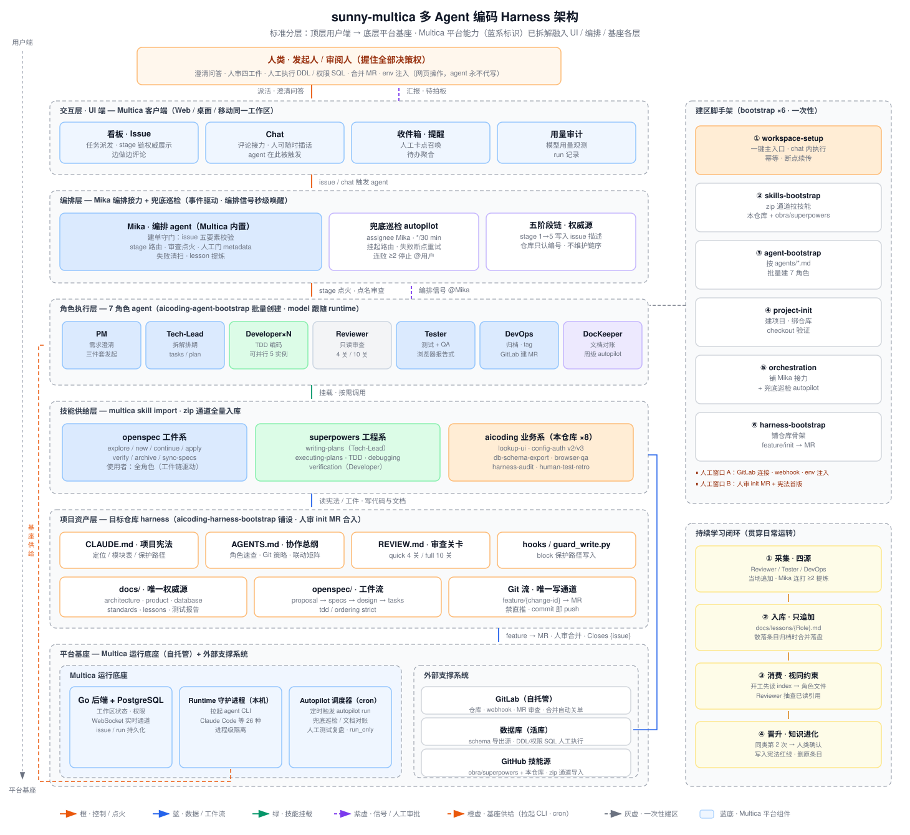

| 层 | 白话职责 |
|---|---|
| UI 交互层（Multica） | 人机界面：提需求、看进度、审结果的"驾驶舱" |
| 编排层 | 车间调度：安排 7 个 AI 谁先干、谁接力 |
| 角色 agent 层 | 干活的 AI 工人：产品/设计/排产/开发/审查/测试各司其职 |
| 技能层 | AI 的"工具箱"：库表导出、SQL 生成、浏览器验证等 8 项技能 |
| 目标仓库治理层 | 每个系统仓库里的"厂规"（宪法/审查关卡/红线）——结构权威源，可对齐铺设到公司任意仓库 |

**② 人机界面：一句话提需求，缺信息会被打回**

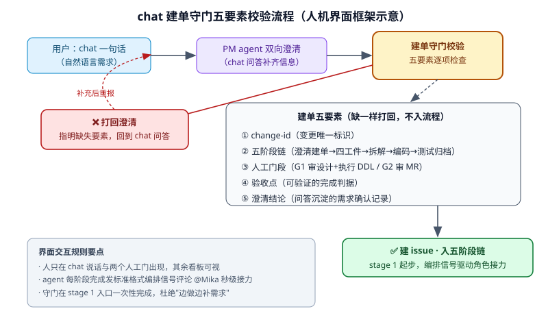

> 用户用一句话提需求，AI 产品经理像真人一样追问补齐信息；建单前过"五要素校验"（变更标识/流程段/人工门/验收点/澄清结论），缺一样就打回——防止模糊需求直接进流水线。

**③ 流程生命周期——一个需求（change）的一生**

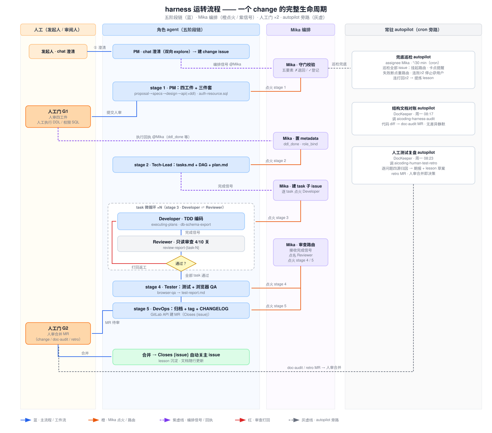

> 五阶段链：**澄清建单 → 四工件设计 → 拆解 → 编码微循环 → 测试 → 归档 MR**。全流程**人只出现两次**（G1 审设计 + 执行数据库脚本 / G2 审最终代码），其余全程 AI 接力、边做边汇报；另有三条自动巡检兜底（30 分钟兜底巡检 / 每周文档对账 / 每周测试复盘）。

**④ 四项关键技术事前论证**（开发前逐一验证可行，全部通过才进入实施）

| 技术 | 白话解释 | 论证结论 |
|---|---|---|
| 事件驱动编排信号 | AI 干完活发一条"完成评论"，下游秒级被唤醒（不等轮询） | ✓ 可行 |
| 写入拦截（PreToolUse 钩子） | 在 AI 动文件前插一道程序关卡，红线文件直接拦下 | ✓ 可行 |
| 工件顺序强制（ordering: strict） | 设计文档没写完，程序不允许开始写代码 | ✓ 可行 |
| 模型分级路由 | 简单工序用小模型（省钱）、关键工序用大模型（保质量） | ✓ 可行 |

> 核心项 2.1 的完整举证见 `核心项举证-2.1概要设计-概要设计说明书.md`（按 GB8567-88 概要设计说明书模板编制）。

#### A3 软件实现：五个重难点 ｜ 行为要点 3.3 · 3.2

**实现① 编排——白话：7 个 AI 工人怎么"交接班"不出乱子**

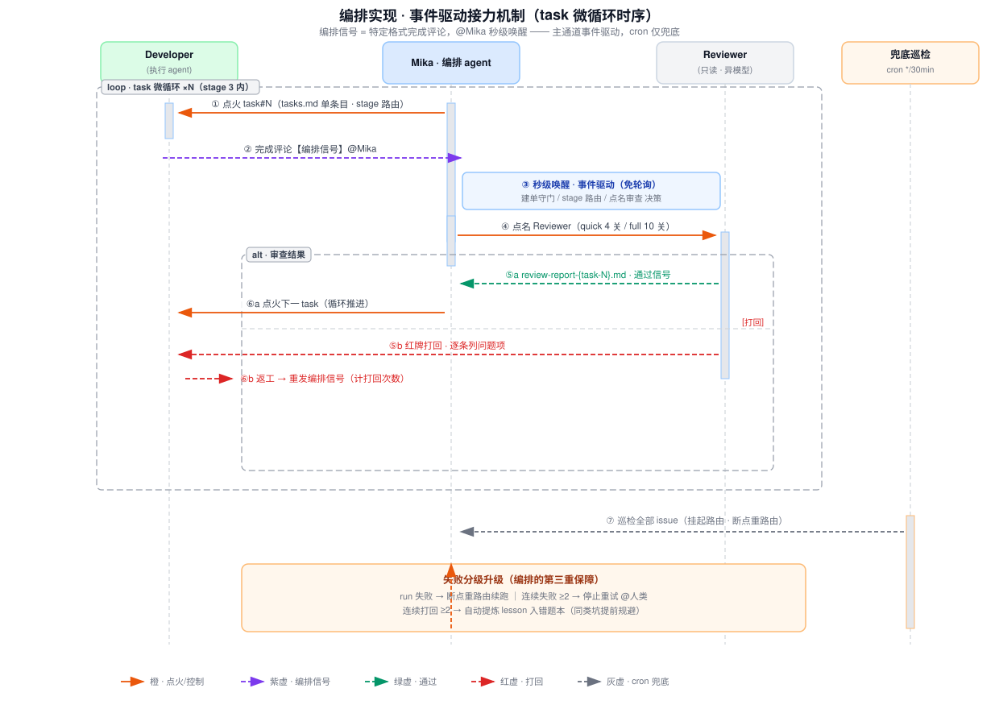

- 问题：7 角色松耦合接力 = 分布式系统三大难（状态一致性 / 接力延迟 / 失败恢复）。
- 方案：上一个 AI 干完活发一条"完成评论"，下一个**秒级被唤醒**（不轮询等待）；每个需求只有一份"生产任务单"（issue 描述）作为唯一权威源，谁都不会拿错版本；再加事件 + 定时双通道自动巡检兜底。
- 突破：交接延迟从分钟级降至秒级；失败分级升级——AI 连败 2 次才找人，被连续打回 2 次就转知识沉淀，**人只在真正需要决策时被召唤**。

**实现② SDD——白话：先画图纸再施工，图纸和房子永远一致**

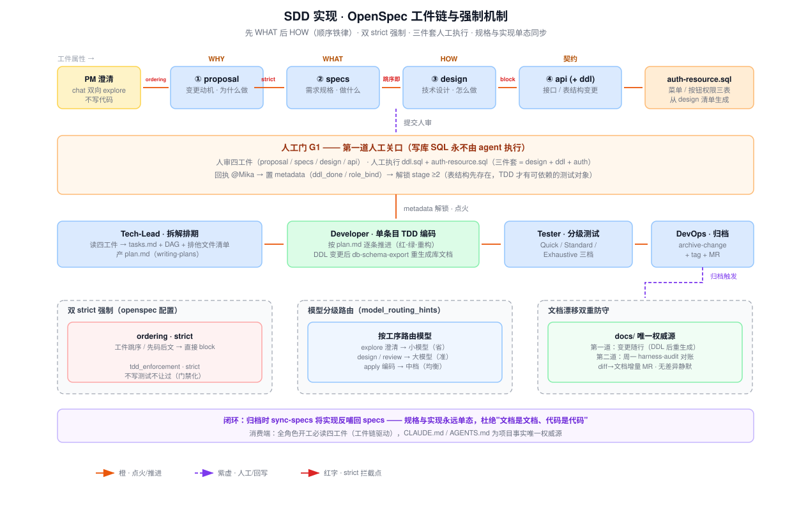

- 问题：AI 三个天然缺陷——先写代码后补文档、需求和实现混在一起、文档与代码"两张皮"越走越远。
- 方案：`proposal→specs→design→api` 四份图纸**按顺序产出，跳序直接被程序拦下**；数据库脚本等高危动作由人工执行；代码合入后规格自动回写。
- 突破：规格与实现永远单态（一个真相）；库表文档由工具统一生成 + 每周对账双重防守，不再漂移。

**实现③ TDD——白话：先出考卷再答题，考试不过不出厂**

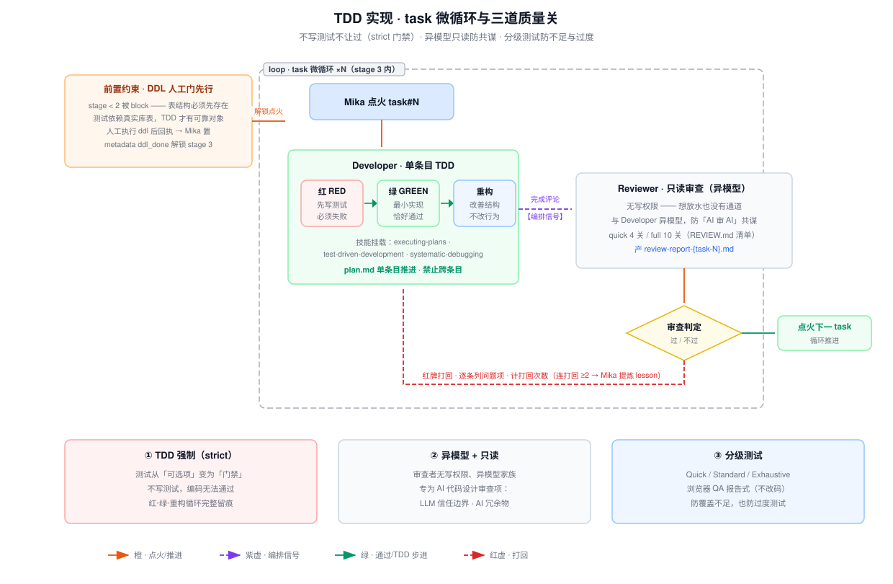

- 问题：AI 不爱写测试、测试常依赖表结构、AI 审 AI 可能"互相包庇"。
- 方案：测试门禁强制开启（`tdd_enforcement: strict`）；每个任务条目走"先写失败测试→写代码让它通过→重构"微循环；数据库变更人工门前置——**用真表测试，拒绝 mock 幻觉**；审查者用**另一个家族的模型**且没有写权限，防共谋。
- 突破：测试从"可选项"变成"闸门"；专为 AI 代码设计审查项（LLM 信任边界、AI 冗余物）。

**实现④ 硬约束——白话：保险丝，AI 一碰红线文件直接"断电"**

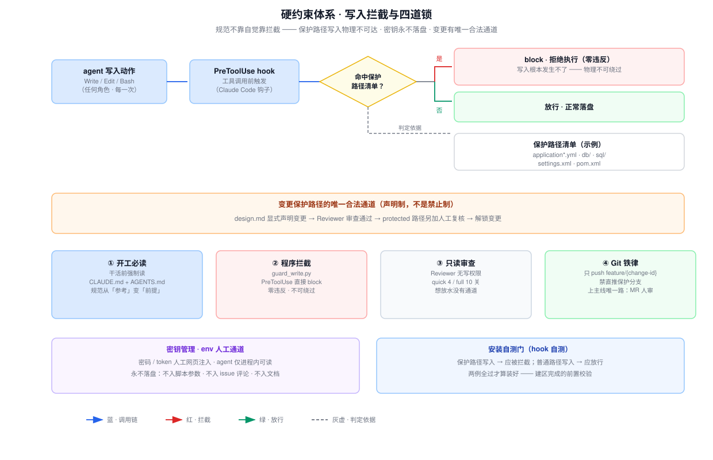

- 问题：规范的痛点是"靠自觉"——提示词可以被绕过，AI 乱改配置防不住。
- 方案：`guard_write.py` 拦截钩子挂在 AI 每次写文件的动作之前，**保护路径（yml/db/sql/pom 等配置与库表）写入直接 block**；确需变更有唯一合法通道（design 声明→审查→人工复核）。
- 突破：默认拦截 + 编排器受控通道（`HARNESS_ALLOW_WRITE=1` 仅受控流程可用），**日常运行零违反**；四道锁（开工必读 / 程序拦截 / 只读审查 / Git 铁律）+ 密钥只走人工通道永不落盘 + 安装自测门。钩子源码：骨架模板版见 `files/治理骨架模板/hooks/guard_write.py`（PROTECTED_PATTERNS 含 settings.xml/pom.xml，decision:block 机制），QMS 实铺版见 `files/治理文件实物/hooks/guard_write.py`（149 行早期变体）。

**实现⑤ 创新点：AI 自我学习闭环——白话：错题本，同类坑不踩第二次 ｜ 行为要点 4.3 ◆**

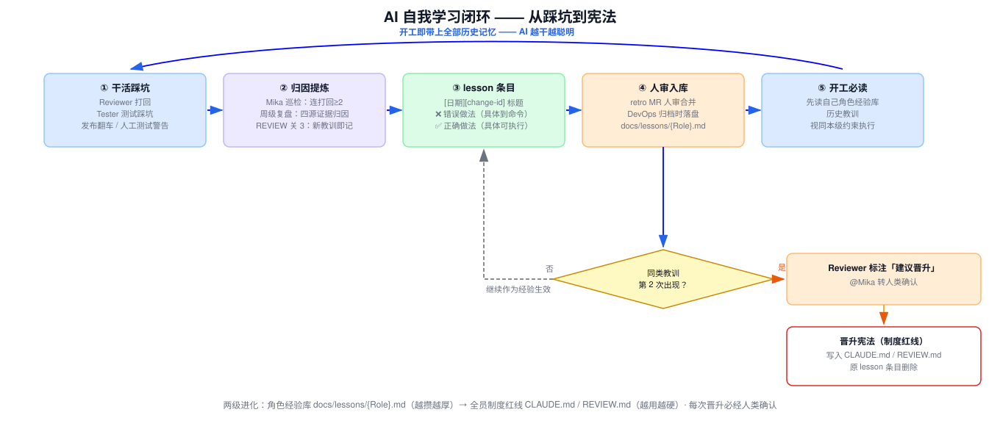

- 问题：同样的坑反复踩——经验只散在个人会话里，不沉淀、不进化。
- 方案：四源采集（审查打回 / 测试踩坑 / 发布踩坑 / 人工测试复盘）→ 每条写成 ❌错误做法/✅正确做法 对照、具体到命令级 → **人审 MR 入库**（AI 不能自说自话改知识库）→ 各角色开工必读、视同本级约束。
- 突破（精髓）：同类教训**第 2 次出现自动晋升全员红线**——错题本越攒越厚，宪法越用越硬，每次晋升必经人类确认。

**实现⑥ 其他核心实现一览**

- 8 个业务技能（UI 选型速查 v2/v3、权限资源 SQL 生成 v2/v3、库表结构导出、浏览器 QA、结构文档对账、人工测试复盘——前后端技能由团队协同建设）；
- 6 个建区脚手架：一键建区全链路（幂等、断点续传）；
- 两项提效革新：模型分级路由（explore 小模型/proposal·review 大模型/apply 中档）压成本；Developer 5 实例并行 + 排他文件清单防写冲突提升吞吐；
- 问题解决范式：Windows GBK 乱码 → 定位代码页根因 → 固化 `@文件` 传参铁律入宪法 → 根治一类问题（同类固化案例还有 ddl.sql 平铺约束、MyBatis Map 大小写等，已沉淀疑难问题技术资料 10 条、晋升红线 6 项，实物归档 `files/疑难问题库/`，见 4.3 举证 §5.1）。

#### A4 治理体系：四套规范，一个体系 ｜ 行为要点 3.1 ◆

**落到每个仓库的治理结构（AI 的"厂规 + 字典"）**

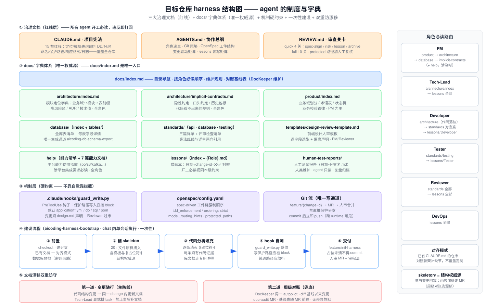

| 规范 | 白话定位 | 内容 |
|---|---|---|
| CLAUDE.md | **项目宪法**：进车间先背的红线 | 骨架模板 §0-§15 共 16 节红线（模块表/TDD/分层/命名/保护路径） |
| AGENTS.md | **协作总纲**：谁跟谁怎么配合 | 骨架模板 §0-§7（适用范围/废弃产物隔离/stage 编号/角色速查/Git 策略/工件结构/变更联动/持续学习层） |
| REVIEW.md | **审查关卡**：出厂质检清单 | 快审 4 关 + 全审 10 关清单（行数路由：<50 行快审 / ≥50 行全审） |
| standards/ | **技术详单**：具体工种的作业标准 | 骨架模板三篇（api / database / testing）+ 各仓库按技术栈实铺扩充（QMS 实例为 java / mybatis / naming / spring / testing 五篇） |

与传统规范的本质区别：**机器可执行的制度**——传统规范靠人自觉（看完记不住、违反没人管），这套规范"开工必读、程序拦截、关卡校验"三重强制，不靠自觉靠拦截；每周对账兜底 + 教训晋升红线 → **规范库越用越严密**。规范实物随案归档两套：**治理骨架模板版**（结构权威源，`files/治理骨架模板/`：宪法/总纲/审查关卡/openspec-config.yaml 双 strict 配置/拦截钩子/standards 三篇/lessons 机制）与 **QMS 仓库实铺版**（`files/治理文件实物/`：按 sunny-qms-service 仓库代码证据填充后的实例，standards 五篇）。

> 核心项 3.1 的完整举证见 `核心项举证-3.1规范编写-详细设计说明书.md`（按 GB8567-88 详细设计说明书模板编制）。

#### A5 测试与知识进化 ｜ 行为要点 4.3 ◆

**三道质量关（小改动快审、大改动全审，自动路由）**

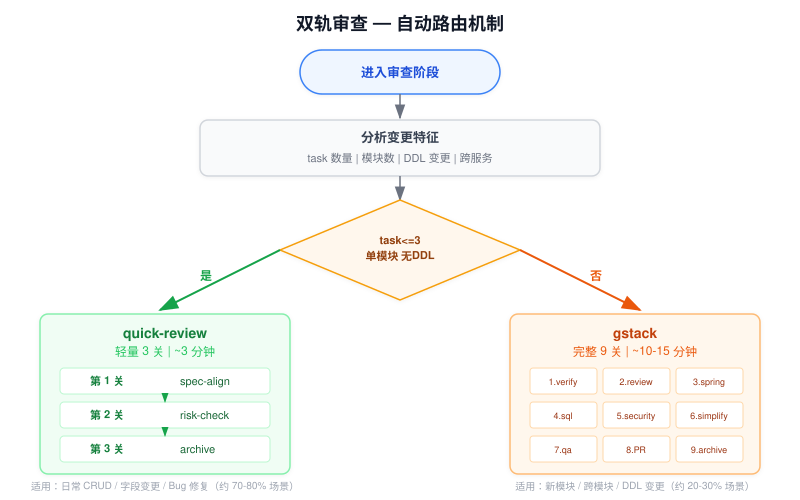

| 质量关 | 白话解释 |
|---|---|
| 第一关：TDD 强制门 | 考试不过不出厂——没有测试或测试不通过，代码进不了下一环节 |
| 第二关：异模型只读审查门 | 换一个"家族"的 AI 当审查员，且只给看、不给改——防"自己人查自己人"互相包庇 |
| 第三关：分级测试 + 浏览器 QA 门 | 单元测试跑真表真库，再用浏览器像真人一样点一遍页面验证 |

疑难问题四源分类归口（审查打回 / 测试踩坑 / 发布踩坑 / 人工测试复盘）；AI 疑难问题库（错题本）的提交、入库把关、查询借鉴、共享、晋升红线全机制落地——标准要求逐项映射见测试举证材料。

> 核心项 4.3 的完整举证见 `核心项举证-4.3综合测试-测试分析报告.md`（按 GB8567-88 测试分析报告模板编制）。

#### A6 部署导入：一键建区，半日接入 ｜ 行为要点 6.1 ◆

**新系统接入只需说一句"安装工作区"**，6 步自动串联（可重复执行不怕中断、断了能从断点继续）：

| 步骤 | 内容 | 谁 |
|---|---|---|
| 1-2 | 技能导入 → 角色创建 | 自动 |
| **3** | **人工窗口①**：确认配置 | 人 |
| 4-6 | 项目初始化 → 编排铺设 → 仓库治理铺设 | 自动 |
| **7** | **人工窗口②**：审 MR 合入 | 人 |

- **装完自测（hook 自测门）**：程序自动验证"该拦的拦住了、该放的放行了"——自测不过不算装好，杜绝"装完才发现防线失效"；
- **性能调优四层**（操作系统 / 数据库 / 应用服务器 / 应用程序，逐层映射见 6.1 举证 §2.2）：事件驱动替代轮询（秒级接力）、模型分级路由、Developer 并行、cron 错峰、增量对账；业务侧批处理调优实例——4211 工厂定时任务（分布式锁单实例 → SQL 分片 5 实例并行 + 线程池 + 每条物料独立事务，2026.04，量化对比见 R1 表）；
- **规模化**：已推广至 LIMS / QMS 服务端 / QMS 前端 / QMS SPC / ECQ / MDM 六个业务系统仓库；新团队从零接入约半日（对照：平台化之前手工落地需 4-6 天）；六系统接入期间的部署答疑与问题解决记录见 `files/凭证/部署导入支撑记录.md`（含各仓库接入时点 GitLab 时间戳实证）。

> 核心项 6.1 的完整举证见 `核心项举证-6.1系统导入-用户手册.md`（按 GB8567-88 用户手册模板编制）。

### R - 结果：三类成果

#### R1 量化效能成果

**结果速览（五个最直观的数字）**

| 🏆 | 白话说法 | 数值 |
|---|---|---|
| ⚡ | 小需求从"按天排期"到"半小时出来" | **约 30 分钟**（bugfix 约 20 分钟 / 中大需求 30-60 分钟） |
| 🏭 | 不是试点，是天天在生产环境用 | **6 个业务系统**规模化应用 |
| 🚪 | 新团队"搬进这套流水线"的时间 | **4-6 天 → 约半日** |
| 🛡️ | 红线文件被违规改动的次数 | **日常运行零违反** |
| 💰 | 六系统需求全部经平台开发的年化节约潜力 | **约 684 万元/年**（六系统 git 实测月均 190 个交付单元 × 保守 1.5 人天） |

以下为完整量化明细：

| 指标 | 数值 |
|---|---|
| 小需求端到端交付 | 约 30 分钟 |
| bugfix 交付 | 约 20 分钟 |
| 中大需求端到端 | 30-60 分钟 |
| 快速审查 / 全量审查 | 2 分钟 / 15 分钟（自动路由） |
| MDM 实战单需求（Harness V2 阶段，2026.06） | 新增 7 文件、修改 6 个 Mapper（10 方法 + 9 段 XML）、**Tests run: 22, Failures: 0**、BUILD SUCCESS |
| MDM 实战单需求（Multica 阶段，2026.09） | 商品码清洗 change：10 文件 +431 行（代码+测试+文档+规格四工件同 MR） |
| 本人在 MDM 仓库 MR 节奏 | 2026.04-11 共 14 个 MR：V2 阶段 8 个（04-07 月）、Multica 阶段 6 个（08-11 月） |
| 规模化应用 | 6 个业务系统仓库（LIMS / QMS×3 / ECQ / MDM） |
| 承载系统规模 | QMS：120+ 业务模块、279 个 Mapper.xml、117 个 Controller |
| 新仓库接入耗时 | 手工 4-6 天 → 一键建区约半日 |
| 4211 工厂定时任务批处理调优（2026.04） | 实例利用率 1/5 → 5/5（分布式锁单实例执行 → SQL 分片 5 实例并行，单实例数据量降至 1/5）；万条物料单一大事务 → 每条物料独立事务（失败影响面从整批降为单条）；改动约 150 行、零新依赖 |
| 单需求当日端到端（Multica 阶段实例） | 商品码清洗：分支首 commit 2026-09-21 10:06 → 四工件+代码+测试+文档当日全部完成（10 files +431 行） |
| 保护路径违规写入 | 日常运行零违反（默认拦截 + 编排器受控通道 HARNESS_ALLOW_WRITE=1；stdin 异常保守放行有日志可查） |

**规模化应用仓库地址（内网 GitLab，实测可达）**：

| 系统 | 仓库地址 |
|---|---|
| LIMS（实验室信息管理系统） | http://192.168.45.236/lims/sunny-lims.git |
| QMS 服务端（质量管理系统） | http://192.168.45.236/qms/sunny-qms-service.git |
| QMS 前端 | http://192.168.45.236/qms/sunny-qms-web.git |
| QMS SPC（统计过程控制） | http://192.168.45.236/qms/sunny-qms-spc.git |
| ECQ | http://192.168.45.236/ecq/sunny-ecq.git |
| MDM（主数据管理） | http://192.168.45.236/MDM/sunny-mdm.git |

**成本节约测算（人天 × 单价口径，与传统纯人工开发对比）**

测算口径：① 人天单价按 2000 元计；② 传统人工耗时 = 需求澄清 + 编码 + 自测 + 人工审查 + 修复往返的保守估算；③ 平台模式只计**人的实际投入**（chat 澄清 + G1 审四工件/执行 DDL + G2 审 MR），AI 执行时间不计人天；④ 需求量按六系统 git 全历史统计（master 分支 merge 交付单元，平均每单元 3.6 个 commit，符合"一需求一次合并交付"形态）。

单需求维度节约（平台前后对比）：

| 需求类型 | 传统纯人工端到端 | 平台模式人的投入 | 单需求节约 |
|---|---|---|---|
| bugfix | ≈ 1 人天（沟通 + 改码 + 自测 + 走查） | ≈ 0.2 人天（约 1.5 小时） | ≈ 0.8 人天 |
| 小需求 | ≈ 2 人天 | ≈ 0.3 人天（约 2.5 小时） | ≈ 1.7 人天 |
| 中大需求 | ≈ 5 人天（如 PLM 继承接口：新增 7 文件 + 改 6 Mapper + 22 项测试） | ≈ 0.5 人天（约 4 小时） | ≈ 4.5 人天 |

**六系统需求量统计（git 全历史实测）**：

| 系统 | 统计跨度 | merge 交付单元 | 月均交付单元 |
|---|---|---|---|
| MDM | 2024.01—2026.11 | 690 | ≈ 20 |
| QMS 服务端 | 2023.05—2026.11 | 1821 | ≈ 44 |
| QMS 前端 | 2023.05—2026.11 | 1461 | ≈ 36 |
| QMS SPC | 2024.12—2026.11 | 349 | ≈ 15 |
| ECQ | 2026.08—2026.10 | 70 | ≈ 32 |
| LIMS | 2024.01—2026.11 | 1513 | ≈ 45 |
| **合计** | | **5904** | **≈ 190 / 月** |

**节约测算（六系统需求全部经平台开发的口径）**：

| 测算项 | 计算 | 结果 |
|---|---|---|
| 月度节约 | 190 个交付单元/月 × 单需求节约保守值 1.5 人天（介于 bugfix 0.8 与小需求 1.7 之间的保守取值） | **285 人天/月 ≈ 57 万元/月** |
| 年化节约 | 285 人天 × 12 | **3420 人天 ≈ 684 万元/年** |

> 说明：① 年化 684 万元为**等价产能释放空间（工时口径）**——按六系统月均 190 个交付单元全部经平台开发测算，释放工时可投入更高价值的分析与创新工作，非人员裁减口径；② 1.5 人天/需求为保守取值——六系统交付单元中含相当比例中大需求（如 PLM 继承接口类传统人工 5 人天+），均值实际更高；③ 未计价的隐性节约未纳入：审查自动化（快审 2 分钟/全审 15 分钟替代人工走查小时级）、文档随行自动同步、错题本知识复用避免重复踩坑。

#### R2 制度资产与专业影响力

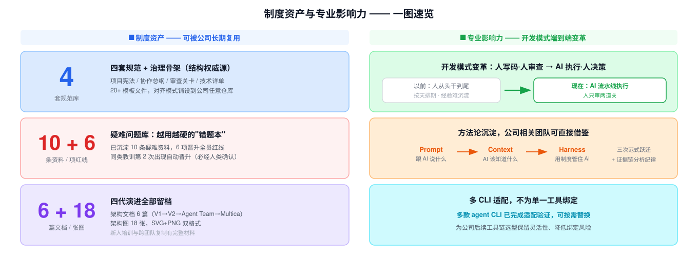

#### R3 知识与经验萃取

- 《Harness》实战方法手册（V1）→《Harness V2 架构设计文档》（七层架构 + 12 checkpoint）→《Harness Agent Team 多 Agent 架构设计》（含"单会话 Task 工具为伪并行"的实现真相论证）→ Multica 平台化——四代演进全部留档，新人培训与跨团队复制有完整材料；
- `harness架构文档` 以"AI 编码公司"类比通俗讲解，用作培训材料。

---

# 四、项目展望：从 AI 编码流水线到"超级个体"

> 流程与信息技术部总经理常总在《AI 时代流程 IT 部门的转型之路》中提出"趋势三：超级个体（OPT 一人团队）和管理幅度大幅增加"。本项目正是这一趋势在软件交付域的先行工程化实例。

## 对"超级个体"的深度解读

**一句话：超级个体 = 1 个人 + n 个数字员工的一人团队，人均管理幅度数量级增加。** 分享中给出三层递进的内涵：

| 层次 | 内涵 | 对应分享原意 |
|---|---|---|
| ① 工作管理权转移 | **工作的规划、定义、编排从人转移到 AI**——人类只设定原则、边界与目标（定义要什么、不能做什么），管理者退到最上游。这是"范式层面的变化，而非效率的渐进改善" | 人管理工作 → AI 管理工作；人执行 → 人与 AI 共同执行 / AI 自主执行 |
| ② 复杂性假设动摇 | 过去岗位分工的因果假设是"人处理不了复杂性"，必须把复杂性预先拆解成 SOP 塞进岗位说明书；**AI 为处理复杂性而生，可在运行中自行拆解问题、调用工具、处理例外、调整路径**——分工的前提开始松动，"产品/前端/后端/测试"的拆分可以被压平 | 生产计划物控与采购计划两个岗位，用 AI 可合并为一个 |
| ③ 组织关系重构 | AI 从提效工具（ROI/减员）深度嵌入为生产要素——组织变革从减员延伸到**岗责合并、拆部门、压缩层级**；中层从"信息传声筒"转变为 **AI 系统的编排者（Orchestrator）** | 通过绩效牵引，鼓励 1 人多岗（1 人 + n 个数字员工）；先做一条全自动的"线体" |

配套支撑：分享同时给出数字员工的 **Hire-to-Retire 治理体系**（Agent OPS：招募入职 / 绩效考核 / 离职淘汰，风险分级权限边界、技术与业务双重检查）与 **FDE 交付方式**（对业务结果而非功能上线负责）——超级个体不是"一个人硬扛"，而是"一个人指挥一支被治理住的数字员工队伍"。

## 本项目与"超级个体"的映射：已在软件交付域先行落地

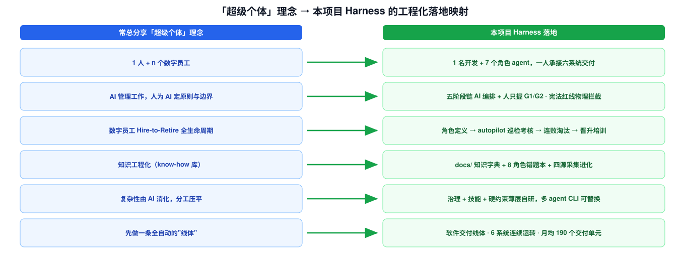

| 超级个体理念 | | 本项目实现 |
|---|:---:|---|
| **1 人 + n 个数字员工** | ═══▶ | 1 名开发 + 7 个角色 agent，本人一人承接六系统交付 |
| **AI 管理工作**（规划/编排归 AI） | ═══▶ | 澄清、拆解、调度全由 agent 完成，人只握 G1/G2 两道门 |
| **人为 AI 定原则、边界与目标** | ═══▶ | 宪法红线 + guard_write.py 物理拦截 + 审查关卡 |
| **数字员工 Hire-to-Retire** | ═══▶ | 角色定义→autopilot 巡检考核→连败 ≥2 淘汰→教训晋升在岗培训 |
| **知识工程化（know-how 库）** | ═══▶ | docs/ 知识字典 + 8 角色错题本 + 四源采集进化 |
| **先做一条全自动的"线体"** | ═══▶ | 软件交付线体：6 系统连续运转、月均约 190 个交付单元 |

## 盘点：已完成什么、还缺什么、目标是什么

**✅ 已完成（四件）**

| 🏆 | 成果 | 一句话 |
|---|---|---|
| 🏭 | 全自动线体 | 软件交付流水线 6 系统规模化，年化节约潜力约 684 万元 |
| 🤖 | AI 管理工作 | 五阶段链 AI 编排 + 人只握 2 道决策门 |
| 🛡️ | 数字员工治理 | 规范开工必读 + 硬约束物理拦截 + 审查关卡，日常零违反 |
| 🧠 | 知识自我进化 | 错题本四源采集，同类坑第 2 次自动晋升全员红线 |

**🔍 还缺（五个缺口 = 下一步路线图）**

| # | 缺口 | 现状 | ──▶ | 目标 |
|---|---|---|:---:|---|
| 1 | 数字员工管理未体系化 | 角色手工定义、绩效靠巡检 | ──▶ | Agent OPS：绩效看板（处理量/准确率/返工率）+ 淘汰交接 |
| 2 | 只有"开发"一条线体 | 代码交付流水线 | ──▶ | 业务线体试点（报表/数据治理），FDE 对业务结果负责 |
| 3 | 知识是文档态 | AI 读 docs/ 理解语义 | ──▶ | 本体化：对象+关系+规则+动作，可校验可推理 |
| 4 | 按系统各自接入 | 六系统分别建区 | ──▶ | 按端到端业务能力串联跨系统流水线 |
| 5 | 缺 1 人多岗绩效牵引 | 个人已实证、团队未铺开 | ──▶ | 绩效认可"1 人 + n 数字员工"产出，带出超级个体团队 |

**🎯 目标（三步走）**

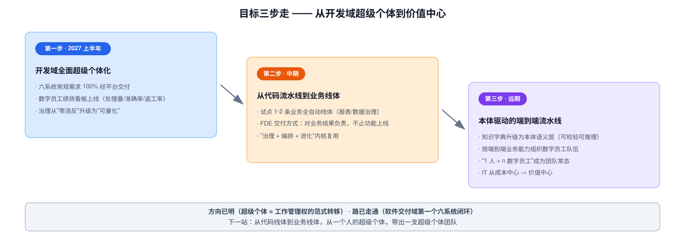

> 一句话收尾：常总指出的是方向——"超级个体不是效率的渐进改善，而是工作管理权的范式转移"；本项目证明的是可行性——**这条范式转移的路，在软件交付域已经走通了第一个六系统规模的闭环**。下一步，是把这套"治理 + 编排 + 进化"的内核，从代码线体带向业务线体，从一个人的超级个体，带出一支超级个体团队。

---

# THANKS!
