# 概要设计说明书

**（AI 多 Agent 编码 Harness 平台）**

> 本说明书按 GB8567-88《概要设计说明书》模板编制。

| 项目 | 内容                              |
|---|---------------------------------|
| 项目名称 | AI 多 Agent 编码 Harness 的设计与规模化落地 |
| 项目时间 | 2026 年 4 月至今                    |
| 编制人 | 翁金林                             |
| 编制日期 | 2026-11-07                      |

---

## 目录

- [1 引言](#1-引言)
  - [1.1 编写目的](#11-编写目的)
  - [1.2 背景](#12-背景)
  - [1.3 定义](#13-定义)
- [2 总体设计](#2-总体设计)
  - [2.1 需求规定](#21-需求规定)
  - [2.2 运行环境](#22-运行环境)
  - [2.3 基本设计概念和处理流程（功能流程设计）](#23-基本设计概念和处理流程功能流程设计)
  - [2.4 结构（结构设计与模块划分）](#24-结构结构设计与模块划分)
  - [2.5 功能需求与程序的关系（部分）](#25-功能需求与程序的关系部分)
  - [2.6 人工处理过程（人机界面框架与用例设计）](#26-人工处理过程人机界面框架与用例设计)
  - [2.7 尚未解决的问题](#27-尚未解决的问题)
- [3 接口设计](#3-接口设计)
  - [3.1 用户接口](#31-用户接口)
  - [3.2 外部接口](#32-外部接口)
  - [3.3 内部接口](#33-内部接口)
- [4 运行设计](#4-运行设计)
  - [4.1 运行模块组合](#41-运行模块组合)
  - [4.2 运行控制](#42-运行控制)
  - [4.3 运行时间](#43-运行时间)
- [5 系统数据结构设计](#5-系统数据结构设计)
  - [5.1 逻辑结构设计要点](#51-逻辑结构设计要点)
  - [5.2 物理结构设计要点](#52-物理结构设计要点)
  - [5.3 数据结构与程序的关系](#53-数据结构与程序的关系)
- [6 系统出错处理设计](#6-系统出错处理设计)
  - [6.1 出错信息](#61-出错信息)
  - [6.2 补救措施](#62-补救措施)
  - [6.3 系统维护设计](#63-系统维护设计)
- [7 关键技术要点分解与可行性论证](#7-关键技术要点分解与可行性论证)
- [8 技术路线与开发文档](#8-技术路线与开发文档)
- [9 设计成果的有效性](#9-设计成果的有效性)
- [附录 A：harness-architecture.md 分层架构总览（原文）](#附录-aharness-architecturemd-分层架构总览原文)
- [附录 B：harness-runtime-flow.md 五阶段链运转流程与 autopilot 旁路（原文）](#附录-bharness-runtime-flowmd-五阶段链运转流程与-autopilot-旁路原文)
- [附录 C：harness-repo-structure.md 目标仓库治理结构与建设 5 步（原文）](#附录-charness-repo-structuremd-目标仓库治理结构与建设-5-步原文)
- [附录 D：harness-explained.md 通俗讲解版（原文）](#附录-dharness-explainedmd-通俗讲解版原文)
- [附录 E：Harness V2 架构设计文档（原文）](#附录-eharness-v2-架构设计文档原文)
- [附录 F：Harness Agent Team 多 Agent 架构设计（原文）](#附录-fharness-agent-team-多-agent-架构设计原文)
- [附录 G：配套架构图 18 张](#附录-g配套架构图-18-张)
  - [G.1 核心流程图（9 张）](#g1-核心流程图9-张)
  - [G.2 四代演进架构图（9 张，SVG 源）](#g2-四代演进架构图9-张svg-源)

---

## 1 引言

### 1.1 编写目的

本说明书给出 AI 多 Agent 编码 Harness 平台的总体设计，作为建设与维护的权威依据。预期读者：平台建设与维护人员。

### 1.2 背景

待开发系统：AI 多 Agent 编码 Harness 平台。任务提出者：集团 IT 部；开发者：IT 开发团队（本人主导架构设计）；用户：IT 各业务系统开发团队；运行于公司内网自托管环境。

### 1.3 定义

同《软件需求说明书》§1.3。补充：五阶段链 = 澄清建单→四工件→拆解→编码微循环→测试归档；G1/G2 = 两个人工决策门。

---

## 2 总体设计

### 2.1 需求规定

见《软件需求说明书》§3（功能：AI 承接全流程执行、人握两个决策门、旁路自愈；性能：接力秒级、需求交付分钟级；安全：密钥人工通道、保护路径物理拦截）。

### 2.2 运行环境

Multica 平台（Go + PostgreSQL + 本机 Runtime 守护进程拉起 agent CLI）自托管；目标项目构建链（Maven/JDK/Node）；GitLab；内网数据库。

### 2.3 基本设计概念和处理流程（功能流程设计）

**一个 change 的一生——五阶段链主线**：

```
stage 1  PM 澄清（chat 双向 explore）→ 四工件设计
         proposal(WHY) → specs(WHAT) → design(HOW) → api(+ddl)
   ═════ 人工门 G1：人审四工件 + 人工执行 ddl.sql / 权限脚本 ═════
stage 2  Tech-Lead 拆解：tasks.md + 依赖图(DAG) + 排他文件清单 → plan.md
stage 3  Developer ⇄ Reviewer 逐任务微循环
         写码(TDD) → 编排信号 → 只读审查 → 不过红色打回 → 返工重循环
stage 4  Tester：集成/边界/性能测试 + 浏览器 QA 三档 → test-report
stage 5  DevOps：归档 + tag + CHANGELOG + GitLab API 建 MR
   ═════ 人工门 G2：人审合并 → Closes {issue} 自动关闭 ═════
```

**旁路机制**（主线之外的自动巡检）：

| autopilot | 频率 | 职责 |
|---|---|---|
| 兜底巡检 | 每 30 分钟 | 挂起路由、人工卡点提醒、失败断点重路由、连败 ≥2 停手 @人、连打回 ≥2 提炼教训 |
| 结构文档对账 | 周一 08:17 | 基线以来代码 diff 映射为文档修正 MR，无差异静默 |
| 人工测试复盘 | 周一 08:23 | 未读测试报告逐 ⚠️ 四源证据链归因 |

### 2.4 结构（结构设计与模块划分）

**五层结构**：

| 层 | 组件 | 模块划分 |
|---|---|---|
| 平台层 | Multica（自托管） | Go 后端 + PostgreSQL + 本机 Runtime 守护进程（拉起 26 种 agent CLI） |
| 编排层 | Mika 调度 agent + 3 autopilot | 建单守门 / stage 路由 / 审查点火 / 人工门 metadata / 失败清扫 |
| 角色层 | 7 角色 agent | PM×3 / Tech-Lead×1 / Developer×5 / Reviewer×3 / Tester×2 / DevOps×1 / DocKeeper×1 |
| 技能层 | 3 系技能库（zip 通道整包入库） | openspec 工件系 7 个 / superpowers 工程系 / aicoding 业务系 8 个 |
| 治理层 | 目标仓库内 | 三大治理文档 + docs/ 九子目录字典 + 硬约束钩子 + Git 流 |

**角色分工表**（部分）：

| 角色 | 职责 | 出场 | 并发 |
|---|---|---|---|
| PM | chat 澄清 + 四工件 + 权限 SQL 草案，不写代码 | stage 1 | 3 |
| Developer | plan.md 单条目 TDD 编码，排他文件清单防冲突 | stage 3 | 5 |
| Reviewer | 只读审查，异模型防共谋，产 review-report | stage 3 横向 | 3 |
| DevOps | 归档 + GitLab API 建 MR（description 含 Closes {issue}） | stage 5 | 1 |

**跨仓库复用设计**：治理层骨架为"结构权威源"（20+ 文件模板），对齐模式铺设到任意仓库——补缺节、不覆盖已有定制。

### 2.5 功能需求与程序的关系（部分）

| 功能需求 | 承载组件 |
|---|---|
| 需求澄清与四工件产出 | PM agent + OpenSpec 工件系技能 |
| 任务拆解与并行编排 | Tech-Lead + Mika + 排他文件清单机制 |
| TDD 编码与审查微循环 | Developer + Reviewer + guard_write.py 钩子 |
| 分级测试与浏览器 QA | Tester + aicoding-browser-qa |
| MR 归档与流水线闭环 | DevOps + GitLab API |
| 文档防漂移 | aicoding-db-schema-export + aicoding-harness-audit |

### 2.6 人工处理过程（人机界面框架与用例设计）

| 界面 | 用途 | 用例设计（规则） |
|---|---|---|
| chat 问答 | 需求澄清、建区引导 | 建单守门五要素：change-id / 五阶段链 / 人工门段 / 验收点 / 澄清结论——**缺一样打回澄清**，不入流程 |
| issue 看板 | 过程可视、agent 汇报 | 每阶段完成发标准格式"编排信号"评论 @调度秒级接力；人可随时插话；agent 边做边评论留痕 |
| 人工门网页 | 关键决策 | 全流程仅 2 个人工门 + 建区 2 个人工窗口（GitLab 集成窗口 / harness MR 人审窗口，另含启动前一轮问答）；环境变量只由人在网页注入（agent 永不代写） |

### 2.7 尚未解决的问题

部分老仓库存量文档缺口需分批对齐（对齐模式按需补缺节，不一次性追溯全量）。

---

## 3 接口设计

### 3.1 用户接口

chat 自然语言问答（建单/建区/澄清）；issue 看板（过程可视+编排信号评论）；MR 审核页（G2 人工门）。

### 3.2 外部接口

GitLab API（注册仓库、webhook 事件、建 MR）；数据库连接（表结构导出，密码 env 单次使用）；浏览器基座（gstack）。

### 3.3 内部接口

编排信号（标准格式完成评论 + @Mika）事件通道；人工门 metadata 状态位（ddl_done / role_bind）；agent 间工件传递（openspec/changes/{change-id}/ 目录约定）。

---

## 4 运行设计

### 4.1 运行模块组合

主链：7 角色按 stage 接力；旁路：3 autopilot 周期巡检；并行：Developer 5 实例（排他文件清单防写冲突）。

### 4.2 运行控制

编排信号事件驱动为主（秒级唤醒）；cron 兜底（30min 全量对账）；人工门 metadata 硬前置（未置位 stage ≥2 点火不生效）。

### 4.3 运行时间

接力延迟秒级；小需求约 30 分钟（场景演示口径）、bugfix 约 20 分钟、中大需求 30-60 分钟端到端；快速审查 2 分钟/全量审查 15 分钟。

---

## 5 系统数据结构设计

### 5.1 逻辑结构设计要点

openspec/changes/{change-id}/ 工件目录（proposal/specs/design/api/ddl/auth-resource/tasks）；docs/ 九子目录知识字典（product/architecture/database/standards/lessons/help/implicit-contracts/human-test-reports/templates）；docs/lessons/{角色}.md 错题本。

### 5.2 物理结构设计要点

全部落 Git 仓库（feature/{change-id} 分支 → MR → master）；对账基线 commit 登记于 docs/index.md。

### 5.3 数据结构与程序的关系

五阶段链链序单一权威源存于 issue 描述（由 Mika 维护），仓库侧只认 stage 编号——结构上消灭两处状态漂移。

---

## 6 系统出错处理设计

### 6.1 出错信息

run 失败/审查打回/信号丢失均有分类出错信息（issue 评论留痕）；agent 输出强制 UTF-8（Windows GBK 乱码根治约定）。

### 6.2 补救措施

失败分级升级：run 失败→断点重路由；连败 ≥2→停手 @人；打回→红色退回逐条返工；连打回 ≥2→自动提炼 lesson；信号丢失→30min cron 兜底对账。

### 6.3 系统维护设计

变更随行（文档随 change 同步更新，不允许事后补文档）+ 周级对账兜底 + 教训晋升红线的规范进化机制。

---

## 7 关键技术要点分解与可行性论证

测试用例设计详见《测试分析报告》。四项关键技术要点的事前可行性论证（开发前逐一验证，全部通过后才进入实施）：

| 技术要点 | 论证结论 | 落地配置（实物） |
|---|---|---|
| 事件驱动编排信号 | 评论格式约定即可秒级唤醒，替代轮询 | 标准格式完成评论 + @Mika，30 分钟 cron 仅兜底 |
| PreToolUse 写入拦截 | agent 工具调用前可注入决策，block 可行 | guard_write.py：stdin 读 tool_input.file_path，命中保护模式输出 `{"decision":"block"}` |
| 工件顺序强制 | strict 模式可校验 proposal→specs→design→tasks | `ordering: strict` |
| 模型分级路由 | 按工序路由大小模型可行且省本 | `explore: haiku / propose: opus / apply: sonnet / review: opus` |

---

## 8 技术路线与开发文档

**技术路线**：Multica（底座）+ Agent CLI（执行引擎）+ OpenSpec（工件规范）+ superpowers（工程方法论），自研面聚焦"编排机制 + 治理层 + 业务技能"薄层。多 agent CLI 适配（opencode/Qwen）已验证，保留工具链替换灵活性。

**输出供开发使用的技术文档 6 篇 + 架构图 18 张**：

| 文档 | 内容 | 主要用途 |
|---|---|---|
| harness-architecture.md | 分层架构总览 | 建设与维护的权威依据 |
| harness-runtime-flow.md | 五阶段链运转流程 + autopilot 旁路 | 日常运转手册 |
| harness-repo-structure.md | 目标仓库治理结构 + 建设 5 步 | 仓库铺设指南 |
| harness-explained.md | 通俗讲解版（AI 编码公司类比） | 培训新人材料 |
| Harness V2 架构设计文档 | 三次范式跃迁 + 七层架构 + 12 checkpoint | 架构决策留档 |
| Harness Agent Team 多 Agent 架构设计 | 伪并行根因论证 + 真并行编排设计 | 多 Agent 演化依据 |

**配套架构图 18 张**：核心流程图 9 张（架构/运转/编排时序/SDD 工件链/TDD 微循环/硬约束/学习闭环/仓库结构/概念图，SVG+PNG 双格式）+ 四代演进架构图 9 张（V2 七层架构、双审查流程、HyperSpec 流程、AI 编码演化、生命周期、会话初始化、TDD 分层、团队架构、多 Agent 团队架构，SVG 源）。

上述 6 篇技术文档全文与 18 张架构图见附录 A～附录 G。

## 9 设计成果的有效性

- 前代 Harness V2 单会话全周期流程（12 checkpoint）在 MDM「PLM 继承接口」真实需求端到端验证（2026.06）；
- Multica 形态五阶段链于 2026.08 平台化后在六个业务系统规模化运行——MDM 仓库 Multica 阶段 6 个 MR（2026.08-11）为两代对照实证，典型 change「商品码清洗」四工件全目录同 MR 归档（分支产出 09-21 → MR 合并 09-24）；
- 六个业务系统仓库（LIMS/QMS×3/ECQ/MDM）铺设应用；
- Developer 5 实例并行经受住并发考验（排他文件清单防写冲突）。

---

## 附录 A：harness-architecture.md 分层架构总览（原文）

### sunny-multica 多 Agent 编码 Harness 架构

> 本文档描述基于 [Multica](https://github.com/multica-ai/multica) 搭建的多 agent 编码 harness 的整体架构。
> 运转流程见配套文档 [harness-runtime-flow.md](./harness-runtime-flow.md)。

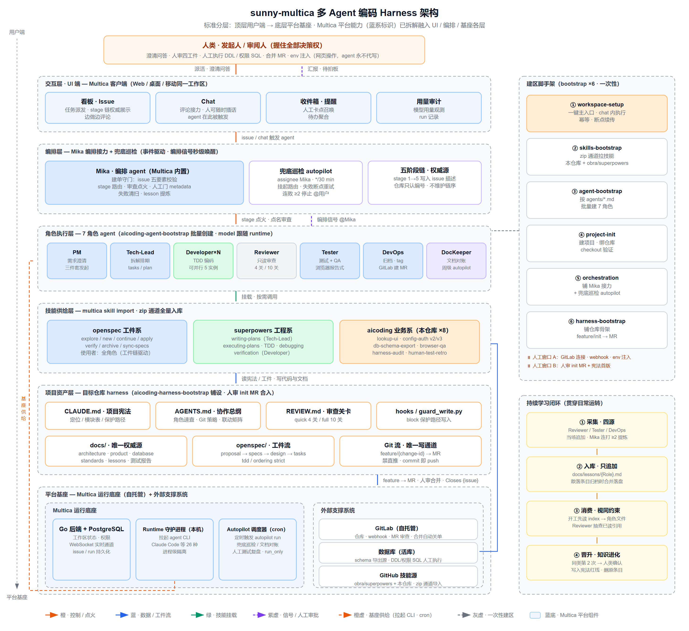

#### 一图总览

harness = **Multica 平台（工作区底座）+ Mika 编排 agent + 7 角色 agent + 3 系技能库 + 目标仓库治理层**，外围由 6 个 bootstrap 脚手架一次性建区，人类只握住三个人工关口（澄清问答、DDL 执行、MR 合并）。

#### 分层说明（自上而下）

> 架构图按标准分层排版：**顶层最接近用户端，底层是平台基座**（见左侧行政轴）。Multica 平台能力不再单列一层，而是拆解融入三处并以蓝系统一标识：**UI 交互层**（看板 / Issue / Chat）、**编排层**（Mika）、**平台基座**（Go 后端 + Runtime + Autopilot 调度器）。建区脚手架位于右侧一次性建设栏，持续学习闭环位于右下角。

##### 1. 人工层（人类 · 发起人 / 审阅人）

不写代码，但握住所有决策权：

- 开头一轮问答：项目名 / 仓库 URL / MR 目标分支 / 数据库信息 / 密码来源
- 中段一次网页操作窗口：GitLab 连接 + webhook + 各 agent 环境变量注入（env 是人工通道，agent 永不代写）
- 结尾人审：harness MR 合并、宪法首版审核、每期 change 的四工件审核、DDL / 权限 SQL 人工执行、最终 MR 合并

##### 2. Multica 平台层（团队工作区 · 自托管 · 图中拆解融入三处）

来自 [multica-ai/multica](https://github.com/multica-ai/multica)：Web / 桌面 / 移动端同一工作区，Go 后端 + PostgreSQL，本机 Runtime 守护进程拉起 agent CLI（Claude Code 等 26 种），Autopilot 调度器按 cron 触发自动化 run。agent 在 issue / chat 中被触发，边做边评论，人可随时插话。

图中该层已拆解为：**看板 / Issue / Chat / 收件箱 → 交互层 UI 端**（顶层）、**Mika → 编排层**、**Go 后端 + PostgreSQL / Runtime / Autopilot 调度器 → 平台基座**（最底层）。

##### 3. 编排层（aicoding-orchestration-bootstrap 复现）

| 组件 | assignee | 频率 | 职责 |
|---|---|---|---|
| **Mika · 编排 agent**（平台内置） | — | 事件驱动（编排信号秒级唤醒） | 建单守门（issue 五要素）、stage 路由、task 级审查点火、人工门 metadata（spec_review / ddl / role_bind）、失败清扫、lesson 提炼 |
| 兜底巡检 autopilot | Mika | `*/30 * * * *` | 挂起 issue 路由、人工卡点提醒、失败 run 断点重路由、连续失败 ≥2 停止重试 @用户、连续打回 ≥2 提炼 lesson |
| 结构文档对账 autopilot | DocKeeper | 周一 08:17 | run 内调 `aicoding-harness-audit`：代码 diff → 结构文档增量 MR，无差异静默 |
| 人工测试复盘 autopilot | DocKeeper | 周一 08:23 | run 内调 `aicoding-human-test-retro`：未读测试报告逐 ⚠️ 四源归因 → retro 分支 MR |

五阶段链的权威源在 Mika 编排层（写入 issue 描述），仓库侧只认 stage 编号不维护链序。

##### 4. 角色 agent 层（aicoding-agent-bootstrap 批量创建 · 7 角色）

| 角色 | 职责 | 出场时机 | 并发 |
|---|---|---|---|
| **PM** | chat 双向澄清需求，产出 OpenSpec 四工件 proposal→specs→design→api(+ddl) 与 `auth-resource.sql`，不写代码 | stage 1 | 3 |
| **Tech-Lead** | 读工件拆 `tasks.md` + DAG + 排他文件清单，产 `plan.md` | stage 2（人审通过后 Mika 点火） | 1 |
| **Developer ×N** | 按 plan.md 单条目 TDD 编码，可多实例并行（dev-squad） | stage 3（task 子 issue 微循环） | 5 |
| **Reviewer** | 只读审查（quick 4 关 / full 10 关），产 `review-report-{task-N}.md`，与 Developer 异模型防共谋 | stage 3 内横向关卡 | 3 |
| **Tester** | 集成 / 边界 / 性能测试 + 报告式浏览器 QA，产 `test-report.md`，不改生产代码 | stage 4 | 2 |
| **DevOps** | 归档 change + tag + CHANGELOG + 走 GitLab API 建 MR（description 含 `Closes {issue}`） | stage 5 | 1 |
| **DocKeeper** | 结构文档对账 + 人工测试复盘，只改 `docs/`，走 doc-audit / retro 分支 MR | 周级 autopilot | 1 |

通用铁律：开工先读 CLAUDE.md + AGENTS.md（项目事实唯一权威源）；只 push `feature/{change-id}`，禁直推保护分支；commit 后立即 push（跨 runtime 协作）。

##### 5. 技能层（multica skill import · zip 通道全量入库）

| 技能组 | 内容 | 主要使用者 |
|---|---|---|
| **openspec 工件系** | explore / new-change / continue-change / apply-change / verify-change / archive-change / sync-specs | 全角色（工件链驱动） |
| **superpowers 工程系**（源：obra/superpowers） | writing-plans（Tech-Lead）；executing-plans · TDD · systematic-debugging · verification（Developer） | Tech-Lead / Developer |
| **aicoding 业务系**（本仓库 `skills/` ×8） | lookup-ui-reference v2/v3 · config-auth-resource v2/v3 · db-schema-export · browser-qa · harness-audit · human-test-retro | PM / Developer / Tester / DocKeeper |

##### 6. 目标仓库 harness 层（aicoding-harness-bootstrap 铺设 · 详见专篇 [harness-repo-structure.md](./harness-repo-structure.md)）

| 工件 | 作用 |
|---|---|
| `CLAUDE.md` | 项目宪法：§0 适用范围 / §1 定位 / §2 模块表 / §3 基础设施 … §10 保护路径 |
| `AGENTS.md` | 协作总纲：角色速查表、Git 策略（feature/{change-id}、禁直推）、OpenSpec 工件结构、变更联动矩阵、lessons 读写矩阵 |
| `REVIEW.md` | 审查关卡：quick 4 关（spec-align / risk-check / lesson-check / archive）+ full 10 关；protected 路径另加人工复核 |
| `hooks/guard_write.py` | Claude Code PreToolUse hook，block 保护路径写入（application*.yml / db/ / sql/ / settings.xml / pom.xml），变更须 design.md 声明 + Reviewer 过审 |
| `docs/` 文档体系 | **唯一权威源**：architecture（模块字典 + 隐性约定）/ product / database（只能经 aicoding-db-schema-export 生成）/ standards / lessons / help / human-test-reports |
| `openspec/` | spec-driven 工件流：proposal → specs → design → tasks；tdd_enforcement strict、ordering strict、model_routing_hints |
| Git 流 | 唯一写通道：`feature/{change-id}` → MR → 人审合并 → `Closes {issue}` 自动关 issue |

##### 7. 建区脚手架层（bootstrap/ ×6 · 一次性 · 图中位于右侧建设栏）

对 Mika 说「**安装工作区**」，`aicoding-workspace-setup` 一键串联全链（幂等探测断点续传，中断后说「继续安装」即可）：

```
① aicoding-workspace-setup（主入口，chat 内单会话执行）
② aicoding-skills-bootstrap     zip 通道拉技能（本仓库 + GitHub obra/superpowers）
③ aicoding-agent-bootstrap      按 agents/*.md 批量建 7 角色
   → 人工窗口：GitLab 连接 + webhook + env 注入（网页操作）
④ aicoding-project-init         建项目 · 绑仓库 · checkout 验证
⑤ aicoding-orchestration-bootstrap  铺 Mika 接力 + 3 autopilot
⑥ aicoding-harness-bootstrap    铺仓库骨架 → feature/init-harness → MR
   → 人工收尾：人审合并 harness MR + 审宪法
```

##### 8. 外部系统（图中沉入最底层平台基座 · 外部支撑系统子区）

- **GitLab（自托管）**：仓库托管、webhook、MR 审查流；MR description 含 `Closes {issue}`，合并后自动关 issue
- **数据库（活库）**：`aicoding-db-schema-export` 的唯一数据源；DDL / 权限 SQL 由发起人**人工执行**（agent 只生成与判读）
- **GitHub 技能源**：obra/superpowers 与本仓库，经 zip 通道导入 Multica 技能库

#### 自我学习闭环（持续学习层 `docs/lessons/`）

harness 不是一个静态系统：它把每次踩坑变成可复用的记忆，让角色 agent **越干越准**。这是设计中的"AI 自我学习"部分，贯穿日常运转而非独立模块（架构图右下角为其采集→入库→消费→晋升四步概览）：

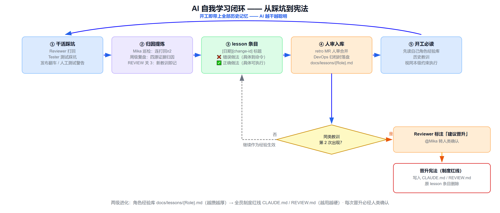

**采集（四源）**：

- Reviewer 打回 / Tester 测试踩坑 / DevOps 发布踩坑——REVIEW.md 关 3 / 关 9（lesson-check）要求"本次是否产生新教训？是则当场追加条目"
- Mika 兜底巡检：连续打回 ≥2 自动提炼 lesson
- DocKeeper 周级复盘 autopilot：人工测试报告逐 ⚠️ 四源归因（报告 × MR diff × OpenSpec 工件 × test-report），产 lesson 草案走 retro MR

**条目格式**（拒绝空话式教训，必须可执行）：

```
- [YYYY-MM-DD] [change-id] 一句话标题
  ❌ 错误做法（具体到命令/代码形态）
  ✅ 正确做法（具体可执行）
```

**入库**：按角色分文件 `docs/lessons/{Role}.md`（只追加不删除，索引不维护条目防漂移）；散落在 review-report / test-report 的条目由 DevOps 归档 change 时合并落盘；retro 草案经人审合并 MR 入库。

**消费**：AGENTS.md §7 读写矩阵——各角色开工先读 `docs/lessons/index.md` 再读自己角色文件，**历史教训视同本级约束执行**；Reviewer 还会在审查时抽查 Developer 是否读过（review-report 中引用条目编号）。

**晋升（知识进化）**：lesson-check 发现问题命中已有条目 = 曝光不足 → Reviewer 标注「建议晋升宪法」（同类第 2 次出现）→ @Mika 转人类确认 → 写入 CLAUDE.md / REVIEW.md 成为全员红线 → 原条目删除。经验库（越攒越厚）与制度红线（越用越硬）两级进化，每次晋升必经人类确认。

#### 架构级铁律

1. **写库 SQL 永不执行**：`ddl.sql` 与 `auth-resource.sql` 同等待遇，三件套（design.md + ddl + auth-resource）由发起人人工执行，agent 只生成与判读
2. **文档是唯一权威源**：`docs/database/` 只能经 `aicoding-db-schema-export` 生成；结构文档双重防守 = 变更随行（第一道）+ harness-audit 周级对账（第二道）
3. **env 永不代写**：环境变量是人工通道，agent 只在自己进程内读
4. **中文传参铁律**：含中文的 CLI 参数值一律经临时文件 `@文件` 传参（GBK 代码页乱码事故）
5. **密码 / token** 只走环境变量或位置指针，永不写入脚本参数、issue 评论或任何文档
6. **不中断批处理**：autopilot run 内不逐条停下等确认

---

## 附录 B：harness-runtime-flow.md 五阶段链运转流程与 autopilot 旁路（原文）

### Harness 运转流程 —— 一个 change 的完整生命周期

> 建区完成后（见 [harness-architecture.md](./harness-architecture.md)），harness 的日常运转以 **change issue** 为主线，由 Mika 编排五阶段链，人类只握两个人工门。本文描述这条主线及常驻 autopilot 旁路。目标仓库内部的治理结构见 [harness-repo-structure.md](./harness-repo-structure.md)。

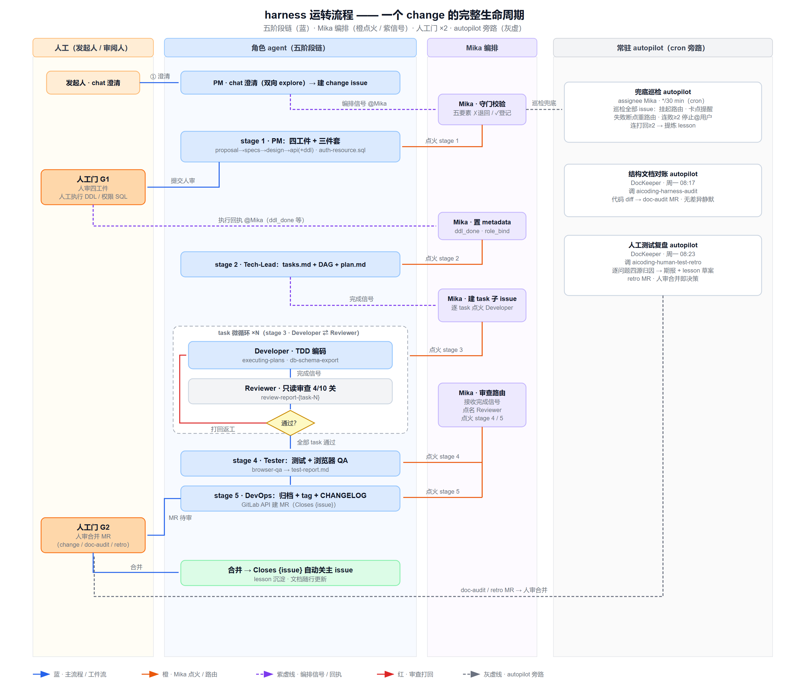

#### 主线：五阶段链

##### 起步：需求澄清与建单

1. 发起人 chat @PM，双向 explore 澄清需求（PM 不写代码）
2. PM 建 change issue，发出**编排信号 @Mika**
3. Mika 守门校验 issue **五要素**：change-id / 五阶段链 / 人工门段 / 验收点 / 澄清结论 —— 不通过退回澄清，通过则登记并进入 stage 路由

##### stage 1 · PM：四工件 + 三件套

- 产出 OpenSpec 四工件：`proposal → specs → design → api(+ddl)`（顺序铁律，先 WHAT 后 HOW）
- 同期生成三件套中的 `auth-resource.sql`（Vue2 走 config-auth-resource-v2，Vue3 走 v3，从 design.md 页面/按钮清单生成三表注册脚本）
- 提交人审，进入**人工门 G1**

##### 人工门 G1（第一道人工关口）

- 人审四工件（proposal / specs / design / api）
- **人工执行** `ddl.sql` 与 `auth-resource.sql`（写库 SQL 永不由 agent 执行；DDL 执行前 stage ≥2 被 block——TDD 依赖表结构先存在）
- 权限就绪后回执 @Mika，Mika 置 metadata（ddl_done / role_bind）解锁下游

##### stage 2 · Tech-Lead：拆解排期

- 读四工件拆 `tasks.md` + DAG + 排他文件清单，产 `plan.md`（superpowers:writing-plans）

##### stage 3 · Developer ⇄ Reviewer：task 微循环 ×N

Mika 按 tasks 逐条建子 issue 点火 Developer，循环直到全部 task 通过：

1. **Developer** 按 plan.md 单条目 TDD 编码（executing-plans + test-driven-development + systematic-debugging；DDL 变更后收尾调 db-schema-export 重生成库文档）
2. 完成信号 @Mika → Mika **点名 Reviewer**
3. **Reviewer** 只读审查（REVIEW.md：quick 4 关 / full 10 关），产 `review-report-{task-N}.md`；与 Developer 异模型防共谋
4. 未通过 → **红色打回**，Developer 返工重走循环；通过 → 下一 task

##### stage 4 · Tester：测试与浏览器 QA

- 集成 / 边界 / 性能测试 + 报告式浏览器 QA（aicoding-browser-qa，分级 Quick / Standard / Exhaustive）
- 产 `test-report.md`，不改生产代码

##### stage 5 · DevOps：归档与 MR

- 归档 change（openspec-archive-change）+ tag + CHANGELOG
- 走 GitLab API 建 MR（JSON body 经 `@文件` 传参，description 含 **`Closes {issue}`**）

##### 人工门 G2（终点）

人审合并 MR → GitLab 自动关闭主 issue → lesson 沉淀、文档随行更新，change 生命周期结束。

#### 旁路：常驻 autopilot（与主线并行）

| autopilot | assignee / 频率 | 运转方式 |
|---|---|---|
| 兜底巡检 | Mika · `*/30 min` | 巡检全部 issue：路由挂起 issue、人工卡点提醒、失败 run 断点重路由、连续失败 ≥2 停止重试 @用户、连续打回 ≥2 提炼 lesson。主通道是编排信号秒级唤醒，cron 仅为兜底 |
| 结构文档对账 | DocKeeper · 周一 08:17 | run 内调 `aicoding-harness-audit`：从上次同步基线到 `origin/master` 的 diff 映射到结构文档更新项，走 `feature/doc-audit-{date}` MR，无差异静默 |
| 人工测试复盘 | DocKeeper · 周一 08:23 | run 内调 `aicoding-human-test-retro`：游标增量读 `docs/human-test-reports/` 未读报告，逐 ⚠️ 四源证据链归因（报告 × MR diff × OpenSpec 工件 × test-report），产期报 + lesson 草案走 `retro/{date}` MR，**人审合并即决策** |

doc-audit / retro MR 与 change MR 同走 G2 人工审合并通道。

#### 学习闭环：每次踩坑都变成记忆（lesson 体系）

主线与旁路中反复出现的"lesson"，背后是一套贯穿运转的自我学习机制：


1. **采集**：REVIEW.md 关 3/9（lesson-check）要求审查时当场记录新教训；Mika 巡检对"连续打回 ≥2"自动提炼；DocKeeper 周级复盘对人工测试 ⚠️ 四源归因产 lesson 草案
2. **条目**：`[日期][change-id] 标题 + ❌ 错误做法 + ✅ 正确做法`，具体到命令/代码形态，拒绝空话
3. **入库**：按角色分文件写入 `docs/lessons/{Role}.md`（只追加不删除）；DevOps 归档时把 report 里散落条目合并落盘；retro 草案走 MR 人审合并
4. **消费**：各角色开工必读自己角色经验库，**历史教训视同本级约束执行**；Reviewer 审查时抽查是否读过
5. **晋升**：同类教训第 2 次出现（= 条目曝光不足）→ Reviewer 标注「建议晋升宪法」→ @Mika 转人类确认 → 写入 CLAUDE.md / REVIEW.md 全员红线，原条目删除

#### 关键运转机制

- **编排信号**：角色 agent 完成评论发【编排信号】@Mika 秒级唤醒接力，Mika 无需轮询
- **断点续传**：失败 run 由兜底巡检自动重路由；建 MR 失败不回滚、降级人工
- **权限边界**：所有 agent 只 push `feature/{change-id}`，禁直推保护分支；hooks/guard_write.py 拦截保护路径写入（yml / db / sql / pom 等），变更须 design.md 声明 + Reviewer 过审
- **失败升级**：连续失败 ≥2 停止重试 @用户；连续打回 ≥2 自动提炼 lesson 沉淀到 `docs/lessons/`
- **环境信息**：env 是人工通道（网页注入），agent 只在自己进程内读；密码 / token 永不入文档与评论

---

## 附录 C：harness-repo-structure.md 目标仓库治理结构与建设 5 步（原文）

### 目标仓库 harness 结构 —— agent 的制度与字典

> 平台侧（Multica + Mika + 7 角色）见 [harness-architecture.md](./harness-architecture.md)，日常运转见 [harness-runtime-flow.md](./harness-runtime-flow.md)。本文专讲**被治理的那个目标仓库**：里面铺了什么、每个文件管什么、怎么建起来、怎么防漂移。

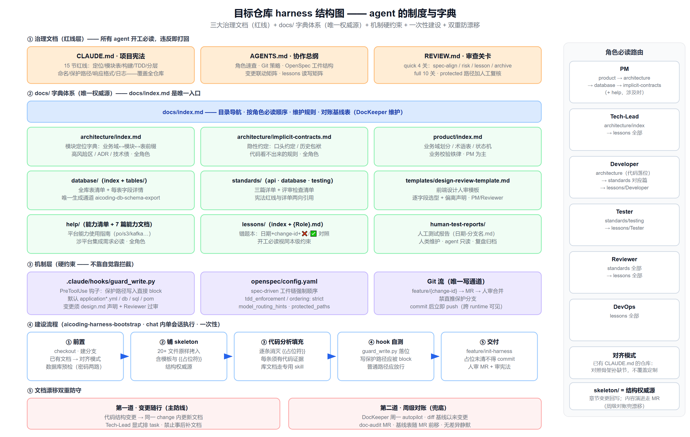

#### 一图总览

目标仓库 harness = **三大治理文档（红线）+ docs/ 字典体系（唯一权威源）+ 机制硬约束 + 一次性建设 + 双重防漂移**。前两者管"agent 读什么"，机制层管"agent 想越界时被什么拦住"，建设与防漂移管"这套制度怎么落地、怎么不过期"。

#### ① 治理文档（红线层）—— 开工必读，违反即打回

| 文档 | 定位 | 核心内容 |
|---|---|---|
| **CLAUDE.md** | 项目宪法 | 15 节红线：§0 适用范围 / §1 定位 / §2 模块表（业务域↔模块↔表前缀）/ §3 基础设施 / §4 构建命令 / §5 TDD 纪律 / §6 分层 / §7 命名 / … §10 保护路径。每个 agent 开工第一件事就是读它 |
| **AGENTS.md** | 协作总纲 | 角色速查表、Git 策略（`feature/{change-id}`、禁直推）、OpenSpec 工件结构、**变更联动矩阵**（改了 X 必须同步查 Y）、**§7 lessons 读写矩阵**（每角色读什么写什么） |
| **REVIEW.md** | 审查关卡 | quick 4 关：spec-align / risk-check / **lesson-check** / archive；full 10 关覆盖测试、分层、命名、安全；protected 路径变更另加人工复核 |

三份文档相互引用形成闭环：宪法立红线 → 总纲定协作 → 关卡验执行。

#### ② docs/ 字典体系 —— 唯一权威源

**`docs/index.md` 是唯一入口**：目录导航 + 按角色必读顺序 + 维护规则 + DocKeeper 对账基线表。任何人（含 agent）查文档先从这里进。

| 子目录 | 内容 | 主要读者 | 生成方式 |
|---|---|---|---|
| `architecture/index.md` | 模块定位字典、高风险区、ADR、技术债 | 全角色 | 人工 + 周级对账 |
| `architecture/implicit-contracts.md` | 隐性约定：口头约定、历史包袱、代码看不出来的规则 | 全角色 | 人工积累 |
| `product/index.md` | 业务域划分、术语表、状态机、业务校验铁律 | PM 为主 | PM 维护 |
| `database/`（index + tables/） | 全库表清单 + 每表字段详情 | Developer / Reviewer | **唯一通道 `aicoding-db-schema-export`** |
| `standards/`（api · database · testing） | 三篇详单 + 评审检查清单，与宪法红线两向引用 | Developer / Reviewer | 人工 + 对账 |
| `templates/design-review-template.md` | 前端设计人审模板（逐字段选型 + 偏离声明） | PM / Reviewer | 静态模板 |
| `help/`（能力清单 + 7 篇能力文档） | 平台能力使用指南（po / s3 / kafka…），涉平台集成需求必读 | 全角色 | 人工 |
| `lessons/`（index + {Role}.md） | 错题本：`[日期][change-id] ❌/✅ 对照` 条目，开工必读视同本级约束 | 各角色 | 人审 MR 入库 |
| `human-test-reports/` | 人工测试报告（`日期-分支名.md`），**人类维护、agent 只读**，复盘归档 | DocKeeper 读 | 人类写 |

#### ③ 机制层 —— 不靠自觉靠拦截

文档说了不算数的地方，由三道机制硬约束兜底：

1. **`.claude/hooks/guard_write.py`**：挂在 agent 工具调用前的 PreToolUse 钩子。对保护路径（`application*.yml` / `db/` / `sql/` / `settings.xml` / `pom.xml`）的写入**直接 block**——要改必须先在 design.md 声明且 Reviewer 过审。agent 想绕过？钩子根本不给执行机会。
2. **`openspec/config.yaml`**：spec-driven 工件流引擎。`tdd_enforcement: strict`（没有测试不让过）、`ordering: strict`（proposal → specs → design → tasks 顺序不能乱）、`model_routing_hints`（explore 小模型 / design·review 大模型 / apply 中档，按工序省钱）、`protected_paths`。
3. **Git 流（唯一写通道）**：所有提交只能走 `feature/{change-id}` 分支 → MR → 人工合并，直推保护分支被平台侧拒绝；commit 后立即 push（跨 runtime 可见）。

#### ④ 建设流程（aicoding-harness-bootstrap · 一次性）

对 Mika 说「铺设仓库 harness」，chat 内单会话五步完成（幂等，中断说"继续"即可续传）：

| 步骤 | 动作 | 关键点 |
|---|---|---|
| ① 前置 | checkout · 建分支 · 数据库预检 | 已有治理文档的仓库 → 切**对齐模式**（补缺节不覆盖定制）；密码两路校验 |
| ② 铺 skeleton | 20+ 文件原样拷入 | 含模板与 `{{占位符}}`；skeleton/ 是结构权威源 |
| ③ 代码分析填充 | 逐条消灭 `{{占位符}}` | **每条须有代码证据**，禁止编造；库文档走 `aicoding-db-schema-export` 专用 skill |
| ④ hook 自测 | guard_write.py 落位 | 写保护路径应被 block、普通路径应放行，自测通过才算装好 |
| ⑤ 交付 | `feature/init-harness` → MR | **占位符未清零不得 commit**；人审 MR + 审宪法首版 |

#### ⑤ 文档漂移双重防守

| 防线 | 机制 | 内容 |
|---|---|---|
| 第一道 · 变更随行（主防线） | 流程内嵌 | 代码结构变更 → **同一 change 内**更新对应文档；Tech-Lead 拆解时显式排 task，禁止事后补文档 |
| 第二道 · 周级对账（兜底） | DocKeeper autopilot（周一 08:17） | 调 `aicoding-harness-audit`：从上次基线到 `origin/master` 的 diff 映射为文档更新项，走 `feature/doc-audit-{date}` MR；基线表随 MR 前移；无差异静默不打扰 |

#### 角色必读路由（AGENTS.md §7 的落地）

| 角色 | 必读顺序 |
|---|---|
| PM | product → architecture → database → implicit-contracts（+ help，涉及时） |
| Tech-Lead | architecture/index → lessons 全部 |
| Developer | architecture（代码落位）→ standards 对应篇 → lessons/Developer |
| Tester | standards/testing → lessons/Tester |
| Reviewer | standards 全部 → lessons 全部 |
| DevOps | lessons 全部 |

#### 对齐模式与维护约定

- **对齐模式**：仓库已有 CLAUDE.md 等治理文档时，bootstrap 对照 skeleton 骨架**补缺节、不覆盖定制**——尊重既有制度，只补缺口。
- **结构权威源**：skeleton/ 决定章节结构；章节变更须回写 skeleton，内容演进走 MR；周级对账兜底防漂移。
- **database/ 例外**：库表文档永远只能由 `aicoding-db-schema-export` 从活库生成，人工不得手改——手改必与库漂移。

#### 铁律回响

平台侧六条铁律（见 [架构文档](./harness-architecture.md#架构级铁律)）在仓库侧的具体投射：写库 SQL 永不执行 → guard_write.py 拦 sql 目录；文档唯一权威源 → database/ 单通道生成 + 双重防守；其余红线 → CLAUDE.md 十五节逐一落地。

---

## 附录 D：harness-explained.md 通俗讲解版（原文）

### 一页看懂 sunny-multica harness

> 通俗讲解版。想看工程级细节，请移步：[架构图](./harness-architecture.md) · [运转流程图](./harness-runtime-flow.md)

#### 一句话

把开源工作台 [Multica](https://github.com/multica-ai/multica) 装修成一家 **"AI 编码公司"**：7 个 AI 角色像流水线工人一样接力干活，1 个 AI 调度员（Mika）管传棒，人类老板只在两个关口拍板。

#### 先看一张图

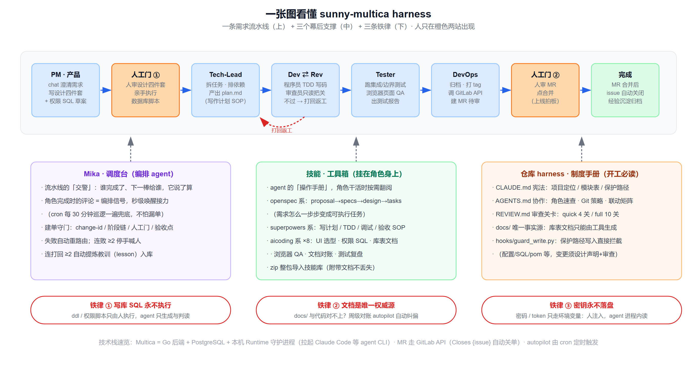

- **上半部**：一个需求从左到右走完 8 站，就变成了上线的代码
- **下半部**：三个"幕后部门"支撑着这条流水线不停转
- **橙色两站是人工**——除问答外，人只需要出现这两次

#### 用"一家公司"来理解

| 公司里 | harness 里 | 它干什么（关键细节） |
|---|---|---|
| 办公楼 + 看板 | **Multica 平台** | Go 后端 + PostgreSQL；每人的机器上跑一个 Runtime 守护进程，负责拉起 Claude Code 等 agent CLI |
| 调度员 | **Mika（编排 agent）** | 谁完成、下一棒给谁，它说了算；每 30 分钟 cron 巡逻兜底 |
| 产品经理 | **PM** | chat 里跟人澄清需求，产出 proposal→specs→design→api 四件工件 + 权限 SQL 草案 |
| 技术负责人 | **Tech-Lead** | 把设计拆成 `tasks.md` + 依赖图 + `plan.md` |
| 程序员（可多个） | **Developer ×N** | 严格 TDD：先写测试再写码，按 plan 单条目推进 |
| 代码审查员 | **Reviewer** | **只读**（无写权限），按 4 关/10 关清单出报告；跟程序员用不同模型，防止"互相包庇" |
| 测试 | **Tester** | 跑集成/边界测试 + 真实浏览器页面 QA，只出报告不改码 |
| 运维 | **DevOps** | 归档、打 tag、调 GitLab API 建 MR |
| 文档管理员 | **DocKeeper** | 每周一自动对账文档、复盘人工测试问题 |
| 老板 | **人类（你）** | 只拍板：审设计、执行数据库脚本、审 MR 点合并 |

#### 五个问题讲透

##### Q1：一个需求是怎么变成上线代码的？

八站接力，每站交接都有"证据"：

1. **PM 澄清 + 设计**：产出 OpenSpec 四工件，顺序铁律 `proposal → specs → design → api`（先"为什么"再"做什么"最后"怎么做"），外加 `auth-resource.sql`（菜单/按钮权限注册脚本）
2. **人工门①**：人审设计；**亲手**在数据库执行 DDL 和权限 SQL——AI 只生成脚本，永不碰库
3. **Tech-Lead 拆解**：任务清单 + 依赖图 + 排他文件清单（防止并行程序员改同一个文件打架）
4. **程序员⇄审查员循环**：写码 → 审查 → 不过就打回返工，每个任务都这样过一遍
5. **测试**：跑完出 `test-report.md`
6. **DevOps 建 MR**：MR 描述里埋了 `Closes {issue}`——**合并瞬间 GitLab 自动关闭主 issue**
7. **人工门②**：人审 MR 点合并，上线

##### Q2：人总共要出现几次？

- **建区时 3 次**：开头一轮问答（项目名/仓库/数据库）→ 中段一次网页操作（连 GitLab、注入环境变量）→ 结尾审合并 harness MR
- **之后每个需求 2 次**：人工门①（审设计+执行 SQL）和人工门②（审 MR 合并）
- **每周零星几次**：审 DocKeeper 自动提的文档对账 / 测试复盘 MR

其余时间不需要盯——agent 边做边在 issue 里评论汇报，需要拍板时收件箱才提醒你。

##### Q3：Mika 凭什么指挥得动？

- **事件驱动**：任何角色干完活发的完成评论就是"编排信号"，@Mika 秒级唤醒它派下一棒
- **cron 兜底**：每 30 分钟自动巡逻一遍所有 issue——挂起的重新路由、失败的断点重派
- **建单守门**：新 issue 必须写全五要素（change-id / 阶段链 / 人工门段 / 验收点 / 澄清结论），缺一样打回
- **升级机制**：连续失败 ≥2 次就停手 @人类；连续被打回 ≥2 次自动提炼教训（lesson）入库

##### Q4：AI 会不会乱改代码？

四道锁：

1. **开工必读**：每个 agent 干活前先读仓库里的 `CLAUDE.md`（项目宪法）和 `AGENTS.md`（协作总纲）
2. **写入拦截**：`hooks/guard_write.py` 是挂在 agent 工具调用前的钩子——配置文件、SQL 目录、pom.xml 等保护路径的写入**直接被拦下**，要改必须先在设计文档里声明并过审
3. **只读审查**：Reviewer 根本没有写权限，想放水也放不了
4. **Git 铁律**：所有人（包括 AI）只能 push `feature/{change-id}` 分支，直推保护分支被禁止；上主线只有一条路——MR 人工合并

##### Q5：出错了怎么办？

| 情况 | 自动处理 |
|---|---|
| 某次运行失败 | Mika 兜底巡检断点重路由，接着干 |
| 连续失败 ≥2 次 | 停止重试，@人类来看 |
| 审查不过 | 红牌打回，Developer 返工重走循环 |
| 连续打回 ≥2 次 | 自动提炼 lesson，下次同类问题提前规避 |
| 文档和代码对不上 | 周一 08:17 DocKeeper 自动 diff 对账，提文档修正 MR |
| 人工测试又踩了坑 | 周一 08:23 自动复盘归因，四源证据链（报告×MR×工件×测试报告）定位到环节 |

##### Q6：AI 怎么越干越聪明？（自我学习闭环）

每个角色都有一本"错题本"（`docs/lessons/{角色}.md`），形成一个记忆闭环：


- **踩坑即记录**：审查打回、测试翻车、人工测试报警——REVIEW.md 的 lesson-check 关卡要求"当场记教训"，格式必须写清 ❌ 错误做法 / ✅ 正确做法（具体到命令，拒绝"下次小心"式空话）
- **归因自动化**：Mika 巡检发现"连续打回 ≥2 次"自动提炼；每周一 DocKeeper 复盘人工测试问题，四源证据链（报告×MR×工件×测试报告）定位到环节
- **人审入库**：教训草案走 MR，人审合并才算数——AI 不能自说自话改"错题本"
- **开工必读**：角色干活前先读自己的错题本，**历史教训视同本级约束执行**；Reviewer 还会抽查"你读过了吗"
- **晋升机制（精髓）**：同类教训出现第 2 次 = 错题本曝光不足 → Reviewer 标注"建议晋升宪法" → 人类确认后写进 CLAUDE.md / REVIEW.md 成为**全员红线**，原条目删除

两级进化：错题本（个人经验，越攒越厚）→ 宪法红线（全员制度，越用越硬）。

#### 技术细节速查卡

| 名词 | 人话解释 |
|---|---|
| **Multica** | 开源 AI 团队工作台：Go 后端 + PostgreSQL + 本机 Runtime 守护进程，把各种 agent CLI（Claude Code 等 26 种）变成看板上的"同事" |
| **skill** | 挂在 agent 身上的操作手册，本仓库 8 个业务 skill + superpowers 工程系 + openspec 工件系，全部经 `multica skill import` zip 通道整包入库（防附带文档丢失） |
| **openspec** | 需求工件流水线规范；配置了 `tdd_enforcement: strict`（不写测试不让过）和 `ordering: strict`（工件顺序不能乱） |
| **编排信号** | 角色完成时发的特定格式评论，@Mika 即唤醒，是整个接力系统的"神经脉冲" |
| **三件套** | design.md + ddl.sql + auth-resource.sql，一律人工执行，AI 只生成与判读 |
| **`@文件` 传参** | Windows 下含中文的命令行参数会因 GBK 代码页乱码，所以一律写临时文件再 `@` 引用——血泪教训固化的铁律 |
| **env 人工通道** | 数据库密码、token 等只由人在网页上注入环境变量，agent 只能在自己进程里读，永不落盘到文档/评论 |
| **model_routing_hints** | openspec 配置里按工序路由模型：explore 用小模型、design/review 用大模型、apply 用中档——省钱的精细化调度 |
| **autopilot** | cron 定时任务：巡检 `*/30 * * * *`、文档对账周一 08:17、测试复盘周一 08:23（错开避免撞车） |
| **lesson 错题本** | `docs/lessons/{角色}.md`，❌/✅ 对照条目，开工必读视同本级约束；同类教训第 2 次出现自动晋升为宪法红线（详见 Q6） |

#### 三条铁律（再念一遍）

1. **写库 SQL 永不执行**——ddl / 权限脚本只由人执行
2. **文档是唯一权威源**——库表文档只能由 `aicoding-db-schema-export` 工具生成，漂移有周级对账兜底
3. **密钥永不落盘**——密码 / token 只走环境变量

#### 想深入？

- 看清每一层怎么搭：[harness 架构图](./harness-architecture.md)
- 看清每个环节怎么转：[harness 运转流程图](./harness-runtime-flow.md)
- 看清目标仓库里铺了什么：[目标仓库 harness 结构](./harness-repo-structure.md)

---

## 附录 E：Harness V2 架构设计文档（原文）

### Harness 完全体架构设计文档

> 版本：2.0 | 更新日期：2026-06-10
> 定位：制造业系统 AI 辅助开发的工程化工作流架构

---

#### 引言：AI Coding 的演化之路

##### 从 Prompt 到 Harness：三次范式跃迁

AI 辅助编程并非一蹴而就。过去两年间，整个行业经历了三次范式跃迁，每一次都解决了一个更深层的问题：

```
Prompt Engineering    →    Context Engineering    →    Harness Engineering
     "说什么"                    "给什么信息"                "怎么可靠运转"
```

**第一次跃迁：Prompt Engineering（提示词工程）**

2023-2024 年，"Prompt Engineer"一度被视为最有前途的职业。零样本提示、少样本提示、思维链（CoT）、角色扮演、提示链等技术层出不穷，核心目标是：**如何跟 AI 说清楚你要什么**。但随着模型能力飞速提升（GPT-3 → GPT-4 → Claude 3），写好 Prompt 的边际效益显著降低——模型本身已经足够聪明，能理解模糊表达。真正的问题不再是"说清楚"，而是"它根本不知道关键信息"。

**第二次跃迁：Context Engineering（上下文工程）**

当模型能力够强却依然出错时，人们意识到问题出在上下文窗口里装了什么。RAG（检索增强生成）、上下文压缩、滚动摘要、层次记忆等技术被系统化应用。OpenAI 的实战经验验证了一条铁律：将巨型规范文件压缩为百行索引，需要时动态加载子文档，模型的遵从度反而显著提升。Context Engineering 回答了"模型在回答时该知道什么"。

**第三次跃迁：Harness Engineering（驾驭工程）**

即使 Prompt 精准、上下文完备，一个不受约束的 Agent 依然会失控——顺手重构不该动的模块、声称测试通过却根本没运行、命名风格与项目不一致。这不是模型的问题，而是**系统层面缺乏约束、验证和反馈机制**。Harness Engineering 应运而生，回答"整个 AI 系统如何可靠地运转"。

> **三者不是替代关系，而是嵌套关系。** 没有 Prompt 基础，Context 无法被正确理解；没有 Context 支撑，Harness 在信息真空中运行；没有 Harness 约束，再好的 Prompt 和 Context 也只是沙滩上的城堡。

##### 从 Vibe Coding 到工程化护栏

Andrej Karpathy 在 2025 年提出 **Vibe Coding（氛围编程）**：开发者通过自然语言描述意图，让 AI 生成代码，观察效果后再反馈调整。效率惊人（据调研可达 126% 提升），但也带来四大痛点：

| 痛点 | 表现 |
|------|------|
| 代码正确性失控 | AI 生成"看起来正确但实际错误"的幻觉代码 |
| 架构一致性缺失 | 快速迭代导致"意大利面条式代码" |
| 需求歧义与翻译损耗 | 自然语言缺乏精确性，AI "自由发挥"空间过大 |
| 缺乏可追溯性 | 没有单一事实来源，团队协作困难 |

社区在实战中逐步形成了五大方法论作为 Vibe Coding 的工程化护栏：

| 方法论 | 定位 | 解决的问题 |
|--------|------|-----------|
| **SDD**（规格驱动开发） | 战略层 — "做什么" | 规格作为唯一事实来源，代码只是规格的表达 |
| **DDD**（领域驱动设计） | 架构层 — "怎么组织" | 统一语言、限界上下文，给 AI 提供架构边界 |
| **ATDD**（验收测试驱动） | 验收层 — "行为是否正确" | 纯领域语言的 Given-When-Then 规格，防止实现细节泄露 |
| **TDD**（测试驱动开发） | 执行层 — "如何正确实现" | Red-Green-Refactor 循环，测试作为 AI 的契约 |
| **BDD**（行为驱动开发） | 协作层 — "业务如何描述" | 跨角色统一语言，活文档 |

这五大方法论的组合，让 Vibe Coding 从"靠感觉"进化为"有护栏、可追溯、可重复"的工程化范式。

##### Rule → Spec → Loop → Harness：控制面的逐层收紧

Phodal 在帮多个团队落地 AI Coding 时发现，AI Coding 的瓶颈从来不在生成端，而在接收端。他提出了四步渐进路径：

| 阶段 | 核心问题 | 本质 |
|------|----------|------|
| **Rule** | 不要乱来 | 先写 NEVER 和 DO NOT，让 AI 先学会不越界 |
| **Spec** | 这次只做什么 | 把模糊意图压缩成可执行、可审查、可验证的变更 |
| **Loop** | 怎么持续收敛 | 读取上下文→做最小改动→运行验证→记录状态→进入下一轮 |
| **Harness** | 凭什么被信任 | 约束+验证+评审+放行，让组织放心 |

四层有严格的依赖关系：没有 Rule，Spec 只是在给无边界的 Agent 提需求；没有 Spec，Loop 只是把错误更高效地放大；没有 Loop，Harness 只能在末端被动兜底。

##### Harness 的衰变定律

Anthropic 的研究发现了一个深刻规律：**模型能力越强，所需的 Harness 越简单。** Claude 3.0 时代需要极严格约束的规则，到 Claude 3.5 时代许多规则自然不再必要。这意味着 Harness 的设计应集中在两类场景：

1. **模型短期内无法自行解决的问题** — 行业特定规则、合规要求、复杂系统协同
2. **即使模型能力再强也无法自行建立的外部接口** — 工具调用、API 集成、权限控制

> 能根据模型能力的边界动态调整 Harness 的"厚度"，才能在工程效率上获得最高回报。

##### 本文档的 Harness 架构

本文档描述的 7 层 Harness 架构，正是上述演化路径的工程化落地：

| 演化阶段 | 对应架构层 | 实现方式 |
|----------|-----------|---------|
| Rule | CLAUDE.md + Hooks | 编码红线、文件保护、约束检查 |
| Spec | L1 OpenSpec | 4 工件强制顺序：proposal → specs → design → tasks |
| Loop | L2 Superpowers + L7 HyperSpec | TDD 红绿重构循环 + 12 checkpoint 状态机 |
| Harness | L3 审查层 + 安全保护层 | 双轨审查 + guard_write + run_checks |

在此基础上，L4 领域知识层、L5 工具精度层、L6 持续学习层进一步增强了 AI 的领域感知和工具精确度，让整个系统从"偶尔能用"走向"稳定交付"。

---

#### 一、概述

##### 1.1 什么是 Harness

Harness 是一套为 Claude Code 设计的**分层 AI 开发工作流架构**，将 AI 辅助开发从"随意对话"升级为"工程化流水线"。它通过 7 层架构，在规范管理、编码纪律、代码审查、流程编排、领域知识、工具精度和持续学习 7 个维度提供完整支撑。

##### 1.2 核心设计理念

| 理念 | 说明 |
|------|------|
| **规范先行** | 需求不清不写代码，先 WHAT 后 HOW |
| **纪律内置** | TDD 不是可选项，是新代码的强制约束 |
| **审查自适应** | 改一个字段不跑 9 关审查，跨模块重构不省略任何关卡 |
| **编排自动化** | 一条命令启动全自动流程，断点可恢复 |
| **领域感知** | 内置制造业 Spring Boot / JPA / 平台包的领域知识 |
| **工具精确** | LSP/AST 级代码分析，不靠文本猜测 |
| **越用越聪明** | 跨会话积累项目知识，隐性约定自动沉淀 |

---

#### 二、架构总览

##### 2.1 七层架构图

```
┌──────────────────────────────────────────────────────────────────┐
│                         用户交互层                                │
│            手动路径 (/opsx:*)    │    自动路径 (/hyperspec)       │
└───────────────┬─────────────────────────────────┬────────────────┘
                │                                 │
┌───────────────▼─────────────────────────────────▼────────────────┐
│                    L7  编排层 — HyperSpec                          │
│     12 checkpoint 状态机  │  断点恢复  │  审查路由  │  通知回调      │
├────────┬──────────┬───────────────┬───────────────────────────────┤
│        │          │               │                               │
│  L1    │   L2     │     L3        │            L4-L6              │
│ 规范层  │  纪律层   │   审查层      │          增强层               │
│        │          │               │                               │
│OpenSpec│Superpowers│  双轨审查     │  ┌─────────────────────────┐  │
│        │          │               │  │ L6 持续学习层            │  │
│proposal│  TDD     │ ┌───────────┐ │  │ ECC 本能系统            │  │
│specs   │  子代理   │ │轻量 3 关  │ │  │ 跨会话知识积累          │  │
│design  │  验证     │ │quick-     │ │  ├─────────────────────────┤  │
│tasks   │          │ │review    │ │  │ L5 工具精度层            │  │
│        │          │ └───────────┘ │  │ OMC MCP                 │  │
│        │          │               │  │ LSP / AST / Python REPL │  │
│        │          │ ┌───────────┐ │  ├─────────────────────────┤  │
│        │          │ │完整 9 关  │ │  │ L4 领域知识层            │  │
│        │          │ │gstack    │ │  │ ECC 技能库              │  │
│        │          │ └───────────┘ │  │ springboot / jpa / api  │  │
│        │          │               │  └─────────────────────────┘  │
├────────┴──────────┴───────────────┴───────────────────────────────┤
│                      安全保护层 — Hooks                            │
│       guard_write  │  ensure_change_context  │  run_checks         │
├───────────────────────────────────────────────────────────────────┤
│                      模型路由层                                    │
│       haiku (探索/快速)  │  sonnet (实现/审查)  │  opus (架构/深度)   │
└───────────────────────────────────────────────────────────────────┘
```

##### 2.2 各层职责一览

| 层级 | 名称 | 核心工具 | 职责 | 说明 |
|------|------|----------|------|------|
| L7 | 编排层 | HyperSpec | 全流程编排、状态管理、审查路由、通知 | 支持 12 checkpoint 状态机、断点恢复、审查自动路由和通知回调 |
| L1 | 规范层 | OpenSpec | 工件化需求管理（proposal→specs→design→tasks） | 通过 4 工件强制顺序，确保需求在编码前明确 |
| L2 | 纪律层 | Superpowers | TDD 红绿重构、子代理开发、完成验证 | TDD 强约束，每个 task 包含完整的红绿重构步骤 |
| L3 | 审查层 | quick-review + gstack | 双轨代码审查，按复杂度自动路由 | 轻量 3 关处理简单变更，完整 9 关处理复杂变更 |
| L4 | 领域知识层 | ECC 技能库 | Spring Boot/JPA/API 编码模式 | 10+ 领域技能，按文件类型自动激活 |
| L5 | 工具精度层 | OMC MCP | LSP/AST 结构化代码分析 | 提供 LSP 悬浮、定义跳转、AST 搜索等结构化分析能力 |
| L6 | 持续学习层 | ECC 本能 | 跨会话知识积累与沉淀 | 自动捕获隐性约定、踩坑经验、团队偏好 |
| — | 安全保护层 | Hooks | 文件保护、变更上下文、编译检查 | 拦截保护目录写入、阻止无上下文风险命令 |
| — | 模型路由层 | OMC 路由 | 按任务复杂度选择 Claude 模型 | 三层路由：haiku/sonnet/opus 按任务复杂度自动选择 |

---

#### 三、核心层详解

##### 3.1 L1 规范层 — OpenSpec

**作用：** 将模糊的需求转化为结构化的工程工件，确保"做什么"在写代码前就明确。

**4 工件创建顺序（强制，不可跳步）：**

```
proposal ──→ specs ──→ design ──→ tasks
 (WHY)      (WHAT)    (HOW)     (执行清单)
```

| 工件 | 文件 | 内容 | 谁审 |
|------|------|------|------|
| proposal | `proposal.md` | 变更动机、边界（做什么/不做什么） | 人类必审 |
| specs | `specs/*.md` | 需求规格、接口定义、数据结构 | 人类选审 |
| design | `design.md` | 技术方案、涉及模块、表名、接口 | 人类必审 |
| tasks | `tasks.md` | 2-5 分钟粒度的原子任务清单 | 人类审粒度 |

**命令体系：**

| 命令 | 作用 |
|------|------|
| `/opsx:explore` | 反问澄清需求（不生成工件） |
| `/opsx:propose` | 生成 4 工件 |
| `/opsx:continue` | 单步推进下一个工件 |
| `/opsx:ff` | 一次生成全部工件 |
| `/opsx:verify` | 验证代码与规范对齐 |
| `/opsx:apply` | 按 tasks 逐条执行 |
| `/opsx:archive` | 归档变更 |

##### 3.2 L2 纪律层 — Superpowers

**作用：** 强制执行编码纪律，确保新代码有测试、有验证。

**核心技能：**

| 技能 | 触发方式 | 作用 |
|------|----------|------|
| `test-driven-development` | always_active（隐式） | TDD 红绿重构：写失败测试→确认失败→写实现→确认通过→提交 |
| `verification-before-completion` | always_active（隐式） | 标记完成前必须跑编译+测试验证 |
| `subagent-driven-development` | 按需调用 | 为每个原子任务派发独立子代理并行开发 |
| `writing-plans` | 按需调用 | 将 tasks.md 拆细为 TDD 实现计划 |
| `systematic-debugging` | 按需调用 | 遇到 Bug 时系统化排查 |

**TDD 强约束规则（来自 openspec/config.yaml）：**

每个 task 必须包含 5 个固定步骤：
1. 写失败测试（附完整测试代码）
2. 跑测试——确认失败（附命令+预期输出）
3. 写最小实现（附完整实现代码）
4. 跑测试——确认通过（附命令+预期输出）
5. 提交（附 git 命令）

##### 3.3 L3 审查层 — 双轨审查

**作用：** 根据变更复杂度自动选择审查强度，避免"杀鸡用牛刀"。

###### 3.3.1 轻量审查 — quick-review（3 关）

**适用场景：** 日常 CRUD 字段变更、Bug 修复、小接口调整

**触发条件（全部满足）：**
- task 数量 ≤ 3
- 涉及模块 ≤ 1
- 无 DDL 变更（CREATE/ALTER/DROP TABLE）
- 无跨服务调用变更

**3 关流水线：**

```
┌────────────────┐     ┌────────────────┐     ┌────────────────┐
│   第 1 关       │     │   第 2 关       │     │   第 3 关       │
│  spec-align     │────→│  risk-check     │────→│  archive       │
│  规范对齐       │     │  风险检查       │     │  归档          │
│  (1 次 AI 调用) │     │  (1 次 AI 调用) │     │  (复用现有)    │
└────────────────┘     └────────────────┘     └────────────────┘
```

**第 1 关 — spec-align（规范对齐 + 工程质量）：**

| 检查项 | 具体内容 |
|--------|----------|
| 规范对齐 | 代码与 tasks.md 逐条对齐，无遗漏无多余 |
| Spring 分层 | Controller 不直接操作 DAO；Service 继承 BaseServiceManager |
| DTO 规范 | 单一 DTO 不拆分；Controller 层只用 DTO 不用 Entity |
| Entity 规范 | 禁用 Lombok；手写 getter/setter |
| 平台包使用 | 优先 sunny-base-*，不引重叠依赖 |
| 通用质量 | 无死代码、无 console.log、无 TODO、import 干净 |

**第 2 关 — risk-check（风险检查）：**

| 检查项 | 具体内容 |
|--------|----------|
| SQL 安全 | 参数化查询、无拼接 SQL、SELECT * 检查 |
| 空值处理 | 新字段可空性、前端空值展示、接口返回 null 安全 |
| 索引感知 | 新增 WHERE 条件是否走索引、避免全表扫描 |
| 隐性约定 | 修改状态字段/接口返回前已查 docs/architecture/implicit-contracts.md |
| 接口兼容 | 不破坏已有接口契约、字段新增而非修改 |
| 数据兼容 | DDL 变更对存量数据的处理（默认值、迁移脚本） |

**第 3 关 — archive（归档）：**
复用 `/opsx:archive`，将 change 移入 `openspec/archive/` 并合并 specs。

###### 3.3.2 完整审查 — gstack（9 关）

**适用场景：** 新模块开发、跨模块重构、涉及 DDL 变更、新集成对接

**触发条件（任一满足）：**
- task 数量 > 3
- 涉及模块 ≥ 2
- 有 DDL 变更
- 有跨服务调用变更
- 用户显式调用 `/full-review`

**9 关流水线（保持不变）：**

```
┌─────┐  ┌───────┐  ┌────────┐  ┌─────┐  ┌────────┐
│ 1.  │  │ 2.    │  │ 3.     │  │ 4.  │  │ 5.     │
│verify│→│review │→│spring  │→│ sql │→│security│
└─────┘  └───────┘  └────────┘  └─────┘  └────────┘
                                              │
┌─────┐  ┌───────┐  ┌────────┐  ┌────────┐   │
│ 9.  │  │ 8.    │  │ 7.     │  │ 6.     │←──┘
│archive│←│  PR   │←│  qa    │←│simplify│
└─────┘  └───────┘  └────────┘  └────────┘
```

| 关卡 | 命令 | 作用 |
|------|------|------|
| 1 | `/opsx:verify` | 规范对齐 |
| 2 | `gstack /review` | 通用代码质量 |
| 3 | `/spring-architecture-review` | Spring 分层审查 |
| 4 | `/sql-risk-review` | SQL 风险审查 |
| 5 | `gstack /security-review` | 安全审查 |
| 6 | `gstack /simplify` | 简化重构 |
| 7 | `gstack /qa` | 真实测试 |
| 8 | `/prepare-review` | PR 摘要 |
| 9 | `/opsx:archive` | 归档 |

**关键约束：** 每关失败必须修完才能进下一关。

###### 3.3.3 自动路由机制

```
                    ┌──────────────────┐
                    │  进入审查阶段     │
                    └────────┬─────────┘
                             │
                    ┌────────▼─────────┐
                    │   分析变更特征    │
                    └────────┬─────────┘
                             │
                ┌────────────▼────────────────┐
                │ task ≤ 3                     │
                │ AND 模块 ≤ 1                 │
                │ AND 无 DDL                   │──── 否 ────→ gstack 完整 9 关
                │ AND 无跨服务                  │
                └────────────┬────────────────┘
                             │ 是
                    ┌────────▼─────────┐
                    │ quick-review 3 关 │
                    └──────────────────┘
```

**用户可显式覆盖：**
- `/quick-review` — 强制轻量审查（不管复杂度）
- `/full-review` — 强制完整审查（不管复杂度）

##### 3.4 L7 编排层 — HyperSpec

**作用：** 全流程自动编排，将 L1-L6 各层串联为一条自动流水线。

**核心能力：**

| 能力 | 说明 |
|------|------|
| 12 checkpoint 状态机 | 追踪流程进度，断点可恢复 |
| 三阶段流程 | propose → apply → archive |
| 审查路由 | 自动判断使用轻量或完整审查 |
| 通知回调 | 关键节点通知（Telegram/Discord/Slack） |
| 自动 commit | 每完成一个 task 自动 commit |

**12 Checkpoint 状态机：**

```
profiler-done → requirements-confirmed → openspec-generated →
plan-generated → plan-generated-and-confirmed → task-N-complete →
verified → reviewed → apply-done → consistency-verified →
archived → done
```

**断点恢复规则：**
- 实际文件状态是 ground truth
- 状态文件只是缓存
- 两者冲突时以实际文件为准并修正状态文件

**通知回调点：**

| 节点 | 通知内容 |
|------|----------|
| openspec-generated | "需求工件已生成，请审核 proposal" |
| plan-generated-and-confirmed | "实现计划已确认，即将开始编码" |
| reviewed | "审查已完成，请查看结果" |
| archived | "变更已归档，流程结束" |

##### 3.5 L4 领域知识层 — ECC 技能库

**作用：** 为 AI 提供制造业 Spring Boot 项目的领域编码模式，让 AI 写出符合团队规范的代码。

**集成的技能清单：**

| 技能 | 提供什么 | 何时激活 |
|------|----------|----------|
| `springboot-patterns` | Spring Boot 分层架构、Bean 管理、配置模式 | 涉及 Spring 代码时 |
| `springboot-security` | 认证授权、权限控制、安全配置 | 涉及安全相关代码时 |
| `springboot-tdd` | Spring Boot 测试模式、Mock 策略、测试配置 | 写测试时 |
| `jpa-patterns` | JPA 实体设计、关联映射、查询优化、N+1 问题 | 涉及 Entity/Mapper 时 |
| `api-design` | RESTful API 设计、DTO 设计、接口版本管理 | 设计/实现接口时 |
| `database-migrations` | 数据库迁移策略、DDL 变更安全、数据兼容 | 涉及 DDL 时 |
| `backend-patterns` | 后端通用模式（缓存、异常处理、日志） | 通用后端代码 |
| `postgres-patterns` | PostgreSQL 特有模式、性能优化 | 涉及 SQL 优化时 |
| `deployment-patterns` | 部署模式、环境配置 | 涉及部署时 |
| `docker-patterns` | Docker 最佳实践 | 涉及容器化时 |

**集成方式：** 放入 `.claude/skills/` 目录，HyperSpec apply 阶段根据文件类型自动激活。

##### 3.6 L5 工具精度层 — OMC MCP

**作用：** 提供结构化代码分析能力，让审查和实现基于精确的代码结构而非文本猜测。

**工具清单：**

| 工具 | 类型 | 用途 |
|------|------|------|
| `lsp_hover` | LSP | 查看类型信息、文档 |
| `lsp_goto_definition` | LSP | 跳转到定义 |
| `lsp_find_references` | LSP | 查找所有引用 |
| `lsp_diagnostics` | LSP | 获取编译错误/警告 |
| `lsp_completion` | LSP | 代码补全 |
| `lsp_rename` | LSP | 安全重命名 |
| `ast_grep_search` | AST | 按语法结构搜索代码模式 |
| `ast_grep_replace` | AST | 按语法结构替换代码模式 |
| `python_repl` | REPL | 交互式 Python 执行 |

**审查层增强效果：**

| 原有能力 | 增强后 |
|----------|--------|
| Spring 分层审查：文本匹配 import | LSP 精确分析类依赖关系 |
| SQL 风险审查：正则匹配 SQL 字符串 | AST 精确定位 SQL 构建模式 |
| 代码审查：通用的 diff 审查 | LSP 引用分析 + AST 模式匹配 |

**集成方式：** 注册为 MCP 服务器到 `.claude/settings.local.json`。

##### 3.7 L6 持续学习层 — ECC 本能系统

**作用：** 自动积累跨会话的项目知识，减少重复犯错。

**学习内容：**

| 知识类型 | 示例 | 存储位置 |
|----------|------|----------|
| 隐性约定 | "这个字段改了必须同步改那个表" | `.claude/instincts/` |
| 踩坑经验 | "这个 Service 不能直接注入，要用工厂获取" | `.claude/instincts/` |
| 团队偏好 | "我们团队习惯用 QueryDSL 不用 JPQL" | `.claude/instincts/` |
| API 变更 | "这个接口已废弃，用新接口" | `.claude/instincts/` |

**工作机制：**
1. **观察模式（SessionStart Hook）**：加载已有本能
2. **捕获模式（SessionEnd Hook）**：自动提取本次会话的隐性知识
3. **应用模式（开发中）**：AI 在编码时自动参考本能知识
4. **分享模式**：支持 `/instinct-export` `/instinct-import` 团队共享

**与现有隐性约定的关系：**
- 现有 `docs/architecture/implicit-contracts.md` 保持不变，作为显式约定
- 本能系统作为补充，自动发现和积累隐式约定
- 两者不冲突：显式优先，本能补充

##### 3.8 安全保护层 — Hooks

**保持不变，3 个 Hook 脚本：**

| 时机 | 脚本 | 作用 |
|------|------|------|
| 编辑/写入前 | `guard_write.py` | 拦截对保护目录的写入（application.yml、db/、sql/） |
| Bash 命令前 | `ensure_change_context.py` | 无活跃 change 时阻止风险命令 |
| 编辑/写入后 | `run_checks.sh` | Java 文件保存后自动编译检查 |

##### 3.9 模型路由层

**作用：** 按任务复杂度选择 Claude 模型，优化成本。

| 级别 | 模型 | 适用场景 | Harness 中的应用 |
|------|------|----------|-----------------|
| 低 | haiku | 快速查询、简单搜索 | OpenSpec explore、轻量审查 spec-align |
| 中 | sonnet | 标准实现、常规审查 | Superpowers apply、quick-review risk-check |
| 高 | opus | 架构决策、深度分析 | OpenSpec propose、gstack 审查、复杂 debug |

**实现方式：** 在 `openspec/config.yaml` 中配置路由提示，HyperSpec 各阶段自动选择。

---

#### 四、AI 工作流程：沿架构的执行链路

##### 4.1 AI 会话的完整生命周期

当开发者打开 Claude Code 进入项目时，AI 并不是"从零开始"的。它沿着 Harness 架构的各层，经历一个完整的初始化→理解→执行→验证→学习过程。

```
┌─────────────────────────────────────────────────────────────────┐
│                     AI 会话生命周期                               │
│                                                                 │
│  ① 会话启动        ② 需求理解      ③ 计划拆解                    │
│  ┌──────────┐     ┌──────────┐     ┌──────────┐                │
│  │ 上下文加载│────→│ 规范层启动 │────→│ 纪律层介入 │                │
│  │ 技能自检  │     │ 工件生成  │     │ TDD 计划  │                │
│  │ 本能加载  │     │ 人类审核  │     │ 复杂度判断 │                │
│  └──────────┘     └──────────┘     └──────────┘                │
│                                          │                      │
│  ⑥ 学习沉淀        ⑤ 审查归档      ④ 编码实施                    │
│  ┌──────────┐     ┌──────────┐     ┌──────────┐                │
│  │ 本能捕获  │←────│ 审查层路由 │←────│ 领域技能  │                │
│  │ 知识沉淀  │     │ 自动审查  │     │ 工具辅助  │                │
│  │ 状态持久  │     │ 归档变更  │     │ TDD 循环  │                │
│  └──────────┘     └──────────┘     └──────────┘                │
└─────────────────────────────────────────────────────────────────┘
```

##### 4.2 阶段 ①：会话启动——AI 如何"认识"你的项目

AI 进入项目后，第一件事不是写代码，而是**加载上下文、建立认知**。

```
开发者打开 Claude Code
        │
        ▼
┌───────────────────────────────────────────────────────────┐
│ Hook: SessionStart 触发                                    │
│                                                            │
│  1. 读取 AGENTS.md                                         │
│     └→ 找到入口："先看 docs/harness/integration.md"         │
│     └→ 知道项目使用 Harness 工作流                          │
│                                                            │
│  2. 读取 CLAUDE.md                                         │
│     └→ 加载编码规则（分层架构、Entity 禁用 Lombok 等）      │
│     └→ 加载 Superpowers 元技能自检指令                      │
│     └→ 知道 TDD 是强制约束                                 │
│                                                            │
│  3. 调用 using-superpowers 元技能                           │
│     └→ 扫描 .claude/skills/ 下所有可用技能                  │
│     └→ 建立"当前可用技能清单"的内部认知                     │
│     └→ 知道自己拥有 springboot/jpa/api 等领域知识           │
│     └→ 知道自己拥有 LSP/AST 分析工具                        │
│                                                            │
│  4. 加载 ECC 本能系统（L6 持续学习层）                      │
│     └→ 读取 .claude/instincts/ 下的历史知识                 │
│     └→ 获得上次会话积累的隐性约定和踩坑经验                 │
│     └→ 知道"这个字段改了必须同步改那个表"                   │
│                                                            │
│  5. HyperSpec 状态检测（L7 编排层）                         │
│     └→ 读取 .hyperspec-state.yaml                           │
│     └→ 检测是否有未完成的 checkpoint                        │
│     └→ 如有：提示"上次中断在 task-3，是否继续？"            │
│     └→ 如无：准备就绪，等待指令                             │
│                                                            │
│  6. 包管理器检测                                            │
│     └→ 自动识别 npm/pnpm/yarn/bun                           │
│     └→ 项目类型检测（Spring Boot / React / 等）             │
└───────────────────────────────────────────────────────────┘
        │
        ▼
    AI 已"认识"项目，等待开发者指令
```

**此时 AI 的"大脑"里有什么：**
- 项目的编码规范和分层规则
- 所有可用的技能（56+ 个）和工具（18+ 个 MCP 工具）
- 历史会话积累的项目知识（本能系统）
- 当前工作状态（是否有未完成的变更）

##### 4.3 阶段 ②：需求理解——AI 如何"想清楚"做什么

当开发者发出 `/opsx:propose` 或 `/hyperspec` 后，AI 进入需求理解阶段。

```
开发者："/opsx:propose" 或 "/hyperspec"
        │
        ▼
┌───────────────────────────────────────────────────────────┐
│ L7 编排层：HyperSpec 启动 Propose 阶段                     │
│                                                            │
│  1. 项目感知（模型路由 → haiku）                            │
│     └→ 自动探测技术栈：Spring Boot + MyBatis + Vue         │
│     └→ 生成 project_profile                                │
│                                                            │
│  2. 需求对话（模型路由 → opus，深度分析）                   │
│     └→ 一次只问一个问题                                    │
│     └→ 结合 ECC 本能中的历史知识提问                       │
│     └→ 示例："上次改这个字段时出了问题，这次要注意什么？"  │
│                                                            │
│  3. 生成工件（L1 规范层 — OpenSpec）                        │
│     └→ 严格按顺序：proposal → specs → design → tasks       │
│     └→ 每个工件写入 openspec/changes/<id>/                  │
│     └→ tasks 粒度自动拆到 2-5 分钟                         │
│     └→ openspec/config.yaml 注入 TDD 强约束规则            │
│                                                            │
│  4. TDD 计划生成（L2 纪律层 — Superpowers）                │
│     └→ 调用 writing-plans 技能                              │
│     └→ 为每个 task 生成 5 步 TDD 实现计划                   │
│     └→ 写入 superpowers/plans/                              │
│                                                            │
│  5. 规范层审查（L3 审查层 — 复杂度路由）                    │
│     └→ 判断：task 数量、模块数、是否有 DDL                  │
│     └→ 中大需求 → gstack /office-hours + CEO/Eng 审查      │
│     └→ 小改动 → 自动跳过                                   │
│                                                            │
│  6. 通知回调                                                │
│     └→ 🔔 通知："需求工件已生成，请审核 proposal"          │
└───────────────────────────────────────────────────────────┘
        │
        ▼
    人类审核 proposal 边界 + tasks 粒度
```

**此时 AI 做了什么：**
- 调用了模型路由层：haiku 做快速探测，opus 做深度分析
- 调用了 L1 规范层：生成 4 个工件
- 调用了 L2 纪律层：生成 TDD 实现计划
- 调用了 L3 审查层：按复杂度路由审查
- 调用了 L6 学习层：参考历史本能提问

##### 4.4 阶段 ③④：编码实施——AI 如何"按规矩"写代码

人类审核通过后，AI 进入编码阶段。这是 Harness 最核心的部分——**AI 不是随意写代码，而是在多层约束下工作。**

```
人类：确认"开始实现"（或 HyperSpec 自动进入 Apply 阶段）
        │
        ▼
┌───────────────────────────────────────────────────────────┐
│ L7 编排层：HyperSpec 启动 Apply 阶段                       │
│                                                            │
│  ┌─ 执行模式选择 ─────────────────────────────────────┐    │
│  │ ≥6 task 或跨 ≥3 模块 → subagent 并行模式          │    │
│  │ ≤5 task 集中 1-2 模块 → inline 串行模式            │    │
│  └───────────────────────────────────────────────────┘    │
│                         │                                  │
│              ┌──────────▼──────────┐                      │
│              │  对每个 Task 循环：   │                      │
│              └──────────┬──────────┘                      │
│                         │                                  │
│  ┌──────────────────────▼──────────────────────────────┐  │
│  │            L2 纪律层 — TDD 循环（always_active）      │  │
│  │                                                       │  │
│  │  🔴 Step 1: 写失败测试                                │  │
│  │     └→ 模型路由：sonnet（标准实现）                    │  │
│  │     └→ AI 先写测试代码，不写生产代码                   │  │
│  │                                                       │  │
│  │  🔴 Step 2: 跑测试——确认失败                          │  │
│  │     └→ Hook: run_checks.sh 自动触发编译               │  │
│  │     └→ 测试失败 = ✅ 符合预期                        │  │
│  │                                                       │  │
│  │  🟢 Step 3: 写最小实现                                │  │
│  │     └→ L4 领域知识层自动激活：                        │  │
│  │        ├→ 涉及 Entity/Mapper → jpa-patterns 激活      │  │
│  │        ├→ 涉及 Controller/Service → springboot 激活   │  │
│  │        └→ 涉及接口设计 → api-design 激活              │  │
│  │     └→ L5 工具精度层辅助：                            │  │
│  │        ├→ LSP goto_definition 查看依赖类型            │  │
│  │        ├→ LSP find_references 确认影响范围            │  │
│  │        └→ AST ast_grep_search 检查代码模式            │  │
│  │     └→ L6 学习层参考：                                │  │
│  │        └→ ECC 本能："这个 Service 要用工厂获取"       │  │
│  │     └→ AI 按领域规范写代码，不凭猜测                   │  │
│  │                                                       │  │
│  │  🟢 Step 4: 跑测试——确认通过                          │  │
│  │     └→ Hook: run_checks.sh 自动编译检查               │  │
│  │     └→ 测试通过 = ✅ 可以继续                         │  │
│  │                                                       │  │
│  │  🔵 Step 5: 提交                                      │  │
│  │     └→ Hook: ensure_change_context.py 检查有活跃变更  │  │
│  │     └→ 自动 git commit（HyperSpec 模式）              │  │
│  │     └→ 更新 tasks.md checkbox                         │  │
│  │     └→ 更新 .hyperspec-state.yaml checkpoint          │  │
│  └──────────────────────────────────────────────────────┘  │
│                         │                                  │
│              所有 Task 完成？                               │
│              └→ 是：进入验证审查                            │
│              └→ 否：继续下一个 Task                        │
└───────────────────────────────────────────────────────────┘
        │
        ▼
    L2 纪律层：verification-before-completion 全量验证
```

**AI 在写每一行代码时，有多少层在同时工作：**

| 层 | 做了什么 | AI 的感受 |
|----|----------|-----------|
| L2 纪律层 | 强制先写测试，再写实现 | "我不能直接写代码，必须先写失败的测试" |
| L4 领域层 | springboot/jpa 技能自动激活 | "我知道 Entity 禁用 Lombok，Service 要继承 BaseServiceManager" |
| L5 工具层 | LSP 查看类型定义，AST 搜索代码模式 | "我看到了这个类的实际依赖关系，不是猜的" |
| L6 学习层 | 参考历史本能 | "上次踩过坑，这个字段改了要同步改另一个表" |
| 安全保护层 | Hook 自动检查 | "我不能写 application.yml，不能没有活跃 change 就改代码" |
| 模型路由层 | 标准实现用 sonnet | "写一个 Entity 字段，用 sonnet 就够了" |

##### 4.5 阶段 ⑤：审查归档——AI 如何"自己查"自己

编码完成后，AI 进入审查阶段。不是简单地"再看一遍"，而是**按预定义的检查清单系统化审查**。

```
所有 Task 完成 + 全量验证通过
        │
        ▼
┌───────────────────────────────────────────────────────────┐
│ L3 审查层：自动路由                                        │
│                                                            │
│  ┌─ 复杂度分析 ──────────────────────────────────────┐    │
│  │ 分析对象：tasks.md + 涉及模块 + DDL 变更情况        │    │
│  │                                                     │    │
│  │ 简单变更（task≤3, 单模块, 无DDL）：                  │    │
│  │ └→ quick-review 3 关                                │    │
│  │                                                     │    │
│  │ 复杂变更（task>3 或 跨模块 或 有DDL）：               │    │
│  │ └→ gstack 完整 9 关                                 │    │
│  └─────────────────────────────────────────────────────┘    │
│                                                            │
│  ┌─ quick-review 示例（轻量 3 关）───────────────────┐    │
│  │                                                     │    │
│  │ 第 1 关 spec-align（模型路由 → sonnet）：            │    │
│  │   ├→ 逐条对齐 tasks.md，确认无遗漏                  │    │
│  │   ├→ Spring 分层检查（Controller 不操作 DAO）       │    │
│  │   ├→ DTO 规范检查（单一 DTO，不用 Entity）          │    │
│  │   ├→ Entity 规范检查（无 Lombok，手写 getter）      │    │
│  │   └→ 通用质量（无死代码、无 console.log）           │    │
│  │                                                     │    │
│  │ 第 2 关 risk-check（模型路由 → sonnet）：            │    │
│  │   ├→ L5 工具层辅助：                                │    │
│  │   │   ├→ AST ast_grep_search 搜索 SQL 拼接模式     │    │
│  │   │   └→ LSP diagnostics 检查编译警告               │    │
│  │   ├→ SQL 安全（参数化查询，无 SELECT *）            │    │
│  │   ├→ 空值处理（新字段可空性）                       │    │
│  │   ├→ 隐性约定（L6 本能参考）                        │    │
│  │   └→ 接口兼容（不破坏已有契约）                     │    │
│  │                                                     │    │
│  │ 第 3 关 archive：                                    │    │
│  │   └→ /opsx:archive 归档变更                         │    │
│  └─────────────────────────────────────────────────────┘    │
│                                                            │
│  🔔 通知回调："审查已完成，请查看结果"                      │
└───────────────────────────────────────────────────────────┘
        │
        ▼
    审查通过 → 进入归档
    审查失败 → AI 自动修复 → 重新审查
```

##### 4.6 阶段 ⑥：学习沉淀——AI 如何"记住"这次经验

流程结束后，AI 不是"失忆"的。它通过 L6 持续学习层自动沉淀知识。

```
归档完成
        │
        ▼
┌───────────────────────────────────────────────────────────┐
│ L6 持续学习层 — ECC 本能系统                               │
│                                                            │
│  1. 知识捕获（Hook: SessionEnd 触发）                      │
│     ├→ 分析本次会话的代码变更                              │
│     ├→ 识别隐性知识：                                      │
│     │   ├→ "发现修改 OrderService 时必须同步更新 Inventory"│
│     │   ├→ "这个项目的统一响应格式是 Result<T>"            │
│     │   └→ "DTO 命名规范是 XxxDTO，不分 Param/Query/VO"   │
│     └→ 写入 .claude/instincts/ 目录                       │
│                                                            │
│  2. 状态持久化                                             │
│     ├→ HyperSpec 更新 .hyperspec-state.yaml → done        │
│     ├→ 会话状态写入持久化存储                              │
│     └→ 下次会话可恢复上下文                                │
│                                                            │
│  3. 通知                                                   │
│     └→ 🔔 通知："变更已归档，流程结束"                    │
│                                                            │
│  ┌─ 知识积累效果 ──────────────────────────────────┐      │
│  │ 第 1 次使用：AI 不知道项目规矩，全靠 CLAUDE.md      │      │
│  │ 第 5 次使用：AI 记住了 10+ 条隐性约定               │      │
│  │ 第 20 次使用：AI 累积了 50+ 条项目知识              │      │
│  │              写代码越来越"像你们团队的老人"          │      │
│  └─────────────────────────────────────────────────┘      │
└───────────────────────────────────────────────────────────┘
```

##### 4.7 各层在各阶段的激活状态总览

| 阶段 | L1 规范 | L2 纪律 | L3 审查 | L4 领域 | L5 工具 | L6 学习 | L7 编排 | Hooks | 模型路由 |
|------|---------|---------|---------|---------|---------|---------|---------|-------|----------|
| ①会话启动 | — | — | — | — | — | ✅ 加载本能 | ✅ 状态检测 | ✅ SessionStart | — |
| ②需求理解 | ✅ 生成工件 | ✅ TDD 计划 | ✅ 规范审查 | — | — | ✅ 参考本能 | ✅ 编排推进 | — | ✅ opus |
| ③④编码实施 | — | ✅ TDD 循环 | — | ✅ 技能激活 | ✅ LSP/AST | ✅ 本能参考 | ✅ 状态推进 | ✅ 编译检查 | ✅ sonnet |
| ⑤审查归档 | ✅ 规范对齐 | ✅ 完成验证 | ✅ 审查路由 | — | ✅ AST 辅助 | ✅ 约定检查 | ✅ 编排推进 | — | ✅ sonnet/opus |
| ⑥学习沉淀 | — | — | — | — | — | ✅ 捕获沉淀 | ✅ 状态收尾 | ✅ SessionEnd | — |

---

#### 五、开发流程

##### 5.1 手动路径

```
用户选择路径
     │
     ├── 小改动 ──────────────────────────────────────────────────┐
     │   (改字段/修Bug)                                             │
     │                                                             │
     ├── 中等需求 ──────────────────────────────────────────┐      │
     │   (新接口/新页面)                                      │      │
     │                                                       │      │
     └── 大需求 ─────────────────────────────────────┐      │      │
         (跨模块/新模块)                               │      │      │
                                                      │      │      │
┌─────────────────────────────────────────────────────▼──────▼──────▼──┐
│ Phase 1: 创建需求                                                    │
│                                                                      │
│   /opsx:explore        反问澄清（可选）                               │
│   /opsx:propose        生成 4 工件（proposal/specs/design/tasks）     │
│   人工审核              proposal 边界 + tasks 粒度                    │
└──────────────────────────────────────────────────────┬───────────────┘
                                                       │
┌──────────────────────────────────────────────────────▼───────────────┐
│ Phase 2: 规范层审查（中大需求，小改动跳过）                             │
│                                                                      │
│   gstack /office-hours     6 个灵魂拷问                               │
│   gstack /plan-ceo-review  CEO 视角                                   │
│   /superpowers:writing-plans   拆细 tasks 到 2-5 分钟                 │
│   gstack /plan-eng-review  工程经理视角                                │
│   gstack /plan-design-review 设计师视角（涉及 UI 时）                   │
└──────────────────────────────────────────────────────┬───────────────┘
                                                       │
┌──────────────────────────────────────────────────────▼───────────────┐
│ Phase 3: 实施                                                        │
│                                                                      │
│   /opsx:apply             按 tasks 逐条执行                          │
│   Superpowers TDD 隐式生效（红→绿→重构）                              │
│   ECC 领域技能自动激活（springboot/jpa/api）                          │
│   OMC MCP LSP/AST 辅助精确实现                                       │
│   可选: /superpowers:subagent-driven-development 并行开发             │
└──────────────────────────────────────────────────────┬───────────────┘
                                                       │
┌──────────────────────────────────────────────────────▼───────────────┐
│ Phase 4: 审查（自动路由）                                             │
│                                                                      │
│   ┌─────────────────────────────────┐                                │
│   │ 自动判断变更复杂度                │                                │
│   │  task≤3 ∧ 单模块 ∧ 无DDL         │───→ quick-review (3 关)        │
│   │  其他                            │───→ gstack (9 关)              │
│   └─────────────────────────────────┘                                │
└──────────────────────────────────────────────────────┬───────────────┘
                                                       │
┌──────────────────────────────────────────────────────▼───────────────┐
│ Phase 5: 提交归档                                                    │
│                                                                      │
│   git add -A && git commit                                           │
│   /opsx:archive                                                      │
└──────────────────────────────────────────────────────────────────────┘
```

##### 5.2 HyperSpec 全自动路径

```
/hyperspec
     │
     ▼
┌──────────────────────────────────────────────────────────────────────┐
│ Propose 阶段                                                         │
│                                                                      │
│  ┌──────────────┐   ┌──────────────┐   ┌──────────────┐             │
│  │ 项目感知      │──→│ 需求确认      │──→│ 生成工件      │             │
│  │ 自动探测技术栈 │   │ 一次问一个问题 │   │ proposal     │             │
│  │ 生成 profile  │   │ 与用户确认     │   │ specs        │             │
│  └──────────────┘   └──────────────┘   │ design       │             │
│                                        │ tasks        │             │
│                                        └──────┬───────┘             │
│                                               │                      │
│  ┌──────────────┐   ┌──────────────┐          │                      │
│  │ TDD 计划生成  │←──│ tasks 拆细    │←─────────┘                      │
│  │ writing-plans│   │ 2-5 分钟粒度  │                                 │
│  └──────┬───────┘   └──────────────┘                                 │
│         │                                                            │
│  ┌──────▼────────────────────────────────────┐                       │
│  │ 规范层审查（自动判断）                       │                       │
│  │ 小改动 → 自动跳过                           │                       │
│  │ 中大需求 → gstack office-hours + 审查       │                       │
│  └──────┬────────────────────────────────────┘                       │
│         │                                                            │
│  checkpoint: plan-generated-and-confirmed                            │
│  🔔 通知: "实现计划已确认，即将开始编码"                                 │
└─────────┬────────────────────────────────────────────────────────────┘
          │
          ▼
┌──────────────────────────────────────────────────────────────────────┐
│ Apply 阶段                                                           │
│                                                                      │
│  ┌─────────────────────────────────────────────┐                     │
│  │ 自动选择执行模式                              │                     │
│  │  ≥6 task 或跨 ≥3 模块 → subagent 并行        │                     │
│  │  ≤5 task 集中 1-2 模块 → inline 串行          │                     │
│  └─────────────────┬───────────────────────────┘                     │
│                    │                                                  │
│  ┌─────────────────▼───────────────────────────┐                     │
│  │ 每个 Task：                                   │                     │
│  │                                               │                     │
│  │  1. TDD 开发（红→绿→重构）                     │                     │
│  │     └ ECC 领域技能自动激活                     │                     │
│  │     └ OMC MCP LSP/AST 辅助                    │                     │
│  │                                               │                     │
│  │  2. 编译检查                                   │                     │
│  │                                               │                     │
│  │  3. 更新 tasks.md checkbox                     │                     │
│  │                                               │                     │
│  │  4. 自动 git commit（原子性）                   │                     │
│  └─────────────────┬───────────────────────────┘                     │
│                    │                                                  │
│  ┌─────────────────▼───────────────────────────┐                     │
│  │ verification-before-completion               │                     │
│  │ 全量编译 + 测试验证                            │                     │
│  └─────────────────┬───────────────────────────┘                     │
│                    │                                                  │
│  ┌─────────────────▼───────────────────────────┐                     │
│  │ 审查阶段（自动路由）                           │                     │
│  │ 简单 → quick-review (3 关)                    │                     │
│  │ 复杂 → gstack (9 关)                          │                     │
│  └─────────────────┬───────────────────────────┘                     │
│                    │                                                  │
│  checkpoint: reviewed                                                │
│  🔔 通知: "审查已完成，请查看结果"                                      │
└──────────┬───────────────────────────────────────────────────────────┘
           │
           ▼
┌──────────────────────────────────────────────────────────────────────┐
│ Archive 阶段                                                         │
│                                                                      │
│  ┌──────────────┐   ┌──────────────┐   ┌──────────────┐             │
│  │ 规格一致性验证 │──→│ 归档变更      │──→│ 清理状态      │             │
│  │ 代码 vs specs │   │ archive      │   │ 更新状态文件   │             │
│  │ 逐项对齐      │   │ 合并 specs   │   │              │             │
│  └──────────────┘   └──────────────┘   └──────────────┘             │
│                                                                      │
│  checkpoint: archived → done                                         │
│  🔔 通知: "变更已归档，流程结束"                                        │
│                                                                      │
│  ECC 本能系统自动捕获本次会话知识                                       │
└──────────────────────────────────────────────────────────────────────┘
```

##### 5.3 断点恢复

```
                    /hyperspec（再次运行）
                           │
                    ┌──────▼──────┐
                    │ 读取状态文件  │
                    │ .hyperspec-  │
                    │ state.yaml  │
                    └──────┬──────┘
                           │
                    ┌──────▼──────┐
                    │ 验证文件状态  │
                    │ 以实际文件为  │
                    │ ground truth │
                    └──────┬──────┘
                           │
                    ┌──────▼──────┐
                    │ 路由到断点   │
                    │ 继续执行     │
                    └─────────────┘
```

---

#### 六、典型场景演示

##### 场景 1：新增一个字段（轻量审查）

```
1. /opsx:propose
   → 生成 proposal：为物料主数据新增"安全库存"字段

2. 人工审核 proposal 边界（1 分钟）

3. /opsx:apply
   → AI 实施：
     - Entity 加字段 + getter/setter
     - DTO 加字段
     - Mapper XML 加映射
     - Service 无需改（CRUD 通用）
     - Controller 无需改（DTO 自动映射）
   → Superpowers TDD 隐式生效：先写测试再写实现
   → ECC springboot-patterns / jpa-patterns 自动激活

4. 审查路由判断：
   → task=2, 模块=1, 无DDL → quick-review

5. 第 1 关 spec-align：代码与 tasks 对齐 + 分层合规 ✓
   第 2 关 risk-check：字段可空性检查 + 无 SQL 风险 ✓
   第 3 关 archive：归档 ✓

总耗时：~5 分钟（原 gstack 9 关需 ~15 分钟）
```

##### 场景 2：修一个 Bug（轻量审查）

```
1. /opsx:propose
   → 生成 proposal：修复库存出库数量校验错误

2. 人工审核修复范围

3. /opsx:apply
   → AI 修复 Service 层校验逻辑
   → Superpowers TDD：先写失败测试（复现 Bug）→ 修复 → 确认通过

4. 审查路由判断：
   → task=1, 模块=1, 无DDL → quick-review

5. 第 1 关 spec-align ✓
   第 2 关 risk-check：隐性约定"数量字段修改需检查出库单状态" ✓
   第 3 关 archive ✓

总耗时：~3 分钟
```

##### 场景 3：新增一个业务模块（完整审查）

```
1. /opsx:explore → 澄清需求

2. /opsx:propose → 生成 4 工件

3. gstack /office-hours → 6 个灵魂拷问

4. gstack /plan-ceo-review → CEO 视角

5. /superpowers:writing-plans → 拆细到 2-5 分钟

6. gstack /plan-eng-review → 工程经理视角

7. /opsx:apply → AI 实施（子代理并行）

8. 审查路由判断：
   → task=12, 模块=3, 有DDL → gstack 完整 9 关

9. 9 关审查全部通过

10. /opsx:archive

总耗时：~30-60 分钟（复杂任务理应投入更多审查时间）
```

---

#### 七、工具集成清单

| 工具/插件 | 安装位置 | 类型 | 来源 | 层级 |
|-----------|----------|------|------|------|
| OpenSpec | npm 全局 | CLI 工具 | `@fission-ai/openspec` | L1 规范层 |
| Superpowers | ~/.claude/plugins/ | Claude Code 插件 | `github.com/obra/superpowers` | L2 纪律层 |
| gstack | .claude/skills/gstack/ | 项目级 skill | `github.com/garrytan/gstack` | L3 审查层 |
| quick-review | .claude/skills/quick-review/ | 项目级 skill | **自建** | L3 审查层 |
| HyperSpec | .claude/skills/hyperspec/ | 项目级 skill | `github.com/wind7rui/HyperSpec` | L7 编排层 |
| ECC springboot-* | .claude/skills/ | 项目级 skill | ECC 项目提取 | L4 领域层 |
| ECC jpa-patterns | .claude/skills/ | 项目级 skill | ECC 项目提取 | L4 领域层 |
| ECC api-design | .claude/skills/ | 项目级 skill | ECC 项目提取 | L4 领域层 |
| OMC MCP Server | MCP 服务器 | MCP 服务 | OMC 项目提取 | L5 工具层 |
| ECC 本能系统 | .claude/skills/ | 项目级 skill + Hook | ECC 项目提取 | L6 学习层 |

---

#### 八、Agent Team 角色编排层（L7 扩展维度）

##### 8.1 设计动机：从"单 Agent 跑流程"到"角色团队接需求"

前面 7 层架构解决了 **AI 怎么不被搞砸**（Rule/Spec/Loop/Harness），但没有显式回答一个关键问题：

> 一个真实需求进来，谁负责把业务语言翻译成技术语言？谁拆任务？谁写代码？谁把关？谁发布？

传统软件团队里这些职责由不同角色承担（PM、架构师、开发、测试、运维），他们各有专业视角，相互制衡。Harness 默认让一个 Claude 实例从头干到尾——这会导致 **PM 视角与 Developer 视角混淆**（写代码时还在纠结需求边界）、**Reviewer 角色缺失独立判断**（自己写的代码自己审）。

**Agent Team 角色编排层**在 L7 HyperSpec 之上加一个维度：每个 checkpoint 分配给特定角色，每个角色加载专属的 prompt + skills + 工具权限 + 模型，形成端到端接力。

##### 8.2 核心设计原则

| 原则 | 含义 |
|------|------|
| **单实例角色切换** | 不引入真多 agent 框架，同一 Claude 按 checkpoint 切换"角色帽子"，加载对应配置 |
| **上下文隔离** | 每个角色只看自己职责相关的上下文，避免视角污染 |
| **工具权限分层** | Reviewer 只读、Developer 可写（受 guard_write 保护）、DevOps 可 commit |
| **工件交接** | 角色之间通过标准工件（proposal/specs/design/tasks）传递，不靠记忆 |
| **回退机制** | Reviewer 可打回 Developer，PM 可拒绝 Architect 的 specs |

##### 8.3 八个角色定义

###### 角色 1：PM 产品经理

| 维度 | 配置 |
|------|------|
| 职责 | 业务需求分析、变更动机澄清、边界定义（做什么/不做什么） |
| 主导 checkpoint | `proposal-draft` |
| 加载技能 | requirements-analysis、business-domain |
| 工具权限 | Read/Grep/Glob（只读，不能改代码） |
| 推荐模型 | opus（深度业务理解） |
| 输入 | 业务需求描述、用户故事、历史 proposal |
| 输出 | `proposal.md` |

###### 角色 2：Architect 架构师

| 维度 | 配置 |
|------|------|
| 职责 | 技术方案设计、API 契约定义、数据库建模 |
| 主导 checkpoint | `proposal-review`、`specs-draft`、`design-draft` |
| 加载技能 | springboot、jpa、api-design、ddd、architecture-patterns |
| 工具权限 | Read/Grep/Glob + LSP（看现有代码结构）+ AST 搜索 |
| 推荐模型 | opus |
| 输入 | proposal.md、现有代码、历史 design |
| 输出 | `specs.md`、`design.md` |

###### 角色 3：Tech Lead 技术负责人

| 维度 | 配置 |
|------|------|
| 职责 | 任务拆解、依赖分析、风险识别、估时 |
| 主导 checkpoint | `tasks-draft` |
| 加载技能 | task-decomposition、estimation、risk-analysis |
| 工具权限 | Read/Grep/Glob + LSP |
| 推荐模型 | sonnet |
| 输入 | design.md |
| 输出 | `tasks.md`（每个 task 边界清晰、可独立验证） |

###### 角色 4：Developer 开发

| 维度 | 配置 |
|------|------|
| 职责 | TDD 编码实现（红绿重构 5 步循环） |
| 主导 checkpoint | `task-N-tdd`（N = 1, 2, 3, ...） |
| 加载技能 | springboot、jpa、mybatis、vue（按文件类型自动激活） |
| 工具权限 | Edit/Write（受 guard_write 保护）、Bash（运行测试）、LSP goto_def、AST |
| 推荐模型 | sonnet（标准）/ opus（复杂任务） |
| 强约束 | TDD 红绿循环、每个 task 5 步、不能跨 task 改代码 |
| 输入 | tasks.md（当前 task）+ 相关代码 |
| 输出 | 生产代码 + 测试代码 |

###### 角色 5：Reviewer 代码审查员

| 维度 | 配置 |
|------|------|
| 职责 | 质量把关、规格合规、安全审查（不写代码） |
| 主导 checkpoint | `task-N-review`、`final-review` |
| 加载技能 | code-review、security-review、simplify |
| 工具权限 | **完全只读** — Read/Grep/Glob/LSP，不能 Edit/Write |
| 推荐模型 | opus（独立审查视角，避免与 Developer 同模型"共谋"） |
| 输入 | task 代码 diff + specs/design（合规对照） |
| 输出 | `review-report.md`（通过/打回 + 具体理由 + 修改建议） |

###### 角色 6：Tester 测试

| 维度 | 配置 |
|------|------|
| 职责 | 集成测试、边界测试、验收测试 |
| 主导 checkpoint | `integration-test`、`acceptance-test` |
| 加载技能 | integration-test、boundary-test、test-design |
| 工具权限 | Bash（运行测试）、Read（看测试结果）、不能改生产代码 |
| 推荐模型 | sonnet |
| 输入 | 所有 task 完成、测试套件 |
| 输出 | `test-report.md`（通过率、失败用例、覆盖率） |

###### 角色 7：DevOps 发布

| 维度 | 配置 |
|------|------|
| 职责 | 归档、变更记录、版本发布 |
| 主导 checkpoint | `archive-draft`、`archive-apply` |
| 加载技能 | deployment、changelog、release-management |
| 工具权限 | Edit（仅 docs/changelog）、Bash（git commit、CI 触发） |
| 推荐模型 | sonnet |
| 输入 | 所有工件、review-report、test-report |
| 输出 | `CHANGELOG.md`、git commit + tag、release notes |

###### 角色 8：Coordinator 协调员（Scrum Master）

| 维度 | 配置 |
|------|------|
| 职责 | 贯穿全程，推进 checkpoint、断点恢复、冲突升级、通知回调 |
| 主导 checkpoint | **所有阶段**（meta 角色，不直接产出业务工件） |
| 加载技能 | hyperspec、orchestration、conflict-resolution |
| 工具权限 | HyperSpec 状态机读写、通知系统 |
| 推荐模型 | haiku（轻量决策，省 token） |
| 输入 | 当前 checkpoint 状态、角色反馈 |
| 输出 | checkpoint 转移、升级报告、人类介入请求 |

##### 8.4 Checkpoint × Role 映射表

| 阶段 | Checkpoint | 主导角色 | 协作角色 | 输入 → 输出 |
|------|-----------|---------|---------|------------|
| Propose | `proposal-draft` | **PM** | Architect（咨询） | 业务需求 → proposal.md |
| Propose | `proposal-review` | **Architect** | PM | proposal.md → 通过/打回 |
| Apply | `specs-draft` | **Architect** | PM | proposal.md → specs.md |
| Apply | `design-draft` | **Architect** | Tech Lead | specs.md → design.md |
| Apply | `tasks-draft` | **Tech Lead** | Architect | design.md → tasks.md |
| Apply | `task-N-tdd` | **Developer** | Tester（验收） | task → 代码+测试 |
| Apply | `task-N-review` | **Reviewer** | — | 代码 → review 通过/打回 |
| Apply | `integration-test` | **Tester** | Developer | 全部 task → test-report |
| Apply | `final-review` | **Reviewer** + **Architect** | — | 全部 → 最终批准 |
| Archive | `archive-draft` | **DevOps** + **PM** | — | 工件 → CHANGELOG |
| Archive | `archive-apply` | **DevOps** | Coordinator | 全部 → git commit |
| 全程 | 状态推进 | **Coordinator** | — | checkpoint 转移 |

##### 8.5 工件交接流（Handoff Pipeline）

```
   业务需求（用户/PM 输入）
        │
        ▼ [PM 接力]
   proposal.md（变更动机 + 边界）
        │
        ▼ [Architect 接力]
   specs.md → design.md（规格 + 技术方案）
        │
        ▼ [Tech Lead 接力]
   tasks.md（可执行任务清单）
        │
        ▼ [Developer 循环 × N]
   task-1 代码+测试 → task-2 → ... → task-N
        │
        ▼ [Reviewer 把关 × N]
   review-report.md（每个 task 通过/打回）
        │
        ▼ [Tester 集成]
   test-report.md（集成测试 + 验收）
        │
        ▼ [Reviewer + Architect 最终批准]
   final-approval
        │
        ▼ [DevOps 收尾]
   CHANGELOG.md + git commit + tag
```

**关键：每个工件是下一角色的唯一输入契约**，不依赖任何"上下文记忆"或"上次对话"。这让流程可断点恢复、可审计、可回退。

##### 8.6 工具权限矩阵

| 角色 | Edit/Write | Bash | Read/Grep | LSP/AST | git commit | CI 触发 |
|------|:---------:|:----:|:---------:|:-------:|:----------:|:-------:|
| PM | ✗ | ✗ | ✓ | ✗ | ✗ | ✗ |
| Architect | ✗ | ✗ | ✓ | ✓ | ✗ | ✗ |
| Tech Lead | ✗ | ✗ | ✓ | ✓ | ✗ | ✗ |
| Developer | ✓（受 guard） | ✓（run_tests） | ✓ | ✓ | commit only | ✗ |
| Reviewer | ✗（只读） | ✗ | ✓ | ✓ | ✗ | ✗ |
| Tester | ✗ | ✓（run_tests） | ✓ | ✗ | ✗ | ✗ |
| DevOps | ✓（仅 docs） | ✓ | ✓ | ✗ | ✓ | ✓ |
| Coordinator | ✗ | ✓（hyperspec） | ✓ | ✗ | ✗ | ✗ |

**Reviewer 严格只读** 是关键设计——避免"自己写自己审"的共谋问题。Reviewer 用 opus 模型 + 与 Developer（sonnet）不同的模型，进一步保证独立性。

##### 8.7 上下文隔离规则

每个角色切换时，HyperSpec 自动清空无关上下文，只加载该角色需要的：

| 角色 | 加载上下文 | 清空上下文 |
|------|-----------|-----------|
| PM | 业务需求、历史 proposal | 代码细节、技术实现 |
| Architect | proposal、现有代码结构、历史 design | 业务原始描述 |
| Tech Lead | design.md、模块依赖图 | 业务背景、代码细节 |
| Developer | 当前 task、相关代码、TDD 纪律 | 业务需求、其他 task |
| Reviewer | 代码 diff、specs/design（合规对照）、安全清单 | 业务背景、开发思路 |
| Tester | 测试套件、验收标准 | 实现细节 |
| DevOps | 全部工件、发布历史 | 业务需求细节 |

**好处**：避免"PM 思维污染 Developer 决策"、"Developer 思维污染 Reviewer 判断"。

##### 8.8 回退与升级机制

| 触发条件 | 回退到 | 触发者 |
|---------|-------|-------|
| Reviewer 打回 task | `task-N-tdd`（重做） | Reviewer |
| Tester 发现集成 bug | `task-N-tdd`（指定 task） | Tester |
| PM 拒绝 specs | `specs-draft`（重写） | PM |
| Architect 发现 proposal 不可行 | `proposal-draft`（重定义边界） | Architect |
| 角色之间冲突（如 Developer 与 Reviewer 争执） | 升级给 Coordinator | 任意角色 |
| Coordinator 无法决策 | 请求人类介入 | Coordinator |

##### 8.9 与现有 7 层架构的关系

Agent Team **不是新的第 8 层**，而是 **L7 HyperSpec 的扩展维度**：

```
原 HyperSpec：1D 编排（checkpoint 顺序）
   propose → apply → archive

加 Team 后：2D 编排（checkpoint × role）
   propose(PM→Architect) → apply(Architect→TechLead→Developer→Reviewer→Tester) → archive(DevOps)
```

每个角色实际上是 **7 层架构的特定配置组合**：

| 角色配置项 | 来源层 |
|-----------|-------|
| 角色的技能子集 | L4 ECC 技能库 |
| 角色的工具权限 | L5 OMC MCP + L3 审查层 |
| 角色的历史经验 | L6 ECC 本能 |
| 角色的 TDD 纪律 | L2 Superpowers |
| 角色遵循的规格 | L1 OpenSpec 工件 |
| 角色的推进状态 | L7 HyperSpec |
| 角色的安全约束 | 安全保护层 Hooks |
| 角色的模型选择 | 模型路由层 |

##### 8.10 实现方式（轻量方案，零新框架）

**不引入新的 subagent 框架，复用现有 HyperSpec 状态机：**

新增文件：

| 文件 | 作用 |
|------|------|
| `.claude/team-roles/{role}.md` | 8 个角色的 prompt 模板（system prompt override） |
| `.claude/team-roles/permissions.json` | 角色 × 工具权限矩阵 |
| `.claude/hooks/apply-role.sh` | SessionStart 时根据当前 checkpoint 加载对应角色配置 |

`.hyperspec-state.yaml` 新增字段：

```yaml
current_checkpoint: apply/tasks-draft
current_role: tech-lead
role_context:
  loaded_skills: [task-decomposition, estimation]
  allowed_tools: [Read, Grep, Glob, LSP]
  model: sonnet
  cleared_context: [business-requirements, code-implementation]
```

##### 8.11 典型场景：一个新需求进来时

**需求**：财务系统新增"按部门统计月度报销"功能。

| 阶段 | 角色 | 产出 |
|------|------|------|
| 1 | **PM** 介入 | proposal.md：动机=财务月报自动化；边界=只读统计、不改报销流程 |
| 2 | **Architect** 介入 | specs.md（验收标准：6 个 Given-When-Then）+ design.md（新增 DeptStatsService + 复用 ReportExporter） |
| 3 | **Tech Lead** 介入 | tasks.md 拆为 4 个 task：DTO 定义 / Service 实现 / Controller 接口 / 前端图表 |
| 4 | **Developer** 循环 4 次 | 每个 task 走 TDD 红绿重构，产出代码 + 单元测试 |
| 5 | **Reviewer** 把关 4 次 | 每个 task 审查规格合规 + 安全 + 命名规范 |
| 6 | **Tester** 介入 | 跑集成测试、跨模块回归、性能基准 |
| 7 | **Reviewer + Architect** 最终批准 | 检查整体架构一致性 |
| 8 | **DevOps** 收尾 | CHANGELOG、git commit、CI 触发、tag |
| 全程 | **Coordinator** 推进 | 12 个 checkpoint 状态转移、断点保护 |

整个过程对用户来说就是一句 `/hyperspec propose "财务月报按部门统计"`，背后 8 个角色按 checkpoint 顺序接力完成。

---

#### 九、目录结构

```
project-root/
├── AGENTS.md                          # AI 协作入口
├── CLAUDE.md                          # AI 编码规则
├── REVIEW.md                          # 代码审查规则
├── .hyperspec-state.yaml              # HyperSpec 状态机
├── .claude/
│   ├── settings.local.json            # 权限 + Hooks + MCP 配置
│   ├── hooks/                         # 安全保护脚本
│   │   ├── guard_write.py
│   │   ├── ensure_change_context.py
│   │   └── run_checks.sh
│   ├── commands/opsx/                 # OpenSpec 命令
│   └── skills/                        # 全部技能
│       ├── openspec-*/                # OpenSpec 工作流 skill (11个)
│       ├── superpowers/               # Superpowers 技能
│       ├── gstack/                    # gstack 多角色审查
│       ├── quick-review/              # 轻量审查
│       ├── hyperspec/                 # 编排层
│       ├── springboot-patterns/       # Spring Boot 模式
│       ├── springboot-tdd/            # Spring Boot 测试
│       ├── springboot-security/       # Spring 安全模式
│       ├── jpa-patterns/              # JPA 模式
│       ├── api-design/                # API 设计
│       ├── database-migrations/       # 数据库迁移
│       ├── backend-patterns/          # 后端模式
│       ├── postgres-patterns/         # PG 模式
│       ├── prepare-review/            # PR 摘要
│       ├── spring-architecture-review/ # Spring 分层审查
│       ├── sql-risk-review/           # SQL 风险审查
│       ├── db-schema-export/          # 数据库导出
│       └── harness-bootstrap/         # 一键部署 harness
├── openspec/
│   ├── config.yaml                    # OpenSpec 上下文配置
│   ├── changes/                       # 活跃 change
│   └── archive/                       # 已归档 change
├── superpowers/
│   └── plans/                         # TDD 实现计划
└── docs/
    ├── architecture/                  # 架构 + 隐性约定
    ├── database/                      # 数据库文档
    ├── harness/                       # Harness 文档
    ├── help/                          # 平台能力指南
    └── standards/                     # 编码标准
```

---

## 附录 F：Harness Agent Team 多 Agent 架构设计（原文）

### Harness Agent Team — 多 Agent + A2A 架构设计

> 版本：2.0 | 更新日期：2026-06-17
> 定位：在 7 层 Harness 基础架构之上，构建真并行多 Agent 团队
> 与单实例方案的关系：本文档替代原"角色编排层"轻量方案，作为并行开发的基础

---

#### 〇、实现真相（必读，避免概念混淆）

> 这一章解决一个核心误解：**"开一个 Claude Code 会话 + 多份 agent 提示词" ≠ "多 agent 并行"**。

##### 0.1 三种运行模型的本质差异

| 运行模型 | Claude 进程数 | 谁是协调者 | 是否真并行 | 实际收益 |
|---------|------------|----------|---------|---------|
| **单实例** | 1 | 主会话自身 | 否 | 串行流转，单需求够用 |
| **伪多 agent**（一个会话内 Task 工具切角色） | 1 | 主会话自身 | **否** | 仅 context 隔离，仍串行 |
| **真多 agent**（本文档目标） | **N** | **外部 Python/Node 编排器** | **是** | 流水线 + 任务级并行 |

##### 0.2 Claude Code 的能力边界（写在这里防止自欺）

Claude Code 的 subagent 机制（Task/Agent 工具）有以下硬限制：

1. **同步阻塞**：主会话调用 Task 工具启动 subagent 时，主会话**阻塞等待** subagent 返回。即使 `run_in_background=true`，subagent 也是单会话内的子任务，不能跨会话并行。
2. **无常驻循环**：subagent 完成任务后即退出，不能像守护进程那样循环 sleep + 检查消息总线。"Team Lead 常驻 agent"在单会话内**不存在**——主会话要响应用户输入，无法专职调度。
3. **无 IPC**：subagent 之间没有内存共享，也没有内建消息传递。只能通过文件系统交换数据。
4. **单会话语境**：所有 subagent 共享同一个主会话的"上层意识"，并不是真正的独立进程。

**结论**：在**单个 Claude Code 会话**内，无论写多少 agent 提示词、多少 A2A 消息文件，本质都是**单实例 + context 隔离**，**无法实现真并行**。

##### 0.3 真并行的唯一路径：外部编排器

要实现真正的多 agent 并行，**Team Lead 不能是 Claude**，必须是**外部 Python/Node 脚本**。架构如下：

```
用户终端（只开一个）:
  $ python team_lead.py                ← 这是 Python，不是 Claude
       │
       │  Team Lead 是 Python 主循环（schedule + 锁管理 + 心跳监控）
       │
       ├─ subprocess.Popen(["claude", "-p", "--agent=pm",          "--input",  ".workspace/inbox/pm-01.json"])  ← Claude 进程 #1
       ├─ subprocess.Popen(["claude", "-p", "--agent=architect",   "--input",  ".workspace/inbox/arch-01.json"]) ← Claude 进程 #2
       ├─ subprocess.Popen(["claude", "-p", "--agent=developer",   "--input",  ".workspace/inbox/dev-01.json"])  ← Claude 进程 #3
       └─ subprocess.Popen(["claude", "-p", "--agent=developer",   "--input",  ".workspace/inbox/dev-02.json"])  ← Claude 进程 #4
                                                                                                                  （真并行）
       Python 主循环:
         while True:
             scan .workspace/bus/             # 拉新消息
             scan subprocess status           # 检查 agent 心跳/退出
             reconcile .workspace/registry/   # 更新需求状态机
             dispatch new agents as needed    # fork 新 claude 进程
             handle lock conflicts            # 死锁检测
             sleep(30s)
```

**关键点**：

| 组件 | 实际实现 |
|------|---------|
| Team Lead | **Python 脚本**（`team_lead.py`），不是 Claude |
| 角色 Agent | 通过 `subprocess.Popen` 启动的**独立 Claude Code 进程**，用 `-p`（print/headless 模式）+ `--agent={role}` 加载角色提示词 |
| 通信 | 各 Claude 进程的 stdin/stdout + `.workspace/bus/` JSON 文件（双向） |
| 状态 | 全部外置于 `.workspace/`（Claude 进程无状态，崩溃可重启） |

##### 0.4 三种实现路径对比

| 路径 | 描述 | 真并行 | 复杂度 | 推荐场景 |
|------|------|-------|-------|---------|
| **A. 单 Claude 会话** | `/hyperspec` 流转，Task 工具切角色 | 否 | 低 | 单需求，task ≤ 5 |
| **B. 外部编排 + N 个 `claude -p`** | Python Team Lead fork 多个 Claude 进程 | **是** | 高 | 多需求并行、task ≥ 6 |
| **C. 手动多终端** | 用户开多个 claude 终端，人工协调 | 是（粗糙） | 中 | 实验/演示 |

本文档描述的是 **路径 B**。如果只看"agent 定义"和"A2A 协议"，它和路径 A 长得很像——**差异只在 Team Lead 是不是 Python**。

##### 0.5 一句话总结

> 没有 `team_lead.py` 这个外部编排器，本文档描述的"多 agent 并行"就只是 PPT。`team_lead.py` 是落地的**必要前提**，不是"未来实现"。

---

#### 一、为什么需要重新设计

##### 1.1 单实例方案的天花板

前一版 Agent Team（单实例角色切换）的并行能力受三个根本性约束：

| 约束 | 表现 |
|------|------|
| 单实例串行 | 一个 Claude Code 会话同时只能扮演一个角色、跑一个 checkpoint |
| 共享上下文 | 角色切换时上下文清空不彻底，导致视角污染 |
| 文件竞争无机制 | 多需求并发时无锁，必然引发 git 冲突 |

实测下，单实例方案即使在理想流水线下也只能榨出 **1.5-2x 加速**，且任务级并行几乎不可行。

##### 1.2 真并行的必要条件

要让多个需求真正同时推进、让一个需求的多个 task 同时跑，需要：

1. **每个角色是独立 Claude 进程**（独立 `claude -p` 子进程，独立上下文窗口、独立模型实例）
2. **外部编排器（非 Claude）负责调度**（Python 脚本 fork/监控子进程，单 Claude 会话做不到）
3. **agent 之间通过文件消息通信**（不靠共享上下文传递状态）
4. **共享工作区**（artifact 仓库 + 文件锁 + 消息总线）
5. **路由协调者**（Team Lead = Python 主循环，负责任务分派与冲突裁决）

这就是 ECC 多 agent + A2A（Agent-to-Agent）通信架构的核心。**第 2 条是关键**——没有外部 Python 编排器，再多 agent 提示词也只是 PPT。

##### 1.3 设计目标

| 目标 | 量化指标 |
|------|---------|
| 流水线并行 | N 个需求同时在不同 checkpoint 推进，互不阻塞 |
| 任务级并行 | 单需求内 N 个无依赖 task 同时执行 |
| 上下文隔离 | 每个 agent 独立上下文，无视角污染 |
| 冲突可控 | 文件锁 + 预检测，冲突率 < 5% |
| 可扩展 | Developer / Reviewer 等角色可按需扩容 |

---

#### 二、与单实例方案的核心差异

| 维度 | 单实例方案 | 多 agent + A2A 方案 |
|------|-----------|------------------|
| **Claude 会话数** | **1** | **N**（每 agent 一个 `claude -p` 进程） |
| **协调者** | 主会话自身 | **★ Python 编排器（非 Claude）★** |
| **真并行能力** | 否 | 是（OS 进程级） |
| 通信方式 | 共享上下文 + 文件 | A2A 消息文件（无共享上下文） |
| 上下文 | 切换有残留 | 完全隔离（独立进程） |
| 并行度 | 串行 | 流水线 + 任务级 |
| Token 成本 | 1x | 3-5x（多 Claude 进程并行消耗） |
| 调试难度 | 简单 | 复杂（需 trace_id 追踪 + 进程日志） |
| 冲突风险 | 无 | 需锁机制管理 |
| 适用场景 | 单需求、轻量任务 | 多需求并行、大型特性 |
| **实现成本** | 低（复用 `/hyperspec`） | **高（需写 Python 编排器 + 7 份角色提示词 + Workspace 运行时）** |

**何时选哪个**：
- 团队只有 1-2 个并发育求、单需求 task ≤ 5 → **单实例够用**
- 并发育求 ≥ 3、单需求 task ≥ 8、或需跨模块大重构 → **多 agent**（且愿意承担 Python 编排器的开发成本）

---

#### 三、架构总览

##### 3.1 三层结构

```
┌─────────────────────────────────────────────────────────────┐
│                    用户需求入口（多个并发）                    │
│        req-A: 财务月报    req-B: 库存预警    req-C: ...        │
└──────────────────────────┬──────────────────────────────────┘
                           │
┌──────────────────────────▼──────────────────────────────────┐
│   Team Lead（★ Python 编排器，不是 Claude ★）                  │
│   team_lead.py：路由 + 协调 + 冲突裁决 + 心跳监控               │
│   接收需求 → fork PM → 推进 checkpoint → fork Developer → 解锁  │
└──────────────────────────┬──────────────────────────────────┘
                           │ subprocess.Popen(["claude","-p",...])
                           │ （每个箭头 = 一个独立 Claude 进程）
        ┌──────────────────┼──────────────────┐
        │                  │                  │
   ┌────▼────┐        ┌────▼────┐        ┌────▼────┐
   │ Claude  │        │ Claude  │        │ Claude  │
   │  pm.md  │        │architect│        │tech-lead│  ← 角色层
   │ 进程#1  │        │进程#2   │        │进程#3   │   （每进程独立 context）
   └────┬────┘        └────┬────┘        └────┬────┘
        │                  │                  │
   ┌────▼────┐        ┌────▼────┐        ┌────▼────┐
   │ Claude  │        │ Claude  │        │ Claude  │
   │developer│        │developer│        │reviewer │
   │进程#4   │        │进程#5   │        │进程#6   │
   └────┬────┘        └────┬────┘        └────┬────┘
        │                  │                  │
        └──────────────────┼──────────────────┘
                           │ 读写文件（唯一的 IPC 通道）
┌──────────────────────────▼──────────────────────────────────┐
│                     Workspace（共享工作区）                    │
│  ┌─────────────┬──────────────┬──────────────┬────────────┐ │
│  │ 消息总线     │ Artifact 仓库 │ 锁管理器      │ 状态注册表  │ │
│  │ (A2A Bus)   │ (Git-based)  │ (File Lock)  │ (Registry) │ │
│  └─────────────┴──────────────┴──────────────┴────────────┘ │
└──────────────────────────┬──────────────────────────────────┘
                           │
┌──────────────────────────▼──────────────────────────────────┐
│        7 层 Harness 基础架构（每个 Claude 进程各自加载）        │
│   L1 OpenSpec | L2 Superpowers | L3 审查 | L4-L6 增强          │
│   安全保护层 | 模型路由层 | L7 HyperSpec                       │
└─────────────────────────────────────────────────────────────┘
```

##### 3.2 核心组件（实现真相）

| 组件 | 职责 | 实现 |
|------|------|------|
| **Team Lead** | 总协调：路由需求、fork agent 进程、裁决冲突、扩容 | **★ Python 脚本 `team_lead.py`（不是 Claude）★** |
| **角色 Agent x N** | 8 个角色，每个可扩展为多实例 | **独立 Claude Code 进程**：`subprocess.Popen(["claude","-p","--agent={role}"])` |
| **A2A 消息总线** | agent 间结构化消息传递 | JSON 文件队列（`.workspace/bus/`，简单可靠） |
| **Artifact 仓库** | proposal/specs/design/tasks/code 的版本化存储 | Git 分支 + 语义化路径 |
| **锁管理器** | 文件级锁，防并行写冲突 | `.workspace/locks/` 目录 + JSON 状态 |
| **状态注册表** | 每个需求的状态机实例 | `.workspace/registry/{req-id}.yaml` |
| **stdin/stdout 桥** | Python 与 Claude 进程的双向数据通道 | `--input`/`--output` JSON 文件，或直接 stdin/stdout pipe |

---

#### 四、A2A 通信协议

##### 4.1 消息结构

每条 A2A 消息是一个 JSON 对象，通过文件或 WebSocket 传递：

```json
{
  "msg_id": "msg-20260617-001",
  "from": "pm-01",
  "to": "architect-pool",
  "type": "task-assign",
  "requirement_id": "req-2026-financial-report",
  "checkpoint": "specs-draft",
  "payload": {
    "input_artifact": "proposal.md@v3",
    "expected_output": "specs.md",
    "deadline": "2026-06-17T15:00:00Z"
  },
  "priority": "normal",
  "requires_reply": true,
  "trace_id": "trace-req-2026-financial-report"
}
```

##### 4.2 消息类型

| Type | 用途 | 触发者 → 接收者 |
|------|------|---------------|
| `task-assign` | 分派任务 | Team Lead → 角色 Agent |
| `task-done` | 任务完成通知 | Agent → Team Lead |
| `handoff` | 工件交接 | 上游 Agent → 下游 Agent |
| `review-request` | 请求审查 | Developer → Reviewer Pool |
| `review-result` | 审查结果 | Reviewer → Developer + Team Lead |
| `query` | 上下文查询 | Agent → 其他 Agent |
| `lock-request` | 请求文件锁 | Developer → Lock Manager |
| `lock-granted` | 锁授予通知 | Lock Manager → Developer |
| `conflict-alert` | 冲突告警 | Lock Manager → Team Lead |
| `status` | 状态广播 | 任意 Agent → Team Lead |
| `escalate` | 升级到人类 | Team Lead → 人类通道 |

##### 4.3 通信模式

**点对点**（task-assign、handoff）：from → to，要求 reply
**广播**（status、conflict-alert）：from → 所有 agent
**队列**（review-request）：from → pool，任意空闲 agent 接单
**请求-响应**（query、lock-request）：同步等待响应

##### 4.4 消息持久化与追踪

每条消息写入 `.workspace/bus/{date}/{msg-id}.json`，支持：
- **trace_id 贯穿**：一个需求的所有消息共享 trace_id
- **重放**：崩溃后可从消息日志恢复状态
- **审计**：谁在什么时间做了什么决策

---

#### 五、8 个 Agent 详细定义

每个 Agent 是独立的 Claude Code subagent，有专属 system prompt、技能、工具权限、模型。

##### 5.1 PM Agent（产品经理）

| 维度 | 配置 |
|------|------|
| 实例数 | 按需求扩容（每需求 1 个） |
| 触发 | Team Lead 收到新需求后启动 |
| system prompt | `.claude/agents/pm.md`（业务视角、不写代码、只产 proposal） |
| 技能 | requirements-analysis、business-domain、stakeholder-interview |
| 工具 | Read、Grep、Glob、WebFetch（查业务文档） |
| 模型 | opus |
| 输出 | `proposal.md` 提交到 Artifact 仓库 |
| A2A 通信 | 完成 → 发 `task-done` 给 Team Lead；阻塞 → 发 `query` 给 Team Lead |

##### 5.2 Architect Agent（架构师）

| 维度 | 配置 |
|------|------|
| 实例数 | 1-3（按并发需求扩容） |
| 触发 | proposal 审核通过后，Team Lead 启动 |
| system prompt | `.claude/agents/architect.md`（技术视角、不写业务代码、产 specs/design） |
| 技能 | springboot、jpa、api-design、ddd、architecture-patterns |
| 工具 | Read、Grep、Glob、LSP goto_def、AST 搜索 |
| 模型 | opus |
| 输出 | `specs.md`、`design.md` |
| A2A 通信 | 接收 PM 的 handoff；产出后 handoff 给 Tech Lead |

##### 5.3 Tech Lead Agent（技术负责人）

| 维度 | 配置 |
|------|------|
| 实例数 | 1-2 |
| 触发 | design 完成后由 Team Lead 启动 |
| system prompt | `.claude/agents/tech-lead.md`（拆任务视角、标注依赖关系） |
| 技能 | task-decomposition、dependency-graph、estimation、risk-analysis |
| 工具 | Read、Grep、Glob、LSP |
| 模型 | sonnet |
| 输出 | `tasks.md`（含每个 task 的依赖标记 + 可并行标记 + 文件清单） |
| 关键能力 | **依赖图构建**：分析 task 之间的顺序与并行关系，输出 DAG |

##### 5.4 Developer Agent（开发，可多实例并行）

| 维度 | 配置 |
|------|------|
| 实例数 | **1-N**（按可并行 task 数扩容，核心扩容点） |
| 触发 | Team Lead 根据 Tech Lead 的依赖图，对每个 ready task 启动 Developer |
| system prompt | `.claude/agents/developer.md`（TDD 红绿循环、不跨 task 改代码） |
| 技能 | springboot、jpa、mybatis、vue（按文件类型自动激活） |
| 工具 | Edit/Write（受 guard_write 保护）、Bash（run_tests）、LSP、AST |
| 模型 | sonnet（标准）/ opus（复杂 task） |
| **关键流程** | 1. 启动时向 Lock Manager 请求 task 文件锁；2. 拿到锁后开始 TDD；3. 完成后发 `task-done` + 释放锁 |
| 输出 | 生产代码 + 测试代码 + `task-{N}-report.md` |

##### 5.5 Reviewer Agent（代码审查员，可多实例）

| 维度 | 配置 |
|------|------|
| 实例数 | 1-3（队列模式，从 pool 取任务） |
| 触发 | Developer 完成 task 后发 `review-request` 到 Reviewer Pool |
| system prompt | `.claude/agents/reviewer.md`（独立审查视角、不写代码） |
| 技能 | code-review、security-review、simplify、spec-compliance |
| 工具 | **完全只读** — Read、Grep、Glob、LSP |
| 模型 | **opus（与 Developer 不同模型，避免共谋）** |
| 输出 | `review-report-{task-N}.md`（通过/打回 + 理由） |
| 关键约束 | 不能改代码；打回时附明确修改建议 |

##### 5.6 Tester Agent（测试）

| 维度 | 配置 |
|------|------|
| 实例数 | 1-2 |
| 触发 | 所有 task 通过 review 后，Team Lead 启动集成测试 |
| system prompt | `.claude/agents/tester.md`（验收视角、不改生产代码） |
| 技能 | integration-test、boundary-test、performance-test |
| 工具 | Bash（运行测试套件）、Read（看测试报告） |
| 模型 | sonnet |
| 输出 | `test-report.md` |

##### 5.7 DevOps Agent（发布）

| 维度 | 配置 |
|------|------|
| 实例数 | 1 |
| 触发 | 最终 review 通过后 |
| system prompt | `.claude/agents/devops.md`（发布视角、谨慎操作） |
| 技能 | deployment、changelog、release-management |
| 工具 | Edit（仅 docs）、Bash（git、CI） |
| 模型 | sonnet |
| 输出 | `CHANGELOG.md` 更新、git commit + tag |

##### 5.8 Team Lead（★ Python 编排器，不是 Claude ★）

> **这是整个架构最关键的反直觉点**：Team Lead **不是 Claude subagent**，而是一个**外部 Python 脚本** `team_lead.py`。原因见第〇章 0.2 节。

| 维度 | 配置 |
|------|------|
| 实现语言 | **Python**（备选 Node.js） |
| 实例数 | **1**（单点协调，避免脑裂） |
| 触发 | 用户在终端运行 `python team_lead.py` |
| 是否是 Claude | **否**。它是 Claude 进程的**父进程**，不调用 LLM 做决策 |
| 决策来源 | **纯规则**（依赖图、容量上限、锁状态），不需要 LLM 推理 |
| 核心循环 | `while True: scan_bus() → scan_processes() → dispatch() → handle_conflicts() → sleep(30s)` |
| 启动 agent 的方式 | `subprocess.Popen(["claude", "-p", "--agent={role}", "--input", "{inbox}.json", "--output", "{outbox}.json"])` |
| 监控 agent 的方式 | `subprocess.poll()` 检查进程退出码 + 心跳文件 mtime |
| 核心职责 | 1. 接收新需求 → fork PM 进程；2. 推进 checkpoint → fork 下游 agent；3. 解析依赖图 → 并行 fork 多个 Developer；4. 监听锁冲突 → 串行化或强制释放；5. 容量管理 → 按需 fork/回收 |

**为什么不把 Team Lead 做成 Claude**：

| 假设的方案 | 致命问题 |
|----------|---------|
| Team Lead 是常驻 Claude subagent | Claude Code subagent 完成即退出，无法循环；主会话要响应用户，无法专职调度 |
| Team Lead 是主会话自身 | 主会话同步阻塞，无法同时跑多个 Developer；且 Developer 是它的 subagent，必然串行 |
| Team Lead 用 run_in_background | 仍是单会话子任务，无法 fork 独立 Claude 进程；context 共享污染 |

**Team Lead 的 Python 实现骨架**（核心 < 200 行）：

```python
# team_lead.py（简化骨架）
import subprocess, json, time
from pathlib import Path

WS = Path(".workspace")

def fork_agent(role, inbox, requirements_id):
    outbox = WS / f"bus/outbox/{role}-{time.time_ns()}.json"
    proc = subprocess.Popen([
        "claude", "-p",
        "--agent", role,                # 加载 .claude/agents/{role}.md
        "--input",  str(inbox),         # 任务包（JSON）
        "--output", str(outbox),        # 输出工件路径
    ])
    return proc, outbox

def main():
    while True:
        # 1. 扫消息总线
        for msg in scan_bus_pending():
            route_message(msg)              # 按 type 分派
        # 2. 扫进程状态
        for proc_id, proc in active_procs.items():
            if proc.poll() is not None:     # 进程退出
                handle_exit(proc_id, proc.returncode)
            elif heartbeat_stale(proc_id):  # 30min 无心跳
                proc.kill()
                restart_task(proc_id)
        # 3. 按依赖图调度
        for req in scan_registry():
            for task in ready_tasks(req):   # 依赖已满足
                if capacity_available("developer"):
                    fork_agent("developer", build_inbox(req, task), req["id"])
        # 4. 死锁检测
        detect_and_break_deadlocks()
        time.sleep(30)

if __name__ == "__main__":
    main()
```

---

#### 六、Workspace（共享工作区）

##### 6.1 目录结构

```
.workspace/
├── bus/                              # A2A 消息总线
│   ├── 2026-06-17/
│   │   ├── msg-001.json
│   │   ├── msg-002.json
│   │   └── ...
│   └── pending/                      # 待消费的消息（队列）
│       ├── review-requests/
│       └── queries/
│
├── registry/                         # 需求状态注册表
│   ├── req-2026-financial-report.yaml
│   ├── req-2026-inventory-alert.yaml
│   └── req-2026-...yaml
│
├── artifacts/                        # Artifact 仓库（按需求组织）
│   ├── req-2026-financial-report/
│   │   ├── proposal.md
│   │   ├── specs.md
│   │   ├── design.md
│   │   ├── tasks.md
│   │   ├── task-01-report.md
│   │   └── review-reports/
│   └── ...
│
├── locks/                            # 文件锁管理
│   ├── lock-state.json               # 当前活跃锁
│   └── history/                      # 锁历史（审计）
│
├── agents/                           # agent 实例注册
│   ├── active.json                   # 当前活跃 agent 列表
│   └── capacity.json                 # 容量配置（每角色上限）
│
└── logs/                             # 执行日志
    ├── team-lead.log
    └── trace-{req-id}/               # 单需求的完整消息轨迹
```

##### 6.2 Artifact 仓库（Git-based）

每个需求的工件存于独立目录，**版本化通过 git tag** 而非文件副本：

```
git tag req-2026-financial-report/proposal@v1
git tag req-2026-financial-report/specs@v3
```

这样：
- 工件交接时引用 tag（如 `proposal.md@v3`），接收方明确版本
- 回退方便（checkout 旧 tag）
- 审计天然支持（git log）

##### 6.3 锁管理器

**锁粒度**：文件级（不是行级，避免过度复杂）

**锁协议**：

```json
// Developer #2 请求锁
{
  "type": "lock-request",
  "from": "developer-02",
  "files": ["src/finance/ReportService.java", "src/finance/ReportMapper.java"]
}

// Lock Manager 授予
{
  "type": "lock-granted",
  "to": "developer-02",
  "locks": {
    "src/finance/ReportService.java": {"owner": "developer-02", "expires": "2026-06-17T15:00:00Z"},
    "src/finance/ReportMapper.java": {"owner": "developer-02", "expires": "2026-06-17T15:00:00Z"}
  }
}

// 若文件已被占
{
  "type": "conflict-alert",
  "to": "developer-02",
  "conflicts": [
    {"file": "src/finance/ReportService.java", "current_owner": "developer-01", "release_expected": "2026-06-17T14:30:00Z"}
  ]
}
```

**锁过期机制**：默认 30 分钟，超时自动释放（避免 agent 崩溃后死锁）。

##### 6.4 状态注册表

每个需求独立状态文件，并行不冲突：

```yaml
# .workspace/registry/req-2026-financial-report.yaml
requirement_id: req-2026-financial-report
title: 财务月报按部门统计
created: 2026-06-17T10:00:00Z
current_checkpoint: apply/task-execute
current_phase: apply
parallel_tasks:
  - task_id: task-01
    status: in_progress
    assigned_to: developer-01
    files_locked: [src/finance/ReportDTO.java]
  - task_id: task-02
    status: in_progress
    assigned_to: developer-02
    files_locked: [src/finance/ReportService.java, src/finance/ReportMapper.java]
  - task_id: task-03
    status: blocked
    blocked_by: [task-01, task-02]   # 依赖前两个 task
history:
  - {checkpoint: propose/draft, agent: pm-01, completed: 2026-06-17T10:30:00Z}
  - {checkpoint: apply/specs-draft, agent: architect-01, completed: 2026-06-17T11:15:00Z}
  - {checkpoint: apply/tasks-draft, agent: tech-lead-01, completed: 2026-06-17T11:45:00Z}
```

---

#### 七、并行执行模型

##### 7.1 流水线并行（需求间）

不同需求处于不同 checkpoint，互不阻塞：

```
时间 →  10:00   11:00   12:00   13:00   14:00   15:00
Req A: [PM A]→[Arch A]→[TL A]→[Dev A1│A2│A3]→[Rev A]→[Test]→[DO]
Req B:        [PM B]→[Arch B]→[TL B]→[Dev B1│B2]→[Rev B]→...
Req C:                [PM C]→[Arch C]→[TL C]→...
```

每个需求独立 registry 文件、独立 artifact 目录、独立 trace_id，完全隔离。

##### 7.2 任务级并行（需求内）

一个需求拆出 N 个 task 后，Tech Lead 标注依赖关系，Team Lead 按依赖图调度：

**依赖图示例（DAG）**：

```
task-01 (DTO 定义)     ──┐
                          ├──→ task-04 (Controller)  ──→ task-05 (前端)
task-02 (Service 实现) ──┤
                          ├──→ task-06 (集成测试)
task-03 (Mapper SQL)   ──┘
```

调度逻辑：

| Task | 依赖 | 可并行？ | 调度 |
|------|------|---------|------|
| task-01 | 无 | ✓ | 立即启动 developer-01 |
| task-02 | 无 | ✓ | 立即启动 developer-02（与 01 并行） |
| task-03 | 无 | ✓ | 立即启动 developer-03（与 01/02 并行） |
| task-04 | task-01/02/03 | ✗ | 等待前三个完成 |
| task-05 | task-04 | ✗ | 等待 04 |
| task-06 | 所有 | ✗ | 最后由 Tester 跑 |

##### 7.3 Reviewer 队列（共享资源）

Reviewer 是共享资源（多需求共用），采用队列模式：

```
[Req A task-01 done]──┐
[Req A task-02 done]──┼──→ review-requests queue ──→ [Reviewer #1][Reviewer #2][Reviewer #3]
[Req B task-01 done]──┘                                   ↓
                                                    review-result 回传
```

3 个 Reviewer 实例可并行处理来自不同需求的审查请求。

##### 7.4 容量管理

每角色有容量上限（避免无限制扩容导致 token 爆炸）：

| 角色 | 默认容量 | 扩容触发条件 |
|------|---------|------------|
| PM | 5（每需求 1 个） | 新需求到达 |
| Architect | 2 | 多需求 specs 同期推进 |
| Tech Lead | 1 | 单点（避免拆任务不一致） |
| Developer | 5 | 可并行 task 增多 |
| Reviewer | 3 | 队列堆积 > 5 |
| Tester | 2 | 多需求集成测试重叠 |
| DevOps | 1 | 单点（避免发布冲突） |
| Team Lead | 1 | **永不扩容**（避免脑裂） |

总 agent 数上限：~20（防止 token 失控）。

---

#### 八、冲突检测与解决

##### 8.1 冲突场景

| 场景 | 触发条件 | 后果 |
|------|---------|------|
| 文件锁冲突 | 两个 Developer 想改同一文件 | 后者必须等待 |
| 跨需求依赖 | Req A 改了 BaseEntity，Req B 依赖 BaseEntity | B 必须重测 |
| 语义冲突 | 两个 Developer 改不同文件，但语义互相影响（如改同一接口的调用方与实现方） | 编译/测试失败 |
| 资源死锁 | Agent A 锁 X 等 Y，Agent B 锁 Y 等 X | 流程僵死 |

##### 8.2 检测机制

**静态检测**（启动 task 前）：
- Tech Lead 在拆任务时，明确列出每个 task 的"文件清单"
- Team Lead 启动 Developer 前，向 Lock Manager 提交文件清单
- 重叠文件 → 自动串行化

**动态检测**（运行中）：
- Developer 编辑文件时，guard_write hook 检查是否有其他 agent 正在改相关文件
- Tester 跑集成测试时，若失败，扫描是否是跨需求影响

**死锁检测**：
- Lock Manager 周期性扫描锁等待图
- 检测到环 → 升级到 Team Lead → 强制释放某个锁 + 通知 agent 重做

##### 8.3 解决策略

| 冲突类型 | 自动解决 | 升级到 Team Lead | 升级到人类 |
|---------|---------|---------------|----------|
| 文件锁冲突 | 串行化（后者排队） | 排队 > 1h | — |
| 死锁 | — | 强制释放 + 重做 | 重做 > 2 次 |
| 语义冲突 | — | 通知 Tester 加测 | 测试持续失败 |
| 跨需求依赖 | — | 协调发布顺序 | 业务影响大 |

---

#### 九、Team Lead 路由逻辑（Python 主循环）

> **重申**：Team Lead 是 `team_lead.py` 的 Python 主循环，**不调用 LLM**，纯规则驱动。

```
team_lead.py 主循环:
  while True:
    1. 扫 .workspace/bus/pending/ 目录
       - 有 new-requirement 消息？→ fork pm 进程
       - 有 task-done 消息？→ 更新 registry，推进该需求 checkpoint
       - 有 review-result 消息？→ 写回 registry（通过/打回）
       - 有 conflict-alert 消息？→ 进入冲突解决流程
    
    2. 扫 .workspace/registry/，按依赖图调度
       - 解析每个需求的 tasks.md 依赖图（YAML/JSON）
       - 找出 ready task（依赖已完成）
       - 检查 .workspace/locks/ 是否冲突
       - 检查 .workspace/agents/capacity.json 容量上限
       - 容量充足 + 无锁冲突 → fork developer 进程
    
    3. 扫活跃 Claude 进程
       - subprocess.poll() 检查退出码
       - 心跳文件 mtime > 30min → kill + 重启
       - 退出码非 0 → 记录 + 重试
    
    4. 死锁检测
       - 构建锁等待图（wait-for graph）
       - 检测到环 → 选一个 victim 强制释放 + 重做
    
    5. 容量回收
       - 空闲 developer 进程 > 10min → terminate
    
    sleep(30s)
```

**Team Lead 不直接产出业务工件**，只做调度决策。它**不需要 LLM 智能**——所有决策都是规则匹配（依赖满足？锁空闲？容量够？），普通 Python 逻辑就够。

**何时需要 LLM 介入**（少数复杂场景，可选）：

| 场景 | 谁来决策 | 实现 |
|------|---------|------|
| 死锁 victim 选择 | 规则（释放代价最小） | Python |
| 跨需求语义冲突（A 改了 B 依赖的接口） | LLM 推理（罕见） | Team Lead fork 一个临时 `claude -p --agent=mediator` 进程裁决 |
| 容量扩容策略 | 规则（队列长度阈值） | Python |

99% 的调度决策由 Python 完成，LLM 仅作为"复杂冲突仲裁员"按需调用。

---

#### 十、状态机与断点恢复

##### 10.1 单需求状态机（与 HyperSpec 兼容）

每个需求的状态机与原 HyperSpec 12 checkpoint 一致，但状态存于独立 registry 文件。

##### 10.2 断点恢复

任意 agent 崩溃后：

1. Team Lead 通过心跳检测到 agent 失联
2. 释放该 agent 持有的文件锁（过期机制兜底）
3. 重新分派任务给新 agent（或等待同角色空闲 agent）
4. 新 agent 从 registry 读取上次 checkpoint + 输入 artifact，从断点继续

**关键**：所有状态外置于 Workspace 文件，agent 本身无状态，崩溃不影响整体流程。

---

#### 十一、与现有 7 层架构的集成

##### 11.1 每个 agent 各自加载 7 层能力

| Agent | L1 OpenSpec | L2 Superpowers | L3 审查 | L4 技能 | L5 工具 | L6 本能 |
|-------|------------|--------------|--------|--------|--------|--------|
| PM | 读 proposal | — | — | 业务分析 | Read only | 业务经验 |
| Architect | 产 specs/design | — | — | springboot/ddd | LSP/AST | 架构经验 |
| Developer | 读 tasks | **TDD 强制** | — | 编码技能 | Edit/Bash | 编码经验 |
| Reviewer | 读 specs 对照 | — | **9 关/3 关** | 审查技能 | Read only | 历史问题 |
| Tester | 读 specs | — | — | 测试技能 | Bash | 边界用例 |

##### 11.2 HyperSpec 升级为 Multi-HyperSpec

原 HyperSpec 是单状态机；新方案下，HyperSpec 变成"状态机管理器"，每个需求一个子状态机实例。Team Lead 是 Multi-HyperSpec 的运行时。

##### 11.3 安全保护层升级

原 Hooks（guard_write、run_checks、ensure_change_context）保留，并新增：
- `lock_check.py`：写文件前检查是否持有锁
- `workspace_sync.py`：每次 commit 后同步 registry 状态

---

#### 十二、实现路径

##### 12.1 技术栈选型（关键：Team Lead 必须是 Python）

| 组件 | 选型 | 备选 | 备注 |
|------|------|------|------|
| **Team Lead 编排器** | **Python 脚本** | Node.js | ★ 非 Claude，落地的必要前提 |
| 角色 Agent runtime | **Claude Code CLI (`claude -p`)** | Claude Agent SDK | 每 agent 一个独立进程 |
| A2A 消息总线 | 文件队列（`.workspace/bus/`） | Redis / RabbitMQ | 首选文件——无依赖、易调试 |
| Artifact 仓库 | Git + 语义 tag | 自建版本化存储 | 与现有 git 工作流契合 |
| 锁管理器 | 文件 + flock | Redis SETNX | 文件级即可 |
| 状态注册表 | YAML 文件 | SQLite | 人可读、易调试 |
| 进程管理 | `subprocess.Popen` + `poll()` | systemd / supervisord | Python 标准库够用 |
| 监控 | 日志 + Grafana | LangSmith | 后期再加 |

##### 12.2 Team Lead 的核心代码结构

```
team_lead/                            # Python 包（不是 Claude agents 目录）
├── __init__.py
├── main.py                           # 入口：python -m team_lead
├── bus.py                            # A2A 文件总线扫描与派发
├── dispatcher.py                     # fork claude -p 子进程的核心逻辑
├── scheduler.py                      # 依赖图调度算法
├── lock_manager.py                   # 锁管理器（含死锁检测）
├── registry.py                       # 状态注册表读写
├── heartbeat.py                      # 子进程心跳监控
└── config.py                         # 容量上限、超时阈值
```

##### 12.3 Claude agents 目录（被 Python fork 加载）

```
.claude/
├── agents/                           # 7 个角色 agent（不含 team-lead）
│   ├── pm.md                         # 接收 inbox.json → 产 proposal.md + outbox.json
│   ├── architect.md
│   ├── tech-lead.md
│   ├── developer.md
│   ├── reviewer.md
│   ├── tester.md
│   └── devops.md
├── workspace/                        # 运行时（git ignored）
│   ├── bus/
│   │   ├── pending/                  # 待消费消息（按 type 分目录）
│   │   │   ├── new-requirements/
│   │   │   ├── task-done/
│   │   │   ├── review-requests/
│   │   │   └── conflict-alerts/
│   │   ├── outbox/                   # 各 Claude 进程的输出
│   │   └── archive/{date}/           # 已归档的消息（审计/重放）
│   ├── registry/
│   │   └── {req-id}.yaml
│   ├── artifacts/{req-id}/
│   ├── locks/
│   │   ├── lock-state.json
│   │   └── history/
│   ├── agents/
│   │   ├── active.json               # 当前活跃 Claude 进程列表（PID + 角色）
│   │   └── capacity.json             # 每角色容量上限
│   └── logs/
│       ├── team_lead.log
│       └── trace-{req-id}/
├── hooks/                            # 安全保护脚本（Claude 进程内执行）
│   ├── guard_write.py                # 原有
│   ├── run_checks.sh                 # 原有
│   ├── lock_check.py                 # 新增：写文件前查锁
│   └── workspace_sync.py             # 新增：commit 后同步 registry
└── commands/
    ├── team-start.md                 # 启动：python -m team_lead
    ├── team-status.md                # 查看状态：python -m team_lead.status
    └── team-stop.md                  # 优雅停止
```

##### 12.4 单个 Claude 进程的输入/输出契约

每个 Claude 子进程接收一个 `inbox.json` 任务包，输出 `outbox.json` 结果：

```json
// inbox.json（Python 写入，Claude 读取）
{
  "agent_role": "developer",
  "agent_instance_id": "developer-02",
  "requirement_id": "req-2026-financial-report",
  "task_id": "task-02",
  "checkpoint": "apply/task-execute",
  "input_artifacts": [
    ".workspace/artifacts/req-2026-financial-report/tasks.md@v3",
    ".workspace/artifacts/req-2026-financial-report/design.md@v2"
  ],
  "files_locked": [
    "src/finance/ReportService.java",
    "src/finance/ReportMapper.java"
  ],
  "expected_output": ".workspace/artifacts/req-2026-financial-report/task-02-report.md",
  "deadline": "2026-06-17T15:00:00Z",
  "trace_id": "trace-req-2026-financial-report"
}
```

```json
// outbox.json（Claude 写入，Python 读取）
{
  "agent_instance_id": "developer-02",
  "status": "done",                    // done | failed | blocked
  "output_artifacts": ["...task-02-report.md"],
  "files_modified": ["src/finance/ReportService.java"],
  "commits": ["a1b2c3d"],
  "next_message": {                    // Python 转发到 bus/pending/
    "type": "review-request",
    "to": "reviewer-pool",
    "payload": { ... }
  },
  "error": null
```

Claude 进程退出后，Python 读取 `outbox.json` → 把 `next_message` 转发到 bus → 进入下一轮调度。

##### 12.5 落地阶段（重新排期：先 Python 编排器，再扩并行）

**阶段 1：Python 编排器 + 单 agent 跑通**（2 周）
- 实现 `team_lead/` Python 包
- Workspace 目录结构与 A2A 协议
- 单需求 fork PM → Architect → Tech Lead → Developer → Reviewer 串行跑通
- **验证里程碑**：`python -m team_lead` 启动后，单需求能完整跑完 7 个角色

**阶段 2：任务级并行**（2 周）
- Tech Lead 输出依赖图（DAG）
- Scheduler 按依赖图并行 fork 多 Developer
- Lock Manager 实现文件锁
- **验证里程碑**：单需求内 ≥ 3 个 Developer 真并行（用 `ps -ef | grep claude` 验证）

**阶段 3：流水线并行 + 冲突解决**（2 周）
- 多需求并发调度
- 死锁检测
- Reviewer/Tester 队列模式
- **验证里程碑**：3 个需求并发跑完，加速比 ≥ 2.5x

**阶段 4：监控与容错**（1 周）
- 心跳/超时重启
- 日志聚合
- 容量动态调整

---

#### 十三、典型场景：3 个需求并行

**需求 A**：财务月报按部门统计（5 task）
**需求 B**：库存预警阈值可配置（3 task）
**需求 C**：生产工单批量审核（6 task）

##### 13.1 时间线

```
10:00  用户连续提交 A、B、C 三个需求
10:01  Team Lead 启动 PM-A、PM-B、PM-C（3 个 PM agent 并行）
10:30  PM-A 完成 proposal-A，启动 Architect-A
       PM-B 完成 proposal-B，启动 Architect-B
       PM-C 还在与用户澄清边界
10:45  PM-C 完成，启动 Architect-C
11:00  Architect-A 完成 specs/design-A，启动 Tech Lead-A
11:15  Architect-B 完成，启动 Tech Lead-B
11:30  Architect-C 完成，启动 Tech Lead-C
11:30  Tech Lead-A 完成，输出 5 个 task（其中 3 个可并行）
       Team Lead 启动 Developer-A1、A2、A3（3 个并行）
       Lock Manager 授予 A1/A2/A3 各自的文件锁
11:45  Tech Lead-B 完成，输出 3 个 task（全部可并行）
       启动 Developer-B1、B2、B3
       Lock Manager 检测：B2 与 A1 都想改 ReportService.java → B2 排队
12:00  Tech Lead-C 完成，输出 6 个 task（部分可并行）
       启动 Developer-C1、C2
       
       此时活跃 agent：3 PM(完成)、3 Arch(完成)、3 TechLead(完成)
                     3 Dev-A、3 Dev-B、2 Dev-C = 8 Developer
                     总活跃：8 + Team Lead = 9 agent
       
12:30  Developer-A1 完成 task-A1，发 review-request
       Reviewer Pool 接单 → Reviewer-01 审查
12:35  Reviewer-01 通过 task-A1
12:40  Developer-A2、A3 也完成 → 加入 review 队列
12:50  Developer-B2 的锁等待超时，Team Lead 介入调度
       发现 A1 已完成释放 ReportService.java → 授予 B2

13:30  所有 A 的 task 通过 review → 启动 Tester-A
14:00  Tester-A 集成测试通过
14:15  Reviewer + Architect 最终批准 A
14:30  DevOps-A 发布 A（git tag req-A@v1）

14:30  B、C 继续推进...
```

##### 13.2 性能对比

| 方案 | 总耗时（A/B/C 全部完成） | 加速比 |
|------|-----------------------|-------|
| 单实例串行 | ~6 小时（A→B→C 顺序） | 1x |
| 单实例流水线 | ~3.5 小时 | 1.7x |
| 多 agent + A2A | ~2 小时 | 3x |

**核心收益**：多 agent 把"等待时间"转化为"并行产出"。

---

#### 十四、风险与对策

| 风险 | 概率 | 影响 | 对策 |
|------|-----|------|------|
| Token 成本爆炸 | 高 | 月费 5-10x | 容量上限 + 模型路由（haiku 优先） |
| 死锁 | 中 | 流程僵死 | 锁过期 + 周期检测 |
| 消息丢失 | 低 | 状态不一致 | 文件持久化 + 重放 |
| Agent 失联 | 中 | 任务停滞 | 心跳 + 超时重启 |
| 跨需求语义冲突 | 中 | 测试失败 | Tester 加跨需求回归 |
| 调试困难 | 高 | 排查慢 | trace_id + 日志聚合 |

---

#### 十五、与单实例方案的切换策略

两套方案**共存**，按需切换。**关键区别：是否启动 `team_lead.py`**。

| 触发条件 | 启用方案 | 启动命令 |
|---------|---------|---------|
| 单需求、task ≤ 5 | 单实例 | `/hyperspec`（一个 Claude 会话内） |
| 单需求、task ≥ 6 或跨模块 | 多 agent | `python -m team_lead`（fork 多个 claude -p） |
| 多需求并发（≥ 2） | 多 agent | `python -m team_lead` |
| 大型重构 | 多 agent + 严格锁管理 | `python -m team_lead` |

**切换的本质**：

| | 单实例 | 多 agent |
|---|---|---|
| 用户终端数 | 1 | 1（只多了一个 Python 进程） |
| Claude 会话数 | 1 | N（被 Python fork 出来） |
| 启动命令 | `/hyperspec` | `python -m team_lead` |
| 协调者 | 主会话自身 | Python 主循环 |
| 真并行 | 否 | 是 |

`AGENTS.md` 顶部声明（由 Python 编排器读取）：

```yaml
mode: auto  # auto | single | multi
auto_rules:
  - if: concurrent_requirements >= 2
    then: multi
  - if: task_count >= 6
    then: multi
  - default: single
mode_switch:
  single: "/hyperspec"                      # Claude 会话内 slash command
  multi:  "python -m team_lead"             # 外部 Python 进程
```

**重要提醒**：在单个 Claude 会话内运行 `/hyperspec` 时，**不要假装在跑多 agent**——即使加载了 8 份 agent 提示词，本质仍是单实例。真多 agent 必须启动 `team_lead.py`。

---

#### 十六、下一步：并行开发讨论

本文档完成了多 agent + A2A 架构的设计。接下来需要讨论的并行开发议题：

1. **容量规划**：每个角色多少 agent 合适？如何动态调整？
2. **锁粒度**：文件级 vs 模块级？行级是否值得？
3. **跨需求优先级**：3 个需求同时到达，谁先？
4. **资源抢占**：Reviewer 是稀缺资源，如何公平调度？
5. **回滚策略**：并行发布后某个需求出问题，如何安全回滚？
6. **可观测性**：如何在 UI 上展示 8+ agent 的实时状态？

这些问题在架构落地后逐一讨论。

---

## 附录 G：配套架构图 18 张

### G.1 核心流程图（9 张）

#### 1. 分层架构总览（harness-architecture）


#### 2. 五阶段链运转流程（harness-runtime-flow）


#### 3. 编排信号时序（orchestration-signal）

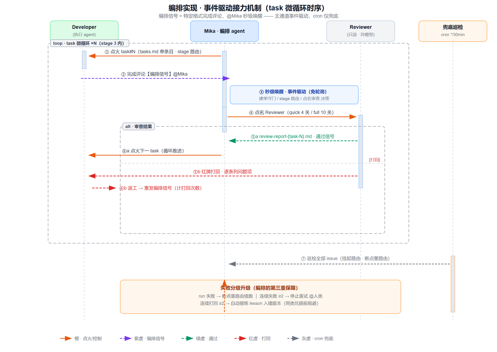

#### 4. SDD 工件链（sdd-pipeline）

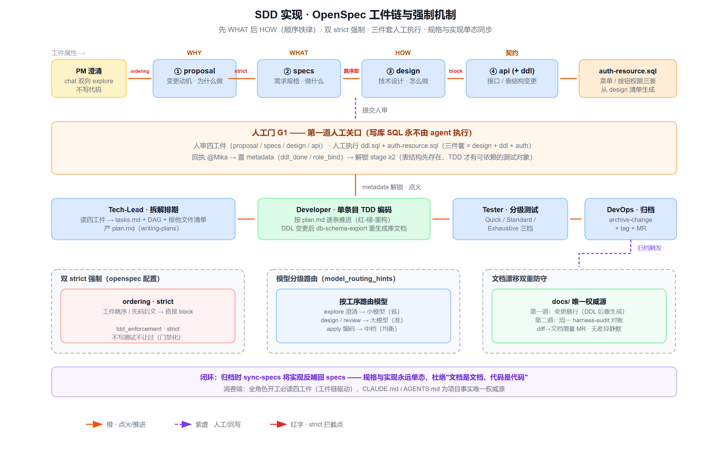

#### 5. TDD 微循环（tdd-microloop）

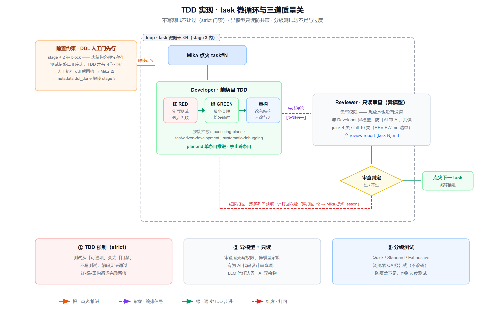

#### 6. 硬约束拦截（hard-guard）

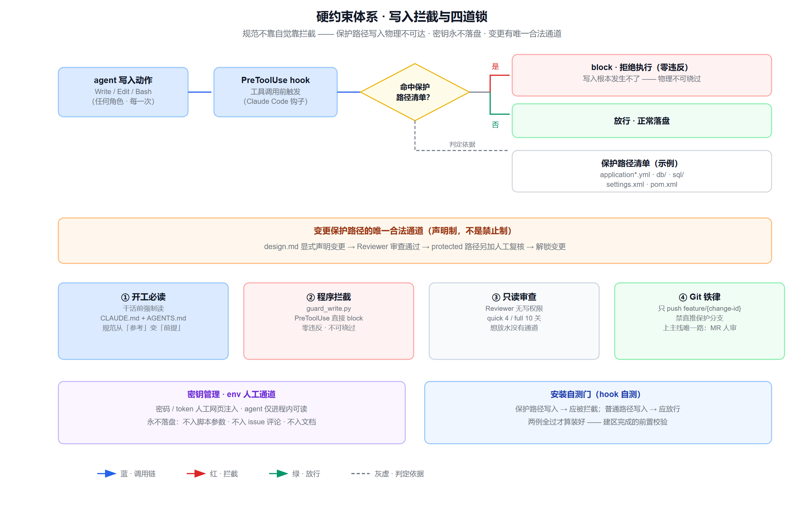

#### 7. 学习闭环（lesson-loop）


#### 8. 目标仓库治理结构（harness-repo-structure）


#### 9. 概念图（harness-concept）


### G.2 四代演进架构图（9 张，SVG 源）

#### 1. V2 七层架构（harness-v2-architecture）

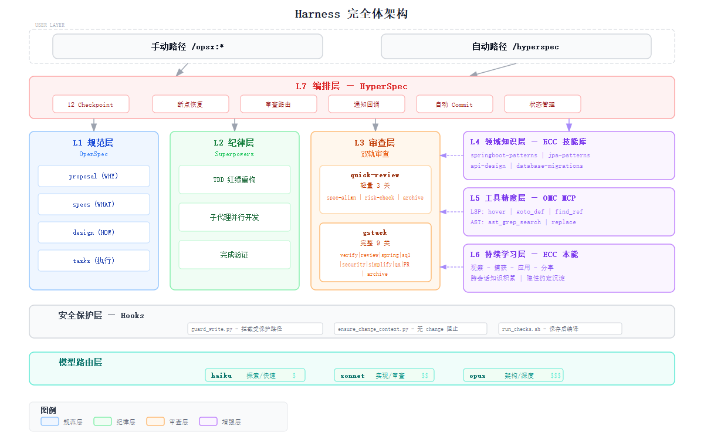

#### 2. 双审查流程（harness-v2-dual-review）

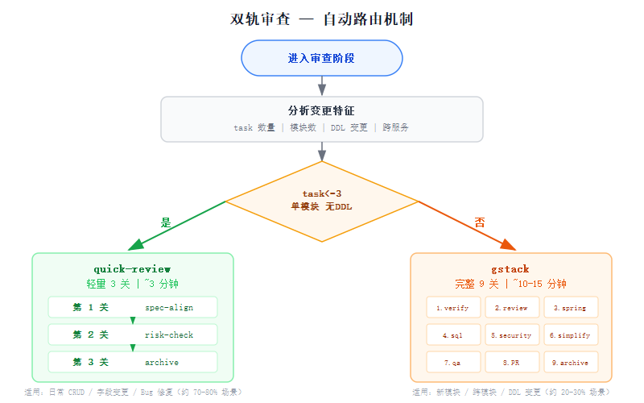

#### 3. HyperSpec 流程（harness-v2-hyperspec-flow）

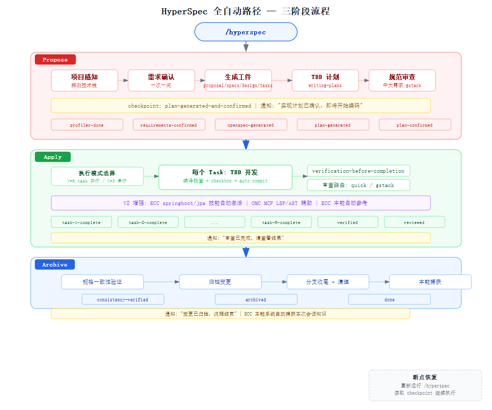

#### 4. AI 编码演化（harness-ai-coding-evolution）

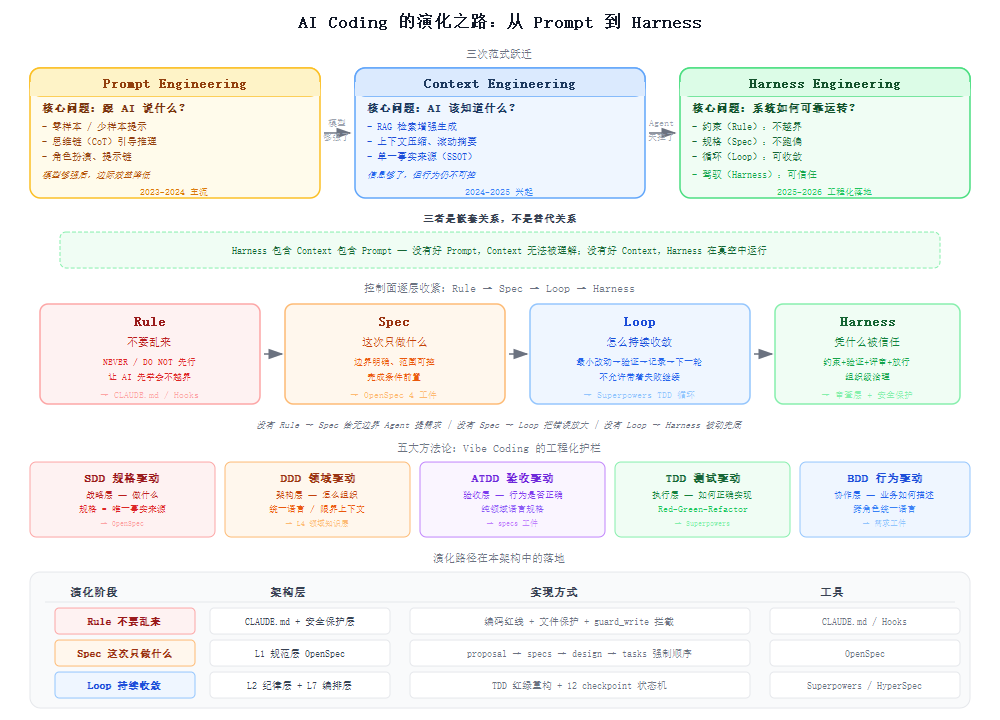

#### 5. 生命周期（harness-ai-lifecycle）

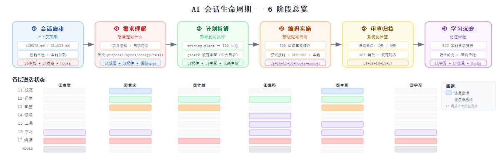

#### 6. 会话初始化（harness-ai-session-init）

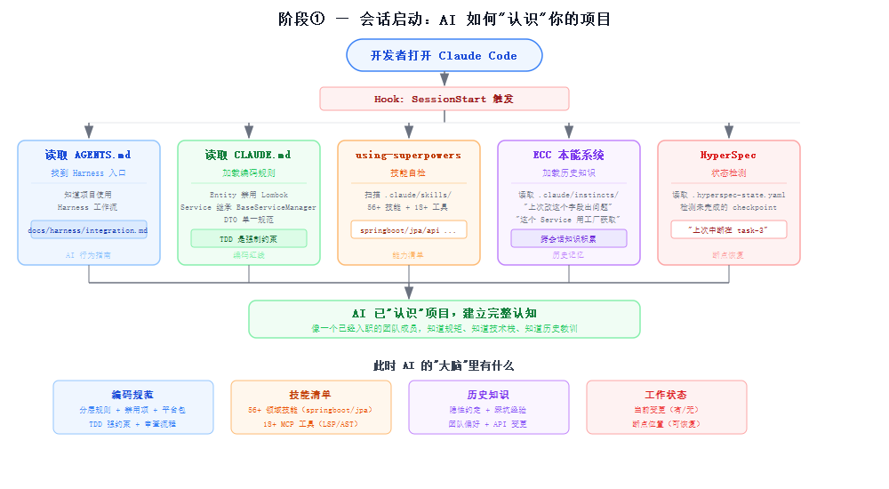

#### 7. TDD 分层（harness-ai-tdd-layers）

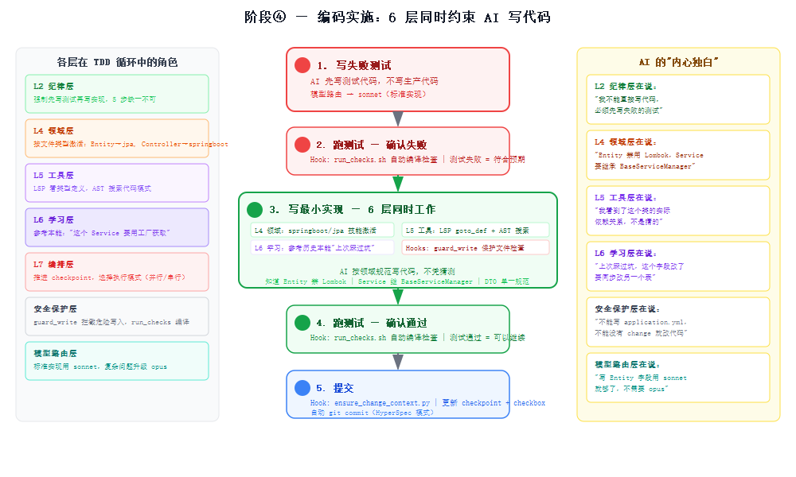

#### 8. 团队架构（harness-team-architecture）

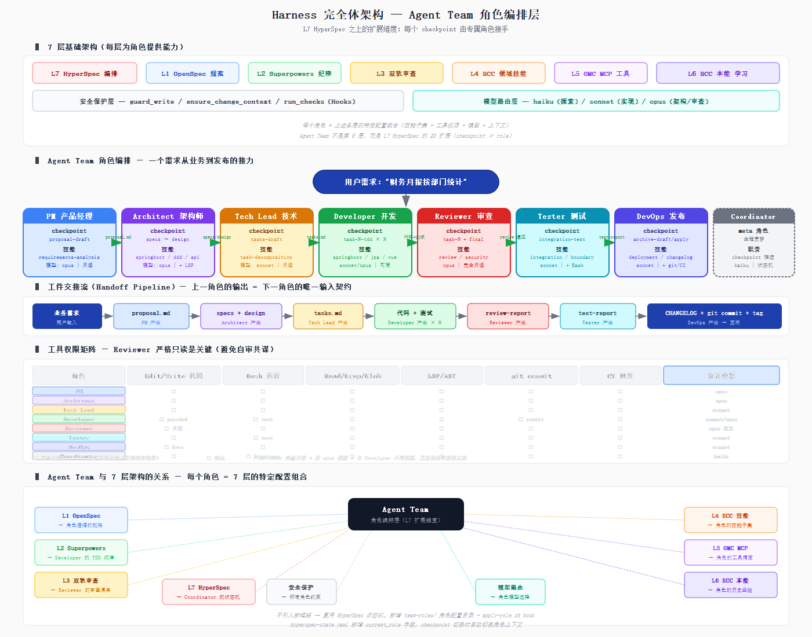

#### 9. 多 Agent 团队架构（harness-team-multiagent-architecture）

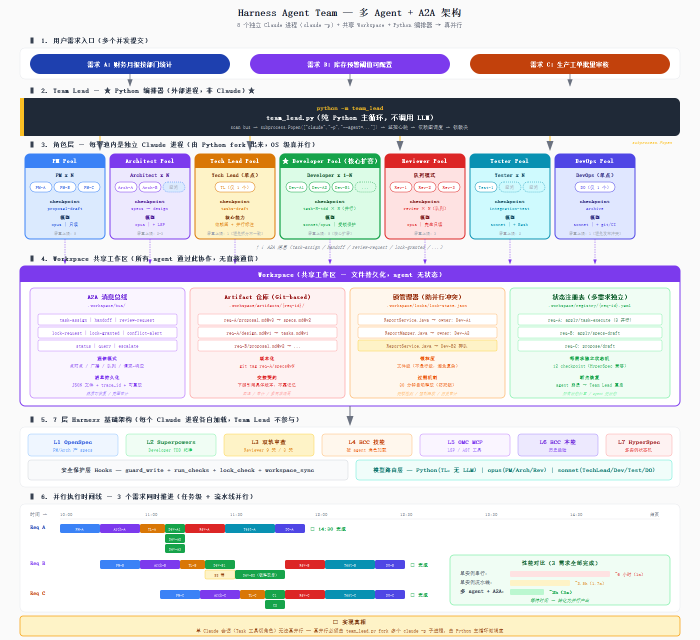
