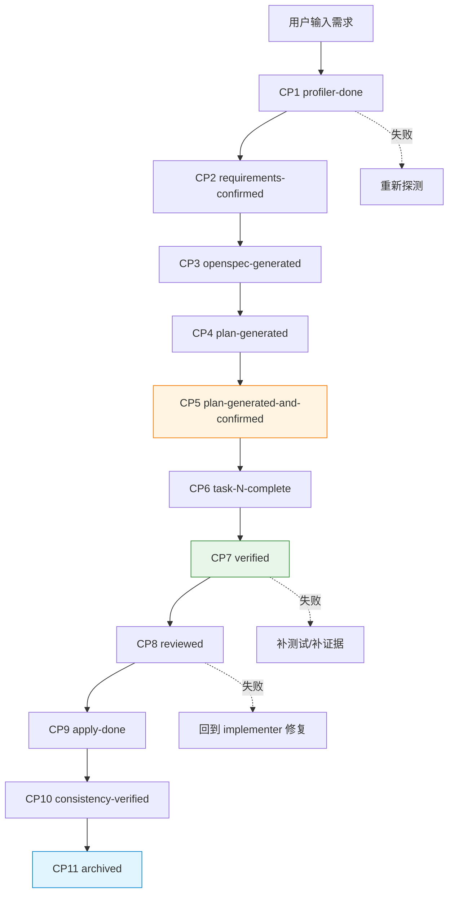

# 详细设计说明书

**（机器可执行软件规范库）**

> 本说明书按 GB8567-88《详细设计说明书》模板编制，对"机器可执行软件规范库"进行详细设计说明——每个规范视作一个"程序单元"详细说明其设计。

| 项目 | 内容                              |
|---|---------------------------------|
| 项目名称 | AI 多 Agent 编码 Harness 的设计与规模化落地 |
| 项目时间 | 2026 年 4 月至今                    |
| 编制人 | 翁金林                             |
| 编制日期 | 2026-11-07                      |

---

## 目录

- [1 引言](#1-引言)
  - [1.1 编写目的](#11-编写目的)
  - [1.2 背景](#12-背景)
  - [1.3 定义](#13-定义)
- [2 规范库总体设计](#2-规范库总体设计)
  - [2.1 总体构成](#21-总体构成)
  - [2.2 两级结构设计方法](#22-两级结构设计方法)
- [3 程序单元 1：CLAUDE.md 项目宪法](#3-程序单元-1claudemd-项目宪法)
  - [3.1 程序描述](#31-程序描述)
  - [3.2 功能](#32-功能)
  - [3.3 条款原文摘录（一）：§6 OpenSpec 工件流（强制顺序）](#33-条款原文摘录一6-openspec-工件流强制顺序)
  - [3.4 条款原文摘录（二）：§7 TDD 强约束（5 步红绿循环）](#34-条款原文摘录二7-tdd-强约束5-步红绿循环)
  - [3.5 条款原文摘录（三）：§10 保护目录（写入会被 hook 拒绝）](#35-条款原文摘录三10-保护目录写入会被-hook-拒绝)
  - [3.6 限制条件](#36-限制条件)
- [4 程序单元 2：AGENTS.md 协作总纲](#4-程序单元-2agentsmd-协作总纲)
  - [4.1 程序描述](#41-程序描述)
  - [4.2 功能](#42-功能)
  - [4.3 条款原文摘录（一）：§4 Git 策略（分支级权限）](#43-条款原文摘录一4-git-策略分支级权限)
  - [4.4 条款原文摘录（二）：§6 变更联动（本规范的特色设计）](#44-条款原文摘录二6-变更联动本规范的特色设计)
- [5 程序单元 3：REVIEW.md 审查关卡](#5-程序单元-3reviewmd-审查关卡)
  - [5.1 程序描述](#51-程序描述)
  - [5.2 功能：触发条件分级路由](#52-功能触发条件分级路由)
  - [5.3 算法：专为 AI 生成代码设计的审查项（节选原文）](#53-算法专为-ai-生成代码设计的审查项节选原文)
  - [5.4 输出项：结论置信度分级（防止 AI 审查误判伤人）](#54-输出项结论置信度分级防止-ai-审查误判伤人)
  - [5.5 限制条件](#55-限制条件)
- [6 程序单元 4：standards/ 技术详单](#6-程序单元-4standards-技术详单)
  - [6.1 程序描述](#61-程序描述)
  - [6.2 功能与特色条款](#62-功能与特色条款)
  - [6.3 存储分配](#63-存储分配)
- [7 接口：规范强制执行机制（从"文档"到"机器可执行的制度"）](#7-接口规范强制执行机制从文档到机器可执行的制度)
- [8 系统维护设计：规范库运维与进化机制（保证长期持续有效）](#8-系统维护设计规范库运维与进化机制保证长期持续有效)
- [9 应用效果](#9-应用效果)
- [附录 A：治理骨架模板版规范库全文](#附录-a治理骨架模板版规范库全文)
  - [A.1 CLAUDE.md（项目宪法）](#a1-claudemd项目宪法)
  - [A.2 AGENTS.md（协作总纲）](#a2-agentsmd协作总纲)
  - [AGENTS.md — 协作总纲](#agentsmd--协作总纲)
  - [A.3 REVIEW.md（审查关卡）](#a3-reviewmd审查关卡)
  - [REVIEW.md — 审查清单](#reviewmd--审查清单)
  - [A.4 docs/standards/api.md（接口设计规范）](#a4-docsstandardsapimd接口设计规范)
  - [A.5 docs/standards/database.md（数据库语言规范）](#a5-docsstandardsdatabasemd数据库语言规范)
  - [A.6 docs/standards/testing.md（测试规范）](#a6-docsstandardstestingmd测试规范)
  - [A.7 docs/index.md（文档导航与维护规则）](#a7-docsindexmd文档导航与维护规则)
  - [A.8 openspec-config.yaml](#a8-openspec-configyaml)
  - [A.9 hooks/guard_write.py（写入拦截钩子）](#a9-hooksguardwritepy写入拦截钩子)
- [附录 B：QMS 仓库实铺版规范文件全文](#附录-bqms-仓库实铺版规范文件全文)
  - [B.1 CLAUDE.md](#b1-claudemd)
  - [B.2 AGENTS.md](#b2-agentsmd)
  - [B.3 REVIEW.md](#b3-reviewmd)
  - [B.4 standards/java.md](#b4-standardsjavamd)
  - [B.5 standards/mybatis.md](#b5-standardsmybatismd)
  - [B.6 standards/naming.md](#b6-standardsnamingmd)
  - [B.7 standards/spring.md](#b7-standardsspringmd)
  - [B.8 standards/testing.md](#b8-standardstestingmd)
  - [B.9 openspec-config.yaml](#b9-openspec-configyaml)
  - [B.10 hooks/guard_write.py](#b10-hooksguardwritepy)
  - [B.11 workflow.md（12-checkpoint 部署流转）](#b11-workflowmd12-checkpoint-部署流转)

---

## 1 引言

### 1.1 编写目的

本说明书详细定义"机器可执行软件规范库"的构成、条款与执行机制，作为规范库建设、使用与推广的权威依据。预期读者：公司 IT 相关岗位（开发/测试/运维）。

### 1.2 背景

在建设 AI 多 Agent 编码 Harness 过程中发现：传统"给人看"的规范无法约束 AI 行为——提示词可被绕过、执行靠自觉。为此设计编制了一套**机器可执行**的规范库：四级规范覆盖编码、数据库、测试、部署、维护全维度，配套三重强制执行机制，已在公司 IT 六个业务系统仓库铺设沿用。

规范实物分两版（本说明书所有"条款原文摘录"均标注出处版本）：

| 版本 | 性质 |
|---|---|
| **治理骨架模板版** | 结构权威源——占位符 + 逐项"代码证据填充"分析指引，铺设到任意仓库的母版 |
| **QMS 仓库实铺版** | 按 sunny-qms-service 仓库代码证据填充后的实例（2026.06 铺设时点，早期简化变体） |

两版全部规范条款文件原文见附录 A（骨架模板版）与附录 B（QMS 实铺版）。

### 1.3 定义

| 术语 | 定义 |
|---|---|
| 项目宪法 | CLAUDE.md，全员红线级规范（骨架模板 §0-§15 共 16 节） |
| 协作总纲 | AGENTS.md，多 Agent 协作制度（骨架模板 §0-§7） |
| 审查关卡 | REVIEW.md，代码审查清单（骨架模板快审 4 关 + 全审 10 关） |
| 技术详单 | standards/ 目录，字段级操作标准（骨架模板三篇，各仓库按技术栈实铺扩充） |
| PreToolUse 钩子 | agent 工具调用前的程序拦截点 |

---

## 2 规范库总体设计

### 2.1 总体构成

| 规范 | 定位 | 覆盖维度 | 篇幅 |
|---|---|---|---|
| **CLAUDE.md（项目宪法）** | 全员红线 | 编码+部署+维护 | 骨架模板 §0-§15 共 16 节 |
| **AGENTS.md（协作总纲）** | 协作制度 | 协作+变更管理+维护 | 骨架模板 §0-§7 |
| **REVIEW.md（审查关卡）** | 质量门禁 | 测试+审查 | quick 4 关 + full 10 关 |
| **standards/（技术详单）** | 操作标准 | 编码+数据库+测试 | 骨架模板三篇（api/database/testing），各仓库按技术栈实铺扩充（QMS 实例五篇：java/mybatis/naming/spring/testing） |
| **部署与维护规范**（承载于上述文件与 docs/ 导航） | 部署流程+文档维护 | 部署+维护 | workflow.md 12-checkpoint 流转与 6.1 用户手册 §4.1 六步链承载部署规范；docs/index.md 维护规则 5 条承载维护规范 |

> 五维度覆盖说明：编程语言（骨架 standards + 实铺 java/spring/naming）、数据库语言（database 篇 + mybatis 篇）、测试（testing 篇）为独立篇目；**部署**与**维护**两维度不设独立篇目，由 workflow.md 部署流转条款、docs/index.md 文档维护规则 5 条与宪法 §4 构建命令 / §15 文档随行条款承载——规范条款与执行入口同文件，避免部署/维护规范与开发规范两张皮。

**部署流转条款原文摘录**（摘自治理文件实物 workflow.md「12 个 Step」部署应用与归档段——变更落地即部署交付的流转条款；原文见附录 B.11）：

> **Step 10: CP9 apply-done（应用）**——输入 reviewed 文件；输出 commit 到分支；命令 `git add docs/<域>/ && git commit`。
> **Step 11: CP10 consistency-verified（一致性验证）**——commit 后与其他文档无矛盾方可继续。
> **Step 12: CP11 archived（归档）**——归档到 `openspec/changes/archive/`（`/opsx:archive`）。
> 流转铁律：任一 checkpoint 未过不得进入下一步；实测合计 ~20 分钟（设计口径 ~2.5h，工作流条款承载后实测压缩，原文明示）。

**维护规则条款原文摘录**（摘自治理骨架模板 docs/index.md「文档维护规则」节，共 5 条全量；原文见附录 A.7）：

> 1. **代码结构变更** → 对应文档在**同一个 change** 内更新：Tech-Lead 在 tasks.md 显式安排文档 task，不允许「事后补文档」
> 2. **数据库表结构变更** → DDL 人工执行后，按 `database/index.md` 的「再生成规则」重生成受影响域文档
> 3. **踩坑沉淀分流**：可复用的平台用法进 `help/`；一次性踩坑进 `lessons/` 角色文件；「大家都知道但代码看不出来」的约定进 `architecture/implicit-contracts.md`；**人工测试发现的问题**按 `human-test-reports/` 机制经复盘提炼进 `lessons/`
> 4. 本索引只在**目录级变化**（新增/删除文档文件）时更新，不维护条目内容
> 5. **结构文档对账兜底**：变更随行（规则 1）仍是主防线；DocKeeper agent（周级 autopilot 触发）按 `aicoding-harness-audit` skill 对基线以来的增量做对账，可自动项走 MR，DDL 与存疑项提醒人工

> 上述两框使"搭载承载"从声明变为可见条款：部署维度有 checkpoint 级流转判据（未过不得下一步）、维护维度有 5 条全量规则（含责任角色与兜底机制）——两维度规范内容的实质性与独立篇目无异，仅载体不同。

### 2.2 两级结构设计方法

"红线一句话进宪法、详单进 standards/"：宪法只保留可速读的红线（如 §11 命名只写一句话红线），字段级详单全部下沉到 standards/ 并与宪法两向引用——避免单文件膨胀失效。规范内容按目标仓库逐条以**代码证据填充**（骨架 16 项结构化占位符，每项内嵌分析指引、每条须有代码证据、禁止编造），保证规范与仓库实况一致而非泛泛模板。

---

## 3 程序单元 1：CLAUDE.md 项目宪法

### 3.1 程序描述

进入仓库的任何 agent（及开发者）的首要约束文件，开工必读。

### 3.2 功能

> 以下目录为**治理骨架模板版** CLAUDE.md 实际节结构；QMS 仓库实铺版 CLAUDE.md 为 2026.06 铺设时点的早期简化版（6 节），骨架模板版为现行结构权威——两版并存体现规范库随使用的迭代。两版全文分别见附录 A.1、附录 B.1。

骨架模板 §0-§15 共 16 节：§0 适用范围 / §1 项目定位 / §2 模块结构表 / §3 通信与基础设施 / §4 构建命令 / §5 构建工具路径约定 / §6 OpenSpec 工作流 / §7 TDD 强约束 / §8 分层规则 / §9 平台包优先级 / §10 保护目录 / §11 命名约定 / §12 统一响应格式 / §13 日志规范 / §14 平台能力帮助文档 / §15 文档体系入口。

### 3.3 条款原文摘录（一）：§6 OpenSpec 工件流（强制顺序）

> 摘录自骨架模板版 CLAUDE.md §6（原文见附录 A.1）：

> | 顺序 | Artifact | 核心问题 |
> |------|----------|----------|
> | 1 | proposal | WHY — 为什么做 |
> | 2 | specs | WHAT — 做什么 |
> | 3 | design | HOW — 怎么做 |
> | 4 | tasks | 执行 |
>
> **判断口诀：先需求后设计，先 WHAT 后HOW。** 即使多个 artifact 同时 ready，也必须先 specs 后 design。

### 3.4 条款原文摘录（二）：§7 TDD 强约束（5 步红绿循环）

> 摘录自骨架模板版 CLAUDE.md §7（原文见附录 A.1）：

> TDD 由 **superpowers:test-driven-development skill** 执行：Tech-Lead 产出的 plan.md 步骤已内含下述 5 步，Developer 逐条走红绿循环，Reviewer 按测试先行证据把关。5 步口径：
>
> 1. 写失败测试
> 2. 确认测试失败
> 3. 实现代码
> 4. 确认测试通过
> 5. 提交
>
> `openspec/config.yaml` 中 `tdd_enforcement: strict`，跳步会被 Reviewer 打回。

### 3.5 条款原文摘录（三）：§10 保护目录（写入会被 hook 拒绝）

> 摘录自骨架模板版 CLAUDE.md §10（`{{PROTECTED_PATHS}}` 为骨架占位符，默认清单见其分析指引：application*.yml / db / sql / settings.xml / pom.xml，按仓库实际调整，须与 hook 的 PROTECTED_PATTERNS 一致；原文见附录 A.1）：

> 以下路径 **禁止** Edit/Write，由 `.claude/hooks/guard_write.py` 拦截……如需变更，必须在 `design.md` 中显式声明，并经 Reviewer 审核通过。

### 3.6 限制条件

宪法红线条目增删须经教训晋升机制的人类确认环节（见 §8 进化机制），不可随意扩写。

---

## 4 程序单元 2：AGENTS.md 协作总纲

### 4.1 程序描述

多 Agent（及人）在同一个 change 上协作的制度总纲。

### 4.2 功能

> 摘录结构出自**治理骨架模板版**（AGENTS.md，§0-§7 共 8 节）。全文见附录 A.2，QMS 实铺版见附录 B.2。

骨架模板 8 节：§0 适用范围 / §1 废弃产物隔离 / §2 stage 编号约定 / §3 角色速查表 / §4 Git 策略 / §5 OpenSpec 工件结构 / §6 变更联动 / §7 持续学习层（错题本读写分区矩阵内嵌于 §7，与 `docs/lessons/index.md` 机制同源）。

### 4.3 条款原文摘录（一）：§4 Git 策略（分支级权限）

> 摘录自骨架模板版 AGENTS.md §4（`{{MR_TARGET_BRANCH}}` 为骨架占位符，铺设时按目标仓库填充；原文见附录 A.2）：

> - **开发分支**：每个 change 在 `feature/{change-id}` 上工作，所有 agent 的产物 commit 都打到这条分支
> - **基线**：开工先 `git fetch origin`，基于最新 `origin/master` 创建 feature 分支；后续接力 checkout 已存在的 feature 分支
> - **合并目标**：MR 目标是 `{{MR_TARGET_BRANCH}}`（不是 master）
> - **保护分支**：`master` / `{{MR_TARGET_BRANCH}}` 禁止直推，只能经 MR 由人类合并
> - 工件 commit 后**必须立即 push**——未 push 的本地分支在其他 runtime 拉不到，跨机协作会断链

### 4.4 条款原文摘录（二）：§6 变更联动（本规范的特色设计）

> 摘录自骨架模板版 AGENTS.md §6（原文见附录 A.2）：

| 触发 | 下游义务 | 执行方式 |
|---|---|---|
| PM 修改 proposal.md（已 in_review 之后） | PM 串联返工 specs + design | PM 在原 issue 评论贴新版本；Mika 把下游所有 stage 子 issue 置 `blocked`，等重做后解锁 |
| PM 修改 specs/design（已 in_review 之后） | Tech-Lead 必须 re-tasks | 同上，PM 评论贴新版本 + Mika 阻塞 stage≥2 子 issue（Tech-Lead 由 Mika 点火） |
| PM 产出 ddl.sql（建表/加字段） | 人工在库上执行 DDL 后流程才可继续；受影响域数据库文档须在本 change 内重生成 | 人工执行后评论回执 @Mika；Mika 置 `ddl=executed` 并解锁 stage≥2（Developer 测试依赖表结构先存在）；Tech-Lead 的 tasks.md 必含「按 docs/database/index.md 再生成规则重生成受影响域表文档」task |
| Developer 实施时发现 design 漏字段 | 反向触发 PM | Developer 不得擅自扩边界：task issue 评论 + status `blocked` + @mention Mika，由 Mika 决定是否回退 |

---

## 5 程序单元 3：REVIEW.md 审查关卡

### 5.1 程序描述

代码审查的质量门禁清单，按变更风险自动路由审查深度。

> 本程序单元条款摘录均出自**治理骨架模板版**（REVIEW.md）。QMS 实铺版（2026.06 铺设时点）为 quick 3 关 + full 9 关、按 task 数路由的早期简化版；骨架模板版（现行权威）为 quick 4 关 + full 10 关、按行数路由——规范库随使用迭代，两版差异如实交代。两版全文分别见附录 A.3、附录 B.3。

### 5.2 功能：触发条件分级路由

| 场景 | 路径 | 关卡数 |
|---|---|---|
| 改动 < 50 行，无 SQL，无架构变化 | **quick-review** | 4 关 |
| 改动 ≥ 50 行 / 含 SQL / 涉及分层 / 涉及表结构 | **full-review** | 10 关 |
| 涉及 protected 路径（宪法 §10 清单） | **full-review + 人工复核** | 10 关 + 人类 |

**quick-review 4 关**：①spec-align（规约对齐）②risk-check（风险检查）③lesson-check（经验命中检查）④archive（归档准备）。

**full-review 10 关**：①verify（OpenSpec 四件套校验）②review（通用代码审查）③架构/分层审查 ④数据访问/SQL 审查 ⑤security（安全）⑥simplify（简化+AI 冗余）⑦qa（质量）⑧prepare-review（摘要）⑨lesson-check ⑩archive。

### 5.3 算法：专为 AI 生成代码设计的审查项（节选原文）

> 摘录自骨架模板版 REVIEW.md full-review 关 5 / 关 6（原文见附录 A.3）：

> **关 5 security（节选）**
> - [ ] **LLM 信任边界**：外部返回 / LLM 产出 / 第三方数据是否未经结构·类型·范围校验直接入库或参与执行？
> - [ ] **条件副作用**：同一条件分支内是否混合了校验逻辑与写操作（副作用应与校验分离）？

> **关 6 simplify — AI 冗余物（AI 生成代码高发坏味道，重点排查）**
> 过度防御（catch 后吞异常或不必要的空判）/ 死代码与永假分支 / 无用注释堆砌（复述代码的"Generated"式注释）/ 同一抽象重复发明（仓库已有工具类又写一个）/ 幻觉式重命名引用不存在的既有方法

### 5.4 输出项：结论置信度分级（防止 AI 审查误判伤人）

> 摘录自骨架模板版 REVIEW.md §4.4（原文见附录 A.3）：

| 置信度 | 判据 | 动作 |
|---|---|---|
| 高 | grep / 只读命令可复现的证据 | 直接定论，可作打回依据 |
| 中 | 模式聚合 / 启发式推断 | 标注「存疑」列出，允许一定噪声 |
| 低 | 需理解视觉/业务意图才能确认 | 列为「可能——请人工验证」，**不得作为打回唯一依据** |

### 5.5 限制条件

打回必须附「打回原因 + 修改建议（文件:行号）+ 重新提交条件」三段式；同一 task 连续 2 次打回自动升级人类 reviewer。

> 两版演进说明：QMS 实铺版（2026.06 铺设时点）为 3+9 关 / task 数路由的早期简化版，骨架模板版（现行权威）演进为 4+10 关 / 行数路由——关卡随实战反馈增补（如 LLM 信任边界、AI 冗余物专关），体现规范库的迭代机制。两版全文分别见附录 A.3、附录 B.3。

---

## 6 程序单元 4：standards/ 技术详单

### 6.1 程序描述

字段级操作标准。骨架模板三篇（api / database / testing）为结构权威源；各仓库按技术栈实铺扩充——QMS 实铺版五篇（java / mybatis / naming / spring / testing）。

### 6.2 功能与特色条款

**database.md（骨架模板，数据库语言规范）**——"受保护目录与 DDL 流程"节将 ddl.sql 执行形式列为**必写条款**（摘录自骨架模板 docs/standards/database.md，原文见附录 A.5；LIMS 仓库实铺版 docs/standards/database.md 已按此逐字填充，内网 GitLab 实测拉取核对在案）：

> ddl.sql 一律平铺 SQL 语句逐条分号结尾（触发器后不加 `/`），**禁止** PL/SQL 匿名块（`DECLARE…BEGIN…END`）/ `EXECUTE IMMEDIATE` / `DBMS_OUTPUT` / 存在性预检查——执行通道常为跳板机受限 SQL 入口，只认平铺语句。业务 SQL（Mapper 内）不受此限，方言照常。

**api.md（骨架模板，接口设计规范）**——"历史命名包袱清单"（禁止改的前端硬依赖逐条列出）与 change 级契约条款（摘录自骨架模板 docs/standards/api.md，原文见附录 A.4）：

> - PM 在 `openspec/changes/{change-id}/api.md` 逐接口列：method / path / 权限 / 请求参数（含校验规则）/ 响应结构 / 错误码
> - 无接口变更的 change 显式写「本变更无接口改动」，不留空
> - **契约先行：后续改接口必须先改 api.md 再改代码**（同一 change 内变更随行）

**java.md / spring.md / mybatis.md / naming.md（QMS 实铺版编码与数据库语言规范）**：基于 QMS 仓库代码实测（323 Entity / 279 Mapper / 182 Controller）的分层与命名约定、平台包优先级、Mapper 变更检查清单；特色条款如 `MapKeyUpperWrapper` 强制 Map key 大写、平台分页封装（非 PageHelper 默认实现）——均带仓库代码证据。原文见附录 B.4～B.7。

**testing.md（测试规范）**：骨架模板版定义项目现状声明（禁止粉饰）/ 新旧代码口径（新代码 TDD 不降级、旧代码修改降级条件、紧急 hotfix 补测时限如 24h）/ mock 边界（**被测对象禁止 mock 自己证明自己**）/ 集成测试 / 浏览器 QA 三档标准（与 aicoding-browser-qa 技能同源）/ 禁止的反模式 / 未测试缺口声明模板；QMS 实铺版为该仓库填充版（覆盖目标分级 / Mock 策略）。两版全文分别见附录 A.6、附录 B.8。测试条款在《测试分析报告》中详述。

### 6.3 存储分配

规范库随治理骨架（skeleton/ 20+ 文件）铺设进每个目标仓库 docs/ 与根目录，进 Git 版本管理；骨架 docs/ 九子目录（architecture/database/help/lessons/product/standards/templates/human-test-reports/原型）即规范库与知识字典的载体结构。

---

## 7 接口：规范强制执行机制（从"文档"到"机器可执行的制度"）

| 机制 | 实现实物 | 效果 |
|---|---|---|
| 开工必读 | 各角色开工先读宪法+总纲，历史教训视同本级约束执行 | 规范从"参考"变为"前提" |
| 程序拦截 | guard_write.py 骨架模板版（PreToolUse 钩子，66 行 Python）——PROTECTED_PATTERNS 保护路径写入输出 `{"decision":"block"}` 直接拦截 | 禁改清单默认拦截 + 编排器受控通道（HARNESS_ALLOW_WRITE=1 仅受控流程可用），日常运行零违反 |
| 关卡校验 | openspec/config.yaml：`tdd_enforcement: strict` + `ordering: strict`；REVIEW.md 10 关 | 执行留痕、可审计 |

> guard_write.py 版本说明：骨架模板版（66 行）为现行权威——PROTECTED_PATTERNS 含 settings.xml / pom.xml，stdin 读 tool_input.file_path、命中模式输出 `{"decision":"block"}`；QMS 实铺版（149 行）为早期变体——BLOCKED_PATTERNS 拦截清单不含 settings.xml/pom.xml，采用 exit(2)+stderr 机制，并含 HARNESS_ALLOW_WRITE 受控通道（实铺版 docstring 停留在"exit(1)"旧描述、实际实现为 sys.exit(2)，注释未随实现同步——实物瑕疵如实保留，反证其非批量生成）。两版源码全文分别见附录 A.9、附录 B.10。

**openspec/config.yaml 全文摘录**（治理骨架模板版，共 15 行；原文见附录 A.8）：

```yaml
schema: spec-driven
tdd_enforcement: strict
ordering: strict
model_routing_hints:
  explore: haiku
  propose: opus
  apply: sonnet
  review: opus
protected_paths:
  - "**/application.yml"
  - "**/application-*.yml"
  - "**/db/**"
  - "**/sql/**"
  - "**/settings.xml"
  - "**/pom.xml"
```

> QMS 实铺版 openspec-config.yaml 为该仓库 2026.06 铺设时点的精简配置，不含 tdd_enforcement / ordering / protected_paths / model_routing_hints 字段——双 strict 门禁与模型路由以骨架模板版为准。两版全文分别见附录 A.8、附录 B.9。

---

## 8 系统维护设计：规范库运维与进化机制（保证长期持续有效）

1. **防漂移双保险**：变更随行（宪法 §15：文档随 change 同步更新，**不允许「事后补文档」**）+ 周级自动对账兜底（aicoding-harness-audit autopilot）；
2. **自我进化**：同类教训第 2 次出现自动晋升写入宪法/审查关卡成为全员红线，原条目删除——规范库随使用越来越严密，而非逐渐过时；每次晋升必经人类确认；
3. **跨仓库复用**：治理层骨架作为"结构权威源"（20+ 文件），对齐模式铺设到任意仓库（补缺节、不覆盖定制），新仓库全套规范铺设约半日。

## 9 应用效果

- 规范库已在公司 IT 六个业务系统仓库（LIMS / QMS 服务端 / QMS 前端 / QMS SPC / ECQ / MDM，内网 GitLab）铺设沿用；
- **跨岗位借鉴已有第三方实证**：LIMS 接入团队（非本人）依据治理骨架分析指引独立完成占位符填充与 hook 落位（commit `a9afbf23c`，执行者 fmchen，2026-10-22，仓库时间戳在案）——规范库"可被他人参考借鉴"不止于声明，已有第三方自助使用的直接实证；长期有效性由防漂移双保险、教训晋升红线、跨仓库复用三机制保障（§8）；
- 保护路径写入默认拦截 + 编排器受控通道，日常运行零违反；
- 新仓库全套规范铺设约半日（此前手工模式 4-6 天）；
- 疑难问题库累计沉淀问题解决技术资料 10 条（MDM 集成踩坑避坑指南，"症状→原因→解决"组织）；经教训晋升机制固化全员红线 6 项——其中 ddl.sql 平铺约束（骨架 database.md 必写条款 + LIMS 仓库实铺版逐字填充，内网拉取核对在案）、MyBatis Map key 大小写与 PageHelper 平台封装（QMS 实铺版 standards/mybatis.md 条款在案）、Windows GBK 传参铁律（固化于建区脚手架 `@文件` 传参实现）有实物可查；BaseEntity 漏继承、OpenFeign 丢 Header 源自 MDM 实战踩坑（实战记录在案），随 lessons 机制在各仓库角色文件累积。LIMS 仓库 `docs/lessons/{角色}.md` 8 文件（Developer / DevOps / DocKeeper / PM / Prototyper / Reviewer / Tech-Lead / Tester）随 lessons 机制持续累积。

---

## 附录 A：治理骨架模板版规范库全文

结构权威源（占位符 + 代码证据填充分析指引），铺设到任意仓库的母版。以下为全部规范条款文件原文。

### A.1 CLAUDE.md（项目宪法）

### {{PROJECT_NAME}} 项目宪法

---

#### 0. 适用范围

本文件是本仓库的统一 harness 宪法，**覆盖仓库所有目录与 {{MODULE_COUNT}} 个模块**（{{MODULE_LIST}}）。子模块内不再单独维护 CLAUDE.md / AGENTS.md / REVIEW.md——所有 agent 在仓库根 cwd 运行，统一读这套文档。

<!-- 分析指引：列出全部模块目录名；单模块项目删掉「模块」措辞 -->

---

#### 1. 项目定位

**{{PROJECT_NAME}} 是{{BUSINESS_DESCRIPTION}}**，以{{REPO_STRUCTURE}}结构组织。

<!-- 分析指引：一句话业务定位（问用户或从 README 提取）；结构要点：有无顶层父 pom / monorepo / 聚合构建；各模块构建方式 -->

---

#### 2. 模块结构表

| 模块 | 类型 | 技术栈 | 端口 |
|---|---|---|---|
| {{MODULE_ROW}} | {{...}} | {{...}} | {{...}} |

**模块定位字典**（业务域 ↔ 模块 ↔ 数据库主表前缀）：见 `docs/architecture/index.md` §1——需求落域、代码落位、表定位一律查该表，本表只做结构概览。

<!-- 分析指引：每个模块一行，从 pom.xml/package.json 提取依赖与版本，端口从配置文件提取；前端模块「技术栈」列必须写明 Vue 2 / Vue 3 + 组件库（如 Vue3+Arco）——这是前端设计第零步版本判断的权威源 -->

---

#### 3. 通信与基础设施

- {{INFRASTRUCTURE_ITEMS}}

<!-- 分析指引：逐条列出（有才写）：前后端代理、服务互调/注册中心、数据库、缓存、消息队列、对象存储、流程引擎、外部系统接口、私服/内网依赖。地址可写，凭据永不写 -->

---

#### 4. 构建命令

- {{BUILD_COMMANDS}}

<!-- 分析指引：前端/后端各自构建命令（从 pom.xml / package.json scripts 提取命令语义）；明确「是否有顶层聚合构建」——没有则强调必须先 cd 到模块；本节只写命令语义（机器无关层），工具定位与 env 前置一律落 §5，勿混入绝对路径 -->

---

#### 5. 构建工具路径约定

{{BUILD_TOOL_PATH}}

<!-- 分析指引：写「自解析协议」而非本机路径快照（快照在 agent 换 runtime 后过期误导）。标准四步链：① 试 PATH（mvn -v / node -v 直接跑）② 读自身进程环境变量约定 key（MVN_BIN / JAVA_HOME / NODE_BIN；agent 无权用 CLI 查 env），值只当候选——-v 验证失败即降级 ③ 探测常见安装位置（glob 模式清单跨机器通用可进 git，如 /c/Program Files/JetBrains/*/plugins/maven/lib/maven3/bin/mvn.cmd、/c/Program Files/Java/jdk*、/d/jdk*、~/.nvm/versions/*）④ 全失败停下评论人工待办（人话提示要配哪些变量，无命令），禁止瞎猜路径。每级命中先 -v 验证再正式使用。填完后在当前 runtime 按链完整走一遍实测（报告注明），保证文档写法可直接复制执行；全工具均在 PATH 的项目可简化为一句「全部工具在 PATH，直接使用」 -->

---

#### 6. OpenSpec 工作流（强制顺序）

无论是否使用自定义 schema，必须按以下顺序创建 artifact：

```
proposal → specs → design → tasks
```

| 顺序 | Artifact | 核心问题 |
|------|----------|----------|
| 1 | proposal | WHY — 为什么做 |
| 2 | specs | WHAT — 做什么 |
| 3 | design | HOW — 怎么做 |
| 4 | tasks | 执行 |

**判断口诀：先需求后设计，先 WHAT 后HOW。** 即使多个 artifact 同时 ready，也必须先 specs 后 design。

---

#### 7. TDD 强约束

TDD 由 **superpowers:test-driven-development skill** 执行：Tech-Lead 产出的 plan.md 步骤已内含下述 5 步，Developer 逐条走红绿循环，Reviewer 按测试先行证据把关。5 步口径：

1. 写失败测试
2. 确认测试失败
3. 实现代码
4. 确认测试通过
5. 提交

`openspec/config.yaml` 中 `tdd_enforcement: strict`，跳步会被 Reviewer 打回。

---

#### 8. 分层规则

{{LAYERING_RULES}}

<!-- 分析指引：抽样现有代码归纳（每类 ≥3 例）：分层链路、各层命名约定、Entity/DTO 规则、允许/禁止的用法。无分层传统的新项目则写目标分层规则并标注「新建约定」 -->

---

#### 9. 平台包优先级

{{PLATFORM_PACKAGES}}

<!-- 分析指引：若存在自研/二方平台包体系：场景→用平台包→不要引入的映射表；无则删本节 -->

---

#### 10. 保护目录（写入会被 hook 拒绝）

以下路径 **禁止** Edit/Write，由 `.claude/hooks/guard_write.py` 拦截：

{{PROTECTED_PATHS}}

<!-- 分析指引：默认清单 application*.yml / db / sql / settings.xml / pom.xml，按仓库实际调整，须与 hook 的 PROTECTED_PATTERNS 一致 -->

如需变更，必须在 `design.md` 中显式声明，并经 Reviewer 审核通过。

---

#### 11. 命名约定提醒（重要）

{{NAMING_RED_LINE}}；拼音/缩写对照见 `docs/architecture/implicit-contracts.md`，接口与数据库命名详单见 `docs/standards/api.md` / `docs/standards/database.md`。

<!-- 分析指引：只写一句话红线（如「业务路径拼音缩写禁止幻觉式重命名」）；详单与 checklist 全部进 standards/，本节不展开 -->

---

#### 12. 统一响应格式

后端响应统一 {{RESPONSE_WRAPPER}} 包装；结构、错误码段、分页字段等前端硬依赖详见 `docs/standards/api.md`，违反即打回。

<!-- 分析指引：只写包装类一句话（如 Result<T>）；字段级约定进 standards/api.md；无后端则删本节 -->

---

#### 13. 日志规范

{{LOGGING_RED_LINE}}；级别/必含要素/异常处理详单见 `docs/standards/api.md` 日志节。

<!-- 分析指引：只写一句话红线（注解/级别要求）；无特殊约定可删本节 -->

---

#### 14. 平台能力帮助文档（docs/help/）

- **涉及平台集成的需求（{{CAPABILITY_LIST}}）**：先读 `docs/help/index.md` 能力清单，再读对应能力文档，按文档方式实现
- **适用时点**：PM 写 proposal/design（技术可行性与 HOW、超时/重试/降级策略）、Developer 实现前、Reviewer 审查时——均按此路由
- `index.md` 的「通用约定」与「受保护/慎用清单」视同宪法红线，违反会被 Reviewer 打回
- 新平台能力的使用经验：可复用的做法补 `docs/help/` 对应文档；一次性踩坑进 `docs/lessons/` 对应角色文件

---

#### 15. 文档体系入口

- `docs/index.md` 是 docs/ 唯一导航入口（各角色必读顺序 + 文档维护规则）；本宪法只保留红线，详单都在 docs/ 下
- 常用定位：业务域/术语 → `docs/product/index.md`；模块↔表前缀 → `docs/architecture/index.md` §1；表结构 → `docs/database/index.md`；测试口径 → `docs/standards/testing.md`；人工测试验证报告 → `docs/human-test-reports/`（人类维护，agent 只读）
- 文档随 change 同步更新（Tech-Lead 安排 task），不允许「事后补文档」

### A.2 AGENTS.md（协作总纲）

### AGENTS.md — 协作总纲

---

#### 0. 适用范围

本文件是所有 agent 在本仓库协作的总纲（角色职责字典、Git 策略、工件约定、变更联动）。宪法（红线）见 `CLAUDE.md`，审查关卡见 `REVIEW.md`。

---

#### 1. 废弃产物隔离

{{DEPRECATED_ARTIFACTS}}

<!-- 分析指引：列出历史上废弃的编排器/产物路径（若有），声明「不写入、不读取、不复制」；全新仓库无废弃产物可写「（无）」 -->

---

#### 2. stage 编号约定

默认链模板维护在**编排 agent（Mika）的工作区配置**中——它在创建 change issue 时把链写入 issue 描述；本仓库不维护链序（避免双源漂移）。

- issue 的 `stage` 字段编号 ↔ 主导 agent 的对照字典：见 §3 角色速查表。
- 单个 change 的实际流程**以其 issue 描述为唯一执行权威**（人工可定制增删阶段）；与任何文档不一致时按 issue 执行，不质疑不纠正。

---

#### 3. 角色速查表

| Agent | 一句话职责 | 主导 stage | 模型 | 关键工具权限 |
|---|---|---|---|---|
| {{AGENT_ROW}} | {{...}} | {{...}} | {{...}} | {{...}} |

<!-- 分析指引：从 Multica 侧 aicoding-agent-bootstrap 建立的角色对齐（multica agent list）；此表是仓库侧字典，变更须回写 -->

---

#### 4. Git 策略（分支级权限）

- **开发分支**：每个 change 在 `feature/{change-id}` 上工作，所有 agent 的产物 commit 都打到这条分支
- **基线**：开工先 `git fetch origin`，基于最新 `origin/master` 创建 feature 分支；后续接力 checkout 已存在的 feature 分支
- **合并目标**：MR 目标是 `{{MR_TARGET_BRANCH}}`（不是 master）
- **保护分支**：`master` / `{{MR_TARGET_BRANCH}}` 禁止直推，只能经 MR 由人类合并
- 工件 commit 后**必须立即 push**——未 push 的本地分支在其他 runtime 拉不到，跨机协作会断链

---

#### 5. OpenSpec 工件结构

```
openspec/changes/{change-id}/
├── proposal.md       # stage 1 产出（WHY + 边界）
├── specs.md          # stage 2 产出（WHAT）
├── design.md         # stage 2 产出（HOW）
└── tasks.md          # stage 3 产出（执行 + 排他文件清单）
```

- 每次产出工件后必须跑 `openspec validate <change-id>`
- 跨工件引用用相对路径（同 change-id 目录内），不用绝对 SHA

---

#### 6. 变更联动（上游改动 → 下游义务）

| 触发 | 下游义务 | 执行方式 |
|---|---|---|
| PM 修改 proposal.md（已 in_review 之后） | PM 串联返工 specs + design | PM 在原 issue 评论贴新版本；Mika 把下游所有 stage 子 issue 置 `blocked`，等重做后解锁 |
| PM 修改 specs/design（已 in_review 之后） | Tech-Lead 必须 re-tasks | 同上，PM 评论贴新版本 + Mika 阻塞 stage≥2 子 issue（Tech-Lead 由 Mika 点火） |
| PM 产出 ddl.sql（建表/加字段） | 人工在库上执行 DDL 后流程才可继续；受影响域数据库文档须在本 change 内重生成 | 人工执行后评论回执 @Mika；Mika 置 `ddl=executed` 并解锁 stage≥2（Developer 测试依赖表结构先存在）；Tech-Lead 的 tasks.md 必含「按 docs/database/index.md 再生成规则重生成受影响域表文档」task |
| Developer 实施时发现 design 漏字段 | 反向触发 PM | Developer 不得擅自扩边界：task issue 评论 + status `blocked` + @mention Mika，由 Mika 决定是否回退 |

---

#### 7. 持续学习层（docs/lessons/ 目录，按角色分文件）

- **开工必读**：各角色先读 `docs/lessons/index.md`（机制与条目格式），再读自己角色（及各自指令中指定）的 `docs/lessons/{角色}.md`，历史教训视同本级约束执行
- 条目只写入本角色文件（索引不维护条目）；条目含来源 change-id 与 ❌/✅ 对照动作
- 各角色读/写分区：

| 角色 | 读 | 写 |
|---|---|---|
| {{ROLE_LESSON_MATRIX}} | {{...}} | {{...}} |

<!-- 分析指引：角色文件与读写矩阵按 Multica agent list 对齐（与 §3 速查表同源，角色文件从 _template.md 复制生成）；升级规则：同一教训第 2 次出现由 Reviewer 标注晋升宪法，经人类确认写入 CLAUDE.md/REVIEW.md 并删除原条目 -->

### A.3 REVIEW.md（审查关卡）

### REVIEW.md — 审查清单

> Reviewer 角色按本文件执行；Developer 自检时可参照。关卡内容按仓库技术栈在填充步按代码证据调整。

---

#### 0. 触发条件（先决定走哪条路径）

| 场景 | 路径 | 关卡数 |
|---|---|---|
| 改动 < 50 行，无 SQL，无架构变化 | **quick-review** | 4 关 |
| 改动 ≥ 50 行 / 含 SQL / 涉及分层 / 涉及表结构 | **full-review** | 10 关 |
| 涉及 protected 路径（宪法 §10 清单） | **full-review + 人工复核** | 10 关 + 人类 |

<!-- 分析指引：50 行阈值与关卡数可按团队口味调整；protected 路径引用宪法 §10，勿在此重复清单（防双源漂移） -->

---

#### 1. quick-review 清单（4 关）

适用：小改动、纯方法体修改、Bug 修复。

##### 关 1：spec-align（规约对齐）

- [ ] 改动是否在 `tasks.md` 声明的 task 范围内？
- [ ] 是否实现了 `specs.md` 中所有相关 requirement？
- [ ] 有无超出 task 范围的"顺手改"？

**违反**：打回，要求拆分到独立 task。

##### 关 2：risk-check（风险检查）

- [ ] 是否触及宪法 §10 保护目录？
- [ ] 是否引入新依赖？如有，是否在 `design.md` 声明？
- [ ] 是否修改公共字段（建表规范中的平台通用字段）？
- [ ] 是否影响日志切面等横切关注点？

**违反**：打回，要求走 full-review。

##### 关 3：lesson-check（经验命中检查）

- [ ] 本次打回/审查发现的问题是否命中 `docs/lessons/` 角色文件已有条目？
  - 命中 → 该条目曝光不足，在 review-report 标注「建议晋升宪法」（同类第 2 次），@Mika 转人类确认
- [ ] 本次是否产生新教训？
  - 是 → review-report 末尾按 `docs/lessons/index.md` 条目格式追加条目（DevOps 归档时落盘到对应角色文件）
- [ ] 通过的改动抽查 Developer 是否读过相关 lesson（review-report 中引用条目编号）

##### 关 4：archive（归档准备）

- [ ] issue 评论是否贴了路径 + diff 摘要？
- [ ] `tasks.md` 是否所有 task 状态置完成？
- [ ] 是否还有 `in_progress` 子 issue？

详细命令：`openspec validate <change-id>`。

---

#### 2. full-review 清单（10 关）

适用：大改动、新功能、涉及架构或表结构。

##### 关 1：verify（OpenSpec 校验）

- [ ] `proposal.md` / `specs.md` / `design.md` / `tasks.md` 四件套齐全？
- [ ] 顺序是否正确（proposal → specs → design → tasks）？
- [ ] `tasks.md` 每个 task 是否含 `id` / `title` / `files` / `parallel_group` / `depends_on`？

详细命令：`openspec validate <change-id>`。

##### 关 2：review（通用代码审查）

- [ ] 命名是否符合 `docs/architecture/implicit-contracts.md`？
- [ ] 是否有未使用的 import / 变量？
- [ ] 是否有幻觉式重命名（缩写未查对照表）？
- [ ] 注释语言是否与团队约定一致？

##### 关 3：{{ARCH_GATE_NAME}}（架构/分层审查）

{{ARCH_GATE_ITEMS}}

<!-- 分析指引：从宪法 §8 分层规则逐条转成检查项（每条一个 checkbox）；无分层传统的项目可删本关 -->

##### 关 4：{{DATA_GATE_NAME}}（数据访问/SQL 审查）

{{DATA_GATE_ITEMS}}

<!-- 分析指引：DB 方言、DELETE/UPDATE 必须 WHERE、SELECT * 禁用、索引走查等按实际数据库填写；含 DDL 变更时必查：ddl.sql 为平铺 SQL 语句（无 PL/SQL 匿名块 / EXECUTE IMMEDIATE / DBMS_OUTPUT / 存在性预检查包装，触发器后不加 `/`）；无 DB 的项目可删本关。diff 级 SQL 安全四问必查：UPDATE/DELETE 是否必带 WHERE、有无字符串拼接 SQL、新查询是否可能索引失效、事务边界是否把远程调用圈进来 -->

##### 关 5：security（安全审查）

- [ ] 是否有 SQL 拼接（字符串拼接 + SQL）？
- [ ] 是否有未脱敏的敏感字段（密码、token、证件号）？
- [ ] 鉴权豁免注解是否漏用/滥用？
- [ ] 文件上传是否限制大小 / 类型？
- [ ] 服务间调用是否带鉴权上下文？
- [ ] **LLM 信任边界**：外部返回 / LLM 产出 / 第三方数据是否未经结构·类型·范围校验直接入库或参与执行？
- [ ] **条件副作用**：同一条件分支内是否混合了校验逻辑与写操作（副作用应与校验分离）？

##### 关 6：simplify（简化 + AI 冗余审查）

- [ ] 是否有重复代码可提取？
- [ ] 是否有过度抽象（"为未来设计"）？
- [ ] 函数是否超过 80 行？
- [ ] 圈复杂度是否超过 10？
- [ ] 注释是否冗余（描述 what 而不是 why）？
- [ ] **AI 冗余物**（AI 生成代码高发坏味道，重点排查）：过度防御（catch 后吞异常或不必要的空判）/ 死代码与永假分支 / 无用注释堆砌（复述代码的"Generated"式注释）/ 同一抽象重复发明（仓库已有工具类又写一个）/ 幻觉式重命名引用不存在的既有方法

##### 关 7：qa（质量审查）

- [ ] 是否有单元测试？
- [ ] 测试是否覆盖关键路径（happy path + 至少 1 个边界）？
- [ ] 测试是否真实（不 mock 数据库连接，按团队约定）？
- [ ] 是否有日志（关键路径含 entry / exit / exception）？

##### 关 8：prepare-review（准备 review 摘要）

- [ ] 生成 diff 摘要（不超过 10 行）
- [ ] 列出所有改动文件路径
- [ ] 列出跑了哪些校验命令及结果
- [ ] 列出剩余风险（已知但未解决的）
- [ ] 把以上贴到 issue 评论

##### 关 9：lesson-check（经验命中检查）

- [ ] 本次打回/审查发现的问题是否命中 `docs/lessons/` 角色文件已有条目？
  - 命中 → 该条目曝光不足，在 review-report 标注「建议晋升宪法」（同类第 2 次），@Mika 转人类确认
- [ ] 本次是否产生新教训？
  - 是 → review-report 末尾按 `docs/lessons/index.md` 条目格式追加条目（DevOps 归档时落盘到对应角色文件）
- [ ] 通过的改动抽查 Developer 是否读过相关 lesson（review-report 中引用条目编号）

##### 关 10：archive（归档）

- [ ] `tasks.md` 全部 task 完成？
- [ ] 所有子 issue 状态置 `in_review` 或 `done`？
- [ ] `openspec/changes/{change-id}/` 移到 `openspec/changes/archive/`？
- [ ] 是否更新 `docs/architecture/implicit-contracts.md`（如发现新缩写/新约定）？

---

#### 3. Reviewer 工具权限

**仅允许**：

- `Read(**)` / `Glob(**)` / `Grep(**)`
- 只读 git（`git status` / `git diff` / `git log`）

**禁止**：

- `Edit(**)` / `Write(**)` —— Reviewer 不改代码，打回由 Developer 改
- 构建/测试命令 —— 跑测试由 Tester 负责

---

#### 4. 打回规则

##### 4.1 打回必须附修改建议

打回评论格式：

```
## 打回原因
<关名>：<具体违反项>

## 修改建议
1. <文件路径:行号>：<建议>
2. ...

## 重新提交条件
- <必须解决的项>
```

##### 4.2 升级规则

- 同一 task 连续 **2 次打回** → 升级到人类 reviewer
- 升级评论格式：`@human-reviewer 需人工介入：T<id> 已 2 次打回，原因：...`

##### 4.3 Reviewer 不能做的事

- 不能改代码（只能打回）
- 不能直接 merge（走 MR 由人类合并）
- 不能跳关（必须按顺序，除非 task 明确豁免）
- 不能凭经验判断（必须查 `docs/architecture/implicit-contracts.md`）

##### 4.4 结论置信度分级（review-report 每条结论标注）

| 置信度 | 判据 | 动作 |
|---|---|---|
| 高 | grep / 只读命令可复现的证据 | 直接定论，可作打回依据 |
| 中 | 模式聚合 / 启发式推断 | 标注「存疑」列出，允许一定噪声 |
| 低 | 需理解视觉/业务意图才能确认 | 列为「可能——请人工验证」，**不得作为打回唯一依据** |

### A.4 docs/standards/api.md（接口设计规范）

### 接口设计规范

> 本项目的接口设计标准。所有新增/修改接口须遵循；Reviewer 按「评审清单」把关。
> 分层与命名红线见仓库根 CLAUDE.md §8/§11——本文件是详单，与通用框架教程冲突之处**以本文件为准**。

#### ⚠️ 本项目特有差异

{{API_PROJECT_DIFFERENCES}}

<!-- 分析指引：与通用框架生态不同的硬约束（如 DTO 单一类不分层、非 RESTful 历史路径、统一包装类来源、响应字段顺序约定等）；每条注明「新接口必须沿用，禁止为了规范而改造」的原因（前端依赖/模板兼容） -->

#### 请求与响应

{{API_REQUEST_RESPONSE}}

<!-- 分析指引：入参/出参形态（入参对象结构、统一响应类与静态方法来源）、错误码约定（码段分配表、成功码、前端判定字段）、错误消息国际化要求 -->

#### 路径与命名

{{API_PATH_NAMING}}

<!-- 分析指引：模块前缀规则、方法命名清单（列表/详情初始化/增/改/删/导入/导出/启停）、历史命名包袱清单（**禁止改**的前端硬依赖，逐条列出）、接口文档注解要求、版本管理策略（不兼容修改何时开 v2） -->

#### 参数校验

{{API_VALIDATION}}

<!-- 分析指引：校验注解选型表（必填/范围/长度/正则）、触发位置（写操作必须触发校验的注解）、校验失败的统一处理与响应形态 -->

#### 分页约定

{{API_PAGINATION}}

<!-- 分析指引：分页参数名与默认值、最大页大小、返回结构字段名（前端硬依赖，禁止改）、ORDER BY 要求、深度分页策略（未实现则如实标注为技术债并链到 architecture/index.md） -->

#### 编码-名称配对

{{API_CODE_NAME_PAIRING}}

<!-- 分析指引：枚举/编码字段是否必须配套名称字段（新老接口口径分开写）；无此约定的项目删本节 -->

#### 日志与链路

{{API_LOGGING}}

<!-- 分析指引：入口/关键操作/异常的日志级别与必含要素（操作者/method/耗时）、禁止吞异常、链路追踪现状（未对接则如实声明） -->

#### change 级契约格式（api.md）

- PM 在 `openspec/changes/{change-id}/api.md` 逐接口列：method / path / 权限 / 请求参数（含校验规则）/ 响应结构 / 错误码——method 与 path 遵循上方「路径与命名」，校验规则遵循「参数校验」，响应结构与分页字段遵循「分页约定」（统一响应包装、错误码段、分页字段是前端硬依赖，必须写全）
- 无接口变更的 change 显式写「本变更无接口改动」，不留空
- 契约先行：后续改接口必须先改 api.md 再改代码（同一 change 内变更随行）；api.md 与 design.md 接口签名保持一致
- Reviewer 按「接口一致性审查」比对实现 ↔ api.md；Tester 对接口类验收点按 api.md 校验请求/响应结构与错误码
- 跨工作区并行开发时，api.md 可单独传阅给前端工作区做澄清（澄清结论回本 change 修订，单一权威在后端仓库 change 目录）

<!-- 固定流程约定：本节不参与代码分析填充 -->

#### 评审清单

- [ ] {{API_REVIEW_ITEM}}

<!-- 分析指引：新/改接口核对项，逐条来源于以上各节红线（入参形态/注解完整/校验触发/响应包装/分页字段/i18n/权限注解）；Reviewer 的 API 关卡引用本清单 -->

### A.5 docs/standards/database.md（数据库语言规范）

### 数据库与 SQL 规范

> 建表/改表/SQL/数据访问层变更须遵循；Reviewer 按「Mapper/SQL 变更检查清单」把关。
> 表结构现状见 `../database/index.md`；状态值/软删除/公共字段的**实际现状 vs 规范差异**见 `../architecture/implicit-contracts.md`。

#### 命名规范

{{DB_NAMING_RULES}}

<!-- 分析指引：表名/列名/序列/索引/触发器命名规则（含字段前缀约定，如 c/n/d/b/ts——有才写）；新表新字段必须遵循，老表历史命名在 implicit-contracts.md 声明差异 -->

#### 建表规范

{{DB_TABLE_DESIGN}}

<!-- 分析指引：主键策略（序列/自增/雪花 + 对应 Java 类型）、必含公共字段清单、软删除字段约定、索引数量上限与复合索引顺序；**PM 生成 ddl.sql 的依据**，须与 CLAUDE.md 建表规范互链 -->

#### SQL 编写规范

{{DB_SQL_RULES}}

<!-- 分析指引：预编译参数强制、动态 SQL 的白名单例外、SELECT * 禁令、ORDER BY 要求、分页方式、批量操作上限、性能红线表（全表扫描/无 WHERE 写操作/全模糊/大事务等——逐条红线附处置） -->

#### 事务规范

{{DB_TRANSACTION_RULES}}

<!-- 分析指引：事务注解参数（rollbackFor/timeout）、事务边界所在层、事务内禁止的操作（远程调用/大事务）、自调用失效等已知坑、跨服务事务策略 -->

#### Mapper / SQL 变更检查清单

- [ ] {{DB_REVIEW_ITEM}}

<!-- 分析指引：每次改 SQL 的核对项：涉及表名（对照 ../database/tables/）/ 操作类型 / WHERE 条件列与索引命中 / 影响行数估算 / N+1 风险 / 兼容性（存量数据）/ 验证方法 / 是否动公共字段；Reviewer 的数据关卡引用本清单 -->

#### 受保护目录与 DDL 流程

{{DB_MIGRATION_RULES}}

<!-- 分析指引：DDL 审核与人工执行流程——对接本 harness 人工门：PM 产 `openspec/changes/{change-id}/ddl.sql` → 人审通过 → **人工在库上执行** → 评论回执 @Mika → 重生成 ../database/ 受影响域文档；另含脚本命名与回滚要求；**执行形式约束（必写）**：ddl.sql 一律平铺 SQL 语句逐条分号结尾（触发器后不加 `/`），禁止 PL/SQL 匿名块（DECLARE…BEGIN…END）/ EXECUTE IMMEDIATE / DBMS_OUTPUT / 存在性预检查——执行通道常为跳板机受限 SQL 入口，只认平铺语句；业务 SQL（Mapper 内）不受此限，方言照常；本节与 AGENTS.md §6 变更联动表同源 -->

### A.6 docs/standards/testing.md（测试规范）

### 测试规范

> 测试相关变更须遵循；Tester 产出 test-report、Reviewer 审测试覆盖均按本文件。
> TDD 5 步铁律见仓库根 CLAUDE.md §7；本文件管「测什么、测到什么程度、没测怎么声明」。

#### 项目现状声明

{{TESTING_STATUS}}

<!-- 分析指引：如实声明存量测试状况（有无测试目录/框架引入未用/覆盖率数据/CI 是否跑测试）；这是「新旧代码口径」的划分依据，**禁止粉饰**；存量缺口按风险列表（哪层没测=什么风险） -->

#### 新旧代码口径

{{TESTING_NEW_OLD_POLICY}}

<!-- 分析指引：新代码（harness 流程开发）TDD 不降级、无测试的 task 不允许过 review；旧代码修改的降级条件（手工验证 + 完成评论显式声明缺口）；紧急 hotfix 的补测时限（如 24h） -->

#### 单元测试

{{TESTING_UNIT_RULES}}

<!-- 分析指引：框架选型（JUnit5+Mockito+AssertJ 等）、测试类/方法命名、given-when-then 结构、覆盖要求（正常路径+边界+异常路径各至少 1）、mock 边界（依赖可 mock，**被测对象禁止 mock 自己证明自己**）、用户上下文/静态工具的桩处理 -->

#### 集成与接口测试

{{TESTING_INTEGRATION_RULES}}

<!-- 分析指引：何时需要集成测试、工具（@SpringBootTest/Testcontainers 等）、测试库策略；项目无集成测试基础设施时如实声明替代手段（EXPLAIN PLAN + 联调环境）并标注为技术债 -->

#### 浏览器 QA（页面/流程类验收点）

> 与 Multica 侧 `aicoding-browser-qa` skill 同源（权威源在 skill）——本段是零依赖兜底口径，改双处同改。执行细节（browse 命令、报告模板）以 skill 为准。

**三档深度**：Quick（critical+high，冒烟）/ Standard（+medium，change 级验收，缺省）/ Exhaustive（+low，发布前）。

**severity 四级**：critical（阻断核心流程/数据丢失/崩溃）→ high（主要功能不可用无绕行）→ medium（可用有明显问题有绕行）→ low（外观小疵）。

**问题七类**：Visual/UI、Functional、UX、Content、Performance、Console/Errors、Accessibility。

**每页 8 步清单**：① 视觉扫描 ② 逐交互点击 ③ 表单（空提交/非法值/边界）④ 导航（进出/回退）⑤ 状态（空/加载/错误/溢出）⑥ Console 新增错误 ⑦ 响应式（按验收点）⑧ 账号边界（登录只用 Tester env 的测试账号 TEST_ACCOUNT，不切角色账号）。

**环境阻塞判定**：验收点菜单不可见或接口报 SEC-00021 → 角色未绑定新模块权限（绑定目标角色 = Tester env 的 TEST_ROLE），属环境阻塞非缺陷——记报告「环境阻塞」节提醒发起人绑定，不进问题清单、不影响健康评分。

**报告要求**：健康评分（基线 100，critical -25 / high -10 / medium -4 / low -1）+ 环境阻塞节（无/有+待办）+ 分级问题表（每条带截图证据与复现步骤）+ ship-readiness 结论；浏览器基座不可用或测试账号环境变量未配置（Tester 的 TEST_ACCOUNT/TEST_PASSWORD）时按本清单手测并显式声明「降级」。

<!-- 分析指引：纯后端/无页面的项目删除本节；sunny 系前端保留并在表单专项处补 SunnyForm/EditGrid 检查点 -->

#### 禁止的反模式

- {{TESTING_ANTIPATTERN}}

<!-- 分析指引：空测试/只为过 CI 的测试、只测 happy path、hardcode 业务 ID、mock 自己写的代码、忽略失败测试等，逐条 ❌ 附正确做法 -->

#### 未测试缺口声明（格式模板）

```markdown
### 未测试说明
- {模块/方法}的{分支}：{手工验证覆盖方式/未覆盖原因}
- {已知风险}：{建议补测时点}
```

<!-- 分析指引：任何未覆盖路径必须在完成评论/PR 摘要按此格式显式声明；新代码无理由不写测试不允许过 review，缺口声明只适用于旧代码修改与降级场景 -->

### A.7 docs/index.md（文档导航与维护规则）

### 文档导航

> docs/ 目录的唯一入口。任何角色开工先读本文件，再按「必读顺序」进对应文档。
> 宪法级红线在仓库根 CLAUDE.md / REVIEW.md，本目录维护的是工作字典与详单。

#### 目录结构

| 分类 | 路径 | 内容 | 主要读者 |
|---|---|---|---|
| 架构 | `architecture/index.md` | 业务模块对应表（模块定位字典）/高风险区域/ADR/技术债 | 全部角色 |
| 架构 | `architecture/implicit-contracts.md` | 隐性业务约定（口头约定/历史包袱/规范差异现状） | 全部角色 |
| 产品 | `product/index.md` | 业务域划分/术语表/状态机/业务校验铁律 | PM 为主 |
| 规范 | `standards/api.md` | 接口设计规范 + 评审清单 | PM/Developer/Reviewer |
| 规范 | `standards/database.md` | 数据库与 SQL 规范 + 变更检查清单 | PM/Developer/Reviewer |
| 规范 | `standards/testing.md` | 测试规范（新旧代码口径） | Developer/Tester/Reviewer |
| 模板 | `templates/design-review-template.md` | 前端设计人审模板（需求概览/表单字段/表格/按钮权限/接口） | PM/Reviewer |
| 数据库 | `database/index.md` | 全库表清单（按域）+ 再生成规则 | PM/Developer |
| 数据库 | `database/tables/<域>.md` | 每表字段/主键/约束详情 | PM/Developer/Reviewer |
| 平台能力 | `help/index.md` | 平台包能力清单与使用指南 | 全部角色 |
| 教训 | `lessons/index.md` + 角色文件 | 按角色分文件的经验教训 | 全部角色 |
| 人工测试 | `human-test-reports/index.md` + 报告 | 人工测试验证报告（日期-分支名.md，测试者只写现象与处理，归因在复盘做） | 人类测试者 / 复盘 |

<!-- 分析指引：按仓库实际保留的文档增删行（无数据库的项目删 database 两行，无平台包体系删 help 行）；删行后同步删「必读顺序」中的引用；human-test-reports 行全部项目保留（人工收口机制不依赖技术栈） -->

#### 必读顺序（按角色）

{{ROLE_READING_ORDER}}

<!-- 分析指引：从 Multica agent list 角色清单生成每个角色的必读列表（PM：product → architecture/index → database → implicit-contracts → help（涉及时）；Tech-Lead：architecture/index → lessons 全部；Developer：architecture/index（代码落位）→ standards 对应篇 → lessons/Developer；Tester：standards/testing → lessons/Tester；Reviewer：standards 全部 → lessons 全部；DevOps：lessons 全部）。与各 agent 指令中的「项目上下文」读单保持一致，双处修改必须同步 -->

#### 文档维护规则

1. **代码结构变更**（新模块/新表/新平台包/新隐性约定）→ 对应文档在**同一个 change** 内更新：Tech-Lead 在 tasks.md 显式安排文档 task，不允许「事后补文档」
2. **数据库表结构变更**（建表/加字段）→ DDL 人工执行后，按 `database/index.md` 的「再生成规则」重生成受影响域文档
3. **踩坑沉淀分流**：可复用的平台用法进 `help/`；一次性踩坑进 `lessons/` 角色文件；「大家都知道但代码看不出来」的约定进 `architecture/implicit-contracts.md`；**人工测试发现的问题**按 `human-test-reports/` 机制经复盘提炼进 `lessons/`
4. 本索引只在**目录级变化**（新增/删除文档文件）时更新，不维护条目内容
5. **结构文档对账兜底**：变更随行（规则 1）仍是主防线；DocKeeper agent（周级 autopilot 触发）按 `aicoding-harness-audit` skill 对基线以来的增量做对账，可自动项走 MR，DDL 与存疑项提醒人工——人不需要主动维护本节之外的对账动作

#### 结构文档同步状态（DocKeeper 维护，人不填）

| 上次对账基线 commit | 日期 | 方式 |
|---|---|---|
| （由 DocKeeper 首次对账时登记基线 = 当时 origin/master HEAD；此后每次对账在同一 MR 中前移） | | |

<!-- 分析指引：本节随骨架铺入即保留空表；值全部由 DocKeeper agent 读写（aicoding-harness-audit skill），人类与其它 agent 不维护此表 -->

### A.8 openspec-config.yaml

```yaml
schema: spec-driven
tdd_enforcement: strict
ordering: strict
model_routing_hints:
  explore: haiku
  propose: opus
  apply: sonnet
  review: opus
protected_paths:
  - "**/application.yml"
  - "**/application-*.yml"
  - "**/db/**"
  - "**/sql/**"
  - "**/settings.xml"
  - "**/pom.xml"
```

### A.9 hooks/guard_write.py（写入拦截钩子）

```python
#!/usr/bin/env python3
"""Claude Code PreToolUse hook for Edit|Write.

Blocks writes to protected paths:
  - application.yml / application-*.yml
  - **/db/**
  - **/sql/**
  - settings.xml
  - pom.xml

Reads JSON from stdin (tool_input.file_path), emits a decision JSON on block, exits 0 silently otherwise.

落位说明：本文件在骨架中位于 hooks/，建设时复制到目标仓库 .claude/hooks/guard_write.py。
PROTECTED_PATTERNS 按目标仓库实际保护清单增删，须与 CLAUDE.md §10 一致。
"""
import json
import os
import re
import sys

PROTECTED_PATTERNS = [
    re.compile(r"application(-[\w-]+)?\.yml$", re.IGNORECASE),
    re.compile(r"docs/db/", re.IGNORECASE),
    re.compile(r"(^|/)db/", re.IGNORECASE),
    re.compile(r"(^|/)sql/", re.IGNORECASE),
    re.compile(r"settings\.xml$", re.IGNORECASE),
    re.compile(r"pom\.xml$", re.IGNORECASE),
]

BLOCK_REASON_TEMPLATE = (
    "保护目录禁止写入：{path}\n"
    "如需变更，请在 openspec/changes/{change}/design.md 中显式声明，"
    "并经 Reviewer 审核通过后再由 hook 临时放行。"
)


def main():
    try:
        payload = json.load(sys.stdin)
    except Exception:
        sys.exit(0)

    tool_input = payload.get("tool_input") or {}
    file_path = tool_input.get("file_path") or ""
    if not file_path:
        sys.exit(0)

    normalized = file_path.replace("\\", "/")

    for pattern in PROTECTED_PATTERNS:
        if pattern.search(normalized):
            decision = {
                "decision": "block",
                "reason": BLOCK_REASON_TEMPLATE.format(
                    path=file_path,
                    change="<active-change-id>",
                ),
            }
            print(json.dumps(decision, ensure_ascii=False))
            sys.exit(0)

    sys.exit(0)


if __name__ == "__main__":
    main()
```

---

## 附录 B：QMS 仓库实铺版规范文件全文

按 sunny-qms-service 仓库代码证据填充后的实例（2026.06 铺设时点，早期简化变体）。以下为全部规范条款文件原文。

### B.1 CLAUDE.md

### sunny-qms-service CLAUDE.md

#### 协作规则
- 始终用中文交流
- 计划执行结束时不需要执行 npm build 测试
- 不在文件里写无意义注释（只在 WHY 非显然时写）
- 项目规范见 `AGENTS.md`（技术栈 / 模块边界 / 编码规范 / 禁止事项）

#### Maven 路径（本机实际）
```bash
MVN="/c/Program Files/JetBrains/IntelliJ IDEA 2025.3/plugins/maven/lib/maven3/bin/mvn.cmd"
export JAVA_HOME="/d/jdk1.8.0_171"
```
项目无 `mvnw`，统一用上面的 mvn.cmd。所有 `mvn` 命令默认带 `-f sunny-qms-service/pom.xml`。

#### 项目命令（实测可用）
所有命令在仓库根目录执行。

| 用途 | 命令 |
|------|------|
| 编译 | `"$MVN" -q -DskipTests --batch-mode compile -f sunny-qms-service/pom.xml` |
| 启动 | `"$MVN" spring-boot:run -f sunny-qms-service/pom.xml` |
| 打包 | `"$MVN" -DskipTests clean package -f sunny-qms-service/pom.xml` |
| 跑测试 | `"$MVN" test -f sunny-qms-service/pom.xml`（⚠ 仅 2 个测试文件，覆盖近 0） |
| 依赖树 | `"$MVN" dependency:tree -f sunny-qms-service/pom.xml` |

启动后默认端口 `8084`，Knife4j 文档：`http://localhost:8084/doc.html`。
dev profile 用 Oracle + Nacos + Redis 哨兵，需内网访问。

#### 目录约定
项目嵌套两层同名目录（**注意别进错**）：

- 仓库根：`E:\IdeaProjects\sunny-qms\sunny-qms-service\`
- Maven 模块根（pom.xml 在这里）：`sunny-qms-service/`
- Java 源码：`sunny-qms-service/src/main/java/com/sunny/`
- 测试源码：`sunny-qms-service/src/test/java/com/sunny/`
- 资源（application*.yml 等）：`sunny-qms-service/src/main/resources/`
- Mapper XML：`sunny-qms-service/src/main/java/com/sunny/modules/<业务>/dao/`（与接口同包）
- 业务模块：`sunny-qms-service/src/main/java/com/sunny/modules/<业务>/{controller,service,service/impl,dao,entity,dto,enums}/`

#### OpenSpec 工作流规则

##### spec-driven Schema 工件创建顺序（必须遵守）

无论项目是否配置了自定义 schema，使用 OpenSpec 时**必须按以下顺序创建 artifacts**：

```
proposal → specs → design → tasks
```

| 顺序 | Artifact | 作用 | 核心问题 |
|------|----------|------|----------|
| 1 | proposal | 定义变更动机 | WHY - 为什么做 |
| 2 | specs | 定义需求规格 | WHAT - 做什么 |
| 3 | design | 定义技术设计 | HOW - 怎么做 |
| 4 | tasks | 执行开发任务 | 执行 |

##### 重要原则

1. **即使多个 artifacts 同时显示 "ready" 状态，也必须按顺序创建**
2. **specs 必须在 design 之前**，因为：
   - specs 定义需求（做什么）
   - design 依赖需求来设计技术方案（怎么做）
   - 先设计后需求会导致返工

##### 常见错误警示

❌ **错误做法**：看到 design 和 specs 都是 ready，直接创建 design
✅ **正确做法**：即使 specs 也是 ready，也应该先创建 specs

##### 判断口诀

> "先需求后设计，先 WHAT 后 HOW"

#### 当前日期
Today's date is 2026-06-17

### B.2 AGENTS.md

### sunny-qms-service AGENTS.md

#### 项目定位

舜宇智能 QMS（Quality Management System，质量管理系统）服务层 — Spring
Boot 单体应用，覆盖检验、SPC、VDA 过程审核、ESD 防护、LIMS 实验室、
经验库、工序/物料/设备、缺陷闭环等 120+ 业务模块，对接 Oracle + Nacos
+ Redis 哨兵 + Kafka + S3 对象存储。

#### 技术栈（强制版本，来自 pom.xml 与父 `com.sunny:base-platform:0.0.1`）

- 框架：Spring Boot **2.2.6.RELEASE**
- Spring Cloud：**Hoxton.SR10**
- 服务发现：spring-cloud-starter-alibaba-nacos-discovery
- RPC：spring-cloud-starter-openfeign + feign-okhttp
- ORM：**MyBatis（Spring Boot Starter，非 MyBatis-Plus，非 JPA）**
- SQL 映射：XML Mapper（279 个 `*Mapper.xml`，与 Mapper 接口同包同名）
- 连接池：Druid **1.1.17**（druid-spring-boot-starter）
- 数据库：**Oracle**（驱动 `com.oracle:ojdbc8`；dev 环境 `jdbc:oracle:thin:@172.26.58.135:1521/orcl`）
  - 注：pom 也声明了 mysql-connector-java 和 postgresql，但当前部署用 Oracle
- 缓存：Redis Sentinel（哨兵模式，spring-boot-starter-data-redis 经由 base-platform 传递）
- 消息：Kafka（开关式，`kafka-config.enable`）
- 对象存储：S3 兼容（vestack-tos / obs.sunnyoptical.cn）
- 认证：sunny-auth-client 0.0.21-SNAPSHOT + jjwt 0.9.1
- API 文档：Knife4j（knife4j-spring-boot-starter）+ Swagger v2 注解（`@Api` / `@ApiOperation`）
- 工具库：Lombok、fastjson、joda-time、Apache POI、commons-math3、commons-csv、
  commons-net（FTP）、httpmime、mvel2（公式）、jfreechart、exp4j
- JDK：**1.8**（class major version 52，父 pom 强制 Java 8 编译）
- 构建：Maven（项目无 `mvnw`，使用 IDEA 内置 Maven：
  `/c/Program Files/JetBrains/IntelliJ IDEA 2025.3/plugins/maven/lib/maven3/bin/mvn.cmd`
  + `JAVA_HOME=D:\jdk1.8.0_171`）

#### 模块边界（红线）

##### 禁止修改（动了全站受影响）

- `com.sunny.StartApplication` — 启动入口，含 `@SpringBootApplication` /
  `@EnableDiscoveryClient` / `@EnableFeignClients` / `@ComponentScan` 等核心开关
- `com.sunny.config.MybatisConfigDs` — 数据源 + `@MapperScan` + PageHelper 拦截器，
  动了影响所有 Mapper
- `com.sunny.config.DataSourceConfig` — Druid 数据源 bean 定义
- `com.sunny.config.SwaggerConfig` / `SwaggerProperties`
- `com.sunny.aop.ParamCheckAspect` — 全局参数校验切面
- `com.sunny.exception.GlobalDefaultExceptionHandler` — 全局 `@RestControllerAdvice`
- `com.sunny.feign.*` — 对外 Feign 客户端接口
- `pom.xml` — 版本由父 `com.sunny:base-platform:0.0.1` 统一管理，禁止在子 pom
  写死版本号
- `src/main/resources/application*.yml` — 含数据库/Redis/Nacos/S3 凭证，受
  `.claude/hooks/guard_write.py` 拦截
- `src/main/resources/db/migration/`、`src/main/resources/sql/`（若有）— 受
  guard_write.py 拦截

##### 谨慎修改（涉及多个业务模块，需评审）

- `com.sunny.baseframe.*` — 基础框架适配
- `com.sunny.kafka.*` — Kafka 数据处理器（`InspectionTransKafkaDataExecuteHandler` 等）
- `com.sunny.modules.common.*` — 跨模块公共能力
- `com.sunny.modules.commondialog.*` / `commonselect.*` — 通用下拉/弹窗
- 任何 `*Mapper.xml`（XML 改一行影响对应业务全部查询）

##### 自由修改（在明确 change 范围内）

- `com.sunny.modules.<某业务>.*`（除上述 common/commondialog/commonselect 外）
  典型：`qmsXxx` / `limsXxx` / `inspectionTask` / `procedureManage` 等
  每个模块标准 5 层：`controller` → `service` (+`service/impl`) → `dao` → `entity`/`dto`/`enums`

#### 业务术语（**5 项待业务侧确认 — 下方 TODO[业务术语] 请逐条校正**）

> 下列 5 个术语是按模块/接口名推测，未与领域专家核对。

- **BKM** — 推测 = "问题闭环管理"（基于 `@Api(tags = "问题闭环-公共功能-BKM台账")`）
- **VDA** — 推测 = VDA 6.3 过程审核标准（基于 `qmsVdaBasic` / `qmsVdaDetail` / `qmsVdaReport`）
- **GP12** — 推测 = GP12 早期生产抑制程序（基于 `qmsGp12Pzjk`，"Pzjk" 可能=品质监控）
- **ESD** — 推测 = 静电放电防护 ElectroStatic Discharge（基于 `qmsEsd*` 系列）
- **QDAS** — 推测 = 质量数据采集系统 Quality Data Acquisition System（基于 `qdas.ftp` 配置）

其他明确术语（无歧义）：
- **LIMS** — 实验室信息管理系统（Laboratory Information Management System）
- **SPC** — 统计过程控制（Statistical Process Control）
- **PAT** — 过程审核（Process Audit Test，基于 `qmsPatMain`）
- **PO** — 测试机调用接口（基于 `po.http.urlPrefix`，访问产线测试设备）
- **工序**（procedureManage）/ **物料**（wuliao）/ **工厂**（qmsFactory）

TODO[业务术语]：以上 5 项推测请逐条确认或更正，BKM / GP12 / Pzjk 等内部缩写尤其需要业务侧解释。

#### 编码规范（按项目现状写，非理想规范）

##### 命名

| 类型 | 规则 | 示例 |
|------|------|------|
| Controller | `<业务>Controller`，所有 Controller 必须用 `@RestController`（全站 170 个，0 个 `@Controller`） | `QmsBkmController` |
| Service 接口 | `I<业务>Service`（168 个，驼峰 + I 前缀） | `IQmsBkmService` |
| Service 实现 | `<业务>ServiceImpl`，放在 `service/impl/` 子包（171 个） | `QmsBkmServiceImpl` |
| Mapper 接口 | `<业务>Mapper`，放在 `dao/` 子包（无 `@Mapper` 注解，由 `MybatisConfigDs` 的 `@MapperScan(basePackages={"com.sunny.modules.*.dao", "com.sunny.auth.modules.*.dao", "com.sunny.core.modules.*.dao"})` 扫描） | `QmsBkmMapper` |
| Mapper XML | `<业务>Mapper.xml`，与接口同包（共 279 个） | `QmsBkmMapper.xml` |
| Entity | `<业务>` 或 `Qms<业务>`，放在 `entity/` 子包，使用 Lombok `@Data` + Swagger `@ApiModelProperty`，**无 JPA 注解** | `QmsBkm` |
| DTO | 放在 `dto/` 子包 | — |

##### 分层依赖方向（强制）

```
Controller  ──依赖──▶  Service(接口)  ──依赖──▶  Mapper(接口) ──绑定──▶ *Mapper.xml
                              │
                              └─▶ ServiceImpl(实现, 在 service/impl/)
```

- Controller 只依赖 Service 接口，禁止直接 new Impl、禁止直接调 Mapper
- ServiceImpl 依赖 Mapper 接口（不依赖 XML；XML 由 MyBatis 绑定）
- Entity 在三层间流转；DTO 用于 Controller ↔ Service；禁止 Entity 直接当
  Controller 返回值（除非该模块已约定）

##### 依赖注入（按项目现状）

> 项目主流是 **`@Autowired` 字段注入**（999 处）+ `@Resource`（353 处），
> 构造器注入仅 38 处。**新增代码沿用字段注入以保持一致性**，不要在老
> 代码里强改构造器注入（会引入大量噪声 diff）。

- 新建 Service/Controller：沿用 `@Autowired` 字段注入
- 同类型多 Bean 注入：用 `@Resource(name="...")` 或 `@Qualifier`
- 测试代码：允许 `@InjectMocks` 构造器注入

##### 异常处理

- 全局拦截：`com.sunny.exception.GlobalDefaultExceptionHandler`（`@RestControllerAdvice`）
- 业务异常：抛 `RuntimeException` 或 `DatabaseException`（同包内定义）
- 返回结构：`com.sunny.util.Result`（`Result.error(code, msg)` / `Result.ok(data)`）
- 国际化：`com.sunny.auth.runner.I18n.errDB(path, msg)` 等方法

##### 日志（强制规范）

- **用 `@Slf4j`（Lombok）** — 182 处在用；新代码默认此方式
- 或 `private static final Logger log = LoggerFactory.getLogger(Xxx.class);`
- **禁止 `System.out.println` / `ex.printStackTrace()`**（现状有 86 处违规，
  属历史债务；新代码必须避免，改动老代码遇到时可顺手清理）
- 异常日志：`log.error("context", ex)`（带异常栈，不要只打 `getMessage()`）
- 访问日志：由 `log-config.access-log-config` 通过 AOP 切面自动记录
  `com.sunny.modules.*.controller..*` 的所有调用，业务代码不需要手写

##### API 文档（Swagger / Knife4j）

- Controller 类：必须 `@Api(tags = "中文业务名-子模块")`
- Controller 方法：必须 `@ApiOperation("接口中文描述")`
- 可选：`@ApiOperationSupport(author = "名字")`（Knife4j 扩展）
- Entity 字段：`@ApiModelProperty(value = "中文说明")`
- 访问地址：`http://<host>:8084/doc.html`（Knife4j）

##### MyBatis 约定

- Mapper 接口方法命名：`get` / `insert` / `update` / `delete` / `findXxx` / `selectForPage` / `exportCustom`
- 分页：使用 `com.sunny.pagehelper.Page` + `SunnyPageInterceptor`（**不是** PageHelper 默认实现，
  也**不是** MyBatis-Plus 分页）
- MyBatis 二级缓存关闭（`LocalCacheScope.STATEMENT`，见 MybatisConfigDs）
- XML 中 `resultType` / `parameterType` 使用全限定类名
- Map 查询返回时 key 自动转大写（`MapKeyUpperWrapper`，见 `config.mybatis`）

#### 验证命令（改完业务代码必跑）

> 项目无 Maven Wrapper，无 checkstyle / spotbugs / pmd 插件。统一用 IDEA 自带 Maven。
> 命令前缀（bash 下）：

```bash
MVN="/c/Program Files/JetBrains/IntelliJ IDEA 2025.3/plugins/maven/lib/maven3/bin/mvn.cmd"
export JAVA_HOME="D:/jdk1.8.0_171"
```

1. **编译检查**（改任何 .java 后必跑）：

   ```bash
   "$MVN" -q -DskipTests --batch-mode compile -f sunny-qms-service/pom.xml
   ```

   > `.claude/hooks/run_checks.sh` 会在每次 Edit/Write .java 后自动跑这个命令

2. **打包**（验证整体打包无误）：

   ```bash
   "$MVN" -DskipTests clean package -f sunny-qms-service/pom.xml
   ```

3. **测试**（**注意：项目测试覆盖几乎为 0，仅 2 个文件 — `ApplicationTest.java`、`MyTest.java`**）：

   ```bash
   "$MVN" test -f sunny-qms-service/pom.xml
   ```

   > 若新增业务代码，请同步在 `sunny-qms-service/src/test/java/com/sunny/modules/<业务>/`
   > 下补齐 `*ServiceTest` / `*ControllerTest`（用 `spring-boot-starter-test` 提供的
   > JUnit 4 + Mockito + Spring Test）

4. **依赖树**（排查冲突时用）：

   ```bash
   "$MVN" dependency:tree -f sunny-qms-service/pom.xml
   ```

#### 禁止事项

- ❌ 不允许硬编码密码 / 密钥 / Token（凭证必须在 `application*.yml` 或环境变量中）
- ❌ 不允许在 Controller 里直接写 SQL（必须经 Mapper 接口 + XML）
- ❌ 不允许 `System.out.println` / `ex.printStackTrace()`（用 `@Slf4j`）
- ❌ 不允许在子 `pom.xml` 写死依赖版本（版本由父 `base-platform` 统一管理）
- ❌ 不允许业务代码直接依赖 `com.sunny.auth.*` 内部类（只能用 `sunny-auth-client`
  暴露的注解，如 `@Authignore`）
- ❌ 不允许新增 `@Controller`（统一用 `@RestController`）
- ❌ 不允许新增 JPA 注解（`@Entity` / `@Table` / `@Column`）— 项目用 MyBatis
- ❌ 不允许新增 MyBatis-Plus 注解（`@TableName` / `@TableId`）— 项目不是 MP
- ❌ 不允许在 `com.sunny.modules.*` 之外的业务包创建新模块（新业务必须在 `modules/` 下）

#### TODO（探测不到，待人工补充）

- [ ] **业务术语 5 项**（见上文 TODO[业务术语]）
- [ ] 项目对外暴露的 Feign 接口清单（`com.sunny.feign.*` 内的具体客户端）
- [ ] 数据库 schema / DDL 位置（dev profile 仅给出连接，未见 Flyway / Liquibase 迁移目录）
- [ ] 代码生成器配置（pom 引入了 `sunny-base-code`，但具体生成模板未探测）
- [ ] CI / CD 构建脚本（未见 Jenkinsfile / GitHub Actions）

### B.3 REVIEW.md

### 双轨审查指南（REVIEW.md）

本项目的代码审查采用**双轨制**：quick-review（快速）+ full-review（完整，基于 gstack）。

#### 审查触发时机

| 时机 | 强制轨道 | 说明 |
|------|---------|------|
| **每个 task 完成** | quick-review | 单 task 自检，~2 分钟 |
| **合并前（Merge / PR）** | full-review | 多 task 协同变更，完整 9 关 |
| **发布前（Release）** | full-review | 影响线上的最后关卡 |
| **热修复（Hotfix）** | quick-review + 人工复核 | 抢时间，但必须事后补 full-review |

**判断口诀**：单 task 走 quick，多 task 走 full；合并/发布必 full。

#### 双轨对比表

| 维度 | quick-review（快速） | full-review（完整，gstack） |
|------|---------------------|----------------------------|
| **耗时** | ~2 分钟 | ~15-30 分钟 |
| **关卡数** | 3 关 | 9 关 |
| **覆盖范围** | 语法 / 测试 / 安全 | 语法 / 测试 / 安全 / 性能 / 可维护性 / 可访问性 / 错误处理 / 依赖 / 文档 |
| **适用场景** | 单 task、小改动（<200 行）| 新功能、架构调整、多 task 协同 |
| **触发命令** | `/quick-review` | `/full-review`（gstack `/review`） |
| **路由规则** | task ≤ 3 自动走此轨道 | task > 3 强制走此轨道 |
| **是否阻塞提交** | 是（任一关失败即阻止） | 是（任一关失败即阻止） |
| **人工复核** | 不要求 | 合并/发布前要求 |
| **依赖工具** | Maven、JUnit | gstack、Maven、JUnit、slop-scan |

#### 9 关完整清单（full-review）

> 参考 gstack `/review` 文档，结合本项目（Java / Maven / Spring）特点裁剪。

##### 第 1 关：语法 / 编译（quick-review 也覆盖）

- [ ] `mvn compile -q` 通过
- [ ] 无未使用 import
- [ ] 命名规范：类 PascalCase、方法/变量 camelCase、常量 UPPER_SNAKE
- [ ] 无语法错误、括号/分号匹配

##### 第 2 关：测试覆盖（quick-review 也覆盖）

- [ ] 新代码有对应单元测试
- [ ] `mvn test -q` 全部通过
- [ ] 覆盖核心分支（happy path + 异常分支 + 边界值）
- [ ] 测试有断言，无 `@Ignore`、无注释掉的测试
- [ ] 覆盖率不低于基线（新增代码行覆盖 ≥ 70%）

##### 第 3 关：安全（quick-review 也覆盖）

- [ ] 无硬编码密码、密钥、token
- [ ] 无 SQL 字符串拼接（必须参数化 / MyBatis `#{}`）
- [ ] 权限校验完整：接口有鉴权注解或全局过滤器覆盖
- [ ] 日志不打印敏感字段（密码、身份证、手机号脱敏）
- [ ] 输入校验：防 XSS、防路径穿越、防反序列化漏洞

##### 第 4 关：性能

- [ ] 无 N+1 查询（循环中调 DB）
- [ ] 索引使用合理，无全表扫描风险
- [ ] 大结果集分页（禁止一次性捞全表）
- [ ] 缓存策略合理（热点数据、TTL）
- [ ] 无明显内存泄漏（流未关闭、静态集合无限增长）

##### 第 5 关：可维护性

- [ ] 单方法 ≤ 80 行，圈复杂度 ≤ 10
- [ ] 无重复代码（DRY，相似逻辑抽取）
- [ ] 命名可读，无 `temp`、`data`、`info` 等无意义命名
- [ ] 注释只解释 **WHY**，不解释 WHAT
- [ ] 单一职责：一个类/方法只做一件事

##### 第 6 关：可访问性 / 国际化

- [ ] 用户文案走 i18n 资源文件，无硬编码中文/英文
- [ ] 错误提示对用户友好（不暴露堆栈、不暴露技术细节）
- [ ] REST API 返回结构符合统一 Response 包装
- [ ] 时间统一时区（UTC 存储、展示层转换）

##### 第 7 关：错误处理

- [ ] 异常分级：业务异常 `BusinessException`、系统异常 `SystemException`
- [ ] 不吞异常（`catch {}` 必须有日志或重新抛出）
- [ ] 不 catch `Throwable` / `Exception`（除非在顶层兜底）
- [ ] 事务边界正确（`@Transactional` rollbackFor 配置）
- [ ] 外部调用（HTTP、RPC）有超时、重试、熔断

##### 第 8 关：依赖管理

- [ ] 无新增未审核依赖（pom.xml 变更需要 review）
- [ ] 无已知高危漏洞版本（`mvn dependency-check`）
- [ ] 无重复依赖、无版本冲突
- [ ] scope 正确（`provided` / `test` 不打入生产包）

##### 第 9 关：文档 / 日志

- [ ] 公共 API 有 Javadoc
- [ ] 关键业务流程有日志（入参、出参、耗时）
- [ ] 日志级别合理（DEBUG 开发、INFO 生产、ERROR 异常）
- [ ] CHANGELOG / README 同步更新（若影响用户）
- [ ] 数据库变更脚本（Flyway / Liquibase）已编写

#### 执行流程（full-review）

1. 读取当前 `git diff origin/master...HEAD`
2. 按 9 关顺序逐项检查
3. 每关输出 ✅ / ❌ / ⚠️（警告）
4. 全部通过 → 输出"full-review 通过"
5. 任一关失败 → 输出问题清单，**阻止合并/发布**

#### 相关命令

| 命令 | 作用 |
|------|------|
| `/quick-review` | 3 关快速审查 |
| `/full-review` | 9 关完整审查（待实现，gstack `/review` 别名） |
| `/security-review` | 单独的安全审查（Claude Code 内置） |
| `/review` | gstack 的 PR 审查 skill |

#### 参考

- gstack `/review` 文档：`.claude/skills/gstack/review/`
- 项目根 CLAUDE.md（全局规则）
- OpenSpec 工作流（task 数判定来源）

### B.4 standards/java.md

### Java 编码规范 (java.md)

> 基于代码实测：323 Entity / 279 Mapper / 182 Controller / 171 ServiceImpl。
> 不是阿里巴巴规范的复述，是项目**实际做法 + 边界红线**。

#### 现状实测

| 维度 | 项目实际 | 数量 |
|------|---------|------|
| `@Slf4j` | 主流日志方式 | 182 文件 |
| `@Data` Lombok | Entity / DTO / VO 必备 | 323+ |
| `@RequiredArgsConstructor` | **0 处**（构造器注入几乎不用） | 0 |
| Stream API | 大量使用，业务转换/过滤主流 | 826 处 |
| `Optional` | 大量使用（多用于链式空判断） | 数百处 |
| 异常 | `RuntimeException` / `DatabaseException` 抛出，`GlobalDefaultExceptionHandler` 兜底 | 1 全局 |
| `new Date()` | Joda-Time 与 `System.currentTimeMillis()` 并存 | — |

#### 🔴 必须遵守（红线）

1. **JDK 1.8**：禁用 `var`、record、switch 表达式（JDK 14+）
2. **包结构**：`com.sunny.modules.<业务域>.{controller,service,service/impl,dao,entity,dto,enums}`
3. **类名后缀**：`Controller` / `ServiceImpl` / `Mapper` / `Entity`（无后缀） / `DTO` / `VO`
4. **Service 接口**：`IXxxService` 前缀 I，实现 `XxxServiceImpl extends BaseServiceManager`
5. **方法命名**：业务命名优先，CRUD 用 `insert/update/delete/get/findXxx/selectForPage`（见 naming.md）
6. **异常**：业务层抛 `RuntimeException` 或 `DatabaseException`，**禁止 try-catch 吞异常**；Controller 不 try-catch
7. **日志**：`@Slf4j` + `log.error("xxx 失败 param={}", param, e)`（异常对象放最后，占位符 `{}` 不字符串拼接）

#### 🟢 推荐做法

- DTO ↔ Entity 转换：简单用 `BeanUtils.copyProperties`，复杂手写 setter
- 集合判空：用项目工具 `ListCheckUtil.isNotEmpty(list)` 而非 `list != null && list.size() > 0`
- 时间：用 Joda-Time `DateTime.now(DateTimeZone.forID("Asia/Shanghai"))`，跨时区显式声明
- 字符串：`String.format` 或 `Message.format`，避免 `+` 拼接
- 集合返回空值：用 `Collections.emptyList()` 而非 `null`
- Stream：单表达式用 Stream，多步骤循环用 for（IDE 友好）

#### ⚫ 禁止做法

| ❌ 禁止 | 原因 |
|--------|------|
| `@Controller + @ResponseBody` | 项目统一 `@RestController` |
| 业务模块 `@Autowired` 跨模块别 Service | 跨模块走 Feign，参考 modules.md 边界红线 |
| `try-catch` 后 `e.printStackTrace()` | 用 `log.error("msg", e)`；吞异常会被 GlobalDefaultExceptionHandler 漏掉 |
| `new FileInputStream` 不 close | 用 try-with-resources |
| 静态可变字段（`static Map` 写缓存） | 项目有 Redis Sentinel，用 `@Cacheable` 或 RedisTemplate |
| `SimpleDateFormat` 共享实例 | 线程不安全；用 `FastDateFormat` 或 Joda `DateTimeFormatter` |
| 业务代码 `Thread.sleep` | 用异步任务 / Kafka |
| 在 Controller 写业务逻辑 | 只做参数校验 + 调 Service + 包装 Result |

#### 建议改进（现状标记）

| 现状 | 建议 | 阻力 |
|------|------|------|
| `@Autowired` 字段注入 999 处 | 新代码用构造器注入（循环依赖编译期暴露） | 父类 BaseServiceManager 强制字段注入 |
| `@ConfigurationProperties` 仅 2 处 | 配置类集中用 `@ConfigurationProperties` 而非散落 `@Value` | 历史代码迁移成本 |
| 测试覆盖近 0 | 新增 Service 必须带单测（见 testing.md） | 全量补单测不现实 |

### B.5 standards/mybatis.md

### MyBatis 规范 (mybatis.md)

> 项目用 **MyBatis 2.1.4（原生）+ XML Mapper**，**非 MyBatis-Plus，非 JPA**。

#### 现状实测

| 维度 | 项目实际 | 数量 |
|------|---------|------|
| Mapper 接口 | 无 `@Mapper`，由 `MybatisConfigDs.@MapperScan` 统一扫描 | 279 |
| Mapper.xml | 与接口同包同名（`dao/XxxMapper.xml`） | 279 |
| SQL 方言 | Oracle（`ROWNUM` / `NVL` / `SEQ_*NEXTVAL` / `DUAL` / `TO_DATE`） | — |
| 参数占位符 | `#{param}` 主流；`${param}` 仅用于 sortField 白名单后 | — |
| 分页 | `com.sunny.pagehelper.Page` + `SunnyPageInterceptor`（非 PageHelper 默认） | — |
| Map 返回 | `MapKeyUpperWrapper` 强制 key 大写 | — |
| 批量 | `insertBatch` / `updateBatch`，Oracle 用 `begin...end;` 包装 | — |

#### 🔴 强制

1. **Mapper 接口命名**：`XxxMapper`（不带 `I` 前缀），放 `dao/` 包
2. **XML 与接口同包**：`com.sunny.modules.<业务>.dao.XxxMapper.{java,xml}`
3. **参数**：单参数 `#{param}`；多参数必加 `@Param("name")`
4. **INSERT 主键回填**：用 `<selectKey keyColumn="id" resultType="java.math.BigDecimal" keyProperty="id" order="AFTER">SELECT SEQ_QMS_<TABLE>_ID.CURRVAL FROM DUAL</selectKey>`
5. **时间处理**：Oracle DATE 字段写入 `to_date(#{...},'yyyy-mm-dd hh24:mi:ss')`，读取 `to_char(d_createtime,'yyyy-mm-dd hh24:mi:ss')`
6. **批量**：禁止业务层循环单条 insert；用 `insertBatch` + `<foreach open="begin" close=";end;">`
7. **列字段抽取**：复用 `<sql id="result_column">` 不写 `SELECT *`

#### 🟢 方法命名约定

| 前缀 | 含义 | 返回 |
|------|------|------|
| `get` | 按 id 单查 | `Entity` |
| `findByIds` | 批量按 id | `List<Entity>` |
| `findXxx` | 按条件查 | `List<Entity>` |
| `selectForPage` | 分页查 | `Page<Entity>` |
| `getByXxx` | 按唯一键查 | `Entity` |
| `getByCount` | 统计 | `int` / `Long` |
| `insertBatch` / `updateBatch` | 批量写 | `int` |
| `delete` | 软删（UPDATE c_sign） | `int` |
| `exportCustom` | 导出查询 | `List<Map>` |

#### ⚫ 禁止

| ❌ 禁止 | 原因 |
|--------|------|
| `@Mapper` 注解 | 项目用 `@MapperScan` 统一扫描 |
| `SELECT *` | 必须显式列字段，用 `<sql id="result_column">` 抽取 |
| `${param}` 字符串拼接 | SQL 注入；仅 sortField 白名单后可用 |
| 跨模块 import 别模块 Mapper | Mapper 只服务本模块；跨模块走对方 Service |
| Mapper 返回 `Map<String,Object>` 混用 | key 大写易踩；用 `<resultMap>` |
| 业务层循环 `for { mapper.insert(x) }` | 必须用 `insertBatch` |
| 引入 MyBatis-Plus 依赖 | 父 POM 锁死原生 MyBatis 2.1.4 |
| 动态拼 ORDER BY `${sortField}` | 必须走白名单映射 |

#### 排序字段白名单（强制）

用户可控 sortField 必须走 `<choose>` 映射，**禁止直接 `${sortField}`**，参考 `QmsInspectionTaskMapper.xml` 的 `<sql id="sortFieldMapping">`。

#### 分页

```java
// 项目封装，不要用 com.github.pagehelper.PageHelper.startPage()
Page<T> page = new Page<>(pageNum, pageSize);
List<T> list = mapper.selectForPage(query);
page.setList(list);
```

由 `SunnyPageInterceptor` 拦截自动加 `ROWNUM`。

### B.6 standards/naming.md

### 命名规范 (naming.md)

> 基于代码实测的项目命名约定，非 Java 通用规范复述。

#### 包名

```
com.sunny
├── StartApplication                  # 启动类（根级，无包）
├── aop / config / exception / constant / utils   # 框架级
├── feign / kafka / schedule          # 外部对接
└── modules.<业务域>                   # 120+ 业务模块
    ├── controller / service / service/impl / dao
    ├── entity / dto / vo / enums / util
    └── handler / config / event      # 部分模块有
```

**规则**：
- 业务域全小写驼峰：`inspectionTask` / `qmsVdaBasic` / `qmsProbfbctrlAbn`
- 模块名首字母大写的（`QmsProbfbZczljzyf` / `QmsProbfbZcycZl`）是历史命名，**新模块不要这样**

#### 类名后缀（强制）

| 后缀 | 含义 | 包路径 | 示例 |
|------|------|--------|------|
| `Controller` | HTTP 入口 | `controller/` | `QmsBkmController` |
| `Service`（接口前缀 I） | Service 接口 | `service/` | `IQmsBkmService` |
| `ServiceImpl` | Service 实现 | `service/impl/` | `QmsBkmServiceImpl extends BaseServiceManager` |
| `Mapper` | MyBatis 接口 | `dao/` | `QmsBkmMapper` |
| `DTO` | Controller ↔ Service 入参 | `dto/` | `QmsBkmDTO` |
| `Request` / `Response` | 具体动作入参/出参 | `dto/` | `QmsLabEntrustOrderInsertRequest` |
| `VO` | 复杂查询返回 | `vo/`（少数） | `BaseVo` |
| Entity | 与表一对一，**无后缀** | `entity/` | `QmsBkm` |
| `Handler` | 弹窗/选择器处理器 | `handler/` | `DepartmentDialogHandler` |

##### 后缀禁忌

| ❌ 禁止 | 正确 |
|--------|------|
| `QmsBkmService`（无 I 前缀） | 接口 `IQmsBkmService`，实现 `QmsBkmServiceImpl` |
| `QmsBkmEntity` | `QmsBkm`（无后缀） |
| `QmsBkmDTO2` / `QmsBkmDTOCopy` | 用动作后缀：`QmsBkmInsertRequest` |

#### 方法命名

##### 业务方法（Service）

| 动词 | 用法 |
|------|------|
| `get` | 按 id 单查 |
| `find*` | 列表查询 |
| `getBy*` | 按唯一键查（非 id） |
| `selectForPage` | 分页查询 |
| `count*` / `exists*` | 统计 / 存在性 |
| `insert` / `insertBatch` | 新增 / 批量新增 |
| `update` / `updateStatus` | 更新 / 状态机更新 |
| `delete` | 软删除 |
| `export` / `generate*` / `async*` | 导出 / 生成 / 异步 |

##### Controller 方法

项目非 RESTful，主流 `/insert` / `/update` / `/delete` / `/get`：
```java
@PostMapping("/insert")
public Result<Long> insert(@RequestBody QmsBkmDTO dto) { ... }
```

#### 数据库字段命名

见 [docs/database/conventions.md](../database/conventions.md)：匈牙利前缀 `N_` / `C_` / `D_` / `FK_`。

#### 常量命名

| 类型 | 风格 | 示例 |
|------|------|------|
| 静态 final 常量 | UPPER_SNAKE | `public static final String STATUS_OPEN = "OPEN";` |
| 枚举值 | UPPER_SNAKE | `CalibrationStatusEnum.AGREE` |
| 状态码（业务） | 数字字符串存 DB | `cState = "1"` |

#### 业务术语 → 代码命名映射（实测）

| 业务术语 | 代码命名 | 含义 |
|---------|---------|------|
| 检验单号 | `cJydh` / `C_JYDH` | Jianyan Dan Hao |
| 物料编码 | `cWlbm` / `C_WLBM` | Wuliao Bianma |
| 供应商编码 | `cGysbm` / `C_GYSBM` | Gongyingshang Bianma |
| 批次号 | `cPch` / `C_PCH` | Pi Ci Hao |
| 工厂 | `cFactory` / `C_FACTORY` | 工厂隔离字段（多租户） |
| 状态 | `cZt` / `cState` | Zhuangtai |
| BKM | `qmsProbfbctrlAbn` | 不合格品闭环（代码用 Probfb 不用 Bkm） |
| VDA 6.3 | `qmsVdaBasic` | 过程审核 |

> 业务命名用**拼音首字母缩写**（`cWlbm` = 物料编码），新模块若英文化会破坏一致性，沿用既有缩写。

### B.7 standards/spring.md

### Spring Boot 规范 (spring.md)

> 基于 Spring Boot 2.2.6 + Spring Cloud Hoxton.SR10 + Nacos。

#### 现状实测

| 维度 | 项目实际 | 数量 |
|------|---------|------|
| Controller 注解 | 统一 `@RestController`，无 `@Controller+@ResponseBody` | 182 |
| Service 接口 | `@Service` 标在 `XxxServiceImpl` 上，必带接口 `IXxxService` | 171 |
| DI 方式 | `@Autowired` 字段注入主流（`@RequiredArgsConstructor` 0 处） | 999 字段注入 |
| 事务 | `@Transactional(rollbackFor = Exception.class)` 写操作方法级 | 744 |
| 配置读取 | `@Value("${x}")` 散落（37 处），`@ConfigurationProperties` 仅 2 处 | — |
| 配置文件 | `application.yml` + 6 个 profile（dev/pro/prodev/proyn/test/mcppro/mcptest） | 7 |
| 异步 | `@Async` + `AsyncConfig` 线程池配置 | inspectionTask 异步采集 |
| 异常处理 | `@RestControllerAdvice` 统一兜底 | 1 |

#### 🔴 强制

1. **Controller**：`@RestController + @RequestMapping("/<业务>") + @Api(tags="中文")`
2. **Controller 方法**：`@PostMapping` 主流（项目非严格 RESTful）；`@ApiOperation` 必填；返回 `Result<?>`
3. **Service 实现**：`@Service` + `extends BaseServiceManager`；接口命名 `IXxxService`
4. **事务**：写操作方法上加 `@Transactional(rollbackFor = Exception.class)`，**类级别不加**（查询也会启动事务，浪费）
5. **日志 Service**：`@Transactional(propagation = Propagation.REQUIRES_NEW)`（参考 `DirectConnectionLogServiceImpl`）
6. **配置 profile**：开发 `dev`、生产 `pro`、预发 `prodev`；启动参数 `--spring.profiles.active=dev`
7. **Bean 注入**：跨模块必须走 `@FeignClient`，禁止 `@Autowired` 别模块 Service（见 modules.md）

#### 🟢 选择

| 场景 | 选 A | 选 B | 项目偏好 |
|------|------|------|---------|
| Controller URL | `@PostMapping("/insert")` | `@PutMapping`/`@PatchMapping` | **A**（项目主流 PostMapping） |
| DI | `@Autowired` 字段 | 构造器 + `@RequiredArgsConstructor` | **A**（历史），**新代码 B** |
| 事务范围 | 方法级 | 类级 | **方法级**（强制） |
| 配置注入 | `@Value` | `@ConfigurationProperties` | 历史代码 `@Value`，**新代码 `@ConfigurationProperties`** |
| 异步 | `@Async` | Kafka 解耦 | 简单异步 `@Async`，跨服务 Kafka |
| 异常 | `@RestControllerAdvice` | Controller 内 try-catch | **全局兜底**，Controller 不 try-catch |
| 拦截 | `@Authignore` | HandlerInterceptor | 标注接口用 `@Authignore` 免登 |

#### 配置文件分层（实测）

```
application.yml          # 基础配置（端口/日志/Kafka 开关）
application-dev.yml      # 开发：内网 Oracle/Nacos/Redis 哨兵
application-pro.yml      # 生产：真实凭据（受保护）
application-prodev.yml   # 预发
application-proyn.yml    # YN 工厂专有配置
application-test.yml     # 测试
application-mcppro.yml   # MCp 生产
application-mcptest.yml  # MCp 测试
```

**禁止修改**：`application*.yml` 受 `.claude/hooks/guard_write.py` 拦截（见 openspec/config.yaml `protected_paths`）。

#### 🟢 @Transactional 使用建议

| 场景 | 写法 |
|------|------|
| 写操作（insert/update/delete） | 方法上 `@Transactional(rollbackFor = Exception.class)` |
| 批量操作 | 方法上同上；Mapper 用 `insertBatch` 不循环单条 |
| 调用其他 Service 写方法 | 走自身代理（`self.xxx()`），避免 `this` 导致事务失效 |
| 跨 Service 调用链 | 链路上游加事务，下游用 `Propagation.REQUIRES_NEW` 仅在日志场景 |
| 长事务（>5s） | 拆分；或改 Kafka 异步 |

#### ⚫ 禁止

| ❌ 禁止 | 原因 |
|--------|------|
| `@Transactional` 加在类上 | 查询也启事务，浪费连接 |
| `@Autowired` 构造器手动写 | 用 `@RequiredArgsConstructor`（项目虽未用，但新代码强制） |
| 跨模块 `@Autowired` 别模块 Service | 见 modules.md 边界红线 |
| 启动类加 `@ComponentScan("com.*")` | 项目用默认扫描 + `@MapperScan` |
| `application.yml` 硬编码密码 | 走 Nacos 配置中心 / 环境变量 |

### B.8 standards/testing.md

### 测试规范 (testing.md)

> 现状：`src/test/java` **仅 2 个测试文件**（`ApplicationTest` / `MyTest`），代码被注释，覆盖率 ≈ 0%。
> 本文档定义**新增代码**的测试要求，不强制回溯补测。

#### 现状实测

| 维度 | 项目实际 |
|------|---------|
| 测试文件 | 2 个（`ApplicationTest.java` / `MyTest.java`） |
| 覆盖率 | ≈ 0% |
| 测试框架 | JUnit 4（`@RunWith(SpringRunner.class)` + `org.junit.Test`） |
| 切片测试 | 无 `@DataJpaTest` / `@WebMvcTest`（无 JPA） |
| Mock | 无 Mockito 使用 |
| Jacoco | 未配置 |

#### 测试目录结构

```
sunny-qms-service/src/test/java/com/sunny/
├── ApplicationTest.java                          # 已有
├── MyTest.java                                   # 已有
└── modules/<业务域>/
    ├── service/impl/XxxServiceImplTest.java      # 单测
    ├── controller/XxxControllerTest.java         # MockMvc
    └── it/XxxServiceIT.java                      # 集成测试（连 Oracle dev）
```

包结构与 `src/main/java/com/sunny/` 镜像。

#### 🔴 命名规范（强制）

| 类型 | 命名 | 示例 |
|------|------|------|
| 单测类 | `<被测类>Test` | `QmsProbfbctrlAbnServiceImplTest` |
| 集成测试 | `<被测类>IT` | `QmsInspectionTaskServiceIT` |
| 测试方法 | `should_<期望> when_<前置>` | `should_returnOpenItems when_statusIsOpen` |

JUnit 4 沿用现有：`@Test` 来自 `org.junit.Test`。

#### 🟢 AAA 结构

```java
@Test
public void should_createBkm_when_alarmUnprocessed() {
    // Arrange
    when(spcAlarmMapper.selectUnprocessed()).thenReturn(Arrays.asList(buildAlarm()));
    // Act
    int count = bkmService.scanAndCreateBkm();
    // Assert
    assertThat(count).isEqualTo(1);
    verify(bkmMapper).insert(argThat(b -> "OPEN".equals(b.getCState())));
}
```

#### 覆盖目标（新增代码强制）

| 层 | 目标 | 优先级 |
|----|------|--------|
| 新增 Service 写操作 | ≥ 80%（含异常分支） | P0 |
| 新增 Controller | ≥ 60%（MockMvc + 参数校验） | P1 |
| Mapper 复杂 SQL | 集成测试覆盖（连 Oracle dev） | P1 |
| 工具类 / 静态方法 | 100% | P0 |
| 历史 Service | 不强制回溯 | — |

#### 🟢 Mock 策略

**Mock**（Mockito）：`@FeignClient` 客户端 / `KafkaTemplate` / `RedisTemplate` / 外部 HTTP
**不要 Mock**：MyBatis Mapper（集成测试连 Oracle dev） / `SunnyPageInterceptor` / `BeanUtils`

```java
@RunWith(SpringRunner.class)
@SpringBootTest(classes = {QmsBkmServiceImpl.class})
public class QmsBkmServiceImplTest {
    @MockBean private QmsBkmMapper bkmMapper;
    @Autowired private QmsBkmServiceImpl bkmService;
}
```

#### ⚫ 禁止

| ❌ 禁止 | 原因 |
|--------|------|
| `assertTrue(true)` 占位 | 无意义的"绿"测试 |
| try-catch 后 `assertNull` | 用 `@Test(expected = XxxException.class)` |
| 测试间共享状态（static 字段） | 测试必须独立 |
| Mock Mapper 跑"集成测试" | Mock 掉 SQL 错误，集成测试无意义 |
| 测试连接生产 Oracle | 用 dev 或 test profile |

#### 待办

TODO: 需要人工补充
- 引入 Jacoco + CI 阻断（≥ 60% for new code）
- 集成测试 profile（连 Oracle dev）建立

### B.9 openspec-config.yaml

```yaml
schema: spec-driven

# ============================================================================
# 项目元信息 (Project Metadata)
# 说明：OpenSpec 项目级 config.yaml 官方仅解析 schema / context / rules 三个字段。
#       下方 project / tech_stack / models 仅供留档与工具链读取，不会被
#       openspec CLI 解析；运行时 AI 上下文以 `context:` 字段为准。
# ============================================================================

project:
  name: sunny-qms-service
  version: 0.0.1-SNAPSHOT
  type: spring-boot
  parent: com.sunny:base-platform:0.0.1
  packaging: jar

# ----------------------------------------------------------------------------
# 技术栈 (Auto-detected)
# 探测规则：pom.xml  -> Spring Boot + Java
#           package.json -> Node.js
#           requirements.txt -> Python
# 探测结果：存在 sunny-qms-service/pom.xml -> spring-boot
# ----------------------------------------------------------------------------

tech_stack:
  language: java
  jdk: "1.8"
  framework: spring-boot
  spring_cloud: alibaba
  service_discovery: nacos
  rpc: openfeign
  http_client: feign-okhttp
  web: spring-boot-starter-web
  servlet_container: tomcat (provided)
  build_tool: maven
  pom: sunny-qms-service/pom.xml

# ----------------------------------------------------------------------------
# 模型路由 (Model Routing)
# 说明：OpenSpec config 原生不支持模型路由字段。以下为 Claude Code 层约定，
#       通过 .claude/agents/*.md 或 .claude/settings.json 落地。
# ----------------------------------------------------------------------------
# propose : opus     (WHY/提案，需要最强推理)
# specs   : sonnet   (WHAT/规格，结构化输出)
# apply   : sonnet   (执行任务，代码生成)
# archive : haiku    (归档整理，轻量任务)

models:
  propose: opus
  specs: sonnet
  apply: sonnet
  archive: haiku

# ============================================================================
# 项目上下文 (Project Context)
# 官方字段：会被注入到所有 artifact (proposal/specs/design/tasks) 的 AI 指令中。
# ============================================================================

context: |
  # sunny-qms-service — 质量管理系统 (QMS)

  - 项目名称: sunny-qms-service
  - 版本: 0.0.1-SNAPSHOT
  - 项目类型: spring-boot (单模块 Maven 工程，父 POM: com.sunny:base-platform:0.0.1)
  - 打包方式: jar

  ## 技术栈
  - 语言 / JDK: Java 1.8
  - 核心框架: Spring Boot + Spring Cloud Alibaba
  - 服务注册/配置: Nacos (spring-cloud-starter-alibaba-nacos-discovery)
  - 服务调用: OpenFeign + feign-okhttp
  - Web: spring-boot-starter-web (Tomcat 为 provided，由外部容器或集成部署提供)
  - AOP / Actuator: spring-boot-starter-aop / actuator
  - 构建工具: Maven

  ## 协作约定
  - 全程使用中文交流与中文注释
  - Maven 调用: "/c/Program Files/JetBrains/IntelliJ IDEA 2025.3/plugins/maven/lib/maven3/bin/mvn.cmd"
  - JAVA_HOME: /d/jdk1.8.0_171
  - 计划/任务结束时不需要执行 npm build 进行测试
  - 提交信息使用 conventional commits (chore / feat / fix / refactor / docs ...)

  ## 工件创建顺序 (必须遵守)
  proposal → specs → design → tasks
  口诀: "先需求后设计，先 WHAT 后 HOW"
  即使多个 artifact 同时显示 ready，也必须按此顺序创建。

# ============================================================================
# 每个 Artifact 的附加规则 (Per-artifact Rules)
# ============================================================================

rules:
  proposal:
    - 用中文撰写，结构包含：Why / What Changes / Capabilities / Impact / Non-goals
    - 必须列出"非目标 (Non-goals)"，明确范围边界
    - 控制在 1~2 页，聚焦"为什么"而非"怎么做"
  specs:
    - 每个 Requirement 必须至少一个 Scenario
    - Scenario 必须使用恰好 4 个井号 (####)
    - 使用 SHALL / MUST 规范动词，避免 should / may
    - 修改现有需求时使用 MODIFIED 并复制完整需求块
  design:
    - 必须列出"备选方案"与"取舍 (Trade-offs)"
    - 涉及数据库变更时附迁移与回滚方案
    - 必须说明每个关键决策的 Why
  tasks:
    - 任务粒度控制在 2 小时内
    - 必须使用 `- [ ] X.Y 描述` 复选框格式
    - 任务按依赖顺序排列
```

### B.10 hooks/guard_write.py

```python
#!/usr/bin/env python3
# -*- coding: utf-8 -*-
"""
L7 安全保护层 - guard_write.py
================================
触发: PreToolUse (Edit | Write)
作用: 拦截对敏感文件的写入,强制人工确认

拦截规则 (基于 sunny-qms-service 项目实际):
  a. application.yml / application*.properties
     - 配置文件,含数据库连接 / 密钥 / 第三方凭证
  b. src/main/resources/db/migration/
     - Flyway / Liquibase 数据库迁移,生产 DDL
  c. src/main/resources/sql/
     - 手工 SQL 脚本,通常用于数据修复 / 初始化
  d. 财务相关包路径 (com.*.finance 或目录 finance/)
     - 涉及金额计算 / 账务,风险最高

白名单: 环境变量 HARNESS_ALLOW_WRITE=1 时全部跳过
        (仅 HyperSpec 编排器在受控流程中使用)

输出: 拦截时 exit(1) + stderr 打印原因,工具调用被阻止
"""

import json
import os
import re
import sys

# 强制 UTF-8 输出 (Windows 默认 GBK 会破坏中文,且 Claude Code 按 UTF-8 解析 stderr)
for stream in (sys.stdout, sys.stderr):
    if hasattr(stream, "reconfigure"):
        try:
            stream.reconfigure(encoding="utf-8")
        except Exception:
            pass


# 命中即拦截的路径模式 (正则,大小写不敏感,匹配 posix 路径)
# 这些模式针对 sunny-qms-service 实际结构
BLOCKED_PATTERNS = [
    # a. Spring Boot 配置文件 (根路径或任意子目录下)
    (re.compile(r"(^|/)application.*\.ya?ml$", re.IGNORECASE),
     "Spring Boot YAML 配置 (可能含数据库/密钥)"),
    (re.compile(r"(^|/)application.*\.properties$", re.IGNORECASE),
     "Spring Boot properties 配置 (可能含数据库/密钥)"),

    # b. 数据库迁移目录 (Flyway / Liquibase)
    (re.compile(r"/db/migration/", re.IGNORECASE),
     "Flyway/Liquibase 数据库迁移目录"),
    (re.compile(r"/db/changelog/", re.IGNORECASE),
     "Liquibase changelog 目录"),

    # c. 手工 SQL 脚本目录
    (re.compile(r"/resources/sql/", re.IGNORECASE),
     "手工 SQL 脚本目录"),

    # d. 财务相关包/目录 (com.xxx.finance 或目录 finance/)
    (re.compile(r"/com/\w+/finance/", re.IGNORECASE),
     "财务包路径 (金额/账务)"),
    (re.compile(r"(^|/)finance/.*\.(java|kt|py|ts|js)$", re.IGNORECASE),
     "finance/ 目录下的代码"),
]

# 显式允许的例外 (例如测试 fixtures / 模板)
ALLOWED_PATTERNS = [
    re.compile(r"/src/test/.*", re.IGNORECASE),           # 测试代码
    re.compile(r"/test/resources/.*", re.IGNORECASE),
    re.compile(r"/__tests__/.*", re.IGNORECASE),
    re.compile(r"\.test\.(java|kt)$", re.IGNORECASE),
    re.compile(r"/target/classes/.*", re.IGNORECASE),     # 编译产物,只读
    re.compile(r"/build/.*", re.IGNORECASE),
    re.compile(r"\.example$", re.IGNORECASE),             # 示例文件
]


def normalize(path: str) -> str:
    """转 posix + 规范化,便于跨平台匹配"""
    p = path.replace("\\", "/")
    # 去掉 ./ ../ 前缀
    p = re.sub(r"^\./+", "", p)
    return p


def is_blocked(path: str):
    """返回 (blocked, reason)"""
    n = normalize(path)

    # 先检查白名单
    for pat in ALLOWED_PATTERNS:
        if pat.search(n):
            return (False, None)

    # 再检查黑名单
    for pat, reason in BLOCKED_PATTERNS:
        if pat.search(n):
            return (True, reason)

    return (False, None)


def main():
    # 白名单逃生阀: 编排器专用
    if os.environ.get("HARNESS_ALLOW_WRITE", "") == "1":
        sys.exit(0)

    try:
        payload = json.load(sys.stdin)
    except Exception as e:
        # 解析失败,保守放行 (避免 hook 错误锁死工具)
        sys.stderr.write("[guard_write] stdin parse failed: %s\n" % e)
        sys.exit(0)

    tool = payload.get("tool_name", "")
    if tool not in ("Edit", "Write", "MultiEdit", "NotebookEdit"):
        sys.exit(0)

    tool_input = payload.get("tool_input", {}) or {}
    file_path = tool_input.get("file_path") or tool_input.get("notebook_path") or ""
    if not file_path:
        sys.exit(0)

    blocked, reason = is_blocked(file_path)
    if not blocked:
        sys.exit(0)

    # 拦截: exit 2 让 Claude Code 知道这是"阻止"决策,stderr 会回显给模型
    msg = (
        "\n"
        "========================================================\n"
        " [guard_write] 写入被拦截 - 需要人工确认\n"
        "========================================================\n"
        " 文件: %s\n"
        " 原因: %s\n"
        "--------------------------------------------------------\n"
        " 若确需修改:\n"
        "   1. 向用户说明修改必要性与影响范围\n"
        "   2. 获得用户明确同意\n"
        "   3. 受控流程下可设置 HARNESS_ALLOW_WRITE=1 临时绕过\n"
        "      (仅 HyperSpec 编排器使用,绕过即丧失保护)\n"
        "========================================================\n"
    ) % (file_path, reason)
    sys.stderr.write(msg)
    sys.exit(2)


if __name__ == "__main__":
    main()
```

### B.11 workflow.md（12-checkpoint 部署流转）

### 完整工作流 (workflow.md)

> 真实例子：本次会话已完成的需求 — **生成项目文档基础设施层**（5 次提交，`docs/architecture/` + `docs/database/` + `docs/standards/`）。
> 演示 L7 HyperSpec 12 个 checkpoint 实际如何流转。
> 实测耗时在每步末尾标注（本会话上下文实际时间）。

#### 流程图



#### 12 个 Step（本会话实测）

##### Step 1: 用户输入

- **谁**：用户
- **输入**：自然语言需求（"生成 docs/architecture/ 下 5 个文档"）
- **输出**：本会话的初始 task
- **命令**：无（用户直接输入）
- **实测**：用户用 6 次连续请求分阶段提需求（避免一次塞太多）

##### Step 2: CP1 profiler-done（项目探测）

- **谁**：profiler 角色（Sonnet）
- **输入**：项目根目录
- **输出**：探测证据（pom.xml/yml/源码 grep 结果）
- **命令**：本会话用 Glob/Grep/Read 直接探测
- **实测**：每文档开始前并行探测（pom.xml + application.yml + Mapper.xml），用时 2-3 分钟

##### Step 3: CP2 requirements-confirmed（需求确认）

- **谁**：用户（互动确认）
- **输入**：profiler 输出的现状 + 用户原始需求
- **输出**：明确文档清单（行数限制、内容要求、commit message）
- **实测**：用户在请求中直接指定，无互动澄清；AGENTS.md 业务术语 TODO 是首次请求中由用户接受草稿

##### Step 4: CP3 openspec-generated（4 工件）

- **谁**：specifier 角色（Sonnet）
- **输入**：confirmed requirements
- **输出**：proposal / specs / design / tasks 4 工件
- **命令**：标准应 `/opsx:propose` → `/opsx:specs` → `/opsx:design` → `/opsx:tasks`
- **本会话简化**：本会话是文档生成任务，未走 OpenSpec change（`openspec/changes/` 仍空），直接进 TaskCreate + 写文件
- **实测**：跳过 OpenSpec 工件 = Harness 实际用法 vs 设计文档存在 gap

##### Step 5: CP4 plan-generated（TDD 计划）

- **谁**：planner 角色（Sonnet）
- **输入**：tasks 工件
- **输出**：执行计划（任务粒度 ≤2h，依赖图）
- **命令**：本会话用 TaskCreate 拆 6-8 个任务/文档
- **实测**：每文档群拆为：探测 → 写 → 校验行数 → 提交，4-6 个任务

##### Step 6: CP5 plan-generated-and-confirmed（用户确认计划）

- **谁**：用户
- **输入**：TaskList
- **输出**：确认（用户可直接看 TaskList 选择继续）
- **实测**：本会话用户在每次请求末尾说"继续"即视为确认

##### Step 7: CP6 task-N-complete（执行）

- **谁**：implementer 角色（Sonnet）
- **输入**：plan
- **输出**：文档文件 + git commit
- **命令**：Write + Bash (git add / git commit)
- **实测**：
  - architecture 群：4 分钟（5 文件）
  - database 群：8 分钟（4 文件 + 索引 grep）
  - standards 群：6 分钟（5 文件 + 注解 grep）

##### Step 8: CP7 verified（验证）

- **谁**：verifier 角色（Sonnet）
- **输入**：实现的文件
- **输出**：验证证据（行数 ≤ 限制 / mermaid 语法 / 内容覆盖）
- **命令**：`wc -l` / 人工通读
- **实测**：每文件 `wc -l` 校验 + 用户通读（standards 群中 naming/testing 超过 80 行触发精简）

##### Step 9: CP8 reviewed（审查）

- **谁**：reviewer 角色（Sonnet）
- **输入**：verified 文件
- **输出**：review 报告
- **命令**：`/quick-review`（未触发，本会话用户直接接受）
- **实测**：跳过 quick-review = 单人开发场景下的常见简化

##### Step 10: CP9 apply-done（应用）

- **谁**：implementer
- **输入**：reviewed 文件
- **输出**：commit 到分支（本会话 `harness` 分支）
- **命令**：`git add docs/<域>/ && git commit`
- **实测**：3 次提交（`fcc3c7044` / `75ec4f76a` / `1b1ffa706`）

##### Step 11: CP10 consistency-verified（一致性验证）

- **谁**：verifier
- **输入**：commit 后状态
- **输出**：与其他文档无矛盾
- **实测**：本会话最后由用户通读，无自动一致性检查

##### Step 12: CP11 archived（归档）

- **谁**：archiver 角色（Haiku）
- **输入**：consistency-verified
- **输出**：归档到 `openspec/changes/archive/`（本会话未用 OpenSpec change 故无归档）
- **命令**：`/opsx:archive`
- **实测**：N/A（无 OpenSpec change）

#### 实际用时统计

| 阶段 | 设计耗时 | 本会话实际 |
|------|---------|-----------|
| profiler | 5 min | 2-3 min（每文档群） |
| requirements | 10 min（互动） | 0（用户直接指定） |
| 4 工件 | 30 min | 跳过（文档任务） |
| plan | 10 min | 1 min（TaskCreate） |
| implement | 60 min | 4-8 min（每文档群） |
| verify + review | 20 min | 1 min（wc -l） |
| apply + archive | 10 min | 30 s（git commit） |
| **合计** | **~2.5h** | **~20 min** |

#### 关键观察

1. **文档生成类任务跳过 OpenSpec 4 工件是合理的**：本会话证明 L7 可降级为 "profiler → plan → implement → verify → apply" 5 步流程
2. **每步角色切换靠 `.hyperspec-state.yaml`**：本会话状态文件保持 null（未启用 `/hyperspec`），靠 commands.md 内联约定 + 用户驱动
3. **`team-roles/` 空目录的影响**：角色上下文靠 skill + commands 提供，未发生"上下文残留"问题
4. **Hook 全程生效**：`guard_write.py` 在写 application*.yml 时会拦截（本会话未触发）；`run_checks.sh` 在编辑 .java 后自动 compile（本会话只写 .md，未触发）
